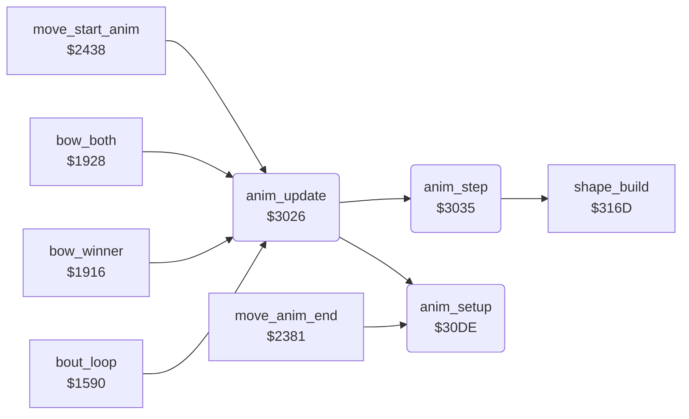

<!-- Generated by c64-docs from knowledge revision 20261021T021734.611-6rf0n2 and src/source-map.json. Do not edit: change the knowledge, generate the source again, then run docs.ts generate. -->
# anim_step.asm: Animation stepper: 4-byte script steps (delay, frame, dx, dy), movement and X limits

Range `$3026-$3108`. Source: [anim_step.asm](../../../src/anim_step.asm). Index: [the reference](../index.md).

## Call graph

A solid arrow is a call, a thick arrow a table entry, a dotted arrow a jump. Rounded nodes are in this file.

## Data

| Range | Type | Name | Read by | Written by |
|---|---|---|---|---|
| [`$3040`](../../../src/anim_step.asm#L25) | unused | [`anim_unused_rts`](../../../src/anim_step.asm#L24) |  |  |

## Names

### [`anim_update`](../../../src/anim_step.asm#L6) `$3026`

*routine*

Plays one frame of the animation of fighter X. Does nothing when anim_number is 0. Calls anim_setup when anim_started is 0, then anim_step. Callers: bout set-up $1599, waits $1919/$1934, fighter update $2456.

- **Called from:** [`bout_loop`](init_bout_loop.md#bout_loop) [`$1599`](../../../src/init_bout_loop.asm#L201), [`bout_loop`](init_bout_loop.md#bout_loop) [`$159E`](../../../src/init_bout_loop.asm#L203), [`bow_winner`](game_modes.md#bow_winner) [`$1919`](../../../src/game_modes.asm#L412), [`bow_both`](game_modes.md#bow_both) [`$1934`](../../../src/game_modes.asm#L428), [`bow_both`](game_modes.md#bow_both) [`$1939`](../../../src/game_modes.asm#L430), [`move_start_anim`](fighter_moves.md#move_start_anim) [`$2456`](../../../src/fighter_moves.asm#L338)
- **Calls:** [`anim_setup`](anim_step.md#anim_setup), [`anim_step`](anim_step.md#anim_step)

### [`anim_update_step`](../../../src/anim_step.asm#L12) `$3031`

*label*

- **Jumped to from:** [`anim_update`](anim_step.md#anim_update) [`$302C`](../../../src/anim_step.asm#L10)

### [`anim_update_done`](../../../src/anim_step.asm#L14) `$3034`

*label*

- **Jumped to from:** [`anim_update`](anim_step.md#anim_update) [`$3028`](../../../src/anim_step.asm#L8)

### [`anim_step`](../../../src/anim_step.asm#L17) `$3035`

*routine*

Counts down anim_frame_delay of fighter X. At 0 it loads the next 4-byte step (forward, or backward when anim_reverse is 1) and builds the shape. On every frame it adds anim_step_dx/dy to the position. After the last step it clears anim_number and sets anim_finished.

- **Called from:** [`anim_update`](anim_step.md#anim_update) [`$3031`](../../../src/anim_step.asm#L13)
- **Calls:** [`shape_build`](shape_build.md#shape_build)
- **Reads:** [`anim_script_ptr`](../memory-map.md#anim_script_ptr)
- **Writes:** [`anim_script_ptr`](../memory-map.md#anim_script_ptr), [`anim_script_ptr+1`](../memory-map.md#anim_script_ptr)
- **Refers to:** [`anim_script_table`](anim_scripts.md#anim_script_table), [`anim_script_table+1`](anim_scripts.md#anim_script_table), [`anim_script_ptr`](../memory-map.md#anim_script_ptr)

### [`anim_unused_rts`](../../../src/anim_step.asm#L24) `$3040`

*data*

Unused RTS after JMP anim_apply_move: nothing reaches it.

### [`anim_next_step`](../../../src/anim_step.asm#L26) `$3041`

*label*

- **Jumped to from:** [`anim_step`](anim_step.md#anim_step) [`$3037`](../../../src/anim_step.asm#L19)

### [`anim_step_back`](../../../src/anim_step.asm#L40) `$305A`

*label*

- **Jumped to from:** [`anim_step`](anim_step.md#anim_step) [`$304B`](../../../src/anim_step.asm#L32)

### [`anim_step_forward`](../../../src/anim_step.asm#L44) `$3060`

*label*

- **Jumped to from:** [`anim_step`](anim_step.md#anim_step) [`$3047`](../../../src/anim_step.asm#L30)

### [`anim_load_step`](../../../src/anim_step.asm#L59) `$3078`

*label*

Reads the step at anim_step_offset of script anim_script_table[anim_number]. Byte 0 is the delay in frames, byte 1 the shape frame, bytes 2/3 dx and dy (signed, per frame).

- **Jumped to from:** [`anim_step`](anim_step.md#anim_step) [`$305D`](../../../src/anim_step.asm#L43), [`anim_step`](anim_step.md#anim_step) [`$3067`](../../../src/anim_step.asm#L49)

### [`anim_apply_move`](../../../src/anim_step.asm#L82) `$30A0`

*label*

Adds anim_step_dy to fighter_y and anim_step_dx to fighter_x on every frame of the step. Facing 1 or reverse play subtracts dx; dy is never negated.

- **Jumped to from:** [`anim_step`](anim_step.md#anim_step) [`$303D`](../../../src/anim_step.asm#L22)

### [`anim_check_x_limits`](../../../src/anim_step.asm#L95) `$30B5`

*label*

- **Jumped to from:** [`anim_step`](anim_step.md#anim_step) [`$30DB`](../../../src/anim_step.asm#L121)

### [`anim_store_x`](../../../src/anim_step.asm#L103) `$30C3`

*label*

- **Jumped to from:** [`anim_step`](anim_step.md#anim_step) [`$30B9`](../../../src/anim_step.asm#L98)

### [`anim_set_sprite_x`](../../../src/anim_step.asm#L105) `$30C5`

*label*

- **Jumped to from:** [`anim_step`](anim_step.md#anim_step) [`$30BD`](../../../src/anim_step.asm#L100), [`anim_step`](anim_step.md#anim_step) [`$30C1`](../../../src/anim_step.asm#L102)

### [`anim_x_msb_clear`](../../../src/anim_step.asm#L113) `$30D1`

*label*

- **Jumped to from:** [`anim_step`](anim_step.md#anim_step) [`$30CA`](../../../src/anim_step.asm#L109)

### [`anim_move_left`](../../../src/anim_step.asm#L117) `$30D6`

*label*

- **Jumped to from:** [`anim_step`](anim_step.md#anim_step) [`$30AE`](../../../src/anim_step.asm#L91)

### [`anim_setup`](../../../src/anim_step.asm#L123) `$30DE`

*routine*

Prepares animation anim_number of fighter X: clears anim_finished, dx and dy, sets the delay to 1 and anim_started. The length is the low byte of the next script pointer minus this one. Callers: anim_update and the move state machine $23e0.

- **Called from:** [`move_anim_end`](fighter_moves.md#move_anim_end) [`$23E0`](../../../src/fighter_moves.asm#L266), [`anim_update`](anim_step.md#anim_update) [`$302E`](../../../src/anim_step.asm#L11)
- **Refers to:** [`anim_script_table`](anim_scripts.md#anim_script_table), [`anim_script_table+2`](anim_scripts.md#anim_script_table)

### [`anim_setup_reverse`](../../../src/anim_step.asm#L144) `$3104`

*label*

Reverse: the first step subtracts 4 and gives the last step

- **Jumped to from:** [`anim_setup`](anim_step.md#anim_setup) [`$30FD`](../../../src/anim_step.asm#L140)
