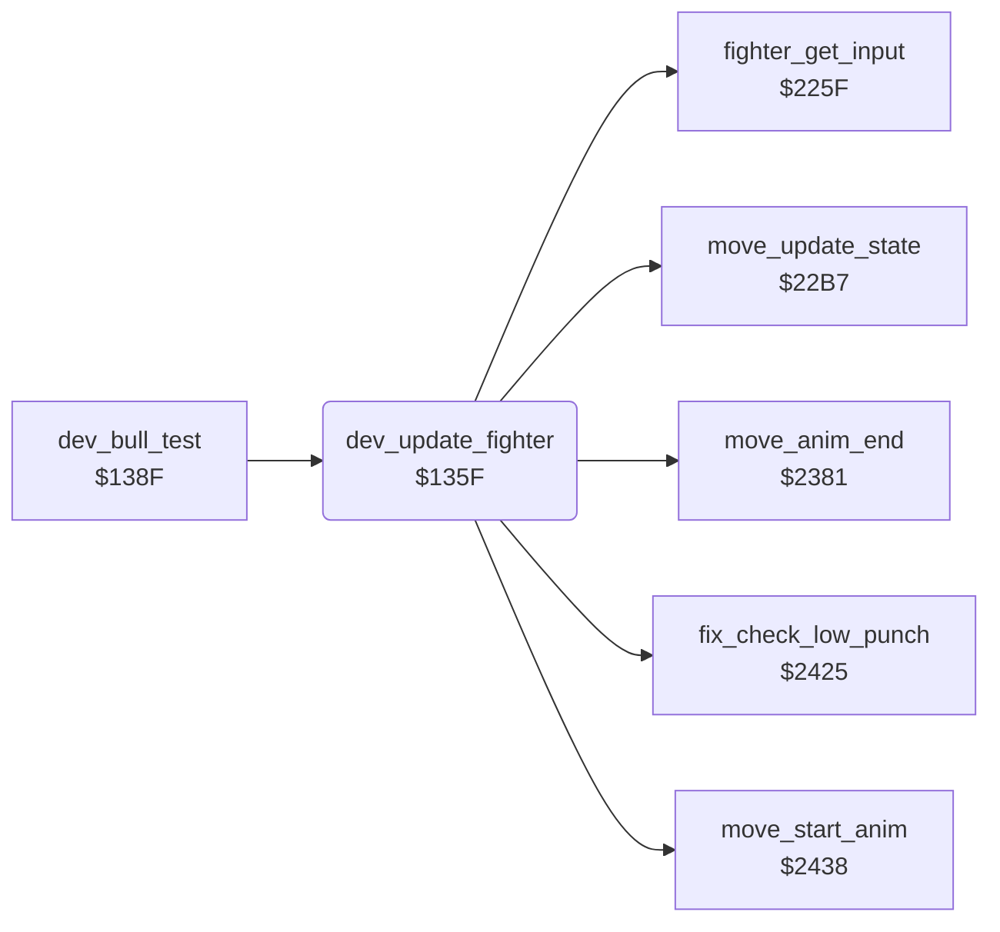

<!-- Generated by c64-docs from knowledge revision 20261025T214834.473-anyvn7 and .c64-re-tools/local/generated/src/source-map.json. Do not edit: change the knowledge, generate the source again, then run docs.ts generate. -->
# dev/dev_bull_test_135f.asm

Range `$135F-$1370`. Source: [dev/dev_bull_test_135f.asm](../../../../src/dev/dev_bull_test_135f.asm). Index: [the reference](../../index.md).

## Routines

| Routine | Address | Reached from | Summary |
|---|---|---|---|
| [`dev_update_fighter`](dev_bull_test_135f.md#dev_update_fighter) | `$135F` | [`dev_bull_test`](dev_bull_test_138f.md#dev_bull_test) | Development code: fighter update without the hit test, the back input fix-up and the front fighter choice. |

## Call graph

A solid arrow is a call, a thick arrow a table entry. Rounded nodes are in this file.

## Details

### [`dev_update_fighter`](../../../../src/dev/dev_bull_test_135f.asm#L6) `$135F`

*routine*

Development code: fighter update without the hit test, the back input fix-up and the front fighter choice. JSR $225f, $2425, $22b7, $2438, $2381.

- **Called from:** [`dev_bull_test`](dev_bull_test_138f.md#dev_bull_test)
- **Calls:** [`fighter_get_input`](../fighter/fighter_moves.md#fighter_get_input), [`fix_check_low_punch`](../fighter/fighter_moves.md#fix_check_low_punch), [`move_update_state`](../fighter/fighter_moves.md#move_update_state), [`move_start_anim`](../fighter/fighter_moves.md#move_start_anim), [`move_anim_end`](../fighter/fighter_moves.md#move_anim_end)
- **Reads:** [`fighter_input`](../../memory-map.md#fighter_input)
