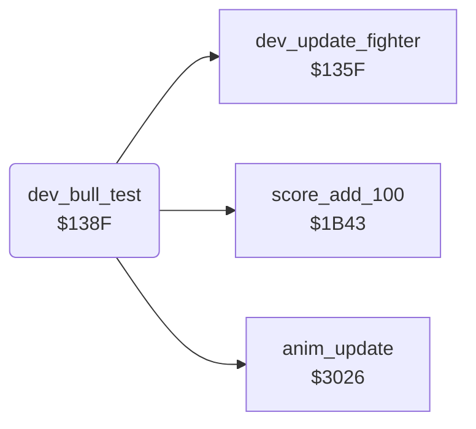

<!-- Generated by c64-docs from knowledge revision 20261025T191824.210-p015r5 and .c64-re-tools/local/generated/src/source-map.json. Do not edit: change the knowledge, generate the source again, then run docs.ts generate. -->
# dev/dev_bull_test_138f.asm

Range `$138F-$1413`. Source: [dev/dev_bull_test_138f.asm](../../../../src/dev/dev_bull_test_138f.asm). Index: [the reference](../../index.md).

## Routines

| Routine | Address | Reached from | Summary |
|---|---|---|---|
| [`dev_bull_test`](dev_bull_test_138f.md#dev_bull_test) | `$138F` |  | Development code: a bull (animation $1c, frames $3b-$3f, shape_page_offset $40) walks in from x $b0 as fighter 1. |

## Call graph

A solid arrow is a call, a thick arrow a table entry. Rounded nodes are in this file.

## Details

### [`dev_bull_test`](../../../../src/dev/dev_bull_test_138f.asm#L6) `$138F`

*routine*

Development code: a bull (animation $1c, frames $3b-$3f, shape_page_offset $40) walks in from x $b0 as fighter 1. A hit with frame $0d at distance $1a-$1e scores 3000.

- **Calls:** [`anim_update`](../fighter/anim_step.md#anim_update), [`dev_update_fighter`](dev_bull_test_135f.md#dev_update_fighter), [`score_add_100`](../game/score_and_timer.md#score_add_100)
- **Reads:** [`SPSPCL`](../../memory-map.md#SPSPCL), [`RASTER`](../../memory-map.md#RASTER), [`anim_number`](../../memory-map.md#anim_number), [`anim_finished`](../../memory-map.md#anim_finished), [`fighter_x`](../../memory-map.md#fighter_x), [`fighter_frame`](../../memory-map.md#fighter_frame)
- **Writes:** [`shape_page_offset`](../../memory-map.md#shape_page_offset), [`fighter_y`](../../memory-map.md#fighter_y), [`fighter_x`](../../memory-map.md#fighter_x), [`anim_number`](../../memory-map.md#anim_number), [`anim_started`](../../memory-map.md#anim_started), [`anim_reverse`](../../memory-map.md#anim_reverse), [`fighter_facing`](../../memory-map.md#fighter_facing), [`fighter_colour`](../../memory-map.md#fighter_colour), [`hit_reaction`](../../memory-map.md#hit_reaction)
- **Refers to:** [`fighter_y`](../../memory-map.md#fighter_y), [`fighter_x`](../../memory-map.md#fighter_x), [`anim_number`](../../memory-map.md#anim_number), [`anim_started`](../../memory-map.md#anim_started), [`anim_reverse`](../../memory-map.md#anim_reverse), [`fighter_facing`](../../memory-map.md#fighter_facing), [`fighter_colour`](../../memory-map.md#fighter_colour), [`anim_finished`](../../memory-map.md#anim_finished)

| Label | Address | Comment |
|---|---|---|
| [`dev_bull_frame_loop`](../../../../src/dev/dev_bull_test_138f.asm#L26) | `$13B3` | Development code: frame loop of the bull test. It waits for raster line $fe and tests the sprite collision of sprites 3 and 4. |
| [`dev_bull_update`](../../../../src/dev/dev_bull_test_138f.asm#L37) | `$13C7` | Development code: updates fighter 0 with offset 0 and steps the bull with offset $40. It ends when the bull reaches x 0. |
| [`dev_bull_check_end`](../../../../src/dev/dev_bull_test_138f.asm#L51) | `$13E2` |  |
| [`dev_bull_contact`](../../../../src/dev/dev_bull_test_138f.asm#L56) | `$13E7` | Development code: a contact. Fighter 0 in frame $0d at distance $1a-$1e scores 30 x 100 and stops the bull (animation $1d); else hit reaction $16. |
| [`dev_bull_score_loop`](../../../../src/dev/dev_bull_test_138f.asm#L68) | `$13FC` |  |
| [`dev_bull_knockdown`](../../../../src/dev/dev_bull_test_138f.asm#L78) | `$140E` |  |
