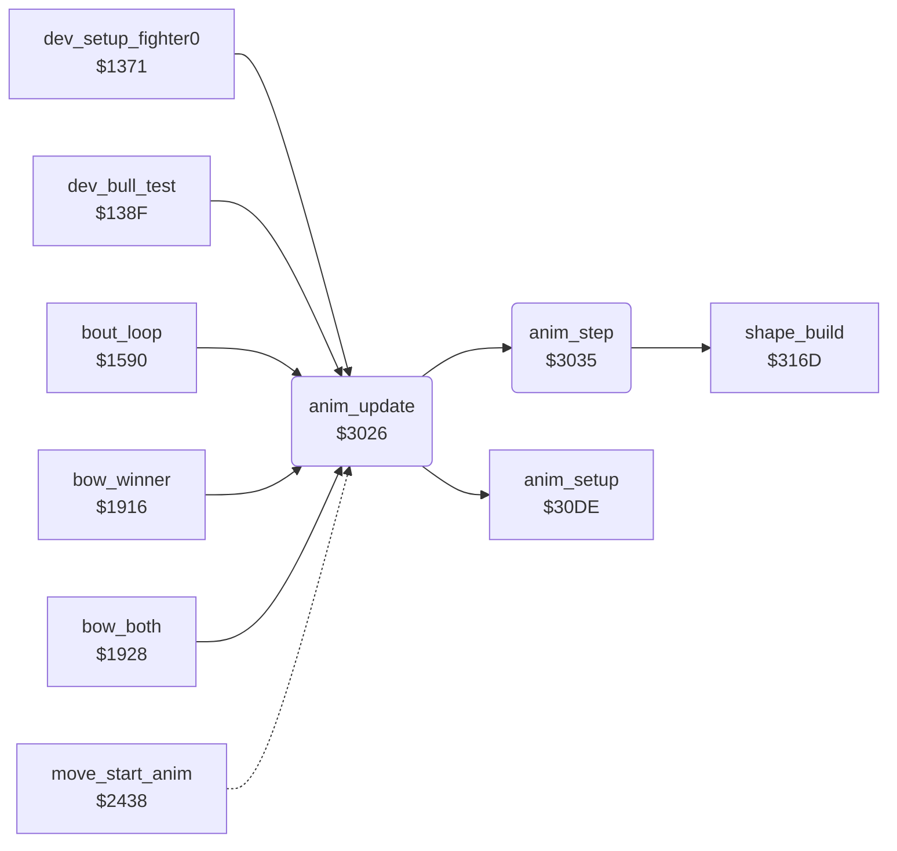

<!-- Generated by c64-docs from knowledge revision 20261022T132731.733-fztd87 and .c64-re-tools/local/generated/src/source-map.json. Do not edit: change the knowledge, generate the source again, then run docs.ts generate. -->
# fighter/anim_step.asm: Animation stepper: 4-byte script steps (delay, frame, dx, dy), movement and X limits

Range `$3026-$303F`. Source: [fighter/anim_step.asm](../../../../src/fighter/anim_step.asm). Index: [the reference](../../index.md).

## Call graph

A solid arrow is a call, a thick arrow a table entry, a dotted arrow a jump. Rounded nodes are in this file.

## Names

### [`anim_update`](../../../../src/fighter/anim_step.asm#L6) `$3026`

*routine*

Plays one frame of the animation of fighter X. Does nothing when anim_number is 0. Calls anim_setup when anim_started is 0, then anim_step. Callers: bout set-up $1599, waits $1919/$1934, fighter update $2456.

- **Called from:** [`dev_setup_fighter0`](../leftovers/leftover_1371.md#dev_setup_fighter0) [`$138B`](../../../../src/leftovers/leftover_1371.asm#L21), [`dev_bull_test`](../dev/dev_bull_test_138f.md#dev_bull_test) [`$13AD`](../../../../src/dev/dev_bull_test_138f.asm#L23), [`dev_bull_test`](../dev/dev_bull_test_138f.md#dev_bull_test) [`$13D3`](../../../../src/dev/dev_bull_test_138f.asm#L44), [`bout_loop`](../game/init_bout_loop.md#bout_loop) [`$1599`](../../../../src/game/init_bout_loop.asm#L189), [`bout_loop`](../game/init_bout_loop.md#bout_loop) [`$159E`](../../../../src/game/init_bout_loop.asm#L191), [`bow_winner`](../game/game_modes.md#bow_winner) [`$1919`](../../../../src/game/game_modes.asm#L406), [`bow_both`](../game/game_modes.md#bow_both) [`$1934`](../../../../src/game/game_modes.asm#L422), [`bow_both`](../game/game_modes.md#bow_both) [`$1939`](../../../../src/game/game_modes.asm#L424)
- **Jumped to from:** [`move_start_anim`](fighter_moves.md#move_start_anim) [`$2456`](../../../../src/fighter/fighter_moves.asm#L338)
- **Calls:** [`anim_setup`](anim_step_3041.md#anim_setup), [`anim_step`](anim_step.md#anim_step)
- **Reads:** [`anim_number`](../../memory-map.md#anim_number), [`anim_started`](../../memory-map.md#anim_started)

### [`anim_update_step`](../../../../src/fighter/anim_step.asm#L12) `$3031`

*label*

- **Jumped to from:** [`anim_update`](anim_step.md#anim_update) [`$302C`](../../../../src/fighter/anim_step.asm#L10)

### [`anim_update_done`](../../../../src/fighter/anim_step.asm#L14) `$3034`

*label*

- **Jumped to from:** [`anim_update`](anim_step.md#anim_update) [`$3028`](../../../../src/fighter/anim_step.asm#L8)

### [`anim_step`](../../../../src/fighter/anim_step.asm#L17) `$3035`

*routine*

Counts down anim_frame_delay of fighter X. At 0 it loads the next 4-byte step (forward, or backward when anim_reverse is 1) and builds the shape. On every frame it adds anim_step_dx/dy to the position. After the last step it clears anim_number and sets anim_finished.

- **Called from:** [`anim_update`](anim_step.md#anim_update) [`$3031`](../../../../src/fighter/anim_step.asm#L13)
- **Calls:** [`shape_build`](../shapes/shape_build_3165.md#shape_build)
- **Reads:** [`anim_frame_delay`](../../memory-map.md#anim_frame_delay), [`anim_reverse`](../../memory-map.md#anim_reverse), [`anim_step_offset`](../../memory-map.md#anim_step_offset), [`anim_script_length`](../../memory-map.md#anim_script_length), [`anim_number`](../../memory-map.md#anim_number), [`anim_script_table`](anim_scripts.md#anim_script_table), [`anim_script_table+1`](anim_scripts.md#anim_script_table), [`anim_script_ptr`](../../memory-map.md#anim_script_ptr), [`fighter_y`](../../memory-map.md#fighter_y), [`anim_step_dy`](../../memory-map.md#anim_step_dy), [`fighter_facing`](../../memory-map.md#fighter_facing), [`fighter_x`](../../memory-map.md#fighter_x), [`anim_step_dx`](../../memory-map.md#anim_step_dx), [`fighter_frame`](../../memory-map.md#fighter_frame)
- **Writes:** [`anim_frame_delay`](../../memory-map.md#anim_frame_delay), [`anim_frame_tick`](../../memory-map.md#anim_frame_tick), [`anim_number`](../../memory-map.md#anim_number), [`anim_finished`](../../memory-map.md#anim_finished), [`anim_step_offset`](../../memory-map.md#anim_step_offset), [`anim_script_ptr`](../../memory-map.md#anim_script_ptr), [`anim_script_ptr+1`](../../memory-map.md#anim_script_ptr), [`fighter_frame`](../../memory-map.md#fighter_frame), [`anim_step_dx`](../../memory-map.md#anim_step_dx), [`anim_step_dy`](../../memory-map.md#anim_step_dy), [`fighter_y`](../../memory-map.md#fighter_y), [`sprite_y`](../../memory-map.md#sprite_y), [`fighter_x`](../../memory-map.md#fighter_x), [`sprite_x_lo`](../../memory-map.md#sprite_x_lo), [`sprite_x_msb`](../../memory-map.md#sprite_x_msb)
- **Refers to:** [`anim_script_table`](anim_scripts.md#anim_script_table), [`anim_script_ptr`](../../memory-map.md#anim_script_ptr)
