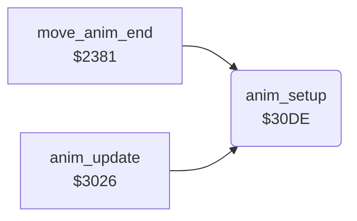

<!-- Generated by c64-docs from knowledge revision 20261025T214834.473-anyvn7 and .c64-re-tools/local/generated/src/source-map.json. Do not edit: change the knowledge, generate the source again, then run docs.ts generate. -->
# fighter/anim_step_3041.asm

Range `$3041-$3108`. Source: [fighter/anim_step_3041.asm](../../../../src/fighter/anim_step_3041.asm). Index: [the reference](../../index.md).

## Routines

| Routine | Address | Reached from | Summary |
|---|---|---|---|
| [`anim_next_step`](anim_step_3041.md#anim_next_step) | `$3041` | [`anim_step`](anim_step.md#anim_step) |  |
| [`anim_apply_move`](anim_step_3041.md#anim_apply_move) | `$30A0` | [`anim_step`](anim_step.md#anim_step) | Adds anim_step_dy to fighter_y and anim_step_dx to fighter_x on every frame of the step. |
| [`anim_setup`](anim_step_3041.md#anim_setup) | `$30DE` | [`move_anim_end`](fighter_moves.md#move_anim_end), [`anim_update`](anim_step.md#anim_update) | Prepares animation anim_number of fighter X: clears anim_finished, dx and dy, sets the delay to 1 and anim_started. |

## Call graph

A solid arrow is a call, a thick arrow a table entry. Rounded nodes are in this file.

## Details

### [`anim_next_step`](../../../../src/fighter/anim_step_3041.asm#L5) `$3041`

*label*

- **Jumped to from:** [`anim_step`](anim_step.md#anim_step)

### [`anim_apply_move`](../../../../src/fighter/anim_step_3041.asm#L61) `$30A0`

*label*

Adds anim_step_dy to fighter_y and anim_step_dx to fighter_x on every frame of the step. Facing 1 or reverse play subtracts dx; dy is never negated.

- **Jumped to from:** [`anim_step`](anim_step.md#anim_step)

### [`anim_setup`](../../../../src/fighter/anim_step_3041.asm#L102) `$30DE`

*routine*

Prepares animation anim_number of fighter X: clears anim_finished, dx and dy, sets the delay to 1 and anim_started. The length is the low byte of the next script pointer minus this one. Callers: anim_update and the move state machine $23e0.

- **Called from:** [`move_anim_end`](fighter_moves.md#move_anim_end), [`anim_update`](anim_step.md#anim_update)
- **Reads:** [`anim_number`](../../memory-map.md#anim_number), [`anim_script_table`](anim_scripts.md#anim_script_table), [`anim_reverse`](../../memory-map.md#anim_reverse), [`anim_script_length`](../../memory-map.md#anim_script_length)
- **Writes:** [`anim_finished`](../../memory-map.md#anim_finished), [`anim_step_dx`](../../memory-map.md#anim_step_dx), [`anim_step_dy`](../../memory-map.md#anim_step_dy), [`anim_frame_delay`](../../memory-map.md#anim_frame_delay), [`anim_started`](../../memory-map.md#anim_started), [`anim_script_length`](../../memory-map.md#anim_script_length), [`anim_step_offset`](../../memory-map.md#anim_step_offset)
- **Refers to:** [`anim_script_table`](anim_scripts.md#anim_script_table)

| Label | Address | Comment |
|---|---|---|
| [`anim_setup_reverse`](../../../../src/fighter/anim_step_3041.asm#L123) | `$3104` | Reverse: the first step subtracts 4 and gives the last step |

## Labels

| Label | Address | Comment |
|---|---|---|
| [`anim_step_back`](../../../../src/fighter/anim_step_3041.asm#L19) | `$305A` |  |
| [`anim_step_forward`](../../../../src/fighter/anim_step_3041.asm#L23) | `$3060` |  |
| [`anim_load_step`](../../../../src/fighter/anim_step_3041.asm#L38) | `$3078` | Reads the step at anim_step_offset of script anim_script_table[anim_number]. Byte 0 is the delay in frames, byte 1 the shape frame, bytes 2/3 dx and dy (signed, per frame). |
| [`anim_check_x_limits`](../../../../src/fighter/anim_step_3041.asm#L74) | `$30B5` |  |
| [`anim_store_x`](../../../../src/fighter/anim_step_3041.asm#L82) | `$30C3` |  |
| [`anim_set_sprite_x`](../../../../src/fighter/anim_step_3041.asm#L84) | `$30C5` |  |
| [`anim_x_msb_clear`](../../../../src/fighter/anim_step_3041.asm#L92) | `$30D1` |  |
| [`anim_move_left`](../../../../src/fighter/anim_step_3041.asm#L96) | `$30D6` |  |
