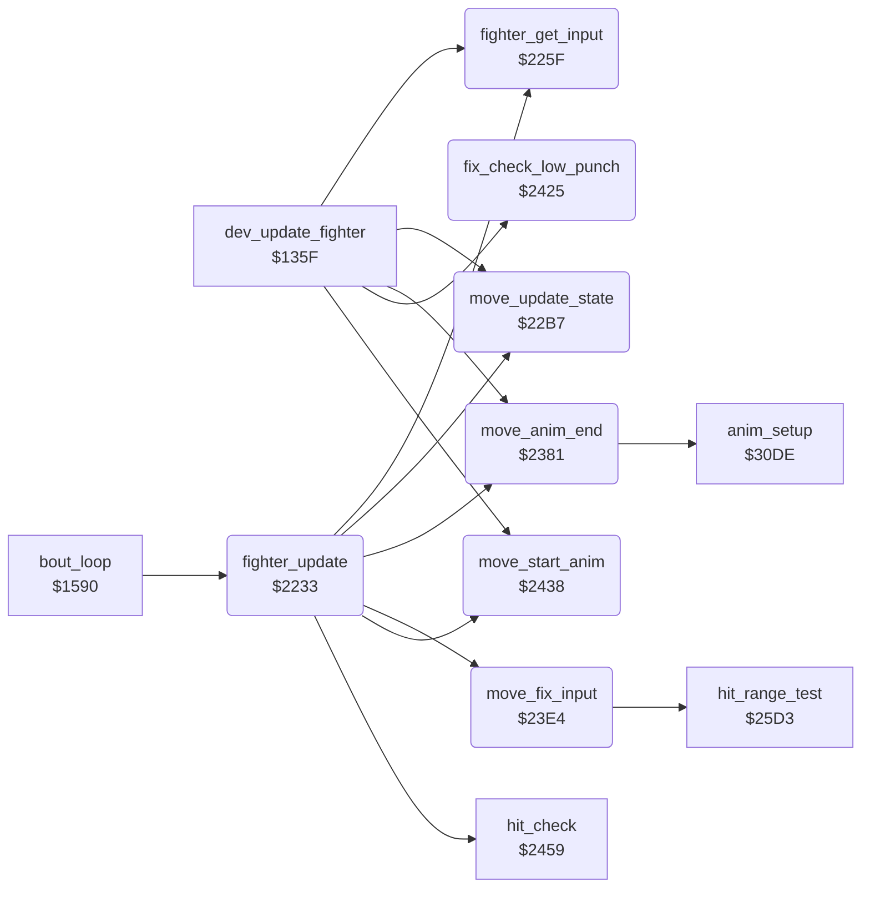

<!-- Generated by c64-docs from knowledge revision 20261025T214834.473-anyvn7 and .c64-re-tools/local/generated/src/source-map.json. Do not edit: change the knowledge, generate the source again, then run docs.ts generate. -->
# fighter/fighter_moves.asm: Fighter update: input, joystick table, move state machine, animation start and end

Range `$2233-$2458`. Source: [fighter/fighter_moves.asm](../../../../src/fighter/fighter_moves.asm). Index: [the reference](../../index.md).

## Routines

| Routine | Address | Reached from | Summary |
|---|---|---|---|
| [`fighter_update`](fighter_moves.md#fighter_update) | `$2233` | [`bout_loop`](../game/init_bout_loop.md#bout_loop) | Updates fighter X for one frame: hit test, input, input fix-ups, move state, animation, end of animation, sprite priority. |
| [`fighter_get_input`](fighter_moves.md#fighter_get_input) | `$225F` | [`dev_update_fighter`](../dev/dev_bull_test_135f.md#dev_update_fighter), [`fighter_update`](fighter_moves.md#fighter_update) | Sets fighter_input,x: the hit reaction when the fighter is hit, else the AI or the joystick. |
| [`move_update_state`](fighter_moves.md#move_update_state) | `$22B7` | [`dev_update_fighter`](../dev/dev_bull_test_135f.md#dev_update_fighter), [`fighter_update`](fighter_moves.md#fighter_update) | Move state machine: changes fighter_move,x from fighter_input,x. |
| [`move_anim_end`](fighter_moves.md#move_anim_end) | `$2381` | [`dev_update_fighter`](../dev/dev_bull_test_135f.md#dev_update_fighter), [`fighter_update`](fighter_moves.md#fighter_update) | Acts when the animation of fighter X ended: a hit reaction ends the bout, a retract returns to stand or crouch, a hold move keeps its end pose ($69). |
| [`move_fix_input`](fighter_moves.md#move_fix_input) | `$23E4` | [`fighter_update`](fighter_moves.md#fighter_update) | Changes fighter_input,x before the state machine. |
| [`fix_check_low_punch`](fighter_moves.md#fix_check_low_punch) | `$2425` | [`dev_update_fighter`](../dev/dev_bull_test_135f.md#dev_update_fighter) |  |
| [`move_start_anim`](fighter_moves.md#move_start_anim) | `$2438` | [`dev_update_fighter`](../dev/dev_bull_test_135f.md#dev_update_fighter), [`fighter_update`](fighter_moves.md#fighter_update) | Selects anim_number,x from fighter_move,x: a new move starts its animation, a held pose stops it, else it runs on. |

## Data

| Range | Type | Name | Read by | Written by |
|---|---|---|---|---|
| [`$2297`](../../../../src/fighter/fighter_moves.asm#L67)-`$22B6` | bytes | [`joystick_move_table`](../../../../src/fighter/fighter_moves.asm#L66) | [`fighter_get_input`](fighter_moves.md#fighter_get_input) |  |

## Call graph

A solid arrow is a call, a thick arrow a table entry. Rounded nodes are in this file.

## Details

### [`fighter_update`](../../../../src/fighter/fighter_moves.asm#L6) `$2233`

*routine*

Updates fighter X for one frame: hit test, input, input fix-ups, move state, animation, end of animation, sprite priority. Called from the bout loop.

- **Called from:** [`bout_loop`](../game/init_bout_loop.md#bout_loop)
- **Calls:** [`hit_check`](hit_test.md#hit_check), [`fighter_get_input`](fighter_moves.md#fighter_get_input), [`move_fix_input`](fighter_moves.md#move_fix_input), [`move_update_state`](fighter_moves.md#move_update_state), [`move_start_anim`](fighter_moves.md#move_start_anim), [`move_anim_end`](fighter_moves.md#move_anim_end)
- **Reads:** [`SPSPCL`](../../memory-map.md#SPSPCL), [`fighter_move`](../../memory-map.md#fighter_move), [`move_attack_flags`](../game/entry_and_tables.md#move_attack_flags), [`opponent_index`](../../memory-map.md#opponent_index)
- **Writes:** [`front_fighter`](../../memory-map.md#front_fighter)

| Label | Address | Comment |
|---|---|---|
| [`fighter_set_priority`](../../../../src/fighter/fighter_moves.asm#L16) | `$224C` |  |
| [`fighter_update_done`](../../../../src/fighter/fighter_moves.asm#L23) | `$2259` |  |
| [`fighter_opponent_in_front`](../../../../src/fighter/fighter_moves.asm#L25) | `$225A` |  |

### [`fighter_get_input`](../../../../src/fighter/fighter_moves.asm#L30) `$225F`

*routine*

Sets fighter_input,x: the hit reaction when the fighter is hit, else the AI or the joystick. Called from fighter_update.

- **Called from:** [`dev_update_fighter`](../dev/dev_bull_test_135f.md#dev_update_fighter), [`fighter_update`](fighter_moves.md#fighter_update)
- **Jumps to:** [`ai_update`](../ai/ai_opponent.md#ai_update)
- **Reads:** [`hit_reaction`](../../memory-map.md#hit_reaction), [`cpu_controlled`](../../memory-map.md#cpu_controlled), [`CIAPRA`](../../memory-map.md#CIAPRA), [`fighter_facing`](../../memory-map.md#fighter_facing)
- **Writes:** [`fighter_input`](../../memory-map.md#fighter_input), [`CIADDRA`](../../memory-map.md#CIADDRA)

| Label | Address | Comment |
|---|---|---|
| [`input_check_cpu`](../../../../src/fighter/fighter_moves.asm#L35) | `$2266` |  |
| [`input_from_ai`](../../../../src/fighter/fighter_moves.asm#L39) | `$226D` |  |
| [`joystick_read_move`](../../../../src/fighter/fighter_moves.asm#L41) | `$2270` |  |
| [`joystick_swap_sides`](../../../../src/fighter/fighter_moves.asm#L57) | `$228D` |  |
| [`joystick_table_lookup`](../../../../src/fighter/fighter_moves.asm#L61) | `$2291` |  |

### [`joystick_move_table`](../../../../src/fighter/fighter_moves.asm#L66) `$2297-$22B6`

*data*

Move for each joystick value AND $1f (bits low = pressed: 0 up, 1 down, 2 left, 3 right, 4 fire), written for facing right.

- **Read by:** [`fighter_get_input`](fighter_moves.md#fighter_get_input)

### [`move_update_state`](../../../../src/fighter/fighter_moves.asm#L72) `$22B7`

*routine*

Move state machine: changes fighter_move,x from fighter_input,x. Handles hit reactions, the crouch before low moves, the about turn and the back kick, and the retract of held moves.

- **Called from:** [`dev_update_fighter`](../dev/dev_bull_test_135f.md#dev_update_fighter), [`fighter_update`](fighter_moves.md#fighter_update)
- **Reads:** [`fighter_input`](../../memory-map.md#fighter_input), [`knockdown_delay`](../../memory-map.md#knockdown_delay), [`fighter_move`](../../memory-map.md#fighter_move), [`pose_held`](../../memory-map.md#pose_held), [`move_return_flags`](../game/entry_and_tables.md#move_return_flags)
- **Writes:** [`knockdown_delay`](../../memory-map.md#knockdown_delay), [`pose_held`](../../memory-map.md#pose_held), [`fighter_move`](../../memory-map.md#fighter_move), [`fighter_y`](../../memory-map.md#fighter_y), [`anim_reverse`](../../memory-map.md#anim_reverse), [`fighter_unused_flag`](../../memory-map.md#fighter_unused_flag), [`anim_started`](../../memory-map.md#anim_started)

| Label | Address | Comment |
|---|---|---|
| [`move_hit_delay`](../../../../src/fighter/fighter_moves.asm#L80) | `$22C5` |  |
| [`move_start_hit_reaction`](../../../../src/fighter/fighter_moves.asm#L87) | `$22D0` |  |
| [`move_check_change`](../../../../src/fighter/fighter_moves.asm#L96) | `$22DF` |  |
| [`move_check_stand`](../../../../src/fighter/fighter_moves.asm#L99) | `$22E3` |  |
| [`move_from_stand`](../../../../src/fighter/fighter_moves.asm#L103) | `$22E9` |  |
| [`move_start_turn`](../../../../src/fighter/fighter_moves.asm#L107) | `$22EF` |  |
| [`move_no_change`](../../../../src/fighter/fighter_moves.asm#L110) | `$22F3` |  |
| [`move_check_low_input`](../../../../src/fighter/fighter_moves.asm#L112) | `$22F4` | Moves $07, $10, $0a start from a crouch |
| [`move_crouch_first`](../../../../src/fighter/fighter_moves.asm#L119) | `$2300` |  |
| [`move_take_input`](../../../../src/fighter/fighter_moves.asm#L123) | `$2305` |  |
| [`move_check_crouch_input`](../../../../src/fighter/fighter_moves.asm#L127) | `$230A` |  |
| [`move_crouch_attack`](../../../../src/fighter/fighter_moves.asm#L135) | `$2318` |  |
| [`move_state_done`](../../../../src/fighter/fighter_moves.asm#L143) | `$2326` |  |
| [`move_cancel_turn`](../../../../src/fighter/fighter_moves.asm#L145) | `$2327` |  |
| [`move_check_turn`](../../../../src/fighter/fighter_moves.asm#L153) | `$2332` |  |
| [`move_turn_done`](../../../../src/fighter/fighter_moves.asm#L164) | `$2346` |  |
| [`move_check_back_kick`](../../../../src/fighter/fighter_moves.asm#L166) | `$2347` |  |
| [`move_input_changed`](../../../../src/fighter/fighter_moves.asm#L180) | `$2360` |  |
| [`move_check_return_type`](../../../../src/fighter/fighter_moves.asm#L184) | `$2367` |  |
| [`move_retract`](../../../../src/fighter/fighter_moves.asm#L186) | `$2369` |  |
| [`move_clear_hold`](../../../../src/fighter/fighter_moves.asm#L189) | `$236D` |  |
| [`move_switch_walk`](../../../../src/fighter/fighter_moves.asm#L193) | `$2372` |  |
| [`move_walk_to_turn`](../../../../src/fighter/fighter_moves.asm#L199) | `$237C` |  |
| [`move_store_walk`](../../../../src/fighter/fighter_moves.asm#L202) | `$237E` |  |

### [`move_anim_end`](../../../../src/fighter/fighter_moves.asm#L206) `$2381`

*routine*

Acts when the animation of fighter X ended: a hit reaction ends the bout, a retract returns to stand or crouch, a hold move keeps its end pose ($69).

- **Called from:** [`dev_update_fighter`](../dev/dev_bull_test_135f.md#dev_update_fighter), [`fighter_update`](fighter_moves.md#fighter_update)
- **Calls:** [`anim_setup`](anim_step_3041.md#anim_setup)
- **Reads:** [`anim_finished`](../../memory-map.md#anim_finished), [`hit_reaction`](../../memory-map.md#hit_reaction), [`anim_reverse`](../../memory-map.md#anim_reverse), [`fighter_move`](../../memory-map.md#fighter_move), [`fighter_facing`](../../memory-map.md#fighter_facing), [`move_return_flags`](../game/entry_and_tables.md#move_return_flags)
- **Writes:** [`anim_finished`](../../memory-map.md#anim_finished), [`bout_knockdown`](../../memory-map.md#bout_knockdown), [`fighter_facing`](../../memory-map.md#fighter_facing), [`anim_reverse`](../../memory-map.md#anim_reverse), [`pose_held`](../../memory-map.md#pose_held), [`fighter_unused_flag`](../../memory-map.md#fighter_unused_flag), [`anim_started`](../../memory-map.md#anim_started), [`fighter_move`](../../memory-map.md#fighter_move), [`ai_command`](../../memory-map.md#ai_command), [`anim_number`](../../memory-map.md#anim_number)

| Label | Address | Comment |
|---|---|---|
| [`anim_end_clear`](../../../../src/fighter/fighter_moves.asm#L209) | `$2385` |  |
| [`anim_end_done`](../../../../src/fighter/fighter_moves.asm#L215) | `$238F` |  |
| [`anim_end_check_reverse`](../../../../src/fighter/fighter_moves.asm#L217) | `$2390` |  |
| [`anim_end_after_retract`](../../../../src/fighter/fighter_moves.asm#L220) | `$2394` |  |
| [`anim_end_reverse_done`](../../../../src/fighter/fighter_moves.asm#L227) | `$23A0` |  |
| [`anim_end_stand`](../../../../src/fighter/fighter_moves.asm#L240) | `$23B8` |  |
| [`anim_end_forward`](../../../../src/fighter/fighter_moves.asm#L244) | `$23BD` |  |
| [`anim_end_hold`](../../../../src/fighter/fighter_moves.asm#L248) | `$23C4` |  |
| [`anim_end_to_stand`](../../../../src/fighter/fighter_moves.asm#L252) | `$23C9` |  |
| [`anim_end_rise_crouch`](../../../../src/fighter/fighter_moves.asm#L260) | `$23D6` |  |

### [`move_fix_input`](../../../../src/fighter/fighter_moves.asm#L269) `$23E4`

*routine*

Changes fighter_input,x before the state machine. Back during an opponent attack in range becomes the matching block; down-forward from a stand becomes move $18.

- **Called from:** [`fighter_update`](fighter_moves.md#fighter_update)
- **Calls:** [`hit_range_test`](hit_test.md#hit_range_test)
- **Jumps to:** [`fix_check_low_punch`](fighter_moves.md#fix_check_low_punch)
- **Reads:** [`fighter_input`](../../memory-map.md#fighter_input), [`fighter_move`](../../memory-map.md#fighter_move), [`opponent_index`](../../memory-map.md#opponent_index), [`anim_reverse`](../../memory-map.md#anim_reverse), [`pose_held`](../../memory-map.md#pose_held), [`move_attack_flags`](../game/entry_and_tables.md#move_attack_flags), [`move_counter_moves`](../game/entry_and_tables.md#move_counter_moves)
- **Writes:** [`fighter_input`](../../memory-map.md#fighter_input)

| Label | Address | Comment |
|---|---|---|
| [`fix_keep_block`](../../../../src/fighter/fighter_moves.asm#L278) | `$23F4` |  |
| [`fix_check_block`](../../../../src/fighter/fighter_moves.asm#L281) | `$23F7` |  |
| [`fix_input_done`](../../../../src/fighter/fighter_moves.asm#L302) | `$2424` |  |

### [`fix_check_low_punch`](../../../../src/fighter/fighter_moves.asm#L304) `$2425`

*label*

- **Called from:** [`dev_update_fighter`](../dev/dev_bull_test_135f.md#dev_update_fighter)
- **Jumped to from:** [`move_fix_input`](fighter_moves.md#move_fix_input)
- **Reads:** [`fighter_move`](../../memory-map.md#fighter_move)
- **Writes:** [`fighter_input`](../../memory-map.md#fighter_input)

| Label | Address | Comment |
|---|---|---|
| [`fix_low_punch_done`](../../../../src/fighter/fighter_moves.asm#L314) | `$2437` |  |

### [`move_start_anim`](../../../../src/fighter/fighter_moves.asm#L317) `$2438`

*routine*

Selects anim_number,x from fighter_move,x: a new move starts its animation, a held pose stops it, else it runs on. Then steps the animation at $3026.

- **Called from:** [`dev_update_fighter`](../dev/dev_bull_test_135f.md#dev_update_fighter), [`fighter_update`](fighter_moves.md#fighter_update)
- **Jumps to:** [`anim_update`](anim_step.md#anim_update)
- **Reads:** [`fighter_move`](../../memory-map.md#fighter_move), [`anim_started`](../../memory-map.md#anim_started), [`pose_held`](../../memory-map.md#pose_held)
- **Writes:** [`anim_number`](../../memory-map.md#anim_number), [`anim_started`](../../memory-map.md#anim_started), [`pose_held`](../../memory-map.md#pose_held)

| Label | Address | Comment |
|---|---|---|
| [`anim_start_new_move`](../../../../src/fighter/fighter_moves.asm#L321) | `$243E` |  |
| [`anim_start_same_move`](../../../../src/fighter/fighter_moves.asm#L327) | `$2448` |  |
| [`anim_start_freeze`](../../../../src/fighter/fighter_moves.asm#L330) | `$244C` |  |
| [`anim_start_continue`](../../../../src/fighter/fighter_moves.asm#L334) | `$2452` |  |
| [`anim_start_step`](../../../../src/fighter/fighter_moves.asm#L337) | `$2456` |  |
