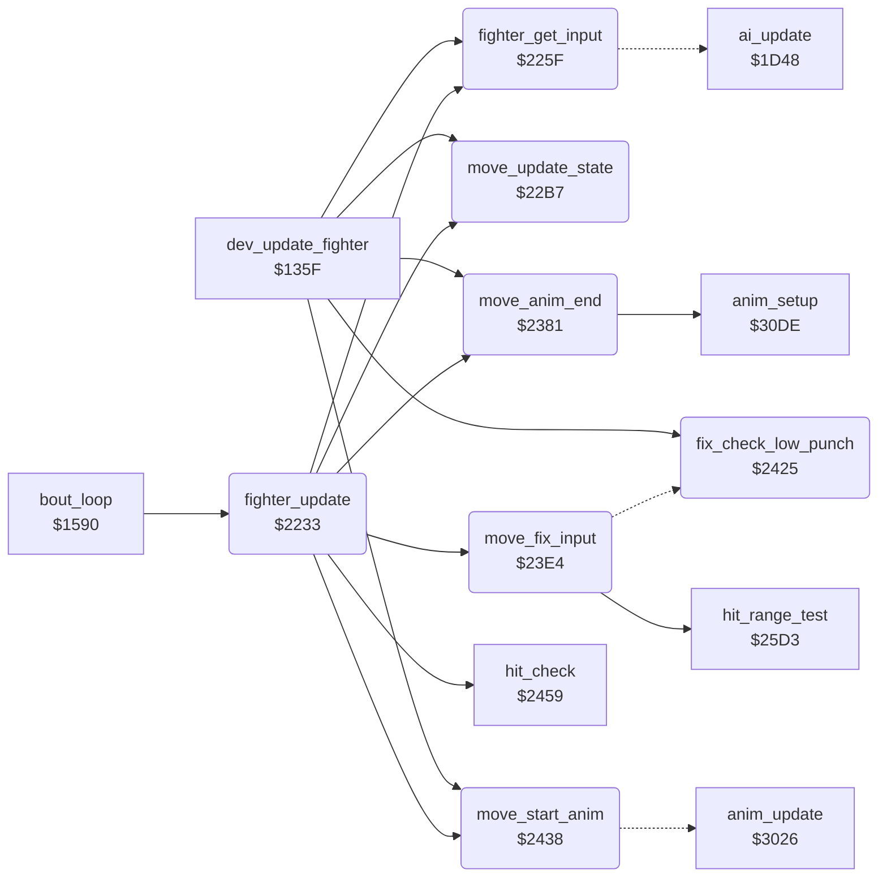

<!-- Generated by c64-docs from knowledge revision 20261022T132731.733-fztd87 and .c64-re-tools/local/generated/src/source-map.json. Do not edit: change the knowledge, generate the source again, then run docs.ts generate. -->
# fighter/fighter_moves.asm: Fighter update: input, joystick table, move state machine, animation start and end

Range `$2233-$2458`. Source: [fighter/fighter_moves.asm](../../../../src/fighter/fighter_moves.asm). Index: [the reference](../../index.md).

## Call graph

A solid arrow is a call, a thick arrow a table entry, a dotted arrow a jump. Rounded nodes are in this file.

## Data

| Range | Type | Name | Read by | Written by |
|---|---|---|---|---|
| [`$2297`](../../../../src/fighter/fighter_moves.asm#L67)-`$22B6` | bytes | [`joystick_move_table`](../../../../src/fighter/fighter_moves.asm#L66) | [`fighter_get_input`](fighter_moves.md#fighter_get_input) |  |

## Names

### [`fighter_update`](../../../../src/fighter/fighter_moves.asm#L6) `$2233`

*routine*

Updates fighter X for one frame: hit test, input, input fix-ups, move state, animation, end of animation, sprite priority. Called from the bout loop.

- **Called from:** [`bout_loop`](../game/init_bout_loop.md#bout_loop) [`$15B7`](../../../../src/game/init_bout_loop.asm#L203), [`bout_loop`](../game/init_bout_loop.md#bout_loop) [`$15BE`](../../../../src/game/init_bout_loop.asm#L206)
- **Calls:** [`hit_check`](hit_test.md#hit_check), [`fighter_get_input`](fighter_moves.md#fighter_get_input), [`move_fix_input`](fighter_moves.md#move_fix_input), [`move_update_state`](fighter_moves.md#move_update_state), [`move_start_anim`](fighter_moves.md#move_start_anim), [`move_anim_end`](fighter_moves.md#move_anim_end)
- **Reads:** [`SPSPCL`](../../memory-map.md#SPSPCL), [`fighter_move`](../../memory-map.md#fighter_move), [`move_attack_flags`](../game/entry_and_tables.md#move_attack_flags), [`opponent_index`](../../memory-map.md#opponent_index)
- **Writes:** [`front_fighter`](../../memory-map.md#front_fighter)

### [`fighter_set_priority`](../../../../src/fighter/fighter_moves.asm#L16) `$224C`

*label*

### [`fighter_update_done`](../../../../src/fighter/fighter_moves.asm#L23) `$2259`

*label*

- **Jumped to from:** [`fighter_update`](fighter_moves.md#fighter_update) [`$224A`](../../../../src/fighter/fighter_moves.asm#L15), [`fighter_update`](fighter_moves.md#fighter_update) [`$2255`](../../../../src/fighter/fighter_moves.asm#L21)

### [`fighter_opponent_in_front`](../../../../src/fighter/fighter_moves.asm#L25) `$225A`

*label*

- **Jumped to from:** [`fighter_update`](fighter_moves.md#fighter_update) [`$2250`](../../../../src/fighter/fighter_moves.asm#L19)

### [`fighter_get_input`](../../../../src/fighter/fighter_moves.asm#L30) `$225F`

*routine*

Sets fighter_input,x: the hit reaction when the fighter is hit, else the AI or the joystick. Called from fighter_update.

- **Called from:** [`dev_update_fighter`](../dev/dev_bull_test_135f.md#dev_update_fighter) [`$135F`](../../../../src/dev/dev_bull_test_135f.asm#L8), [`fighter_update`](fighter_moves.md#fighter_update) [`$2236`](../../../../src/fighter/fighter_moves.asm#L8)
- **Jumps to:** [`ai_update`](../ai/ai_opponent.md#ai_update)
- **Reads:** [`hit_reaction`](../../memory-map.md#hit_reaction), [`cpu_controlled`](../../memory-map.md#cpu_controlled), [`CIAPRA`](../../memory-map.md#CIAPRA), [`fighter_facing`](../../memory-map.md#fighter_facing)
- **Writes:** [`fighter_input`](../../memory-map.md#fighter_input), [`CIADDRA`](../../memory-map.md#CIADDRA)

### [`input_check_cpu`](../../../../src/fighter/fighter_moves.asm#L35) `$2266`

*label*

- **Jumped to from:** [`fighter_get_input`](fighter_moves.md#fighter_get_input) [`$2261`](../../../../src/fighter/fighter_moves.asm#L32)

### [`input_from_ai`](../../../../src/fighter/fighter_moves.asm#L39) `$226D`

*label*

- **Jumped to from:** [`fighter_get_input`](fighter_moves.md#fighter_get_input) [`$2268`](../../../../src/fighter/fighter_moves.asm#L37)

### [`joystick_read_move`](../../../../src/fighter/fighter_moves.asm#L41) `$2270`

*label*

- **Jumped to from:** [`fighter_get_input`](fighter_moves.md#fighter_get_input) [`$226A`](../../../../src/fighter/fighter_moves.asm#L38)

### [`joystick_swap_sides`](../../../../src/fighter/fighter_moves.asm#L57) `$228D`

*label*

### [`joystick_table_lookup`](../../../../src/fighter/fighter_moves.asm#L61) `$2291`

*label*

- **Jumped to from:** [`fighter_get_input`](fighter_moves.md#fighter_get_input) [`$2284`](../../../../src/fighter/fighter_moves.asm#L52), [`fighter_get_input`](fighter_moves.md#fighter_get_input) [`$228B`](../../../../src/fighter/fighter_moves.asm#L56)

### [`joystick_move_table`](../../../../src/fighter/fighter_moves.asm#L66) `$2297-$22B6`

*data*

Move for each joystick value AND $1f (bits low = pressed: 0 up, 1 down, 2 left, 3 right, 4 fire), written for facing right.

- **Read by:** [`fighter_get_input`](fighter_moves.md#fighter_get_input) [`$2291`](../../../../src/fighter/fighter_moves.asm#L62)

### [`move_update_state`](../../../../src/fighter/fighter_moves.asm#L72) `$22B7`

*routine*

Move state machine: changes fighter_move,x from fighter_input,x. Handles hit reactions, the crouch before low moves, the about turn and the back kick, and the retract of held moves.

- **Called from:** [`dev_update_fighter`](../dev/dev_bull_test_135f.md#dev_update_fighter) [`$1367`](../../../../src/dev/dev_bull_test_135f.asm#L11), [`fighter_update`](fighter_moves.md#fighter_update) [`$223C`](../../../../src/fighter/fighter_moves.asm#L10)
- **Reads:** [`fighter_input`](../../memory-map.md#fighter_input), [`knockdown_delay`](../../memory-map.md#knockdown_delay), [`fighter_move`](../../memory-map.md#fighter_move), [`pose_held`](../../memory-map.md#pose_held), [`move_return_flags`](../game/entry_and_tables.md#move_return_flags)
- **Writes:** [`knockdown_delay`](../../memory-map.md#knockdown_delay), [`pose_held`](../../memory-map.md#pose_held), [`fighter_move`](../../memory-map.md#fighter_move), [`fighter_y`](../../memory-map.md#fighter_y), [`anim_reverse`](../../memory-map.md#anim_reverse), [`fighter_unused_flag`](../../memory-map.md#fighter_unused_flag), [`anim_started`](../../memory-map.md#anim_started)

### [`move_hit_delay`](../../../../src/fighter/fighter_moves.asm#L80) `$22C5`

*label*

- **Jumped to from:** [`move_update_state`](fighter_moves.md#move_update_state) [`$22BB`](../../../../src/fighter/fighter_moves.asm#L75), [`move_update_state`](fighter_moves.md#move_update_state) [`$22BF`](../../../../src/fighter/fighter_moves.asm#L77)

### [`move_start_hit_reaction`](../../../../src/fighter/fighter_moves.asm#L87) `$22D0`

*label*

- **Jumped to from:** [`move_update_state`](fighter_moves.md#move_update_state) [`$22C7`](../../../../src/fighter/fighter_moves.asm#L82)

### [`move_check_change`](../../../../src/fighter/fighter_moves.asm#L96) `$22DF`

*label*

- **Jumped to from:** [`move_update_state`](fighter_moves.md#move_update_state) [`$22C3`](../../../../src/fighter/fighter_moves.asm#L79)

### [`move_check_stand`](../../../../src/fighter/fighter_moves.asm#L99) `$22E3`

*label*

### [`move_from_stand`](../../../../src/fighter/fighter_moves.asm#L103) `$22E9`

*label*

### [`move_start_turn`](../../../../src/fighter/fighter_moves.asm#L107) `$22EF`

*label*

### [`move_no_change`](../../../../src/fighter/fighter_moves.asm#L110) `$22F3`

*label*

- **Jumped to from:** [`move_update_state`](fighter_moves.md#move_update_state) [`$22E1`](../../../../src/fighter/fighter_moves.asm#L98)

### [`move_check_low_input`](../../../../src/fighter/fighter_moves.asm#L112) `$22F4`

*label*

Moves $07, $10, $0a start from a crouch

- **Jumped to from:** [`move_update_state`](fighter_moves.md#move_update_state) [`$22ED`](../../../../src/fighter/fighter_moves.asm#L106)

### [`move_crouch_first`](../../../../src/fighter/fighter_moves.asm#L119) `$2300`

*label*

- **Jumped to from:** [`move_update_state`](fighter_moves.md#move_update_state) [`$22F6`](../../../../src/fighter/fighter_moves.asm#L114), [`move_update_state`](fighter_moves.md#move_update_state) [`$22FA`](../../../../src/fighter/fighter_moves.asm#L116)

### [`move_take_input`](../../../../src/fighter/fighter_moves.asm#L123) `$2305`

*label*

- **Jumped to from:** [`move_update_state`](fighter_moves.md#move_update_state) [`$22FE`](../../../../src/fighter/fighter_moves.asm#L118)

### [`move_check_crouch_input`](../../../../src/fighter/fighter_moves.asm#L127) `$230A`

*label*

- **Jumped to from:** [`move_update_state`](fighter_moves.md#move_update_state) [`$22E7`](../../../../src/fighter/fighter_moves.asm#L102)

### [`move_crouch_attack`](../../../../src/fighter/fighter_moves.asm#L135) `$2318`

*label*

- **Jumped to from:** [`move_update_state`](fighter_moves.md#move_update_state) [`$230E`](../../../../src/fighter/fighter_moves.asm#L130), [`move_update_state`](fighter_moves.md#move_update_state) [`$2312`](../../../../src/fighter/fighter_moves.asm#L132)

### [`move_state_done`](../../../../src/fighter/fighter_moves.asm#L143) `$2326`

*label*

- **Jumped to from:** [`move_update_state`](fighter_moves.md#move_update_state) [`$2320`](../../../../src/fighter/fighter_moves.asm#L140), [`move_update_state`](fighter_moves.md#move_update_state) [`$232B`](../../../../src/fighter/fighter_moves.asm#L148)

### [`move_cancel_turn`](../../../../src/fighter/fighter_moves.asm#L145) `$2327`

*label*

- **Jumped to from:** [`move_update_state`](fighter_moves.md#move_update_state) [`$231C`](../../../../src/fighter/fighter_moves.asm#L138)

### [`move_check_turn`](../../../../src/fighter/fighter_moves.asm#L153) `$2332`

*label*

- **Jumped to from:** [`move_update_state`](fighter_moves.md#move_update_state) [`$2316`](../../../../src/fighter/fighter_moves.asm#L134)

### [`move_turn_done`](../../../../src/fighter/fighter_moves.asm#L164) `$2346`

*label*

- **Jumped to from:** [`move_update_state`](fighter_moves.md#move_update_state) [`$2340`](../../../../src/fighter/fighter_moves.asm#L161)

### [`move_check_back_kick`](../../../../src/fighter/fighter_moves.asm#L166) `$2347`

*label*

- **Jumped to from:** [`move_update_state`](fighter_moves.md#move_update_state) [`$2336`](../../../../src/fighter/fighter_moves.asm#L156)

### [`move_input_changed`](../../../../src/fighter/fighter_moves.asm#L180) `$2360`

*label*

- **Jumped to from:** [`move_update_state`](fighter_moves.md#move_update_state) [`$233C`](../../../../src/fighter/fighter_moves.asm#L159), [`move_update_state`](fighter_moves.md#move_update_state) [`$2349`](../../../../src/fighter/fighter_moves.asm#L168), [`move_update_state`](fighter_moves.md#move_update_state) [`$234D`](../../../../src/fighter/fighter_moves.asm#L170)

### [`move_check_return_type`](../../../../src/fighter/fighter_moves.asm#L184) `$2367`

*label*

### [`move_retract`](../../../../src/fighter/fighter_moves.asm#L186) `$2369`

*label*

### [`move_clear_hold`](../../../../src/fighter/fighter_moves.asm#L189) `$236D`

*label*

- **Jumped to from:** [`move_update_state`](fighter_moves.md#move_update_state) [`$2367`](../../../../src/fighter/fighter_moves.asm#L185)

### [`move_switch_walk`](../../../../src/fighter/fighter_moves.asm#L193) `$2372`

*label*

- **Jumped to from:** [`move_update_state`](fighter_moves.md#move_update_state) [`$2365`](../../../../src/fighter/fighter_moves.asm#L183)

### [`move_walk_to_turn`](../../../../src/fighter/fighter_moves.asm#L199) `$237C`

*label*

### [`move_store_walk`](../../../../src/fighter/fighter_moves.asm#L202) `$237E`

*label*

- **Jumped to from:** [`move_update_state`](fighter_moves.md#move_update_state) [`$237A`](../../../../src/fighter/fighter_moves.asm#L198)

### [`move_anim_end`](../../../../src/fighter/fighter_moves.asm#L206) `$2381`

*routine*

Acts when the animation of fighter X ended: a hit reaction ends the bout, a retract returns to stand or crouch, a hold move keeps its end pose ($69).

- **Called from:** [`dev_update_fighter`](../dev/dev_bull_test_135f.md#dev_update_fighter) [`$136D`](../../../../src/dev/dev_bull_test_135f.asm#L13), [`fighter_update`](fighter_moves.md#fighter_update) [`$2242`](../../../../src/fighter/fighter_moves.asm#L12)
- **Calls:** [`anim_setup`](anim_step_3041.md#anim_setup)
- **Reads:** [`anim_finished`](../../memory-map.md#anim_finished), [`hit_reaction`](../../memory-map.md#hit_reaction), [`anim_reverse`](../../memory-map.md#anim_reverse), [`fighter_move`](../../memory-map.md#fighter_move), [`fighter_facing`](../../memory-map.md#fighter_facing), [`move_return_flags`](../game/entry_and_tables.md#move_return_flags)
- **Writes:** [`anim_finished`](../../memory-map.md#anim_finished), [`bout_knockdown`](../../memory-map.md#bout_knockdown), [`fighter_facing`](../../memory-map.md#fighter_facing), [`anim_reverse`](../../memory-map.md#anim_reverse), [`pose_held`](../../memory-map.md#pose_held), [`fighter_unused_flag`](../../memory-map.md#fighter_unused_flag), [`anim_started`](../../memory-map.md#anim_started), [`fighter_move`](../../memory-map.md#fighter_move), [`ai_command`](../../memory-map.md#ai_command), [`anim_number`](../../memory-map.md#anim_number)

### [`anim_end_clear`](../../../../src/fighter/fighter_moves.asm#L209) `$2385`

*label*

### [`anim_end_done`](../../../../src/fighter/fighter_moves.asm#L215) `$238F`

*label*

- **Jumped to from:** [`move_anim_end`](fighter_moves.md#move_anim_end) [`$2383`](../../../../src/fighter/fighter_moves.asm#L208)

### [`anim_end_check_reverse`](../../../../src/fighter/fighter_moves.asm#L217) `$2390`

*label*

- **Jumped to from:** [`move_anim_end`](fighter_moves.md#move_anim_end) [`$238B`](../../../../src/fighter/fighter_moves.asm#L213)

### [`anim_end_after_retract`](../../../../src/fighter/fighter_moves.asm#L220) `$2394`

*label*

### [`anim_end_reverse_done`](../../../../src/fighter/fighter_moves.asm#L227) `$23A0`

*label*

- **Jumped to from:** [`move_anim_end`](fighter_moves.md#move_anim_end) [`$2398`](../../../../src/fighter/fighter_moves.asm#L223)

### [`anim_end_stand`](../../../../src/fighter/fighter_moves.asm#L240) `$23B8`

*label*

### [`anim_end_forward`](../../../../src/fighter/fighter_moves.asm#L244) `$23BD`

*label*

- **Jumped to from:** [`move_anim_end`](fighter_moves.md#move_anim_end) [`$2392`](../../../../src/fighter/fighter_moves.asm#L219)

### [`anim_end_hold`](../../../../src/fighter/fighter_moves.asm#L248) `$23C4`

*label*

### [`anim_end_to_stand`](../../../../src/fighter/fighter_moves.asm#L252) `$23C9`

*label*

- **Jumped to from:** [`move_anim_end`](fighter_moves.md#move_anim_end) [`$23C2`](../../../../src/fighter/fighter_moves.asm#L247)

### [`anim_end_rise_crouch`](../../../../src/fighter/fighter_moves.asm#L260) `$23D6`

*label*

- **Jumped to from:** [`move_anim_end`](fighter_moves.md#move_anim_end) [`$23AE`](../../../../src/fighter/fighter_moves.asm#L235), [`move_anim_end`](fighter_moves.md#move_anim_end) [`$23B2`](../../../../src/fighter/fighter_moves.asm#L237), [`move_anim_end`](fighter_moves.md#move_anim_end) [`$23B6`](../../../../src/fighter/fighter_moves.asm#L239)

### [`move_fix_input`](../../../../src/fighter/fighter_moves.asm#L269) `$23E4`

*routine*

Changes fighter_input,x before the state machine. Back during an opponent attack in range becomes the matching block; down-forward from a stand becomes move $18.

- **Called from:** [`fighter_update`](fighter_moves.md#fighter_update) [`$2239`](../../../../src/fighter/fighter_moves.asm#L9)
- **Calls:** [`hit_range_test`](hit_test.md#hit_range_test)
- **Jumps to:** [`fix_check_low_punch`](fighter_moves.md#fix_check_low_punch)
- **Reads:** [`fighter_input`](../../memory-map.md#fighter_input), [`fighter_move`](../../memory-map.md#fighter_move), [`opponent_index`](../../memory-map.md#opponent_index), [`anim_reverse`](../../memory-map.md#anim_reverse), [`pose_held`](../../memory-map.md#pose_held), [`move_attack_flags`](../game/entry_and_tables.md#move_attack_flags), [`move_counter_moves`](../game/entry_and_tables.md#move_counter_moves)
- **Writes:** [`fighter_input`](../../memory-map.md#fighter_input)

### [`fix_keep_block`](../../../../src/fighter/fighter_moves.asm#L278) `$23F4`

*label*

- **Jumped to from:** [`move_fix_input`](fighter_moves.md#move_fix_input) [`$23EE`](../../../../src/fighter/fighter_moves.asm#L275)

### [`fix_check_block`](../../../../src/fighter/fighter_moves.asm#L281) `$23F7`

*label*

- **Jumped to from:** [`move_fix_input`](fighter_moves.md#move_fix_input) [`$23F2`](../../../../src/fighter/fighter_moves.asm#L277)

### [`fix_input_done`](../../../../src/fighter/fighter_moves.asm#L302) `$2424`

*label*

- **Jumped to from:** [`move_fix_input`](fighter_moves.md#move_fix_input) [`$23FC`](../../../../src/fighter/fighter_moves.asm#L284), [`move_fix_input`](fighter_moves.md#move_fix_input) [`$2401`](../../../../src/fighter/fighter_moves.asm#L286), [`move_fix_input`](fighter_moves.md#move_fix_input) [`$2409`](../../../../src/fighter/fighter_moves.asm#L290), [`move_fix_input`](fighter_moves.md#move_fix_input) [`$240D`](../../../../src/fighter/fighter_moves.asm#L292), [`move_fix_input`](fighter_moves.md#move_fix_input) [`$2412`](../../../../src/fighter/fighter_moves.asm#L294), [`move_fix_input`](fighter_moves.md#move_fix_input) [`$2417`](../../../../src/fighter/fighter_moves.asm#L296)

### [`fix_check_low_punch`](../../../../src/fighter/fighter_moves.asm#L304) `$2425`

*label*

- **Called from:** [`dev_update_fighter`](../dev/dev_bull_test_135f.md#dev_update_fighter) [`$1364`](../../../../src/dev/dev_bull_test_135f.asm#L10)
- **Jumped to from:** [`move_fix_input`](fighter_moves.md#move_fix_input) [`$23E8`](../../../../src/fighter/fighter_moves.asm#L272)
- **Reads:** [`fighter_move`](../../memory-map.md#fighter_move)
- **Writes:** [`fighter_input`](../../memory-map.md#fighter_input)

### [`fix_low_punch_done`](../../../../src/fighter/fighter_moves.asm#L314) `$2437`

*label*

- **Jumped to from:** [`fix_check_low_punch`](fighter_moves.md#fix_check_low_punch) [`$2427`](../../../../src/fighter/fighter_moves.asm#L306), [`fix_check_low_punch`](fighter_moves.md#fix_check_low_punch) [`$242D`](../../../../src/fighter/fighter_moves.asm#L309), [`fix_check_low_punch`](fighter_moves.md#fix_check_low_punch) [`$2431`](../../../../src/fighter/fighter_moves.asm#L311)

### [`move_start_anim`](../../../../src/fighter/fighter_moves.asm#L317) `$2438`

*routine*

Selects anim_number,x from fighter_move,x: a new move starts its animation, a held pose stops it, else it runs on. Then steps the animation at $3026.

- **Called from:** [`dev_update_fighter`](../dev/dev_bull_test_135f.md#dev_update_fighter) [`$136A`](../../../../src/dev/dev_bull_test_135f.asm#L12), [`fighter_update`](fighter_moves.md#fighter_update) [`$223F`](../../../../src/fighter/fighter_moves.asm#L11)
- **Jumps to:** [`anim_update`](anim_step.md#anim_update)
- **Reads:** [`fighter_move`](../../memory-map.md#fighter_move), [`anim_started`](../../memory-map.md#anim_started), [`pose_held`](../../memory-map.md#pose_held)
- **Writes:** [`anim_number`](../../memory-map.md#anim_number), [`anim_started`](../../memory-map.md#anim_started), [`pose_held`](../../memory-map.md#pose_held)

### [`anim_start_new_move`](../../../../src/fighter/fighter_moves.asm#L321) `$243E`

*label*

### [`anim_start_same_move`](../../../../src/fighter/fighter_moves.asm#L327) `$2448`

*label*

- **Jumped to from:** [`move_start_anim`](fighter_moves.md#move_start_anim) [`$243C`](../../../../src/fighter/fighter_moves.asm#L320)

### [`anim_start_freeze`](../../../../src/fighter/fighter_moves.asm#L330) `$244C`

*label*

### [`anim_start_continue`](../../../../src/fighter/fighter_moves.asm#L334) `$2452`

*label*

- **Jumped to from:** [`move_start_anim`](fighter_moves.md#move_start_anim) [`$244A`](../../../../src/fighter/fighter_moves.asm#L329)

### [`anim_start_step`](../../../../src/fighter/fighter_moves.asm#L337) `$2456`

*label*

- **Jumped to from:** [`move_start_anim`](fighter_moves.md#move_start_anim) [`$2446`](../../../../src/fighter/fighter_moves.asm#L326), [`move_start_anim`](fighter_moves.md#move_start_anim) [`$2450`](../../../../src/fighter/fighter_moves.asm#L333)
