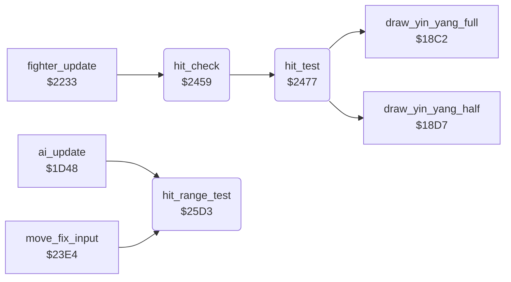

<!-- Generated by c64-docs from knowledge revision 20261022T132731.733-fztd87 and .c64-re-tools/local/generated/src/source-map.json. Do not edit: change the knowledge, generate the source again, then run docs.ts generate. -->
# fighter/hit_test.asm: Hit test at the hit frame of an attack, points and reaction of a hit, attack range test

Range `$2459-$2634`. Source: [fighter/hit_test.asm](../../../../src/fighter/hit_test.asm). Index: [the reference](../../index.md).

## Call graph

A solid arrow is a call, a thick arrow a table entry, a dotted arrow a jump. Rounded nodes are in this file.

## Names

### [`hit_check`](../../../../src/fighter/hit_test.asm#L6) `$2459`

*routine*

Starts the hit test for fighter X when its attack move shows the hit frame. The move must have the attack flag ($1174), the animation must step forward in this frame, and $69,x must be 0. Called from the fighter update at $2233.

- **Called from:** [`fighter_update`](fighter_moves.md#fighter_update) [`$2233`](../../../../src/fighter/fighter_moves.asm#L7)
- **Calls:** [`hit_test`](hit_test.md#hit_test)
- **Reads:** [`fighter_move`](../../memory-map.md#fighter_move), [`move_attack_flags`](../game/entry_and_tables.md#move_attack_flags), [`anim_frame_tick`](../../memory-map.md#anim_frame_tick), [`anim_reverse`](../../memory-map.md#anim_reverse), [`pose_held`](../../memory-map.md#pose_held), [`move_hit_frames`](../game/entry_and_tables.md#move_hit_frames), [`fighter_frame`](../../memory-map.md#fighter_frame)

### [`hit_check_done`](../../../../src/fighter/hit_test.asm#L20) `$2476`

*label*

- **Jumped to from:** [`hit_check`](hit_test.md#hit_check) [`$245E`](../../../../src/fighter/hit_test.asm#L9), [`hit_check`](hit_test.md#hit_check) [`$2462`](../../../../src/fighter/hit_test.asm#L11), [`hit_check`](hit_test.md#hit_check) [`$2466`](../../../../src/fighter/hit_test.asm#L13), [`hit_check`](hit_test.md#hit_check) [`$246A`](../../../../src/fighter/hit_test.asm#L15), [`hit_check`](hit_test.md#hit_check) [`$2471`](../../../../src/fighter/hit_test.asm#L18)

### [`hit_test`](../../../../src/fighter/hit_test.asm#L23) `$2477`

*routine*

Tests if the attack of fighter X hits the opponent (opponent_index). The hit-zone table of the move gives a target extent for the opponent frame; fighter_distance must lie in the reach window ($11bb full, $11d4 half). A hit sets hit_points,x to 2 or 1, then scoring_move and the hit_reaction of the opponent. A miss changes nothing.

- **Called from:** [`hit_check`](hit_test.md#hit_check) [`$2473`](../../../../src/fighter/hit_test.asm#L19)
- **Calls:** [`draw_yin_yang_full`](../game/game_modes.md#draw_yin_yang_full), [`draw_yin_yang_half`](../game/game_modes.md#draw_yin_yang_half)
- **Reads:** [`opponent_index`](../../memory-map.md#opponent_index), [`fighter_facing`](../../memory-map.md#fighter_facing), [`fighter_move`](../../memory-map.md#fighter_move), [`move_hit_zone_facing`](../game/entry_and_tables.md#move_hit_zone_facing), [`move_hit_zone_facing+1`](../game/entry_and_tables.md#move_hit_zone_facing), [`move_hit_zone_same_facing`](../game/entry_and_tables.md#move_hit_zone_same_facing), [`move_hit_zone_same_facing+1`](../game/entry_and_tables.md#move_hit_zone_same_facing), [`fighter_frame`](../../memory-map.md#fighter_frame), [`hit_zone_ptr`](../../memory-map.md#hit_zone_ptr), [`fighter_x`](../../memory-map.md#fighter_x), [`move_reach_types`](../game/entry_and_tables.md#move_reach_types), [`fighter_distance`](../../memory-map.md#fighter_distance), [`hit_target_extent`](../../memory-map.md#hit_target_extent), [`move_full_reach`](../game/entry_and_tables.md#move_full_reach), [`move_half_reach`](../game/entry_and_tables.md#move_half_reach), [`two_player_mode`](../../memory-map.md#two_player_mode), [`yin_yang_fighter_offsets`](../game/entry_and_tables_1287.md#yin_yang_fighter_offsets)
- **Writes:** [`hit_zone_ptr`](../../memory-map.md#hit_zone_ptr), [`hit_zone_ptr+1`](../../memory-map.md#hit_zone_ptr), [`hit_target_extent`](../../memory-map.md#hit_target_extent), [`fighter_distance`](../../memory-map.md#fighter_distance), [`hit_points`](../../memory-map.md#hit_points), [`scoring_move`](../../memory-map.md#scoring_move), [`hit_reaction`](../../memory-map.md#hit_reaction)
- **Refers to:** [`move_hit_zone_facing`](../game/entry_and_tables.md#move_hit_zone_facing), [`hit_zone_ptr`](../../memory-map.md#hit_zone_ptr), [`move_hit_zone_same_facing`](../game/entry_and_tables.md#move_hit_zone_same_facing)

### [`hit_test_same_facing`](../../../../src/fighter/hit_test.asm#L36) `$2491`

*label*

The same-facing path: the recordings ran it

- **Jumped to from:** [`hit_test`](hit_test.md#hit_test) [`$247E`](../../../../src/fighter/hit_test.asm#L27)

### [`hit_test_facing`](../../../../src/fighter/hit_test.asm#L45) `$24A2`

*label*

- **Jumped to from:** [`hit_test`](hit_test.md#hit_test) [`$248E`](../../../../src/fighter/hit_test.asm#L35)

### [`hit_dist_facing_left`](../../../../src/fighter/hit_test.asm#L62) `$24C2`

*label*

- **Jumped to from:** [`hit_test`](hit_test.md#hit_test) [`$24B7`](../../../../src/fighter/hit_test.asm#L57)

### [`hit_dist_store`](../../../../src/fighter/hit_test.asm#L66) `$24C8`

*label*

- **Jumped to from:** [`hit_test`](hit_test.md#hit_test) [`$24BF`](../../../../src/fighter/hit_test.asm#L61)

### [`hit_miss`](../../../../src/fighter/hit_test.asm#L77) `$24DC`

*label*

- **Jumped to from:** [`hit_test`](hit_test.md#hit_test) [`$24AC`](../../../../src/fighter/hit_test.asm#L51), [`hit_test`](hit_test.md#hit_test) [`$24F4`](../../../../src/fighter/hit_test.asm#L92)

### [`hit_try_full_reach`](../../../../src/fighter/hit_test.asm#L79) `$24DD`

*label*

- **Jumped to from:** [`hit_test`](hit_test.md#hit_test) [`$24D8`](../../../../src/fighter/hit_test.asm#L75)

### [`hit_reach_type_set`](../../../../src/fighter/hit_test.asm#L88) `$24EE`

*label*

Reach type not 0: hit when extent <= distance < extent + reach

- **Jumped to from:** [`hit_test`](hit_test.md#hit_test) [`$24D2`](../../../../src/fighter/hit_test.asm#L72)

### [`hit_full_point`](../../../../src/fighter/hit_test.asm#L101) `$2507`

*label*

- **Jumped to from:** [`hit_test`](hit_test.md#hit_test) [`$24DA`](../../../../src/fighter/hit_test.asm#L76), [`hit_test`](hit_test.md#hit_test) [`$24E2`](../../../../src/fighter/hit_test.asm#L82), [`hit_test`](hit_test.md#hit_test) [`$24F2`](../../../../src/fighter/hit_test.asm#L91), [`hit_test`](hit_test.md#hit_test) [`$24FB`](../../../../src/fighter/hit_test.asm#L95), [`hit_test`](hit_test.md#hit_test) [`$2563`](../../../../src/fighter/hit_test.asm#L150), [`hit_test`](hit_test.md#hit_test) [`$256C`](../../../../src/fighter/hit_test.asm#L154), [`hit_test`](hit_test.md#hit_test) [`$257C`](../../../../src/fighter/hit_test.asm#L164), [`hit_test`](hit_test.md#hit_test) [`$2585`](../../../../src/fighter/hit_test.asm#L169)

### [`hit_full_record`](../../../../src/fighter/hit_test.asm#L109) `$2517`

*label*

- **Jumped to from:** [`hit_test`](hit_test.md#hit_test) [`$250F`](../../../../src/fighter/hit_test.asm#L106)

### [`hit_half_point`](../../../../src/fighter/hit_test.asm#L111) `$251A`

*label*

- **Jumped to from:** [`hit_test`](hit_test.md#hit_test) [`$24EB`](../../../../src/fighter/hit_test.asm#L86), [`hit_test`](hit_test.md#hit_test) [`$2504`](../../../../src/fighter/hit_test.asm#L99), [`hit_test`](hit_test.md#hit_test) [`$2575`](../../../../src/fighter/hit_test.asm#L158), [`hit_test`](hit_test.md#hit_test) [`$258E`](../../../../src/fighter/hit_test.asm#L173)

### [`hit_same_facing_zone`](../../../../src/fighter/hit_test.asm#L120) `$252D`

*label*

Mirror of hit_test_facing: opposite distance sign and reach-type rules

- **Jumped to from:** [`hit_test`](hit_test.md#hit_test) [`$249F`](../../../../src/fighter/hit_test.asm#L44)

### [`hit_sf_dist_facing_right`](../../../../src/fighter/hit_test.asm#L137) `$254D`

*label*

- **Jumped to from:** [`hit_test`](hit_test.md#hit_test) [`$2542`](../../../../src/fighter/hit_test.asm#L132)

### [`hit_sf_dist_store`](../../../../src/fighter/hit_test.asm#L141) `$2553`

*label*

- **Jumped to from:** [`hit_test`](hit_test.md#hit_test) [`$254A`](../../../../src/fighter/hit_test.asm#L136)

### [`hit_sf_miss`](../../../../src/fighter/hit_test.asm#L159) `$2577`

*label*

- **Jumped to from:** [`hit_test`](hit_test.md#hit_test) [`$2537`](../../../../src/fighter/hit_test.asm#L126), [`hit_test`](hit_test.md#hit_test) [`$2565`](../../../../src/fighter/hit_test.asm#L151), [`hit_test`](hit_test.md#hit_test) [`$257E`](../../../../src/fighter/hit_test.asm#L165)

### [`hit_sf_reach_type_set`](../../../../src/fighter/hit_test.asm#L161) `$2578`

*label*

- **Jumped to from:** [`hit_test`](hit_test.md#hit_test) [`$255D`](../../../../src/fighter/hit_test.asm#L147)

### [`hit_record`](../../../../src/fighter/hit_test.asm#L175) `$2591`

*label*

- **Jumped to from:** [`hit_test`](hit_test.md#hit_test) [`$2517`](../../../../src/fighter/hit_test.asm#L110), [`hit_test`](hit_test.md#hit_test) [`$2522`](../../../../src/fighter/hit_test.asm#L116), [`hit_test`](hit_test.md#hit_test) [`$252A`](../../../../src/fighter/hit_test.asm#L119)

### [`hit_reaction_1b`](../../../../src/fighter/hit_test.asm#L191) `$25B1`

*label*

- **Jumped to from:** [`hit_test`](hit_test.md#hit_test) [`$25A7`](../../../../src/fighter/hit_test.asm#L186), [`hit_test`](hit_test.md#hit_test) [`$25AB`](../../../../src/fighter/hit_test.asm#L188)

### [`hit_reaction_16`](../../../../src/fighter/hit_test.asm#L196) `$25B9`

*label*

- **Jumped to from:** [`hit_test`](hit_test.md#hit_test) [`$25AF`](../../../../src/fighter/hit_test.asm#L190), [`hit_test`](hit_test.md#hit_test) [`$25D0`](../../../../src/fighter/hit_test.asm#L211)

### [`hit_reaction_1a`](../../../../src/fighter/hit_test.asm#L201) `$25C1`

*label*

- **Jumped to from:** [`hit_test`](hit_test.md#hit_test) [`$25A3`](../../../../src/fighter/hit_test.asm#L184), [`hit_test`](hit_test.md#hit_test) [`$25CE`](../../../../src/fighter/hit_test.asm#L209)

### [`hit_reaction_same_facing`](../../../../src/fighter/hit_test.asm#L206) `$25C9`

*label*

Same facing: reach type 0 gives $1a, else $16

- **Jumped to from:** [`hit_test`](hit_test.md#hit_test) [`$259C`](../../../../src/fighter/hit_test.asm#L181)

### [`hit_range_test`](../../../../src/fighter/hit_test.asm#L213) `$25D3`

*routine*

Tests the distance to the opponent against the reach type of the opponent's move. Facing each other: in range when the reach type is 0 and the distance is -17 to 19. Facing the same way: reach type not 0 and distance 3 to 31. Returns A=1 (Z clear) in range, else A=0. Called from the AI at $1dec and the input fix-up at $2414.

- **Called from:** [`ai_update`](../ai/ai_opponent.md#ai_update) [`$1DEC`](../../../../src/ai/ai_opponent.asm#L99), [`move_fix_input`](fighter_moves.md#move_fix_input) [`$2414`](../../../../src/fighter/fighter_moves.asm#L295)
- **Reads:** [`fighter_facing`](../../memory-map.md#fighter_facing), [`opponent_index`](../../memory-map.md#opponent_index), [`fighter_x`](../../memory-map.md#fighter_x), [`fighter_move`](../../memory-map.md#fighter_move), [`move_reach_types`](../game/entry_and_tables.md#move_reach_types), [`fighter_distance`](../../memory-map.md#fighter_distance)
- **Writes:** [`fighter_distance`](../../memory-map.md#fighter_distance)

### [`range_dist_facing_left`](../../../../src/fighter/hit_test.asm#L224) `$25E9`

*label*

- **Jumped to from:** [`hit_range_test`](hit_test.md#hit_range_test) [`$25DE`](../../../../src/fighter/hit_test.asm#L219)

### [`range_dist_store`](../../../../src/fighter/hit_test.asm#L228) `$25EF`

*label*

- **Jumped to from:** [`hit_range_test`](hit_test.md#hit_range_test) [`$25E6`](../../../../src/fighter/hit_test.asm#L223)

### [`range_out`](../../../../src/fighter/hit_test.asm#L239) `$2604`

*label*

- **Jumped to from:** [`hit_range_test`](hit_test.md#hit_range_test) [`$25F8`](../../../../src/fighter/hit_test.asm#L233), [`hit_range_test`](hit_test.md#hit_range_test) [`$2626`](../../../../src/fighter/hit_test.asm#L261), [`hit_range_test`](hit_test.md#hit_range_test) [`$262C`](../../../../src/fighter/hit_test.asm#L264), [`hit_range_test`](hit_test.md#hit_range_test) [`$2630`](../../../../src/fighter/hit_test.asm#L266)

### [`range_in`](../../../../src/fighter/hit_test.asm#L242) `$2607`

*label*

- **Jumped to from:** [`hit_range_test`](hit_test.md#hit_range_test) [`$25FE`](../../../../src/fighter/hit_test.asm#L236), [`hit_range_test`](hit_test.md#hit_range_test) [`$2602`](../../../../src/fighter/hit_test.asm#L238)

### [`range_same_facing`](../../../../src/fighter/hit_test.asm#L245) `$260A`

*label*

Same-facing range test: the recordings ran it

- **Jumped to from:** [`hit_range_test`](hit_test.md#hit_range_test) [`$25DA`](../../../../src/fighter/hit_test.asm#L217)

### [`range_sf_dist_facing_right`](../../../../src/fighter/hit_test.asm#L252) `$2617`

*label*

- **Jumped to from:** [`hit_range_test`](hit_test.md#hit_range_test) [`$260C`](../../../../src/fighter/hit_test.asm#L247)

### [`range_sf_dist_store`](../../../../src/fighter/hit_test.asm#L256) `$261D`

*label*

- **Jumped to from:** [`hit_range_test`](hit_test.md#hit_range_test) [`$2614`](../../../../src/fighter/hit_test.asm#L251)
