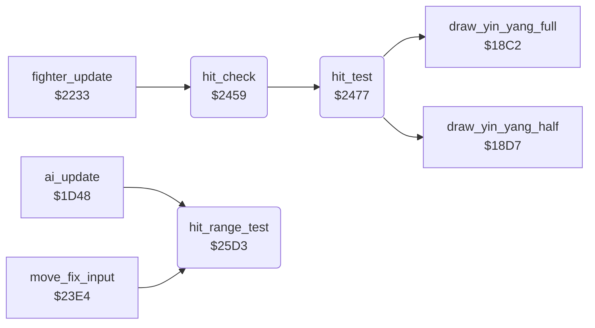

<!-- Generated by c64-docs from knowledge revision 20261025T214834.473-anyvn7 and .c64-re-tools/local/generated/src/source-map.json. Do not edit: change the knowledge, generate the source again, then run docs.ts generate. -->
# fighter/hit_test.asm: Hit test at the hit frame of an attack, points and reaction of a hit, attack range test

Range `$2459-$2634`. Source: [fighter/hit_test.asm](../../../../src/fighter/hit_test.asm). Index: [the reference](../../index.md).

## Routines

| Routine | Address | Reached from | Summary |
|---|---|---|---|
| [`hit_check`](hit_test.md#hit_check) | `$2459` | [`fighter_update`](fighter_moves.md#fighter_update) | Starts the hit test for fighter X when its attack move shows the hit frame. |
| [`hit_test`](hit_test.md#hit_test) | `$2477` | [`hit_check`](hit_test.md#hit_check) | Tests if the attack of fighter X hits the opponent (opponent_index). |
| [`hit_range_test`](hit_test.md#hit_range_test) | `$25D3` | [`ai_update`](../ai/ai_opponent.md#ai_update), [`move_fix_input`](fighter_moves.md#move_fix_input) | Tests the distance to the opponent against the reach type of the opponent's move. |

## Call graph

A solid arrow is a call, a thick arrow a table entry. Rounded nodes are in this file.

## Details

### [`hit_check`](../../../../src/fighter/hit_test.asm#L6) `$2459`

*routine*

Starts the hit test for fighter X when its attack move shows the hit frame. The move must have the attack flag ($1174), the animation must step forward in this frame, and $69,x must be 0. Called from the fighter update at $2233.

- **Called from:** [`fighter_update`](fighter_moves.md#fighter_update)
- **Calls:** [`hit_test`](hit_test.md#hit_test)
- **Reads:** [`fighter_move`](../../memory-map.md#fighter_move), [`move_attack_flags`](../game/entry_and_tables.md#move_attack_flags), [`anim_frame_tick`](../../memory-map.md#anim_frame_tick), [`anim_reverse`](../../memory-map.md#anim_reverse), [`pose_held`](../../memory-map.md#pose_held), [`move_hit_frames`](../game/entry_and_tables.md#move_hit_frames), [`fighter_frame`](../../memory-map.md#fighter_frame)

| Label | Address | Comment |
|---|---|---|
| [`hit_check_done`](../../../../src/fighter/hit_test.asm#L20) | `$2476` |  |

### [`hit_test`](../../../../src/fighter/hit_test.asm#L23) `$2477`

*routine*

Tests if the attack of fighter X hits the opponent (opponent_index). The hit-zone table of the move gives a target extent for the opponent frame; fighter_distance must lie in the reach window ($11bb full, $11d4 half). A hit sets hit_points,x to 2 or 1, then scoring_move and the hit_reaction of the opponent. A miss changes nothing.

- **Called from:** [`hit_check`](hit_test.md#hit_check)
- **Calls:** [`draw_yin_yang_full`](../game/game_modes.md#draw_yin_yang_full), [`draw_yin_yang_half`](../game/game_modes.md#draw_yin_yang_half)
- **Reads:** [`opponent_index`](../../memory-map.md#opponent_index), [`fighter_facing`](../../memory-map.md#fighter_facing), [`fighter_move`](../../memory-map.md#fighter_move), [`move_hit_zone_facing`](../game/entry_and_tables.md#move_hit_zone_facing), [`move_hit_zone_same_facing`](../game/entry_and_tables.md#move_hit_zone_same_facing), [`fighter_frame`](../../memory-map.md#fighter_frame), [`hit_zone_ptr`](../../memory-map.md#hit_zone_ptr), [`fighter_x`](../../memory-map.md#fighter_x), [`move_reach_types`](../game/entry_and_tables.md#move_reach_types), [`fighter_distance`](../../memory-map.md#fighter_distance), [`hit_target_extent`](../../memory-map.md#hit_target_extent), [`move_full_reach`](../game/entry_and_tables.md#move_full_reach) and 3 more
- **Writes:** [`hit_zone_ptr`](../../memory-map.md#hit_zone_ptr), [`hit_target_extent`](../../memory-map.md#hit_target_extent), [`fighter_distance`](../../memory-map.md#fighter_distance), [`hit_points`](../../memory-map.md#hit_points), [`scoring_move`](../../memory-map.md#scoring_move), [`hit_reaction`](../../memory-map.md#hit_reaction)
- **Refers to:** [`move_hit_zone_facing`](../game/entry_and_tables.md#move_hit_zone_facing), [`hit_zone_ptr`](../../memory-map.md#hit_zone_ptr), [`move_hit_zone_same_facing`](../game/entry_and_tables.md#move_hit_zone_same_facing)

| Label | Address | Comment |
|---|---|---|
| [`hit_test_same_facing`](../../../../src/fighter/hit_test.asm#L36) | `$2491` | The same-facing path: the recordings ran it |
| [`hit_test_facing`](../../../../src/fighter/hit_test.asm#L45) | `$24A2` |  |
| [`hit_dist_facing_left`](../../../../src/fighter/hit_test.asm#L62) | `$24C2` |  |
| [`hit_dist_store`](../../../../src/fighter/hit_test.asm#L66) | `$24C8` |  |
| [`hit_miss`](../../../../src/fighter/hit_test.asm#L77) | `$24DC` |  |
| [`hit_try_full_reach`](../../../../src/fighter/hit_test.asm#L79) | `$24DD` |  |
| [`hit_reach_type_set`](../../../../src/fighter/hit_test.asm#L88) | `$24EE` | Reach type not 0: hit when extent <= distance < extent + reach |
| [`hit_full_point`](../../../../src/fighter/hit_test.asm#L101) | `$2507` |  |
| [`hit_full_record`](../../../../src/fighter/hit_test.asm#L109) | `$2517` |  |
| [`hit_half_point`](../../../../src/fighter/hit_test.asm#L111) | `$251A` |  |
| [`hit_same_facing_zone`](../../../../src/fighter/hit_test.asm#L120) | `$252D` | Mirror of hit_test_facing: opposite distance sign and reach-type rules |
| [`hit_sf_dist_facing_right`](../../../../src/fighter/hit_test.asm#L137) | `$254D` |  |
| [`hit_sf_dist_store`](../../../../src/fighter/hit_test.asm#L141) | `$2553` |  |
| [`hit_sf_miss`](../../../../src/fighter/hit_test.asm#L159) | `$2577` |  |
| [`hit_sf_reach_type_set`](../../../../src/fighter/hit_test.asm#L161) | `$2578` |  |
| [`hit_record`](../../../../src/fighter/hit_test.asm#L175) | `$2591` |  |
| [`hit_reaction_1b`](../../../../src/fighter/hit_test.asm#L191) | `$25B1` |  |
| [`hit_reaction_16`](../../../../src/fighter/hit_test.asm#L196) | `$25B9` |  |
| [`hit_reaction_1a`](../../../../src/fighter/hit_test.asm#L201) | `$25C1` |  |
| [`hit_reaction_same_facing`](../../../../src/fighter/hit_test.asm#L206) | `$25C9` | Same facing: reach type 0 gives $1a, else $16 |

### [`hit_range_test`](../../../../src/fighter/hit_test.asm#L213) `$25D3`

*routine*

Tests the distance to the opponent against the reach type of the opponent's move. Facing each other: in range when the reach type is 0 and the distance is -17 to 19. Facing the same way: reach type not 0 and distance 3 to 31. Returns A=1 (Z clear) in range, else A=0. Called from the AI at $1dec and the input fix-up at $2414.

- **Called from:** [`ai_update`](../ai/ai_opponent.md#ai_update), [`move_fix_input`](fighter_moves.md#move_fix_input)
- **Reads:** [`fighter_facing`](../../memory-map.md#fighter_facing), [`opponent_index`](../../memory-map.md#opponent_index), [`fighter_x`](../../memory-map.md#fighter_x), [`fighter_move`](../../memory-map.md#fighter_move), [`move_reach_types`](../game/entry_and_tables.md#move_reach_types), [`fighter_distance`](../../memory-map.md#fighter_distance)
- **Writes:** [`fighter_distance`](../../memory-map.md#fighter_distance)

| Label | Address | Comment |
|---|---|---|
| [`range_dist_facing_left`](../../../../src/fighter/hit_test.asm#L224) | `$25E9` |  |
| [`range_dist_store`](../../../../src/fighter/hit_test.asm#L228) | `$25EF` |  |
| [`range_out`](../../../../src/fighter/hit_test.asm#L239) | `$2604` |  |
| [`range_in`](../../../../src/fighter/hit_test.asm#L242) | `$2607` |  |
| [`range_same_facing`](../../../../src/fighter/hit_test.asm#L245) | `$260A` | Same-facing range test: the recordings ran it |
| [`range_sf_dist_facing_right`](../../../../src/fighter/hit_test.asm#L252) | `$2617` |  |
| [`range_sf_dist_store`](../../../../src/fighter/hit_test.asm#L256) | `$261D` |  |
