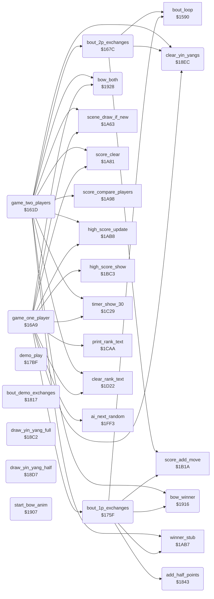

<!-- Generated by c64-docs from knowledge revision 20261025T191824.210-p015r5 and .c64-re-tools/local/generated/src/source-map.json. Do not edit: change the knowledge, generate the source again, then run docs.ts generate. -->
# game/game_modes.asm: Two-player game, one-player game, demo, half points, yin-yang symbols and bows

Range `$161D-$1947`. Source: [game/game_modes.asm](../../../../src/game/game_modes.asm). Index: [the reference](../../index.md).

## Routines

| Routine | Address | Reached from | Summary |
|---|---|---|---|
| [`game_two_players`](game_modes.md#game_two_players) | `$161D` | [`read_title_keys`](title_and_scene.md#read_title_keys) | Two-player game: 4 bouts of 30 seconds, one per scene, points only as score. |
| [`bout_2p_exchanges`](game_modes.md#bout_2p_exchanges) | `$167C` | [`game_two_players`](game_modes.md#game_two_players) | One two-player bout: exchanges until the time ends. |
| [`game_one_player`](game_modes.md#game_one_player) | `$16A9` | [`read_title_keys`](title_and_scene.md#read_title_keys) | One-player game against the computer from NOVICE up. |
| [`bout_1p_exchanges`](game_modes.md#bout_1p_exchanges) | `$175F` | [`game_one_player`](game_modes.md#game_one_player) | One-player bout: exchanges until a fighter has 4 half points or the time ends. |
| [`demo_play`](game_modes.md#demo_play) | `$17BF` | [`read_title_keys`](title_and_scene.md#read_title_keys) | Attract demo: two computer fighters with random levels 3-11 fight 4 bouts, one per scene. |
| [`bout_demo_exchanges`](game_modes.md#bout_demo_exchanges) | `$1817` | [`demo_play`](game_modes.md#demo_play) | One demo bout: exchanges until a fighter has 4 half points or the time ends. |
| [`add_half_points`](game_modes.md#add_half_points) | `$1843` | [`bout_1p_exchanges`](game_modes.md#bout_1p_exchanges), [`bout_demo_exchanges`](game_modes.md#bout_demo_exchanges) | Adds hit_points of fighter X to half_points and draws the yin-yang symbols for 1-4 half points. |
| [`draw_yin_yang_full`](game_modes.md#draw_yin_yang_full) | `$18C2` | [`add_half_points`](game_modes.md#add_half_points), [`hit_test`](../fighter/hit_test.md#hit_test) | Draws a whole yin-yang symbol (characters 1-4, 2 x 2) at $cc03+Y. |
| [`draw_yin_yang_half`](game_modes.md#draw_yin_yang_half) | `$18D7` | [`add_half_points`](game_modes.md#add_half_points), [`hit_test`](../fighter/hit_test.md#hit_test) | Draws a half yin-yang symbol (characters 5-8, 2 x 2) at $cc03+Y. |
| [`clear_yin_yangs`](game_modes.md#clear_yin_yangs) | `$18EC` | [`game_two_players`](game_modes.md#game_two_players), [`bout_2p_exchanges`](game_modes.md#bout_2p_exchanges), [`game_one_player`](game_modes.md#game_one_player), [`demo_play`](game_modes.md#demo_play) | Clears both yin-yang symbols of a fighter, Y = 0 for fighter 0 or $1d for fighter 1. |
| [`start_bow_anim`](game_modes.md#start_bow_anim) | `$1907` | [`bow_winner`](game_modes.md#bow_winner), [`bow_both`](game_modes.md#bow_both) | Starts animation $19 (the bow) for fighter X on the ground. |
| [`bow_winner`](game_modes.md#bow_winner) | `$1916` | [`game_two_players`](game_modes.md#game_two_players), [`bout_1p_exchanges`](game_modes.md#bout_1p_exchanges), [`bout_demo_exchanges`](game_modes.md#bout_demo_exchanges) | Plays the bow of fighter X frame by frame until it ends. |
| [`bow_both`](game_modes.md#bow_both) | `$1928` | [`game_two_players`](game_modes.md#game_two_players), [`game_one_player`](game_modes.md#game_one_player) | Both fighters bow; waits for the end of the bow of fighter 1. |

## Call graph

A solid arrow is a call, a thick arrow a table entry. Rounded nodes are in this file.

The graph shows 30 of the 53 edges.

## Details

### [`game_two_players`](../../../../src/game/game_modes.asm#L6) `$161D`

*routine*

Two-player game: 4 bouts of 30 seconds, one per scene, points only as score. The higher score wins and can set high_score_2p. Called by the title loop.

- **Called from:** [`read_title_keys`](title_and_scene.md#read_title_keys)
- **Calls:** [`clear_rank_text`](panel_texts_1c62.md#clear_rank_text), [`clear_yin_yangs`](game_modes.md#clear_yin_yangs), [`score_clear`](score_and_timer.md#score_clear), [`timer_show_30`](panel_texts.md#timer_show_30), [`scene_draw_if_new`](title_and_scene.md#scene_draw_if_new), [`bout_2p_exchanges`](game_modes.md#bout_2p_exchanges), [`score_compare_players`](score_and_timer.md#score_compare_players), [`bow_both`](game_modes.md#bow_both), [`winner_stub`](score_and_timer.md#winner_stub), [`bow_winner`](game_modes.md#bow_winner), [`high_score_update`](score_and_timer.md#high_score_update)
- **Reads:** [`stage_counter`](../../memory-map.md#stage_counter)
- **Writes:** [`stage_counter`](../../memory-map.md#stage_counter), [`cpu_controlled`](../../memory-map.md#cpu_controlled), [`in_game`](../../memory-map.md#in_game), [`game_mode`](../../memory-map.md#game_mode), [`timer_frames`](../../memory-map.md#timer_frames), [`timer_seconds`](../../memory-map.md#timer_seconds), [`time_up`](../../memory-map.md#time_up)
- **Refers to:** [`cpu_controlled`](../../memory-map.md#cpu_controlled)

| Label | Address | Comment |
|---|---|---|
| [`game_2p_bout_loop`](../../../../src/game/game_modes.asm#L24) | `$1644` |  |
| [`game_2p_draw`](../../../../src/game/game_modes.asm#L41) | `$1668` | Equal scores: both bow, and player 1's score goes to the high score test. |
| [`game_2p_winner`](../../../../src/game/game_modes.asm#L46) | `$1670` | Lone RTS with the winner in X. |
| [`game_2p_high_score`](../../../../src/game/game_modes.asm#L49) | `$1676` |  |
| [`game_2p_exit`](../../../../src/game/game_modes.asm#L52) | `$167B` |  |

### [`bout_2p_exchanges`](../../../../src/game/game_modes.asm#L55) `$167C`

*routine*

One two-player bout: exchanges until the time ends. Each hit gives score points to the other player and clears the yin-yang cells. Called by game_two_players.

- **Called from:** [`game_two_players`](game_modes.md#game_two_players)
- **Calls:** [`bout_loop`](init_bout_loop.md#bout_loop), [`score_add_move`](score_and_timer.md#score_add_move), [`clear_yin_yangs`](game_modes.md#clear_yin_yangs)
- **Reads:** [`hit_reaction`](../../memory-map.md#hit_reaction), [`time_up`](../../memory-map.md#time_up)
- **Refers to:** [`hit_reaction`](../../memory-map.md#hit_reaction)

| Label | Address | Comment |
|---|---|---|
| [`bout_2p_one_hit`](../../../../src/game/game_modes.asm#L62) | `$1689` |  |
| [`bout_2p_score_p2`](../../../../src/game/game_modes.asm#L68) | `$1695` |  |
| [`bout_2p_clear_symbols`](../../../../src/game/game_modes.asm#L71) | `$169A` |  |
| [`bout_2p_exit`](../../../../src/game/game_modes.asm#L78) | `$16A8` |  |

### [`game_one_player`](../../../../src/game/game_modes.asm#L81) `$16A9`

*routine*

One-player game against the computer from NOVICE up. Two won bouts give the next rank and a stronger opponent. Returns A = 0 after the lost bout.

- **Called from:** [`read_title_keys`](title_and_scene.md#read_title_keys)
- **Calls:** [`clear_rank_text`](panel_texts_1c62.md#clear_rank_text), [`score_clear`](score_and_timer.md#score_clear), [`print_rank_text`](panel_texts_1c62.md#print_rank_text), [`clear_yin_yangs`](game_modes.md#clear_yin_yangs), [`timer_show_30`](panel_texts.md#timer_show_30), [`scene_draw_if_new`](title_and_scene.md#scene_draw_if_new), [`bout_1p_exchanges`](game_modes.md#bout_1p_exchanges), [`bow_both`](game_modes.md#bow_both), [`high_score_update`](score_and_timer.md#high_score_update), [`high_score_show`](score_and_timer.md#high_score_show), [`ai_next_random`](../ai/ai_opponent_1f8f.md#ai_next_random)
- **Reads:** [`frame_random`](../../memory-map.md#frame_random), [`wins_to_promotion`](../../memory-map.md#wins_to_promotion), [`stage_counter`](../../memory-map.md#stage_counter), [`cpu_skill`](../../memory-map.md#cpu_skill), [`rank_number_table`](panel_texts_1c62.md#rank_number_table)
- **Writes:** [`stage_counter`](../../memory-map.md#stage_counter), [`cpu_controlled`](../../memory-map.md#cpu_controlled), [`cpu_skill`](../../memory-map.md#cpu_skill), [`in_game`](../../memory-map.md#in_game), [`wins_to_promotion`](../../memory-map.md#wins_to_promotion), [`panel_row1`](../../memory-map.md#panel_row1), [`ai_random`](../../memory-map.md#ai_random), [`text_dest_ptr`](../../memory-map.md#text_dest_ptr), [`game_mode`](../../memory-map.md#game_mode), [`half_points`](../../memory-map.md#half_points), [`bout_hit_value`](../../memory-map.md#bout_hit_value), [`timer_frames`](../../memory-map.md#timer_frames) and 2 more
- **Refers to:** [`cpu_skill`](../../memory-map.md#cpu_skill), [`cpu_controlled`](../../memory-map.md#cpu_controlled), [`text_dest_ptr`](../../memory-map.md#text_dest_ptr), [`half_points`](../../memory-map.md#half_points), [`bout_hit_value`](../../memory-map.md#bout_hit_value)

| Label | Address | Comment |
|---|---|---|
| [`game_1p_bout_loop`](../../../../src/game/game_modes.asm#L105) | `$16E2` |  |
| [`game_1p_promote`](../../../../src/game/game_modes.asm#L133) | `$171D` | Rank index and AI level of fighter 1 go up together. |
| [`game_1p_check_draw`](../../../../src/game/game_modes.asm#L141) | `$1734` |  |
| [`game_1p_over`](../../../../src/game/game_modes.asm#L146) | `$173E` |  |
| [`game_1p_rank_wrap`](../../../../src/game/game_modes.asm#L152) | `$1749` | After 22 promotions: scenes go on, the rank text stays and the AI level is random 2-10. |

### [`bout_1p_exchanges`](../../../../src/game/game_modes.asm#L165) `$175F`

*routine*

One-player bout: exchanges until a fighter has 4 half points or the time ends. Returns A: 1 won, 0 lost, $81 draw, $80 key.

- **Called from:** [`game_one_player`](game_modes.md#game_one_player)
- **Calls:** [`bout_loop`](init_bout_loop.md#bout_loop), [`bout_hit_value_add`](panel_texts.md#bout_hit_value_add), [`add_half_points`](game_modes.md#add_half_points), [`score_add_move`](score_and_timer.md#score_add_move), [`winner_stub`](score_and_timer.md#winner_stub), [`bow_winner`](game_modes.md#bow_winner), [`time_bonus_count`](panel_texts_1c62.md#time_bonus_count)
- **Reads:** [`hit_reaction`](../../memory-map.md#hit_reaction), [`time_up`](../../memory-map.md#time_up), [`half_points`](../../memory-map.md#half_points), [`bout_hit_value`](../../memory-map.md#bout_hit_value)
- **Refers to:** [`hit_reaction`](../../memory-map.md#hit_reaction), [`half_points`](../../memory-map.md#half_points), [`bout_hit_value`](../../memory-map.md#bout_hit_value)

| Label | Address | Comment |
|---|---|---|
| [`bout_1p_one_hit`](../../../../src/game/game_modes.asm#L172) | `$176C` |  |
| [`bout_1p_p1_scores`](../../../../src/game/game_modes.asm#L180) | `$177D` |  |
| [`bout_1p_check_time`](../../../../src/game/game_modes.asm#L187) | `$178C` |  |
| [`bout_1p_tie_break`](../../../../src/game/game_modes.asm#L195) | `$179B` |  |
| [`bout_1p_won_decision`](../../../../src/game/game_modes.asm#L200) | `$17A3` |  |
| [`bout_1p_won`](../../../../src/game/game_modes.asm#L203) | `$17A8` |  |
| [`bout_1p_exit`](../../../../src/game/game_modes.asm#L207) | `$17B0` |  |
| [`bout_1p_lost_decision`](../../../../src/game/game_modes.asm#L209) | `$17B1` |  |
| [`bout_1p_lost`](../../../../src/game/game_modes.asm#L212) | `$17B6` |  |
| [`bout_1p_draw`](../../../../src/game/game_modes.asm#L216) | `$17BC` |  |

### [`demo_play`](../../../../src/game/game_modes.asm#L220) `$17BF`

*routine*

Attract demo: two computer fighters with random levels 3-11 fight 4 bouts, one per scene. Returns N set when a start key or fire ends it.

- **Called from:** [`read_title_keys`](title_and_scene.md#read_title_keys)
- **Calls:** [`ai_next_random`](../ai/ai_opponent_1f8f.md#ai_next_random), [`clear_rank_text`](panel_texts_1c62.md#clear_rank_text), [`show_demo_text`](panel_texts_1c62.md#show_demo_text), [`clear_yin_yangs`](game_modes.md#clear_yin_yangs), [`timer_show_30`](panel_texts.md#timer_show_30), [`scene_draw_if_new`](title_and_scene.md#scene_draw_if_new), [`bout_demo_exchanges`](game_modes.md#bout_demo_exchanges)
- **Reads:** [`stage_counter`](../../memory-map.md#stage_counter)
- **Writes:** [`stage_counter`](../../memory-map.md#stage_counter), [`cpu_skill`](../../memory-map.md#cpu_skill), [`cpu_controlled`](../../memory-map.md#cpu_controlled), [`game_mode`](../../memory-map.md#game_mode), [`half_points`](../../memory-map.md#half_points), [`bout_hit_value`](../../memory-map.md#bout_hit_value), [`timer_frames`](../../memory-map.md#timer_frames), [`timer_seconds`](../../memory-map.md#timer_seconds), [`time_up`](../../memory-map.md#time_up)
- **Refers to:** [`cpu_skill`](../../memory-map.md#cpu_skill), [`cpu_controlled`](../../memory-map.md#cpu_controlled), [`half_points`](../../memory-map.md#half_points), [`bout_hit_value`](../../memory-map.md#bout_hit_value)

| Label | Address | Comment |
|---|---|---|
| [`demo_bout_loop`](../../../../src/game/game_modes.asm#L237) | `$17E3` |  |
| [`demo_exit`](../../../../src/game/game_modes.asm#L261) | `$1816` |  |

### [`bout_demo_exchanges`](../../../../src/game/game_modes.asm#L264) `$1817`

*routine*

One demo bout: exchanges until a fighter has 4 half points or the time ends. No score. Returns A = 0, or $80 with N set on a start key.

- **Called from:** [`demo_play`](game_modes.md#demo_play)
- **Calls:** [`bout_loop`](init_bout_loop.md#bout_loop), [`add_half_points`](game_modes.md#add_half_points), [`bow_winner`](game_modes.md#bow_winner)
- **Reads:** [`hit_reaction`](../../memory-map.md#hit_reaction), [`time_up`](../../memory-map.md#time_up)
- **Refers to:** [`hit_reaction`](../../memory-map.md#hit_reaction)

| Label | Address | Comment |
|---|---|---|
| [`bout_demo_one_hit`](../../../../src/game/game_modes.asm#L271) | `$1824` |  |
| [`bout_demo_bow`](../../../../src/game/game_modes.asm#L277) | `$182F` |  |
| [`bout_demo_exit`](../../../../src/game/game_modes.asm#L280) | `$1834` |  |
| [`bout_demo_p1_scores`](../../../../src/game/game_modes.asm#L282) | `$1835` |  |
| [`bout_demo_check_time`](../../../../src/game/game_modes.asm#L286) | `$183C` |  |

### [`add_half_points`](../../../../src/game/game_modes.asm#L292) `$1843`

*routine*

Adds hit_points of fighter X to half_points and draws the yin-yang symbols for 1-4 half points. Returns C set when the fighter has 4.

- **Called from:** [`bout_1p_exchanges`](game_modes.md#bout_1p_exchanges), [`bout_demo_exchanges`](game_modes.md#bout_demo_exchanges)
- **Calls:** [`draw_yin_yang_half`](game_modes.md#draw_yin_yang_half), [`draw_yin_yang_full`](game_modes.md#draw_yin_yang_full)
- **Reads:** [`half_points`](../../memory-map.md#half_points), [`hit_points`](../../memory-map.md#hit_points)
- **Writes:** [`half_points`](../../memory-map.md#half_points)

| Label | Address | Comment |
|---|---|---|
| [`points_p1_test`](../../../../src/game/game_modes.asm#L299) | `$184E` |  |
| [`points_p1_one`](../../../../src/game/game_modes.asm#L307) | `$185D` |  |
| [`points_p1_two`](../../../../src/game/game_modes.asm#L311) | `$1865` |  |
| [`points_p1_three`](../../../../src/game/game_modes.asm#L315) | `$186D` |  |
| [`points_p1_four`](../../../../src/game/game_modes.asm#L321) | `$187A` |  |
| [`points_p2_test`](../../../../src/game/game_modes.asm#L327) | `$1887` |  |
| [`points_p2_one`](../../../../src/game/game_modes.asm#L335) | `$1896` |  |
| [`points_p2_two`](../../../../src/game/game_modes.asm#L339) | `$189E` |  |
| [`points_p2_three`](../../../../src/game/game_modes.asm#L343) | `$18A6` |  |
| [`points_p2_four`](../../../../src/game/game_modes.asm#L349) | `$18B3` |  |
| [`points_test_won`](../../../../src/game/game_modes.asm#L354) | `$18BD` |  |

### [`draw_yin_yang_full`](../../../../src/game/game_modes.asm#L359) `$18C2`

*routine*

Draws a whole yin-yang symbol (characters 1-4, 2 x 2) at $cc03+Y. Called by add_half_points.

- **Called from:** [`add_half_points`](game_modes.md#add_half_points), [`hit_test`](../fighter/hit_test.md#hit_test)
- **Writes:** [`screen_ram`](../../memory-map.md#screen_ram), [`panel_row1`](../../memory-map.md#panel_row1)

### [`draw_yin_yang_half`](../../../../src/game/game_modes.asm#L370) `$18D7`

*routine*

Draws a half yin-yang symbol (characters 5-8, 2 x 2) at $cc03+Y. Called by add_half_points.

- **Called from:** [`add_half_points`](game_modes.md#add_half_points), [`hit_test`](../fighter/hit_test.md#hit_test)
- **Writes:** [`screen_ram`](../../memory-map.md#screen_ram), [`panel_row1`](../../memory-map.md#panel_row1)

### [`clear_yin_yangs`](../../../../src/game/game_modes.asm#L381) `$18EC`

*routine*

Clears both yin-yang symbols of a fighter, Y = 0 for fighter 0 or $1d for fighter 1. Called at the start of each bout and by bout_2p_exchanges.

- **Called from:** [`game_two_players`](game_modes.md#game_two_players), [`bout_2p_exchanges`](game_modes.md#bout_2p_exchanges), [`game_one_player`](game_modes.md#game_one_player), [`demo_play`](game_modes.md#demo_play)
- **Writes:** [`screen_ram`](../../memory-map.md#screen_ram), [`panel_row1`](../../memory-map.md#panel_row1)

### [`start_bow_anim`](../../../../src/game/game_modes.asm#L393) `$1907`

*routine*

Starts animation $19 (the bow) for fighter X on the ground. Called by bow_winner and bow_both.

- **Called from:** [`bow_winner`](game_modes.md#bow_winner), [`bow_both`](game_modes.md#bow_both)
- **Writes:** [`anim_number`](../../memory-map.md#anim_number), [`fighter_y`](../../memory-map.md#fighter_y), [`anim_started`](../../memory-map.md#anim_started), [`anim_reverse`](../../memory-map.md#anim_reverse)

### [`bow_winner`](../../../../src/game/game_modes.asm#L403) `$1916`

*routine*

Plays the bow of fighter X frame by frame until it ends. Called after a won bout in each mode.

- **Called from:** [`game_two_players`](game_modes.md#game_two_players), [`bout_1p_exchanges`](game_modes.md#bout_1p_exchanges), [`bout_demo_exchanges`](game_modes.md#bout_demo_exchanges)
- **Calls:** [`start_bow_anim`](game_modes.md#start_bow_anim), [`anim_update`](../fighter/anim_step.md#anim_update)
- **Reads:** [`RASTER`](../../memory-map.md#RASTER), [`anim_finished`](../../memory-map.md#anim_finished)

| Label | Address | Comment |
|---|---|---|
| [`bow_winner_step`](../../../../src/game/game_modes.asm#L405) | `$1919` |  |
| [`bow_winner_wait`](../../../../src/game/game_modes.asm#L407) | `$191C` |  |

### [`bow_both`](../../../../src/game/game_modes.asm#L415) `$1928`

*routine*

Both fighters bow; waits for the end of the bow of fighter 1. Called after a draw.

- **Called from:** [`game_two_players`](game_modes.md#game_two_players), [`game_one_player`](game_modes.md#game_one_player)
- **Calls:** [`start_bow_anim`](game_modes.md#start_bow_anim), [`anim_update`](../fighter/anim_step.md#anim_update)
- **Reads:** [`RASTER`](../../memory-map.md#RASTER), [`anim_finished`](../../memory-map.md#anim_finished)

| Label | Address | Comment |
|---|---|---|
| [`bow_both_step`](../../../../src/game/game_modes.asm#L420) | `$1932` |  |
| [`bow_both_wait`](../../../../src/game/game_modes.asm#L425) | `$193C` |  |
