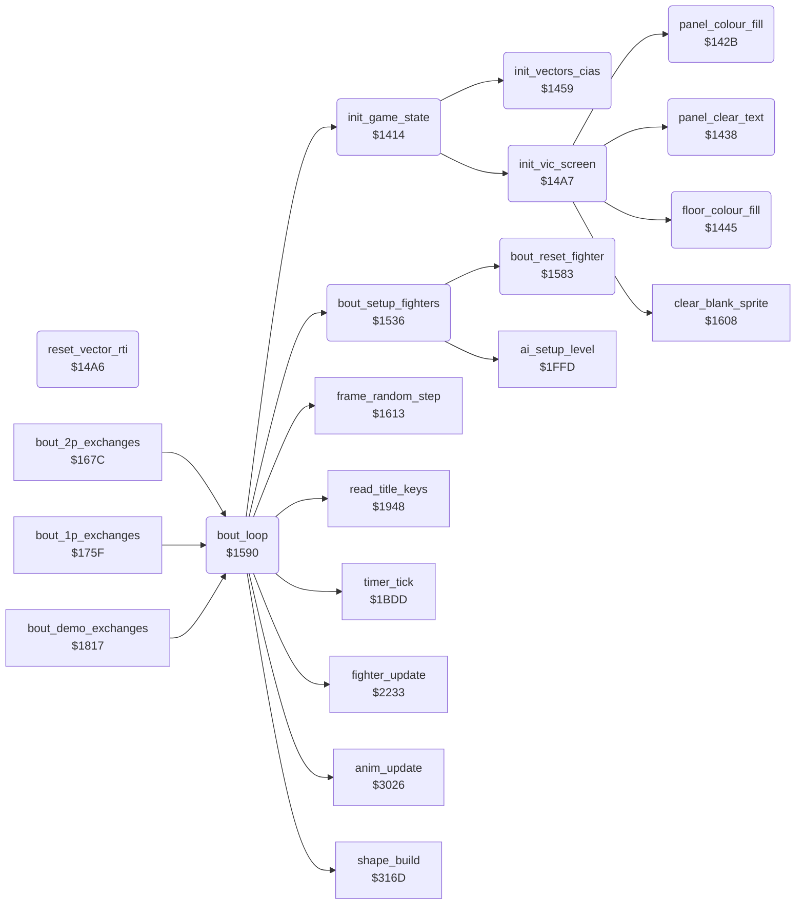

<!-- Generated by c64-docs from knowledge revision 20261025T214834.473-anyvn7 and .c64-re-tools/local/generated/src/source-map.json. Do not edit: change the knowledge, generate the source again, then run docs.ts generate. -->
# game/init_bout_loop.asm: Start-up, VIC and CIA set-up, bout set-up and the frame loop of one exchange

Range `$1414-$1606`. Source: [game/init_bout_loop.asm](../../../../src/game/init_bout_loop.asm). Index: [the reference](../../index.md).

## Routines

| Routine | Address | Reached from | Summary |
|---|---|---|---|
| [`init_game_state`](init_bout_loop.md#init_game_state) | `$1414` | [`bout_loop`](init_bout_loop.md#bout_loop) | Start-up: sets game_mode, front_fighter and shape_page_offset to 0, sets the vectors and the VIC, seeds frame_random with $53, scene_shown 1. |
| [`panel_colour_fill`](init_bout_loop.md#panel_colour_fill) | `$142B` | [`init_vic_screen`](init_bout_loop.md#init_vic_screen) | Fills colour RAM of the text rows 0-4 ($d800-$d8c7) with 6, blue. |
| [`panel_clear_text`](init_bout_loop.md#panel_clear_text) | `$1438` | [`init_vic_screen`](init_bout_loop.md#init_vic_screen) | Fills screen rows 0-4 ($cc00-$ccc7) with spaces. |
| [`floor_colour_fill`](init_bout_loop.md#floor_colour_fill) | `$1445` | [`init_vic_screen`](init_bout_loop.md#init_vic_screen) | Fills screen and colour RAM of rows 17-24 with $77, so the floor bitmap shows yellow only. |
| [`init_vectors_cias`](init_bout_loop.md#init_vectors_cias) | `$1459` | [`init_game_state`](init_bout_loop.md#init_game_state) | Switches the ROMs out ($01 = $05) and stops the CIA 1 interrupts. |
| [`reset_vector_rti`](init_bout_loop.md#reset_vector_rti) | `$14A6` |  | Lone RTI, the target of the RESET vector at $fffc. |
| [`init_vic_screen`](init_bout_loop.md#init_vic_screen) | `$14A7` | [`init_game_state`](init_bout_loop.md#init_game_state) | Sets VIC bank 3, screen $cc00 with bitmap and characters at $e000, colours, multicolour sprites and the panel. |
| [`bout_setup_fighters`](init_bout_loop.md#bout_setup_fighters) | `$1536` | [`bout_loop`](init_bout_loop.md#bout_loop) | Puts both fighters at the start: x $3e and $5a, on the ground, facing each other, move and animation $17. |
| [`bout_reset_fighter`](init_bout_loop.md#bout_reset_fighter) | `$1583` | [`bout_setup_fighters`](init_bout_loop.md#bout_setup_fighters) | Clears hit_reaction, $5c and the hold flag $69 of fighter X and sets fighter_move $17. |
| [`bout_loop`](init_bout_loop.md#bout_loop) | `$1590` | [`bout_2p_exchanges`](game_modes.md#bout_2p_exchanges), [`bout_1p_exchanges`](game_modes.md#bout_1p_exchanges), [`bout_demo_exchanges`](game_modes.md#bout_demo_exchanges) | Plays one exchange from the start positions until a fighter falls, the time ends or a start key comes. |
| [`cold_start`](init_bout_loop.md#cold_start) | `$1601` | [`$1158`](../../../../src/game/entry_and_tables.asm#L7) | Cold start: initialises the machine and enters the title loop. |

## Call graph

A solid arrow is a call, a thick arrow a table entry. Rounded nodes are in this file.

## Details

### [`init_game_state`](../../../../src/game/init_bout_loop.asm#L6) `$1414`

*routine*

Start-up: sets game_mode, front_fighter and shape_page_offset to 0, sets the vectors and the VIC, seeds frame_random with $53, scene_shown 1. Called by cold_start.

- **Called from:** [`bout_loop`](init_bout_loop.md#bout_loop)
- **Calls:** [`init_vectors_cias`](init_bout_loop.md#init_vectors_cias), [`init_vic_screen`](init_bout_loop.md#init_vic_screen)
- **Writes:** [`game_mode`](../../memory-map.md#game_mode), [`front_fighter`](../../memory-map.md#front_fighter), [`shape_page_offset`](../../memory-map.md#shape_page_offset), [`frame_random`](../../memory-map.md#frame_random), [`scene_shown`](../../memory-map.md#scene_shown)

### [`panel_colour_fill`](../../../../src/game/init_bout_loop.asm#L19) `$142B`

*routine*

Fills colour RAM of the text rows 0-4 ($d800-$d8c7) with 6, blue. Called by init_vic_screen.

- **Called from:** [`init_vic_screen`](init_bout_loop.md#init_vic_screen)
- **Writes:** [`figure_f67_parts`](../graphics/shadow_sprites_facing0.md#figure_f67_parts)

| Label | Address | Comment |
|---|---|---|
| [`panel_colour_loop`](../../../../src/game/init_bout_loop.asm#L22) | `$142F` |  |

### [`panel_clear_text`](../../../../src/game/init_bout_loop.asm#L29) `$1438`

*routine*

Fills screen rows 0-4 ($cc00-$ccc7) with spaces. Called by init_vic_screen.

- **Called from:** [`init_vic_screen`](init_bout_loop.md#init_vic_screen)
- **Writes:** [`screen_ram`](../../memory-map.md#screen_ram)

| Label | Address | Comment |
|---|---|---|
| [`panel_clear_loop`](../../../../src/game/init_bout_loop.asm#L32) | `$143C` |  |

### [`floor_colour_fill`](../../../../src/game/init_bout_loop.asm#L39) `$1445`

*routine*

Fills screen and colour RAM of rows 17-24 with $77, so the floor bitmap shows yellow only. Called by init_vic_screen.

- **Called from:** [`init_vic_screen`](init_bout_loop.md#init_vic_screen)
- **Writes:** [`figure_heads_unused`](../graphics/shadow_sprites_facing1.md#figure_heads_unused), [`screen_scene_rows`](../../memory-map.md#screen_scene_rows)

| Label | Address | Comment |
|---|---|---|
| [`floor_colour_loop`](../../../../src/game/init_bout_loop.asm#L42) | `$1449` |  |

### [`init_vectors_cias`](../../../../src/game/init_bout_loop.asm#L51) `$1459`

*routine*

Switches the ROMs out ($01 = $05) and stops the CIA 1 interrupts. It enables the raster IRQ, sets the IRQ, NMI and RESET vectors and arms the CIA 2 timer B NMI.

- **Called from:** [`init_game_state`](init_bout_loop.md#init_game_state)
- **Writes:** [`cpu_port`](../../memory-map.md#cpu_port), [`CIAICR`](../../memory-map.md#CIAICR), [`IRQMSK`](../../memory-map.md#IRQMSK), [`hw_irq_vector`](../../memory-map.md#hw_irq_vector), [`hw_reset_vector`](../../memory-map.md#hw_reset_vector), [`CI2ICR`](../../memory-map.md#CI2ICR), [`hw_nmi_vector`](../../memory-map.md#hw_nmi_vector), [`CI2TBLO`](../../memory-map.md#CI2TBLO), [`$DD07`](../../../../src/graphics/shadow_sprites_facing1.asm#L191), [`CIADDRA`](../../memory-map.md#CIADDRA)
- **Refers to:** [`irq_frame_start`](../irq/sprite_mux_plan.md#irq_frame_start), [`reset_vector_rti`](init_bout_loop.md#reset_vector_rti), [`nmi_floor_colour`](../irq/irq_screen_split.md#nmi_floor_colour)

### [`reset_vector_rti`](../../../../src/game/init_bout_loop.asm#L75) `$14A6`

*routine*

Lone RTI, the target of the RESET vector at $fffc. No run executes it.

- **Referred to by:** [`init_vectors_cias`](init_bout_loop.md#init_vectors_cias)

### [`init_vic_screen`](../../../../src/game/init_bout_loop.asm#L79) `$14A7`

*routine*

Sets VIC bank 3, screen $cc00 with bitmap and characters at $e000, colours, multicolour sprites and the panel. Called by init_game_state.

- **Called from:** [`init_game_state`](init_bout_loop.md#init_game_state)
- **Calls:** [`clear_blank_sprite`](init_bout_loop_1608.md#clear_blank_sprite), [`floor_colour_fill`](init_bout_loop.md#floor_colour_fill), [`panel_colour_fill`](init_bout_loop.md#panel_colour_fill), [`panel_clear_text`](init_bout_loop.md#panel_clear_text)
- **Writes:** [`CI2PRA`](../../memory-map.md#CI2PRA), [`VMCSB`](../../memory-map.md#VMCSB), [`BGCOL0`](../../memory-map.md#BGCOL0), [`EXTCOL`](../../memory-map.md#EXTCOL), [`panel_bg_colour`](../../memory-map.md#panel_bg_colour), [`SCROLY`](../../memory-map.md#SCROLY), [`RASTER`](../../memory-map.md#RASTER), [`SCROLX`](../../memory-map.md#SCROLX), [`SPMC0`](../../memory-map.md#SPMC0), [`SPMC1`](../../memory-map.md#SPMC1), [`fighter_colour`](../../memory-map.md#fighter_colour), [`SPMC`](../../memory-map.md#SPMC) and 5 more
- **Refers to:** [`fighter_colour`](../../memory-map.md#fighter_colour)

### [`bout_setup_fighters`](../../../../src/game/init_bout_loop.asm#L136) `$1536`

*routine*

Puts both fighters at the start: x $3e and $5a, on the ground, facing each other, move and animation $17. Also red for fighter 1 and the AI set-up. Called by bout_loop.

- **Called from:** [`bout_loop`](init_bout_loop.md#bout_loop)
- **Calls:** [`bout_reset_fighter`](init_bout_loop.md#bout_reset_fighter), [`ai_setup_level`](../ai/ai_opponent_1f8f.md#ai_setup_level)
- **Writes:** [`fighter_x`](../../memory-map.md#fighter_x), [`fighter_y`](../../memory-map.md#fighter_y), [`anim_reverse`](../../memory-map.md#anim_reverse), [`fighter_facing`](../../memory-map.md#fighter_facing), [`anim_number`](../../memory-map.md#anim_number), [`anim_started`](../../memory-map.md#anim_started), [`bout_knockdown`](../../memory-map.md#bout_knockdown), [`draw_buffer`](../../memory-map.md#draw_buffer), [`fighter_colour`](../../memory-map.md#fighter_colour), [`knockdown_delay`](../../memory-map.md#knockdown_delay)
- **Refers to:** [`fighter_x`](../../memory-map.md#fighter_x), [`fighter_y`](../../memory-map.md#fighter_y), [`anim_reverse`](../../memory-map.md#anim_reverse), [`fighter_facing`](../../memory-map.md#fighter_facing), [`anim_number`](../../memory-map.md#anim_number), [`anim_started`](../../memory-map.md#anim_started), [`draw_buffer`](../../memory-map.md#draw_buffer), [`fighter_colour`](../../memory-map.md#fighter_colour), [`knockdown_delay`](../../memory-map.md#knockdown_delay)

### [`bout_reset_fighter`](../../../../src/game/init_bout_loop.asm#L175) `$1583`

*routine*

Clears hit_reaction, $5c and the hold flag $69 of fighter X and sets fighter_move $17. Called by bout_setup_fighters.

- **Called from:** [`bout_setup_fighters`](init_bout_loop.md#bout_setup_fighters)
- **Writes:** [`hit_reaction`](../../memory-map.md#hit_reaction), [`fighter_unused_flag`](../../memory-map.md#fighter_unused_flag), [`pose_held`](../../memory-map.md#pose_held), [`fighter_move`](../../memory-map.md#fighter_move)

### [`bout_loop`](../../../../src/game/init_bout_loop.asm#L184) `$1590`

*routine*

Plays one exchange from the start positions until a fighter falls, the time ends or a start key comes. Returns A: $80 key, the reaction move, or 1 time up.
Only the bull test sets the offset nonzero.

- **Called from:** [`bout_2p_exchanges`](game_modes.md#bout_2p_exchanges), [`bout_1p_exchanges`](game_modes.md#bout_1p_exchanges), [`bout_demo_exchanges`](game_modes.md#bout_demo_exchanges)
- **Calls:** [`bout_setup_fighters`](init_bout_loop.md#bout_setup_fighters), [`anim_update`](../fighter/anim_step.md#anim_update), [`fighter_update`](../fighter/fighter_moves.md#fighter_update), [`frame_random_step`](init_bout_loop_1608.md#frame_random_step), [`read_title_keys`](title_and_scene.md#read_title_keys), [`timer_tick`](score_and_timer.md#timer_tick), [`shape_build`](../shapes/shape_build_3165.md#shape_build), [`init_game_state`](init_bout_loop.md#init_game_state)
- **Jumps to:** [`title_main_loop`](title_and_scene.md#title_main_loop)
- **Reads:** [`SPENA`](../../memory-map.md#SPENA), [`RASTER`](../../memory-map.md#RASTER), [`opponent_index`](../../memory-map.md#opponent_index), [`bout_knockdown`](../../memory-map.md#bout_knockdown), [`hit_reaction`](../../memory-map.md#hit_reaction), [`fighter_move`](../../memory-map.md#fighter_move), [`time_up`](../../memory-map.md#time_up)
- **Writes:** [`shape_page_offset`](../../memory-map.md#shape_page_offset), [`SPENA`](../../memory-map.md#SPENA), [`opponent_index`](../../memory-map.md#opponent_index), [`fighter_frame`](../../memory-map.md#fighter_frame), [`fighter_y`](../../memory-map.md#fighter_y), [`sprite_y`](../../memory-map.md#sprite_y)
- **Refers to:** [`hit_reaction`](../../memory-map.md#hit_reaction), [`fighter_frame`](../../memory-map.md#fighter_frame), [`fighter_y`](../../memory-map.md#fighter_y), [`sprite_y`](../../memory-map.md#sprite_y)

| Label | Address | Comment |
|---|---|---|
| [`bout_frame_loop`](../../../../src/game/init_bout_loop.asm#L196) | `$15AA` |  |
| [`bout_check_time_up`](../../../../src/game/init_bout_loop.asm#L220) | `$15DE` |  |
| [`bout_loop_exit`](../../../../src/game/init_bout_loop.asm#L237) | `$1600` |  |

### [`cold_start`](../../../../src/game/init_bout_loop.asm#L240) `$1601`

*label*

Cold start: initialises the machine and enters the title loop.

- **Jumped to from:** [`$1158`](../../../../src/game/entry_and_tables.asm#L7)
