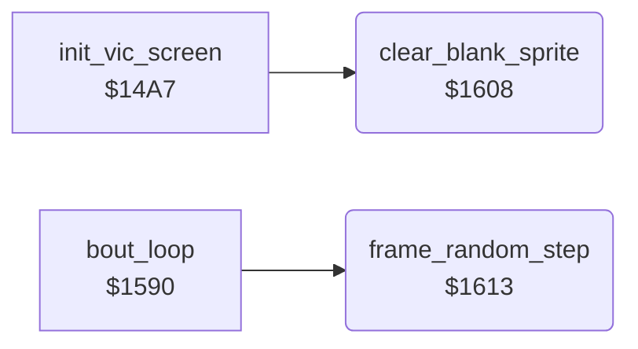

<!-- Generated by c64-docs from knowledge revision 20261025T214834.473-anyvn7 and .c64-re-tools/local/generated/src/source-map.json. Do not edit: change the knowledge, generate the source again, then run docs.ts generate. -->
# game/init_bout_loop_1608.asm

Range `$1608-$161C`. Source: [game/init_bout_loop_1608.asm](../../../../src/game/init_bout_loop_1608.asm). Index: [the reference](../../index.md).

## Routines

| Routine | Address | Reached from | Summary |
|---|---|---|---|
| [`clear_blank_sprite`](init_bout_loop_1608.md#clear_blank_sprite) | `$1608` | [`init_vic_screen`](init_bout_loop.md#init_vic_screen) | Clears the sprite at $c000 (pointer 0), the blank sprite of empty shape parts. |
| [`frame_random_step`](init_bout_loop_1608.md#frame_random_step) | `$1613` | [`bout_loop`](init_bout_loop.md#bout_loop) | Steps frame_random once (shift left, EOR #$1d on carry). |

## Call graph

A solid arrow is a call, a thick arrow a table entry. Rounded nodes are in this file.

## Details

### [`clear_blank_sprite`](../../../../src/game/init_bout_loop_1608.asm#L6) `$1608`

*routine*

Clears the sprite at $c000 (pointer 0), the blank sprite of empty shape parts. Called by init_vic_screen.

- **Called from:** [`init_vic_screen`](init_bout_loop.md#init_vic_screen)
- **Writes:** [`sprite_blank`](../../memory-map.md#sprite_blank)

| Label | Address | Comment |
|---|---|---|
| [`clear_blank_sprite_loop`](../../../../src/game/init_bout_loop_1608.asm#L9) | `$160C` |  |

### [`frame_random_step`](../../../../src/game/init_bout_loop_1608.asm#L15) `$1613`

*routine*

Steps frame_random once (shift left, EOR #$1d on carry). Called each frame by bout_loop.

- **Called from:** [`bout_loop`](init_bout_loop.md#bout_loop)
- **Reads:** [`frame_random`](../../memory-map.md#frame_random)
- **Writes:** [`frame_random`](../../memory-map.md#frame_random)

| Label | Address | Comment |
|---|---|---|
| [`frame_random_store`](../../../../src/game/init_bout_loop_1608.asm#L20) | `$161A` |  |
