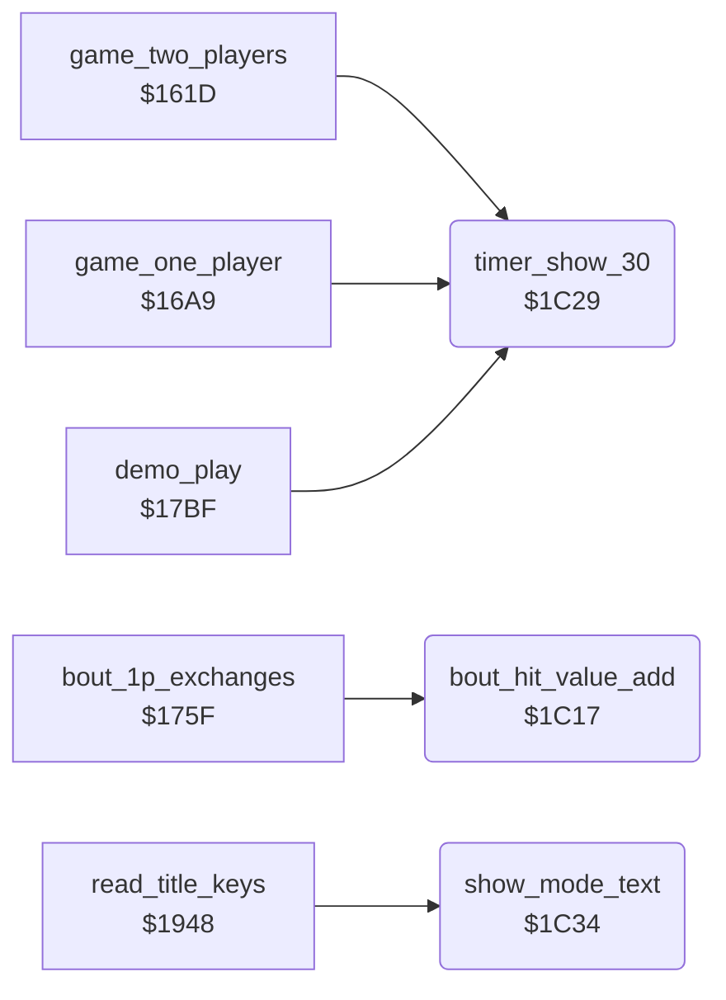

<!-- Generated by c64-docs from knowledge revision 20261022T132731.733-fztd87 and .c64-re-tools/local/generated/src/source-map.json. Do not edit: change the knowledge, generate the source again, then run docs.ts generate. -->
# game/panel_texts.asm: Tie-break value, panel texts, waits, time bonus and rank texts

Range `$1C17-$1C52`. Source: [game/panel_texts.asm](../../../../src/game/panel_texts.asm). Index: [the reference](../../index.md).

## Call graph

A solid arrow is a call, a thick arrow a table entry, a dotted arrow a jump. Rounded nodes are in this file.

## Names

### [`bout_hit_value_add`](../../../../src/game/panel_texts.asm#L6) `$1C17`

*routine*

Adds the score value of scoring_move (half for a half point) to bout_hit_value of fighter X, the tie-break at time up. Called by bout_1p_exchanges.

- **Called from:** [`bout_1p_exchanges`](game_modes.md#bout_1p_exchanges) [`$1772`](../../../../src/game/game_modes.asm#L176), [`bout_1p_exchanges`](game_modes.md#bout_1p_exchanges) [`$1784`](../../../../src/game/game_modes.asm#L184)
- **Reads:** [`scoring_move`](../../memory-map.md#scoring_move), [`move_score_values`](entry_and_tables_1287.md#move_score_values), [`hit_points`](../../memory-map.md#hit_points), [`bout_hit_value`](../../memory-map.md#bout_hit_value)
- **Writes:** [`bout_hit_value`](../../memory-map.md#bout_hit_value)

### [`bout_hit_value_sum`](../../../../src/game/panel_texts.asm#L13) `$1C23`

*label*

- **Jumped to from:** [`bout_hit_value_add`](panel_texts.md#bout_hit_value_add) [`$1C20`](../../../../src/game/panel_texts.asm#L11)

### [`timer_show_30`](../../../../src/game/panel_texts.asm#L19) `$1C29`

*routine*

Writes 30 into the clock digits at $cc3b. Called before each bout.

- **Called from:** [`game_two_players`](game_modes.md#game_two_players) [`$1650`](../../../../src/game/game_modes.asm#L31), [`game_one_player`](game_modes.md#game_one_player) [`$1702`](../../../../src/game/game_modes.asm#L121), [`demo_play`](game_modes.md#demo_play) [`$1803`](../../../../src/game/game_modes.asm#L253)
- **Writes:** [`panel_timer_digits`](../../memory-map.md#panel_timer_digits), [`panel_timer_digits+1`](../../memory-map.md#panel_timer_digits)

### [`show_mode_text`](../../../../src/game/panel_texts.asm#L26) `$1C34`

*routine*

Writes 1 PLAYER or 2 PLAYER at $ccbf for two_player_mode. Called by the title loop and the F3 key.

- **Called from:** [`read_title_keys`](title_and_scene.md#read_title_keys) [`$1998`](../../../../src/game/title_and_scene.asm#L52), [`read_title_keys`](title_and_scene.md#read_title_keys) [`$19AE`](../../../../src/game/title_and_scene.asm#L69)
- **Reads:** [`two_player_mode`](../../memory-map.md#two_player_mode), [`text_1_player`](entry_and_tables_1287.md#text_1_player), [`text_2_player`](entry_and_tables_1287.md#text_2_player)
- **Writes:** [`panel_mode_text`](../../memory-map.md#panel_mode_text), [`panel_row4`](../../memory-map.md#panel_row4), [`panel_row4+1`](../../memory-map.md#panel_row4), [`panel_row4+2`](../../memory-map.md#panel_row4), [`panel_row4+3`](../../memory-map.md#panel_row4)

### [`mode_text_test_2p`](../../../../src/game/panel_texts.asm#L30) `$1C3A`

*label*

### [`mode_text_bad_mode`](../../../../src/game/panel_texts.asm#L33) `$1C3E`

*label*

### [`mode_text_1p_loop`](../../../../src/game/panel_texts.asm#L36) `$1C3F`

*label*

- **Jumped to from:** [`show_mode_text`](panel_texts.md#show_mode_text) [`$1C38`](../../../../src/game/panel_texts.asm#L29), [`show_mode_text`](panel_texts.md#show_mode_text) [`$1C46`](../../../../src/game/panel_texts.asm#L40)

### [`mode_text_2p_loop`](../../../../src/game/panel_texts.asm#L42) `$1C49`

*label*

- **Jumped to from:** [`show_mode_text`](panel_texts.md#show_mode_text) [`$1C3C`](../../../../src/game/panel_texts.asm#L32), [`show_mode_text`](panel_texts.md#show_mode_text) [`$1C50`](../../../../src/game/panel_texts.asm#L46)

### [`mode_text_done`](../../../../src/game/panel_texts.asm#L47) `$1C52`

*label*
