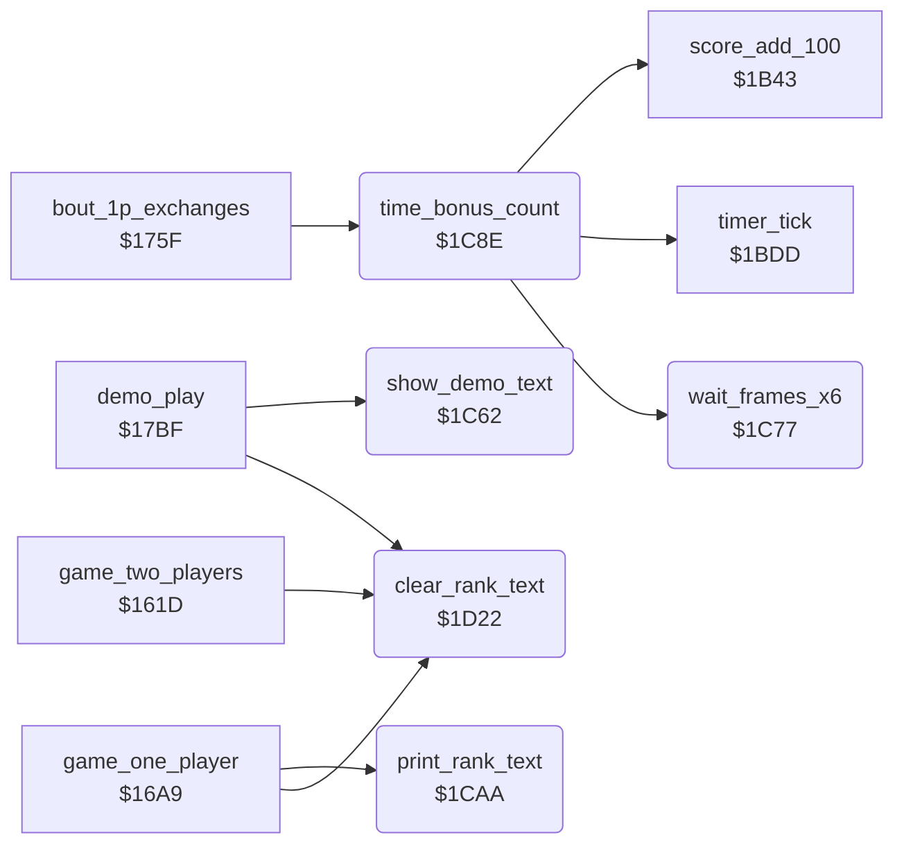

<!-- Generated by c64-docs from knowledge revision 20261025T191824.210-p015r5 and .c64-re-tools/local/generated/src/source-map.json. Do not edit: change the knowledge, generate the source again, then run docs.ts generate. -->
# game/panel_texts_1c62.asm

Range `$1C62-$1D47`. Source: [game/panel_texts_1c62.asm](../../../../src/game/panel_texts_1c62.asm). Index: [the reference](../../index.md).

## Routines

| Routine | Address | Reached from | Summary |
|---|---|---|---|
| [`show_demo_text`](panel_texts_1c62.md#show_demo_text) | `$1C62` | [`demo_play`](game_modes.md#demo_play) | Writes DEMO at $cca0, the place of the rank text. |
| [`wait_frames_x6`](panel_texts_1c62.md#wait_frames_x6) | `$1C77` | [`time_bonus_count`](panel_texts_1c62.md#time_bonus_count) | Waits X times 6 frames: it counts passes of raster line $fe. |
| [`time_bonus_count`](panel_texts_1c62.md#time_bonus_count) | `$1C8E` | [`bout_1p_exchanges`](game_modes.md#bout_1p_exchanges) | After a one-player win: counts the clock down second by second and adds 100 points per second, with a 6-frame pause. |
| [`print_rank_text`](panel_texts_1c62.md#print_rank_text) | `$1CAA` | [`game_one_player`](game_modes.md#game_one_player) | Writes the rank X at text_dest_ptr: 0 NOVICE, 1-9 the digit with ST, ND, RD or TH and DAN, 10 the text 10TH DAN. |
| [`clear_rank_text`](panel_texts_1c62.md#clear_rank_text) | `$1D22` | [`game_two_players`](game_modes.md#game_two_players), [`game_one_player`](game_modes.md#game_one_player), [`demo_play`](game_modes.md#demo_play) | Fills the 8 cells of the rank text at $cca0 with spaces. |

## Data

| Range | Type | Name | Read by | Written by |
|---|---|---|---|---|
| [`$1D2D`](../../../../src/game/panel_texts_1c62.asm#L140)-`$1D33` | petscii | [`rank_text_novice`](../../../../src/game/panel_texts_1c62.asm#L139) | [`print_rank_text`](panel_texts_1c62.md#print_rank_text) |  |
| [`$1D34`](../../../../src/game/panel_texts_1c62.asm#L142)-`$1D3B` | petscii | [`rank_text_10th_dan`](../../../../src/game/panel_texts_1c62.asm#L141) | [`print_rank_text`](panel_texts_1c62.md#print_rank_text) |  |
| [`$1D3C`](../../../../src/game/panel_texts_1c62.asm#L145)-`$1D47` | bytes | [`rank_number_table`](../../../../src/game/panel_texts_1c62.asm#L144) | [`game_one_player`](game_modes.md#game_one_player) |  |

## Call graph

A solid arrow is a call, a thick arrow a table entry. Rounded nodes are in this file.

## Details

### [`show_demo_text`](../../../../src/game/panel_texts_1c62.asm#L6) `$1C62`

*routine*

Writes DEMO at $cca0, the place of the rank text. Called by demo_play.

- **Called from:** [`demo_play`](game_modes.md#demo_play)
- **Writes:** [`panel_row4`](../../memory-map.md#panel_row4)

### [`wait_frames_x6`](../../../../src/game/panel_texts_1c62.asm#L17) `$1C77`

*routine*

Waits X times 6 frames: it counts passes of raster line $fe. Called by time_bonus_count.

- **Called from:** [`time_bonus_count`](panel_texts_1c62.md#time_bonus_count)
- **Reads:** [`RASTER`](../../memory-map.md#RASTER)

| Label | Address | Comment |
|---|---|---|
| [`wait_line_reach`](../../../../src/game/panel_texts_1c62.asm#L19) | `$1C79` |  |
| [`wait_line_leave`](../../../../src/game/panel_texts_1c62.asm#L23) | `$1C80` |  |

### [`time_bonus_count`](../../../../src/game/panel_texts_1c62.asm#L33) `$1C8E`

*routine*

After a one-player win: counts the clock down second by second and adds 100 points per second, with a 6-frame pause. Called by bout_1p_exchanges.

- **Called from:** [`bout_1p_exchanges`](game_modes.md#bout_1p_exchanges)
- **Calls:** [`timer_tick`](score_and_timer.md#timer_tick), [`score_add_100`](score_and_timer.md#score_add_100), [`wait_frames_x6`](panel_texts_1c62.md#wait_frames_x6)
- **Reads:** [`time_up`](../../memory-map.md#time_up), [`timer_frames`](../../memory-map.md#timer_frames)

| Label | Address | Comment |
|---|---|---|
| [`time_bonus_loop`](../../../../src/game/panel_texts_1c62.asm#L36) | `$1C92` | Runs the clock without a frame wait up to the next whole second. |
| [`time_bonus_exit`](../../../../src/game/panel_texts_1c62.asm#L47) | `$1CA9` |  |

### [`print_rank_text`](../../../../src/game/panel_texts_1c62.asm#L50) `$1CAA`

*routine*

Writes the rank X at text_dest_ptr: 0 NOVICE, 1-9 the digit with ST, ND, RD or TH and DAN, 10 the text 10TH DAN. Called by game_one_player.

- **Called from:** [`game_one_player`](game_modes.md#game_one_player)
- **Reads:** [`rank_text_novice`](panel_texts_1c62.md#rank_text_novice), [`text_dest_ptr`](../../memory-map.md#text_dest_ptr), [`rank_text_10th_dan`](panel_texts_1c62.md#rank_text_10th_dan)

| Label | Address | Comment |
|---|---|---|
| [`rank_novice_loop`](../../../../src/game/panel_texts_1c62.asm#L54) | `$1CB0` |  |
| [`rank_number_text`](../../../../src/game/panel_texts_1c62.asm#L60) | `$1CB9` |  |
| [`rank_suffix_st`](../../../../src/game/panel_texts_1c62.asm#L70) | `$1CC9` |  |
| [`rank_test_2nd`](../../../../src/game/panel_texts_1c62.asm#L78) | `$1CD6` |  |
| [`rank_suffix_nd`](../../../../src/game/panel_texts_1c62.asm#L81) | `$1CDA` |  |
| [`rank_test_3rd`](../../../../src/game/panel_texts_1c62.asm#L89) | `$1CE7` |  |
| [`rank_suffix_rd`](../../../../src/game/panel_texts_1c62.asm#L92) | `$1CEB` |  |
| [`rank_suffix_th`](../../../../src/game/panel_texts_1c62.asm#L100) | `$1CF8` |  |
| [`rank_suffix_dan`](../../../../src/game/panel_texts_1c62.asm#L107) | `$1D02` |  |
| [`rank_10th_dan`](../../../../src/game/panel_texts_1c62.asm#L121) | `$1D17` |  |
| [`rank_10th_dan_loop`](../../../../src/game/panel_texts_1c62.asm#L123) | `$1D19` |  |

### [`clear_rank_text`](../../../../src/game/panel_texts_1c62.asm#L130) `$1D22`

*routine*

Fills the 8 cells of the rank text at $cca0 with spaces. Called at the start of each mode.

- **Called from:** [`game_two_players`](game_modes.md#game_two_players), [`game_one_player`](game_modes.md#game_one_player), [`demo_play`](game_modes.md#demo_play)
- **Writes:** [`panel_row4`](../../memory-map.md#panel_row4)

| Label | Address | Comment |
|---|---|---|
| [`clear_rank_text_loop`](../../../../src/game/panel_texts_1c62.asm#L133) | `$1D26` |  |

### [`rank_text_novice`](../../../../src/game/panel_texts_1c62.asm#L139) `$1D2D-$1D33`

*data*

Rank texts in the ASCII order of the panel characters. NOVICE has 7 characters, with a space.

- **Read by:** [`print_rank_text`](panel_texts_1c62.md#print_rank_text)

### [`rank_text_10th_dan`](../../../../src/game/panel_texts_1c62.asm#L141) `$1D34-$1D3B`

*data*

- **Read by:** [`print_rank_text`](panel_texts_1c62.md#print_rank_text)

### [`rank_number_table`](../../../../src/game/panel_texts_1c62.asm#L144) `$1D3C-$1D47`

*data*

Rank number of each rank index: 0, 1-10, 10. Only 12 entries; the rank index goes up to 22, so ranks 12-22 read the code of ai_update.

- **Read by:** [`game_one_player`](game_modes.md#game_one_player)
