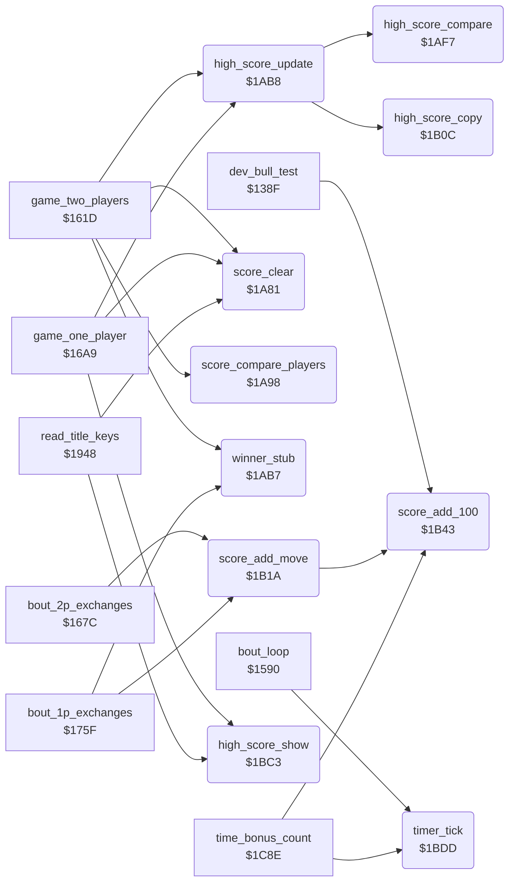

<!-- Generated by c64-docs from knowledge revision 20261022T132731.733-fztd87 and .c64-re-tools/local/generated/src/source-map.json. Do not edit: change the knowledge, generate the source again, then run docs.ts generate. -->
# game/score_and_timer.asm: Score digits, score compare, high scores and the bout timer

Range `$1A81-$1C16`. Source: [game/score_and_timer.asm](../../../../src/game/score_and_timer.asm). Index: [the reference](../../index.md).

## Call graph

A solid arrow is a call, a thick arrow a table entry, a dotted arrow a jump. Rounded nodes are in this file.

## Names

### [`score_clear`](../../../../src/game/score_and_timer.asm#L6) `$1A81`

*routine*

Sets the score of the player at $cc28+X to five spaces and a 0. X = 9 for player 1, $19 for player 2.

- **Called from:** [`game_two_players`](game_modes.md#game_two_players) [`$1638`](../../../../src/game/game_modes.asm#L19), [`game_two_players`](game_modes.md#game_two_players) [`$163D`](../../../../src/game/game_modes.asm#L21), [`game_one_player`](game_modes.md#game_one_player) [`$16C0`](../../../../src/game/game_modes.asm#L93), [`game_one_player`](game_modes.md#game_one_player) [`$16C5`](../../../../src/game/game_modes.asm#L95), [`read_title_keys`](title_and_scene.md#read_title_keys) [`$19B7`](../../../../src/game/title_and_scene.asm#L73), [`read_title_keys`](title_and_scene.md#read_title_keys) [`$19BC`](../../../../src/game/title_and_scene.asm#L75)
- **Writes:** [`panel_row1`](../../memory-map.md#panel_row1), [`panel_row1+1`](../../memory-map.md#panel_row1), [`panel_row1+2`](../../memory-map.md#panel_row1), [`panel_row1+3`](../../memory-map.md#panel_row1), [`panel_row1+4`](../../memory-map.md#panel_row1), [`panel_row1+5`](../../memory-map.md#panel_row1)

### [`score_compare_players`](../../../../src/game/score_and_timer.asm#L17) `$1A98`

*routine*

Compares the six score digits of both players. Returns X = 0 when player 1 is higher, 1 when player 2 is higher, $80 when equal. Called by game_two_players.

- **Called from:** [`game_two_players`](game_modes.md#game_two_players) [`$1663`](../../../../src/game/game_modes.asm#L39)
- **Reads:** [`panel_row1`](../../memory-map.md#panel_row1)

### [`score_compare_loop`](../../../../src/game/score_and_timer.asm#L20) `$1A9C`

*label*

- **Jumped to from:** [`score_compare_players`](score_and_timer.md#score_compare_players) [`$1AAC`](../../../../src/game/score_and_timer.asm#L31)

### [`score_compare_differ`](../../../../src/game/score_and_timer.asm#L24) `$1AA4`

*label*

### [`score_compare_next`](../../../../src/game/score_and_timer.asm#L27) `$1AA8`

*label*

- **Jumped to from:** [`score_compare_players`](score_and_timer.md#score_compare_players) [`$1AA2`](../../../../src/game/score_and_timer.asm#L23)

### [`score_compare_equal`](../../../../src/game/score_and_timer.asm#L32) `$1AAE`

*label*

### [`score_p1_higher`](../../../../src/game/score_and_timer.asm#L36) `$1AB1`

*label*

- **Jumped to from:** [`score_compare_players`](score_and_timer.md#score_compare_players) [`$1AA4`](../../../../src/game/score_and_timer.asm#L25)

### [`score_p2_higher`](../../../../src/game/score_and_timer.asm#L39) `$1AB4`

*label*

- **Jumped to from:** [`score_compare_players`](score_and_timer.md#score_compare_players) [`$1AA6`](../../../../src/game/score_and_timer.asm#L26)

### [`winner_stub`](../../../../src/game/score_and_timer.asm#L43) `$1AB7`

*routine*

Lone RTS. Called with the winner in X after a decision by time or by score. It is the place of a removed winner action.

- **Called from:** [`game_two_players`](game_modes.md#game_two_players) [`$1670`](../../../../src/game/game_modes.asm#L47), [`bout_1p_exchanges`](game_modes.md#bout_1p_exchanges) [`$17A5`](../../../../src/game/game_modes.asm#L202), [`bout_1p_exchanges`](game_modes.md#bout_1p_exchanges) [`$17B3`](../../../../src/game/game_modes.asm#L211)

### [`high_score_update`](../../../../src/game/score_and_timer.asm#L46) `$1AB8`

*routine*

Copies the score of the player in X to the high score of the mode when it is higher. Called at the end of a game.

- **Called from:** [`game_two_players`](game_modes.md#game_two_players) [`$1676`](../../../../src/game/game_modes.asm#L50), [`game_one_player`](game_modes.md#game_one_player) [`$1740`](../../../../src/game/game_modes.asm#L148)
- **Calls:** [`high_score_compare`](score_and_timer.md#high_score_compare), [`high_score_copy`](score_and_timer.md#high_score_copy)
- **Reads:** [`two_player_mode`](../../memory-map.md#two_player_mode)
- **Writes:** [`text_dest_ptr`](../../memory-map.md#text_dest_ptr), [`text_dest_ptr+1`](../../memory-map.md#text_dest_ptr)
- **Refers to:** [`high_score_1p`](entry_and_tables_1287.md#high_score_1p), [`text_dest_ptr`](../../memory-map.md#text_dest_ptr), [`high_score_2p`](entry_and_tables_1287.md#high_score_2p)

### [`high_score_set_1p`](../../../../src/game/score_and_timer.asm#L53) `$1ACB`

*label*

### [`high_score_exit`](../../../../src/game/score_and_timer.asm#L56) `$1AD0`

*label*

- **Jumped to from:** [`high_score_update`](score_and_timer.md#high_score_update) [`$1AC9`](../../../../src/game/score_and_timer.asm#L52), [`high_score_update`](score_and_timer.md#high_score_update) [`$1AE2`](../../../../src/game/score_and_timer.asm#L66), [`high_score_update`](score_and_timer.md#high_score_update) [`$1AEF`](../../../../src/game/score_and_timer.asm#L74)

### [`high_score_2p_mode`](../../../../src/game/score_and_timer.asm#L58) `$1AD1`

*label*

- **Jumped to from:** [`high_score_update`](score_and_timer.md#high_score_update) [`$1ABA`](../../../../src/game/score_and_timer.asm#L48)

### [`high_score_2p_p1`](../../../../src/game/score_and_timer.asm#L62) `$1ADD`

*label*

### [`high_score_set_2p_p1`](../../../../src/game/score_and_timer.asm#L67) `$1AE4`

*label*

### [`high_score_2p_p2`](../../../../src/game/score_and_timer.asm#L71) `$1AEA`

*label*

- **Jumped to from:** [`high_score_update`](score_and_timer.md#high_score_update) [`$1ADB`](../../../../src/game/score_and_timer.asm#L61)

### [`high_score_set_2p_p2`](../../../../src/game/score_and_timer.asm#L75) `$1AF1`

*label*

### [`high_score_compare`](../../../../src/game/score_and_timer.asm#L80) `$1AF7`

*routine*

Compares the high score at text_dest_ptr with the score at $cc28+X. Returns C clear when the score is higher. Called by high_score_update.

- **Called from:** [`high_score_update`](score_and_timer.md#high_score_update) [`$1AC6`](../../../../src/game/score_and_timer.asm#L51), [`high_score_update`](score_and_timer.md#high_score_update) [`$1ADF`](../../../../src/game/score_and_timer.asm#L65), [`high_score_update`](score_and_timer.md#high_score_update) [`$1AEC`](../../../../src/game/score_and_timer.asm#L73)
- **Reads:** [`text_dest_ptr`](../../memory-map.md#text_dest_ptr), [`panel_row1`](../../memory-map.md#panel_row1)

### [`high_score_cmp_loop`](../../../../src/game/score_and_timer.asm#L82) `$1AF9`

*label*

- **Jumped to from:** [`high_score_compare`](score_and_timer.md#high_score_compare) [`$1B08`](../../../../src/game/score_and_timer.asm#L94)

### [`high_score_cmp_differ`](../../../../src/game/score_and_timer.asm#L86) `$1B00`

*label*

### [`high_score_cmp_next`](../../../../src/game/score_and_timer.asm#L90) `$1B04`

*label*

- **Jumped to from:** [`high_score_compare`](score_and_timer.md#high_score_compare) [`$1B00`](../../../../src/game/score_and_timer.asm#L87)

### [`high_score_cmp_equal`](../../../../src/game/score_and_timer.asm#L95) `$1B0A`

*label*

### [`high_score_cmp_exit`](../../../../src/game/score_and_timer.asm#L98) `$1B0B`

*label*

- **Jumped to from:** [`high_score_compare`](score_and_timer.md#high_score_compare) [`$1AFE`](../../../../src/game/score_and_timer.asm#L85)

### [`high_score_copy`](../../../../src/game/score_and_timer.asm#L101) `$1B0C`

*routine*

Copies the six score digits at $cc28+X to the high score at text_dest_ptr. Called by high_score_update.

- **Called from:** [`high_score_update`](score_and_timer.md#high_score_update) [`$1ACD`](../../../../src/game/score_and_timer.asm#L55), [`high_score_update`](score_and_timer.md#high_score_update) [`$1AE6`](../../../../src/game/score_and_timer.asm#L69), [`high_score_update`](score_and_timer.md#high_score_update) [`$1AF3`](../../../../src/game/score_and_timer.asm#L77)
- **Reads:** [`panel_row1`](../../memory-map.md#panel_row1), [`text_dest_ptr`](../../memory-map.md#text_dest_ptr)

### [`high_score_copy_loop`](../../../../src/game/score_and_timer.asm#L103) `$1B0E`

*label*

- **Jumped to from:** [`high_score_copy`](score_and_timer.md#high_score_copy) [`$1B17`](../../../../src/game/score_and_timer.asm#L109)

### [`score_add_move`](../../../../src/game/score_and_timer.asm#L112) `$1B1A`

*routine*

Adds move_score_values of scoring_move times 100 to the player at $cc28+X, half of it for a half point. X = 9 or $19.

- **Called from:** [`bout_2p_exchanges`](game_modes.md#bout_2p_exchanges) [`$168F`](../../../../src/game/game_modes.asm#L66), [`bout_2p_exchanges`](game_modes.md#bout_2p_exchanges) [`$1697`](../../../../src/game/game_modes.asm#L70), [`bout_1p_exchanges`](game_modes.md#bout_1p_exchanges) [`$177F`](../../../../src/game/game_modes.asm#L182)
- **Calls:** [`score_add_100`](score_and_timer.md#score_add_100)
- **Reads:** [`scoring_move`](../../memory-map.md#scoring_move), [`move_score_values`](entry_and_tables_1287.md#move_score_values), [`hit_points`](../../memory-map.md#hit_points), [`hit_points+1`](../../memory-map.md#hit_points), [`panel_row1+4`](../../memory-map.md#panel_row1)
- **Writes:** [`panel_row1+4`](../../memory-map.md#panel_row1)
- **Refers to:** [`hit_points`](../../memory-map.md#hit_points)

### [`score_hits_p1`](../../../../src/game/score_and_timer.asm#L117) `$1B23`

*label*

### [`score_hits_p2`](../../../../src/game/score_and_timer.asm#L120) `$1B28`

*label*

- **Jumped to from:** [`score_add_move`](score_and_timer.md#score_add_move) [`$1B21`](../../../../src/game/score_and_timer.asm#L116)

### [`score_test_full`](../../../../src/game/score_and_timer.asm#L122) `$1B2A`

*label*

- **Jumped to from:** [`score_add_move`](score_and_timer.md#score_add_move) [`$1B25`](../../../../src/game/score_and_timer.asm#L119)

### [`score_halve`](../../../../src/game/score_and_timer.asm#L125) `$1B2E`

*label*

A half point gives half the value.

### [`score_add_value`](../../../../src/game/score_and_timer.asm#L127) `$1B2F`

*label*

- **Jumped to from:** [`score_add_move`](score_and_timer.md#score_add_move) [`$1B2C`](../../../../src/game/score_and_timer.asm#L124)

### [`score_set_tens`](../../../../src/game/score_and_timer.asm#L132) `$1B37`

*label*

The first points change the tens digit from space to 0.

### [`score_add_loop`](../../../../src/game/score_and_timer.asm#L135) `$1B3C`

*label*

- **Jumped to from:** [`score_add_move`](score_and_timer.md#score_add_move) [`$1B35`](../../../../src/game/score_and_timer.asm#L131), [`score_add_move`](score_and_timer.md#score_add_move) [`$1B40`](../../../../src/game/score_and_timer.asm#L138)

### [`score_add_done`](../../../../src/game/score_and_timer.asm#L139) `$1B42`

*label*

### [`score_add_100`](../../../../src/game/score_and_timer.asm#L142) `$1B43`

*routine*

Adds 100 points to the score at $cc28+X: increments the hundreds digit with carry. A space digit becomes 1. Called by score_add_move, time_bonus_count and the bull test.

- **Called from:** [`dev_bull_test`](../dev/dev_bull_test_138f.md#dev_bull_test) [`$13FE`](../../../../src/dev/dev_bull_test_138f.asm#L70), [`score_add_move`](score_and_timer.md#score_add_move) [`$1B3C`](../../../../src/game/score_and_timer.asm#L136), [`time_bonus_count`](panel_texts_1c62.md#time_bonus_count) [`$1C9D`](../../../../src/game/panel_texts_1c62.asm#L42)
- **Reads:** [`panel_row1+3`](../../memory-map.md#panel_row1), [`panel_row1+2`](../../memory-map.md#panel_row1), [`panel_row1+1`](../../memory-map.md#panel_row1), [`panel_row1`](../../memory-map.md#panel_row1)
- **Writes:** [`panel_row1+3`](../../memory-map.md#panel_row1), [`panel_row1+2`](../../memory-map.md#panel_row1), [`panel_row1+1`](../../memory-map.md#panel_row1), [`panel_row1`](../../memory-map.md#panel_row1), [`panel_row1+4`](../../memory-map.md#panel_row1), [`panel_row1+5`](../../memory-map.md#panel_row1)

### [`score_new_100s`](../../../../src/game/score_and_timer.asm#L146) `$1B4A`

*label*

### [`score_inc_100s`](../../../../src/game/score_and_timer.asm#L150) `$1B50`

*label*

- **Jumped to from:** [`score_add_100`](score_and_timer.md#score_add_100) [`$1B48`](../../../../src/game/score_and_timer.asm#L145)

### [`score_carry_1000s`](../../../../src/game/score_and_timer.asm#L155) `$1B5A`

*label*

### [`score_new_1000s`](../../../../src/game/score_and_timer.asm#L161) `$1B66`

*label*

### [`score_inc_1000s`](../../../../src/game/score_and_timer.asm#L165) `$1B6C`

*label*

- **Jumped to from:** [`score_add_100`](score_and_timer.md#score_add_100) [`$1B64`](../../../../src/game/score_and_timer.asm#L160)

### [`score_carry_10000s`](../../../../src/game/score_and_timer.asm#L170) `$1B76`

*label*

### [`score_new_10000s`](../../../../src/game/score_and_timer.asm#L176) `$1B82`

*label*

### [`score_inc_10000s`](../../../../src/game/score_and_timer.asm#L180) `$1B88`

*label*

- **Jumped to from:** [`score_add_100`](score_and_timer.md#score_add_100) [`$1B80`](../../../../src/game/score_and_timer.asm#L175)

### [`score_carry_100000s`](../../../../src/game/score_and_timer.asm#L185) `$1B92`

*label*

### [`score_new_100000s`](../../../../src/game/score_and_timer.asm#L191) `$1B9E`

*label*

### [`score_inc_100000s`](../../../../src/game/score_and_timer.asm#L195) `$1BA4`

*label*

- **Jumped to from:** [`score_add_100`](score_and_timer.md#score_add_100) [`$1B9C`](../../../../src/game/score_and_timer.asm#L190)

### [`score_overflow`](../../../../src/game/score_and_timer.asm#L201) `$1BAE`

*label*

Above 999900 the score becomes 000000.

### [`score_add_exit`](../../../../src/game/score_and_timer.asm#L209) `$1BC2`

*label*

- **Jumped to from:** [`score_add_100`](score_and_timer.md#score_add_100) [`$1B58`](../../../../src/game/score_and_timer.asm#L154), [`score_add_100`](score_and_timer.md#score_add_100) [`$1B74`](../../../../src/game/score_and_timer.asm#L169), [`score_add_100`](score_and_timer.md#score_add_100) [`$1B90`](../../../../src/game/score_and_timer.asm#L184), [`score_add_100`](score_and_timer.md#score_add_100) [`$1BAC`](../../../../src/game/score_and_timer.asm#L200)

### [`high_score_show`](../../../../src/game/score_and_timer.asm#L212) `$1BC3`

*routine*

Shows the high score of the current mode at $ccb1. Called by the title loop, the F3 key and the end of the one-player game.

- **Called from:** [`game_one_player`](game_modes.md#game_one_player) [`$1743`](../../../../src/game/game_modes.asm#L149), [`read_title_keys`](title_and_scene.md#read_title_keys) [`$199B`](../../../../src/game/title_and_scene.asm#L53), [`read_title_keys`](title_and_scene.md#read_title_keys) [`$19AB`](../../../../src/game/title_and_scene.asm#L68)
- **Reads:** [`two_player_mode`](../../memory-map.md#two_player_mode), [`high_score_2p`](entry_and_tables_1287.md#high_score_2p), [`high_score_1p`](entry_and_tables_1287.md#high_score_1p)
- **Writes:** [`panel_hiscore_digits`](../../memory-map.md#panel_hiscore_digits)

### [`high_score_show_2p`](../../../../src/game/score_and_timer.asm#L216) `$1BC9`

*label*

- **Jumped to from:** [`high_score_show`](score_and_timer.md#high_score_show) [`$1BD0`](../../../../src/game/score_and_timer.asm#L220)

### [`high_score_show_done`](../../../../src/game/score_and_timer.asm#L221) `$1BD2`

*label*

### [`high_score_show_1p`](../../../../src/game/score_and_timer.asm#L223) `$1BD3`

*label*

- **Jumped to from:** [`high_score_show`](score_and_timer.md#high_score_show) [`$1BC7`](../../../../src/game/score_and_timer.asm#L215), [`high_score_show`](score_and_timer.md#high_score_show) [`$1BDA`](../../../../src/game/score_and_timer.asm#L227)

### [`timer_tick`](../../../../src/game/score_and_timer.asm#L230) `$1BDD`

*routine*

Counts one frame of the bout clock. Each 50 frames it decrements the digits at $cc3b and timer_seconds; at 0 it sets time_up. Called by bout_loop and time_bonus_count.

- **Called from:** [`bout_loop`](init_bout_loop.md#bout_loop) [`$15DB`](../../../../src/game/init_bout_loop.asm#L219), [`time_bonus_count`](panel_texts_1c62.md#time_bonus_count) [`$1C92`](../../../../src/game/panel_texts_1c62.asm#L37)
- **Reads:** [`timer_frames`](../../memory-map.md#timer_frames), [`panel_timer_digits+1`](../../memory-map.md#panel_timer_digits), [`panel_timer_digits`](../../memory-map.md#panel_timer_digits), [`timer_seconds`](../../memory-map.md#timer_seconds)
- **Writes:** [`timer_frames`](../../memory-map.md#timer_frames), [`panel_timer_digits`](../../memory-map.md#panel_timer_digits), [`panel_timer_digits+1`](../../memory-map.md#panel_timer_digits), [`timer_seconds`](../../memory-map.md#timer_seconds), [`time_up`](../../memory-map.md#time_up)

### [`timer_next_second`](../../../../src/game/score_and_timer.asm#L233) `$1BE1`

*label*

### [`timer_units_zero`](../../../../src/game/score_and_timer.asm#L239) `$1BEC`

*label*

### [`timer_dec_tens`](../../../../src/game/score_and_timer.asm#L243) `$1BF3`

*label*

### [`timer_tens_blank`](../../../../src/game/score_and_timer.asm#L248) `$1BFE`

*label*

From 10 to 9: the tens digit becomes a space.

- **Jumped to from:** [`timer_tick`](score_and_timer.md#timer_tick) [`$1BF1`](../../../../src/game/score_and_timer.asm#L242)

### [`timer_dec_units`](../../../../src/game/score_and_timer.asm#L254) `$1C0B`

*label*

- **Jumped to from:** [`timer_tick`](score_and_timer.md#timer_tick) [`$1BEA`](../../../../src/game/score_and_timer.asm#L238)

### [`timer_dec_seconds`](../../../../src/game/score_and_timer.asm#L256) `$1C0E`

*label*

- **Jumped to from:** [`timer_tick`](score_and_timer.md#timer_tick) [`$1BFB`](../../../../src/game/score_and_timer.asm#L247), [`timer_tick`](score_and_timer.md#timer_tick) [`$1C08`](../../../../src/game/score_and_timer.asm#L253)

### [`timer_set_time_up`](../../../../src/game/score_and_timer.asm#L259) `$1C12`

*label*

### [`timer_exit`](../../../../src/game/score_and_timer.asm#L262) `$1C16`

*label*

- **Jumped to from:** [`timer_tick`](score_and_timer.md#timer_tick) [`$1BDF`](../../../../src/game/score_and_timer.asm#L232), [`timer_tick`](score_and_timer.md#timer_tick) [`$1C10`](../../../../src/game/score_and_timer.asm#L258)
