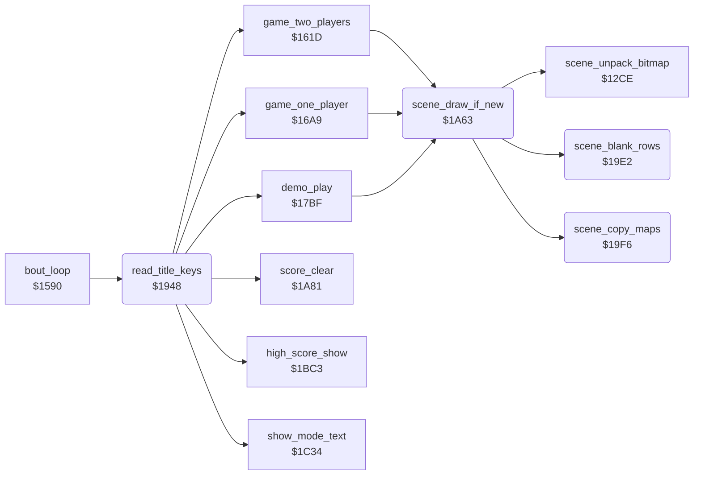

<!-- Generated by c64-docs from knowledge revision 20261025T191824.210-p015r5 and .c64-re-tools/local/generated/src/source-map.json. Do not edit: change the knowledge, generate the source again, then run docs.ts generate. -->
# game/title_and_scene.asm: Function keys, title loop and the scene drawing

Range `$1948-$1A80`. Source: [game/title_and_scene.asm](../../../../src/game/title_and_scene.asm). Index: [the reference](../../index.md).

## Routines

| Routine | Address | Reached from | Summary |
|---|---|---|---|
| [`read_title_keys`](title_and_scene.md#read_title_keys) | `$1948` | [`bout_loop`](init_bout_loop.md#bout_loop) | Reads keyboard column 0 and fire on port 2. |
| [`title_main_loop`](title_and_scene.md#title_main_loop) | `$19A7` | [`bout_loop`](init_bout_loop.md#bout_loop) | Title loop: one player, then the high score, the mode text and the demo again and again. |
| [`scene_blank_rows`](title_and_scene.md#scene_blank_rows) | `$19E2` | [`scene_draw_if_new`](title_and_scene.md#scene_draw_if_new) | Fills screen and colour RAM of rows 5-16 with $33, so the scene area shows one colour while it is drawn. |
| [`scene_copy_maps`](title_and_scene.md#scene_copy_maps) | `$19F6` | [`scene_draw_if_new`](title_and_scene.md#scene_draw_if_new) | Copies the 480-byte colour map and screen map of scene_shown to $d8c8 and $ccc8. |
| [`scene_draw_if_new`](title_and_scene.md#scene_draw_if_new) | `$1A63` | [`game_two_players`](game_modes.md#game_two_players), [`game_one_player`](game_modes.md#game_one_player), [`demo_play`](game_modes.md#demo_play) | Draws scene stage_counter AND 3 when it is not on the screen: blank, unpack, maps. |

## Call graph

A solid arrow is a call, a thick arrow a table entry. Rounded nodes are in this file.

## Details

### [`read_title_keys`](../../../../src/game/title_and_scene.asm#L6) `$1948`

*routine*

Reads keyboard column 0 and fire on port 2. F1 or fire starts a game from the demo, F3 changes 1 or 2 players, F5 goes to the title. Returns A = $80 to start.

- **Called from:** [`bout_loop`](init_bout_loop.md#bout_loop)
- **Calls:** [`show_mode_text`](panel_texts.md#show_mode_text), [`high_score_show`](score_and_timer.md#high_score_show), [`score_clear`](score_and_timer.md#score_clear), [`demo_play`](game_modes.md#demo_play), [`game_one_player`](game_modes.md#game_one_player), [`game_two_players`](game_modes.md#game_two_players)
- **Reads:** [`CIAPRB`](../../memory-map.md#CIAPRB), [`last_key_row`](../../memory-map.md#last_key_row), [`in_game`](../../memory-map.md#in_game), [`CIAPRA`](../../memory-map.md#CIAPRA), [`two_player_mode`](../../memory-map.md#two_player_mode)
- **Writes:** [`CIADDRA`](../../memory-map.md#CIADDRA), [`CIADDRB`](../../memory-map.md#CIADDRB), [`CIAPRA`](../../memory-map.md#CIAPRA), [`last_key_row`](../../memory-map.md#last_key_row), [`two_player_mode`](../../memory-map.md#two_player_mode), [`in_game`](../../memory-map.md#in_game)

| Label | Address | Comment |
|---|---|---|
| [`title_keys_fire`](../../../../src/game/title_and_scene.asm#L25) | `$1970` |  |
| [`title_keys_none`](../../../../src/game/title_and_scene.asm#L33) | `$197E` |  |
| [`title_key_f1`](../../../../src/game/title_and_scene.asm#L36) | `$1981` |  |
| [`title_key_f3`](../../../../src/game/title_and_scene.asm#L41) | `$1988` |  |
| [`title_f3_show`](../../../../src/game/title_and_scene.asm#L50) | `$1998` |  |
| [`title_f3_done`](../../../../src/game/title_and_scene.asm#L53) | `$199E` |  |
| [`title_key_f7`](../../../../src/game/title_and_scene.asm#L56) | `$19A1` | F7 does nothing. |
| [`title_key_f5`](../../../../src/game/title_and_scene.asm#L59) | `$19A4` | F5 works also during a game; the stack is not reset. |
| [`title_demo_loop`](../../../../src/game/title_and_scene.asm#L65) | `$19AB` |  |
| [`title_test_2p`](../../../../src/game/title_and_scene.asm#L78) | `$19C8` |  |
| [`title_bad_mode`](../../../../src/game/title_and_scene.asm#L81) | `$19CC` | No mode 2 or more exists. |
| [`title_start_1p`](../../../../src/game/title_and_scene.asm#L84) | `$19CD` |  |
| [`title_1p_again`](../../../../src/game/title_and_scene.asm#L86) | `$19D0` | Fire held at the end starts a new one-player game. |
| [`title_start_2p`](../../../../src/game/title_and_scene.asm#L91) | `$19DA` |  |

### [`title_main_loop`](../../../../src/game/title_and_scene.asm#L62) `$19A7`

*label*

Title loop: one player, then the high score, the mode text and the demo again and again. A start key or fire starts the game of two_player_mode.

- **Jumped to from:** [`bout_loop`](init_bout_loop.md#bout_loop), [`read_title_keys`](title_and_scene.md#read_title_keys)

### [`scene_blank_rows`](../../../../src/game/title_and_scene.asm#L96) `$19E2`

*routine*

Fills screen and colour RAM of rows 5-16 with $33, so the scene area shows one colour while it is drawn. Called by scene_draw_if_new.

- **Called from:** [`scene_draw_if_new`](title_and_scene.md#scene_draw_if_new)
- **Writes:** [`shadow_facing0_b`](../graphics/shadow_sprites_facing0.md#shadow_facing0_b), [`screen_scene_rows`](../../memory-map.md#screen_scene_rows)

| Label | Address | Comment |
|---|---|---|
| [`scene_blank_loop`](../../../../src/game/title_and_scene.asm#L99) | `$19E6` |  |

### [`scene_copy_maps`](../../../../src/game/title_and_scene.asm#L108) `$19F6`

*routine*

Copies the 480-byte colour map and screen map of scene_shown to $d8c8 and $ccc8. Called by scene_draw_if_new.

- **Called from:** [`scene_draw_if_new`](title_and_scene.md#scene_draw_if_new)
- **Reads:** [`scene_shown`](../../memory-map.md#scene_shown), [`scene_colour_map_ptrs`](entry_and_tables_1287.md#scene_colour_map_ptrs), [`copy_src_ptr`](../../memory-map.md#copy_src_ptr), [`copy_dest_ptr`](../../memory-map.md#copy_dest_ptr), [`scene_screen_map_ptrs`](entry_and_tables_1287.md#scene_screen_map_ptrs)
- **Writes:** [`copy_src_ptr`](../../memory-map.md#copy_src_ptr), [`copy_dest_ptr`](../../memory-map.md#copy_dest_ptr)
- **Refers to:** [`scene_colour_map_ptrs`](entry_and_tables_1287.md#scene_colour_map_ptrs), [`copy_src_ptr`](../../memory-map.md#copy_src_ptr), [`copy_dest_ptr`](../../memory-map.md#copy_dest_ptr), [`scene_screen_map_ptrs`](entry_and_tables_1287.md#scene_screen_map_ptrs)

| Label | Address | Comment |
|---|---|---|
| [`scene_copy_colour_page`](../../../../src/game/title_and_scene.asm#L118) | `$1A0E` |  |
| [`scene_copy_colour_rest`](../../../../src/game/title_and_scene.asm#L129) | `$1A21` |  |
| [`scene_copy_screen_page`](../../../../src/game/title_and_scene.asm#L145) | `$1A44` |  |
| [`scene_copy_screen_rest`](../../../../src/game/title_and_scene.asm#L156) | `$1A57` |  |

### [`scene_draw_if_new`](../../../../src/game/title_and_scene.asm#L165) `$1A63`

*routine*

Draws scene stage_counter AND 3 when it is not on the screen: blank, unpack, maps. Called before each bout.

- **Called from:** [`game_two_players`](game_modes.md#game_two_players), [`game_one_player`](game_modes.md#game_one_player), [`demo_play`](game_modes.md#demo_play)
- **Calls:** [`scene_blank_rows`](title_and_scene.md#scene_blank_rows), [`scene_unpack_bitmap`](../scenes/scene_unpack.md#scene_unpack_bitmap), [`scene_copy_maps`](title_and_scene.md#scene_copy_maps)
- **Reads:** [`stage_counter`](../../memory-map.md#stage_counter), [`scene_shown`](../../memory-map.md#scene_shown)
- **Writes:** [`scene_shown`](../../memory-map.md#scene_shown), [`irq_bitmap_on_bg_colour`](../irq/irq_screen_split.md#irq_bitmap_on_bg_colour)

| Label | Address | Comment |
|---|---|---|
| [`scene_draw_exit`](../../../../src/game/title_and_scene.asm#L178) | `$1A80` |  |
