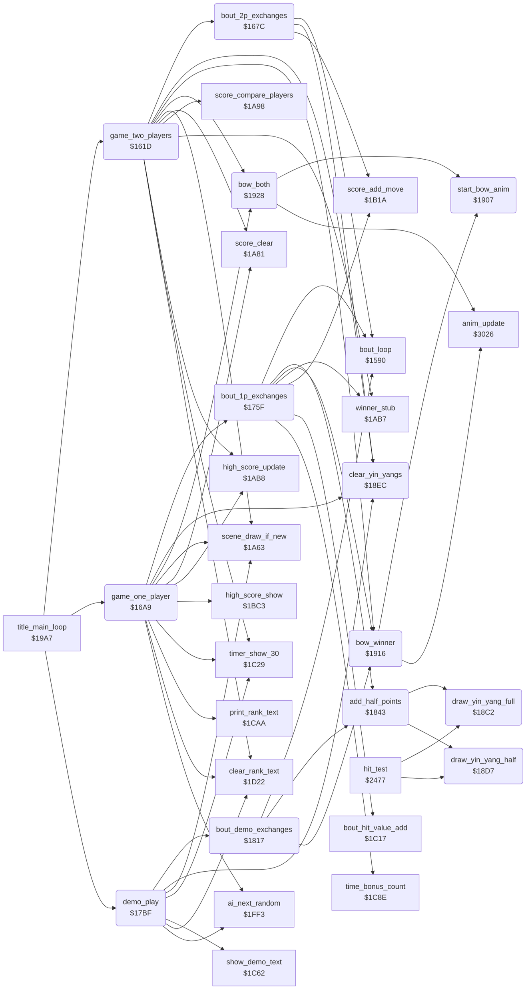

<!-- Generated by c64-docs from knowledge revision 20261021T021734.611-6rf0n2 and src/source-map.json. Do not edit: change the knowledge, generate the source again, then run docs.ts generate. -->
# game_modes.asm: Two-player game, one-player game, demo, half points, yin-yang symbols and bows

Range `$161D-$1947`. Source: [game_modes.asm](../../../src/game_modes.asm). Index: [the reference](../index.md).

## Call graph

A solid arrow is a call, a thick arrow a table entry, a dotted arrow a jump. Rounded nodes are in this file.

## Names

### [`game_two_players`](../../../src/game_modes.asm#L6) `$161D`

*routine*

Two-player game: 4 bouts of 30 seconds, one per scene, points only as score. The higher score wins and can set high_score_2p. Called by the title loop.

- **Called from:** [`title_main_loop`](title_and_scene.md#title_main_loop) [`$19DA`](../../../src/title_and_scene.asm#L94)
- **Calls:** [`clear_rank_text`](panel_texts.md#clear_rank_text), [`clear_yin_yangs`](game_modes.md#clear_yin_yangs), [`score_clear`](score_and_timer.md#score_clear), [`timer_show_30`](panel_texts.md#timer_show_30), [`scene_draw_if_new`](title_and_scene.md#scene_draw_if_new), [`bout_2p_exchanges`](game_modes.md#bout_2p_exchanges), [`score_compare_players`](score_and_timer.md#score_compare_players), [`bow_both`](game_modes.md#bow_both), [`winner_stub`](score_and_timer.md#winner_stub), [`bow_winner`](game_modes.md#bow_winner), [`high_score_update`](score_and_timer.md#high_score_update)
- **Reads:** [`stage_counter`](../memory-map.md#stage_counter)
- **Writes:** [`stage_counter`](../memory-map.md#stage_counter), [`cpu_controlled`](../memory-map.md#cpu_controlled), [`cpu_controlled+1`](../memory-map.md#cpu_controlled), [`in_game`](../memory-map.md#in_game), [`game_mode`](../memory-map.md#game_mode), [`timer_frames`](../memory-map.md#timer_frames), [`timer_seconds`](../memory-map.md#timer_seconds), [`time_up`](../memory-map.md#time_up)
- **Refers to:** [`cpu_controlled`](../memory-map.md#cpu_controlled)

### [`game_2p_bout_loop`](../../../src/game_modes.asm#L24) `$1644`

*label*

- **Jumped to from:** [`game_two_players`](game_modes.md#game_two_players) [`$1661`](../../../src/game_modes.asm#L38)

### [`game_2p_draw`](../../../src/game_modes.asm#L41) `$1668`

*label*

Equal scores: both bow, and player 1's score goes to the high score test.

### [`game_2p_winner`](../../../src/game_modes.asm#L46) `$1670`

*label*

Lone RTS with the winner in X.

- **Jumped to from:** [`game_two_players`](game_modes.md#game_two_players) [`$1666`](../../../src/game_modes.asm#L40)

### [`game_2p_high_score`](../../../src/game_modes.asm#L49) `$1676`

*label*

- **Jumped to from:** [`game_two_players`](game_modes.md#game_two_players) [`$166D`](../../../src/game_modes.asm#L45)

### [`game_2p_exit`](../../../src/game_modes.asm#L52) `$167B`

*label*

- **Jumped to from:** [`game_two_players`](game_modes.md#game_two_players) [`$1659`](../../../src/game_modes.asm#L34)

### [`bout_2p_exchanges`](../../../src/game_modes.asm#L55) `$167C`

*routine*

One two-player bout: exchanges until the time ends. Each hit gives score points to the other player and clears the yin-yang cells. Called by game_two_players.

- **Called from:** [`game_two_players`](game_modes.md#game_two_players) [`$1656`](../../../src/game_modes.asm#L33)
- **Calls:** [`bout_loop`](init_bout_loop.md#bout_loop), [`score_add_move`](score_and_timer.md#score_add_move), [`clear_yin_yangs`](game_modes.md#clear_yin_yangs)
- **Reads:** [`hit_reaction`](../memory-map.md#hit_reaction), [`hit_reaction+1`](../memory-map.md#hit_reaction), [`time_up`](../memory-map.md#time_up)
- **Refers to:** [`hit_reaction`](../memory-map.md#hit_reaction)

### [`bout_2p_one_hit`](../../../src/game_modes.asm#L62) `$1689`

*label*

### [`bout_2p_score_p2`](../../../src/game_modes.asm#L68) `$1695`

*label*

- **Jumped to from:** [`bout_2p_exchanges`](game_modes.md#bout_2p_exchanges) [`$168B`](../../../src/game_modes.asm#L64)

### [`bout_2p_clear_symbols`](../../../src/game_modes.asm#L71) `$169A`

*label*

- **Jumped to from:** [`bout_2p_exchanges`](game_modes.md#bout_2p_exchanges) [`$1687`](../../../src/game_modes.asm#L61), [`bout_2p_exchanges`](game_modes.md#bout_2p_exchanges) [`$1692`](../../../src/game_modes.asm#L67)

### [`bout_2p_exit`](../../../src/game_modes.asm#L78) `$16A8`

*label*

- **Jumped to from:** [`bout_2p_exchanges`](game_modes.md#bout_2p_exchanges) [`$167F`](../../../src/game_modes.asm#L57)

### [`game_one_player`](../../../src/game_modes.asm#L81) `$16A9`

*routine*

One-player game against the computer from NOVICE up. Two won bouts give the next rank and a stronger opponent. Returns A = 0 after the lost bout.

- **Called from:** [`title_main_loop`](title_and_scene.md#title_main_loop) [`$19CD`](../../../src/title_and_scene.asm#L87)
- **Calls:** [`clear_rank_text`](panel_texts.md#clear_rank_text), [`score_clear`](score_and_timer.md#score_clear), [`print_rank_text`](panel_texts.md#print_rank_text), [`clear_yin_yangs`](game_modes.md#clear_yin_yangs), [`timer_show_30`](panel_texts.md#timer_show_30), [`scene_draw_if_new`](title_and_scene.md#scene_draw_if_new), [`bout_1p_exchanges`](game_modes.md#bout_1p_exchanges), [`bow_both`](game_modes.md#bow_both), [`high_score_update`](score_and_timer.md#high_score_update), [`high_score_show`](score_and_timer.md#high_score_show), [`ai_next_random`](ai_opponent.md#ai_next_random)
- **Reads:** [`frame_random`](../memory-map.md#frame_random), [`wins_to_promotion`](../memory-map.md#wins_to_promotion), [`stage_counter`](../memory-map.md#stage_counter), [`cpu_skill+1`](../memory-map.md#cpu_skill)
- **Writes:** [`stage_counter`](../memory-map.md#stage_counter), [`cpu_controlled`](../memory-map.md#cpu_controlled), [`cpu_skill+1`](../memory-map.md#cpu_skill), [`cpu_controlled+1`](../memory-map.md#cpu_controlled), [`in_game`](../memory-map.md#in_game), [`wins_to_promotion`](../memory-map.md#wins_to_promotion), [`panel_timer_digits+11`](../memory-map.md#panel_timer_digits), [`ai_random`](../memory-map.md#ai_random), [`text_dest_ptr`](../memory-map.md#text_dest_ptr), [`text_dest_ptr+1`](../memory-map.md#text_dest_ptr), [`game_mode`](../memory-map.md#game_mode), [`half_points`](../memory-map.md#half_points), [`half_points+1`](../memory-map.md#half_points), [`bout_hit_value`](../memory-map.md#bout_hit_value), [`bout_hit_value+1`](../memory-map.md#bout_hit_value), [`timer_frames`](../memory-map.md#timer_frames), [`timer_seconds`](../memory-map.md#timer_seconds), [`time_up`](../memory-map.md#time_up)
- **Refers to:** [`cpu_skill`](../memory-map.md#cpu_skill), [`cpu_controlled`](../memory-map.md#cpu_controlled), [`text_dest_ptr`](../memory-map.md#text_dest_ptr), [`half_points`](../memory-map.md#half_points), [`bout_hit_value`](../memory-map.md#bout_hit_value), [`rank_number_table+1`](panel_texts.md#rank_number_table)

### [`game_1p_bout_loop`](../../../src/game_modes.asm#L108) `$16E2`

*label*

- **Jumped to from:** [`game_one_player`](game_modes.md#game_one_player) [`$1711`](../../../src/game_modes.asm#L130), [`game_one_player`](game_modes.md#game_one_player) [`$1731`](../../../src/game_modes.asm#L146), [`game_one_player`](game_modes.md#game_one_player) [`$173B`](../../../src/game_modes.asm#L151), [`game_one_player`](game_modes.md#game_one_player) [`$175C`](../../../src/game_modes.asm#L169)

### [`game_1p_promote`](../../../src/game_modes.asm#L136) `$171D`

*label*

Rank index and AI level of fighter 1 go up together.

### [`game_1p_check_draw`](../../../src/game_modes.asm#L147) `$1734`

*label*

- **Jumped to from:** [`game_one_player`](game_modes.md#game_one_player) [`$170B`](../../../src/game_modes.asm#L127)

### [`game_1p_over`](../../../src/game_modes.asm#L152) `$173E`

*label*

- **Jumped to from:** [`game_one_player`](game_modes.md#game_one_player) [`$170D`](../../../src/game_modes.asm#L128), [`game_one_player`](game_modes.md#game_one_player) [`$1736`](../../../src/game_modes.asm#L149)

### [`game_1p_rank_wrap`](../../../src/game_modes.asm#L158) `$1749`

*label*

After 22 promotions: scenes go on, the rank text stays and the AI level is random 2-10.

- **Jumped to from:** [`game_one_player`](game_modes.md#game_one_player) [`$171B`](../../../src/game_modes.asm#L135)

### [`bout_1p_exchanges`](../../../src/game_modes.asm#L171) `$175F`

*routine*

One-player bout: exchanges until a fighter has 4 half points or the time ends. Returns A: 1 won, 0 lost, $81 draw, $80 key.

- **Called from:** [`game_one_player`](game_modes.md#game_one_player) [`$1708`](../../../src/game_modes.asm#L126)
- **Calls:** [`bout_loop`](init_bout_loop.md#bout_loop), [`bout_hit_value_add`](panel_texts.md#bout_hit_value_add), [`add_half_points`](game_modes.md#add_half_points), [`score_add_move`](score_and_timer.md#score_add_move), [`winner_stub`](score_and_timer.md#winner_stub), [`bow_winner`](game_modes.md#bow_winner), [`time_bonus_count`](panel_texts.md#time_bonus_count)
- **Reads:** [`hit_reaction`](../memory-map.md#hit_reaction), [`hit_reaction+1`](../memory-map.md#hit_reaction), [`time_up`](../memory-map.md#time_up), [`half_points`](../memory-map.md#half_points), [`half_points+1`](../memory-map.md#half_points), [`bout_hit_value`](../memory-map.md#bout_hit_value), [`bout_hit_value+1`](../memory-map.md#bout_hit_value)
- **Refers to:** [`hit_reaction`](../memory-map.md#hit_reaction), [`half_points`](../memory-map.md#half_points), [`bout_hit_value`](../memory-map.md#bout_hit_value)

### [`bout_1p_one_hit`](../../../src/game_modes.asm#L178) `$176C`

*label*

### [`bout_1p_p1_scores`](../../../src/game_modes.asm#L186) `$177D`

*label*

- **Jumped to from:** [`bout_1p_exchanges`](game_modes.md#bout_1p_exchanges) [`$176E`](../../../src/game_modes.asm#L180)

### [`bout_1p_check_time`](../../../src/game_modes.asm#L193) `$178C`

*label*

- **Jumped to from:** [`bout_1p_exchanges`](game_modes.md#bout_1p_exchanges) [`$176A`](../../../src/game_modes.asm#L177), [`bout_1p_exchanges`](game_modes.md#bout_1p_exchanges) [`$177A`](../../../src/game_modes.asm#L185)

### [`bout_1p_tie_break`](../../../src/game_modes.asm#L201) `$179B`

*label*

- **Jumped to from:** [`bout_1p_exchanges`](game_modes.md#bout_1p_exchanges) [`$1796`](../../../src/game_modes.asm#L199)

### [`bout_1p_won_decision`](../../../src/game_modes.asm#L206) `$17A3`

*label*

- **Jumped to from:** [`bout_1p_exchanges`](game_modes.md#bout_1p_exchanges) [`$1798`](../../../src/game_modes.asm#L200)

### [`bout_1p_won`](../../../src/game_modes.asm#L209) `$17A8`

*label*

- **Jumped to from:** [`bout_1p_exchanges`](game_modes.md#bout_1p_exchanges) [`$178A`](../../../src/game_modes.asm#L192)

### [`bout_1p_exit`](../../../src/game_modes.asm#L213) `$17B0`

*label*

- **Jumped to from:** [`bout_1p_exchanges`](game_modes.md#bout_1p_exchanges) [`$1762`](../../../src/game_modes.asm#L173)

### [`bout_1p_lost_decision`](../../../src/game_modes.asm#L215) `$17B1`

*label*

- **Jumped to from:** [`bout_1p_exchanges`](game_modes.md#bout_1p_exchanges) [`$1794`](../../../src/game_modes.asm#L198), [`bout_1p_exchanges`](game_modes.md#bout_1p_exchanges) [`$179F`](../../../src/game_modes.asm#L204)

### [`bout_1p_lost`](../../../src/game_modes.asm#L218) `$17B6`

*label*

- **Jumped to from:** [`bout_1p_exchanges`](game_modes.md#bout_1p_exchanges) [`$1778`](../../../src/game_modes.asm#L184)

### [`bout_1p_draw`](../../../src/game_modes.asm#L222) `$17BC`

*label*

- **Jumped to from:** [`bout_1p_exchanges`](game_modes.md#bout_1p_exchanges) [`$17A1`](../../../src/game_modes.asm#L205)

### [`demo_play`](../../../src/game_modes.asm#L226) `$17BF`

*routine*

Attract demo: two computer fighters with random levels 3-11 fight 4 bouts, one per scene. Returns N set when a start key or fire ends it.

- **Called from:** [`title_main_loop`](title_and_scene.md#title_main_loop) [`$19BF`](../../../src/title_and_scene.asm#L76)
- **Calls:** [`ai_next_random`](ai_opponent.md#ai_next_random), [`clear_rank_text`](panel_texts.md#clear_rank_text), [`show_demo_text`](panel_texts.md#show_demo_text), [`clear_yin_yangs`](game_modes.md#clear_yin_yangs), [`timer_show_30`](panel_texts.md#timer_show_30), [`scene_draw_if_new`](title_and_scene.md#scene_draw_if_new), [`bout_demo_exchanges`](game_modes.md#bout_demo_exchanges)
- **Reads:** [`stage_counter`](../memory-map.md#stage_counter)
- **Writes:** [`stage_counter`](../memory-map.md#stage_counter), [`cpu_skill`](../memory-map.md#cpu_skill), [`cpu_skill+1`](../memory-map.md#cpu_skill), [`cpu_controlled`](../memory-map.md#cpu_controlled), [`cpu_controlled+1`](../memory-map.md#cpu_controlled), [`game_mode`](../memory-map.md#game_mode), [`half_points`](../memory-map.md#half_points), [`half_points+1`](../memory-map.md#half_points), [`bout_hit_value`](../memory-map.md#bout_hit_value), [`bout_hit_value+1`](../memory-map.md#bout_hit_value), [`timer_frames`](../memory-map.md#timer_frames), [`timer_seconds`](../memory-map.md#timer_seconds), [`time_up`](../memory-map.md#time_up)
- **Refers to:** [`cpu_skill`](../memory-map.md#cpu_skill), [`cpu_controlled`](../memory-map.md#cpu_controlled), [`half_points`](../memory-map.md#half_points), [`bout_hit_value`](../memory-map.md#bout_hit_value)

### [`demo_bout_loop`](../../../src/game_modes.asm#L243) `$17E3`

*label*

- **Jumped to from:** [`demo_play`](game_modes.md#demo_play) [`$1814`](../../../src/game_modes.asm#L266)

### [`demo_exit`](../../../src/game_modes.asm#L267) `$1816`

*label*

- **Jumped to from:** [`demo_play`](game_modes.md#demo_play) [`$180C`](../../../src/game_modes.asm#L262)

### [`bout_demo_exchanges`](../../../src/game_modes.asm#L270) `$1817`

*routine*

One demo bout: exchanges until a fighter has 4 half points or the time ends. No score. Returns A = 0, or $80 with N set on a start key.

- **Called from:** [`demo_play`](game_modes.md#demo_play) [`$1809`](../../../src/game_modes.asm#L261)
- **Calls:** [`bout_loop`](init_bout_loop.md#bout_loop), [`add_half_points`](game_modes.md#add_half_points), [`bow_winner`](game_modes.md#bow_winner)
- **Reads:** [`hit_reaction`](../memory-map.md#hit_reaction), [`hit_reaction+1`](../memory-map.md#hit_reaction), [`time_up`](../memory-map.md#time_up)
- **Refers to:** [`hit_reaction`](../memory-map.md#hit_reaction)

### [`bout_demo_one_hit`](../../../src/game_modes.asm#L277) `$1824`

*label*

### [`bout_demo_bow`](../../../src/game_modes.asm#L283) `$182F`

*label*

- **Jumped to from:** [`bout_demo_exchanges`](game_modes.md#bout_demo_exchanges) [`$183A`](../../../src/game_modes.asm#L291)

### [`bout_demo_exit`](../../../src/game_modes.asm#L286) `$1834`

*label*

- **Jumped to from:** [`bout_demo_exchanges`](game_modes.md#bout_demo_exchanges) [`$181A`](../../../src/game_modes.asm#L272)

### [`bout_demo_p1_scores`](../../../src/game_modes.asm#L288) `$1835`

*label*

- **Jumped to from:** [`bout_demo_exchanges`](game_modes.md#bout_demo_exchanges) [`$1826`](../../../src/game_modes.asm#L279)

### [`bout_demo_check_time`](../../../src/game_modes.asm#L292) `$183C`

*label*

- **Jumped to from:** [`bout_demo_exchanges`](game_modes.md#bout_demo_exchanges) [`$1822`](../../../src/game_modes.asm#L276), [`bout_demo_exchanges`](game_modes.md#bout_demo_exchanges) [`$182D`](../../../src/game_modes.asm#L282)

### [`add_half_points`](../../../src/game_modes.asm#L298) `$1843`

*routine*

Adds hit_points of fighter X to half_points and draws the yin-yang symbols for 1-4 half points. Returns C set when the fighter has 4.

- **Called from:** [`bout_1p_exchanges`](game_modes.md#bout_1p_exchanges) [`$1775`](../../../src/game_modes.asm#L183), [`bout_1p_exchanges`](game_modes.md#bout_1p_exchanges) [`$1787`](../../../src/game_modes.asm#L191), [`bout_demo_exchanges`](game_modes.md#bout_demo_exchanges) [`$182A`](../../../src/game_modes.asm#L281), [`bout_demo_exchanges`](game_modes.md#bout_demo_exchanges) [`$1837`](../../../src/game_modes.asm#L290)
- **Calls:** [`draw_yin_yang_half`](game_modes.md#draw_yin_yang_half), [`draw_yin_yang_full`](game_modes.md#draw_yin_yang_full)

### [`points_p1_test`](../../../src/game_modes.asm#L305) `$184E`

*label*

### [`points_p1_one`](../../../src/game_modes.asm#L313) `$185D`

*label*

- **Jumped to from:** [`add_half_points`](game_modes.md#add_half_points) [`$1850`](../../../src/game_modes.asm#L307)

### [`points_p1_two`](../../../src/game_modes.asm#L317) `$1865`

*label*

- **Jumped to from:** [`add_half_points`](game_modes.md#add_half_points) [`$1854`](../../../src/game_modes.asm#L309)

### [`points_p1_three`](../../../src/game_modes.asm#L321) `$186D`

*label*

- **Jumped to from:** [`add_half_points`](game_modes.md#add_half_points) [`$1858`](../../../src/game_modes.asm#L311)

### [`points_p1_four`](../../../src/game_modes.asm#L327) `$187A`

*label*

- **Jumped to from:** [`add_half_points`](game_modes.md#add_half_points) [`$185A`](../../../src/game_modes.asm#L312)

### [`points_p2_test`](../../../src/game_modes.asm#L333) `$1887`

*label*

- **Jumped to from:** [`add_half_points`](game_modes.md#add_half_points) [`$184C`](../../../src/game_modes.asm#L304)

### [`points_p2_one`](../../../src/game_modes.asm#L341) `$1896`

*label*

- **Jumped to from:** [`add_half_points`](game_modes.md#add_half_points) [`$1889`](../../../src/game_modes.asm#L335)

### [`points_p2_two`](../../../src/game_modes.asm#L345) `$189E`

*label*

- **Jumped to from:** [`add_half_points`](game_modes.md#add_half_points) [`$188D`](../../../src/game_modes.asm#L337)

### [`points_p2_three`](../../../src/game_modes.asm#L349) `$18A6`

*label*

- **Jumped to from:** [`add_half_points`](game_modes.md#add_half_points) [`$1891`](../../../src/game_modes.asm#L339)

### [`points_p2_four`](../../../src/game_modes.asm#L355) `$18B3`

*label*

- **Jumped to from:** [`add_half_points`](game_modes.md#add_half_points) [`$1893`](../../../src/game_modes.asm#L340)

### [`points_test_won`](../../../src/game_modes.asm#L360) `$18BD`

*label*

- **Jumped to from:** [`add_half_points`](game_modes.md#add_half_points) [`$1862`](../../../src/game_modes.asm#L316), [`add_half_points`](game_modes.md#add_half_points) [`$186A`](../../../src/game_modes.asm#L320), [`add_half_points`](game_modes.md#add_half_points) [`$1877`](../../../src/game_modes.asm#L326), [`add_half_points`](game_modes.md#add_half_points) [`$1884`](../../../src/game_modes.asm#L332), [`add_half_points`](game_modes.md#add_half_points) [`$189B`](../../../src/game_modes.asm#L344), [`add_half_points`](game_modes.md#add_half_points) [`$18A3`](../../../src/game_modes.asm#L348), [`add_half_points`](game_modes.md#add_half_points) [`$18B0`](../../../src/game_modes.asm#L354)

### [`draw_yin_yang_full`](../../../src/game_modes.asm#L365) `$18C2`

*routine*

Draws a whole yin-yang symbol (characters 1-4, 2 x 2) at $cc03+Y. Called by add_half_points.

- **Called from:** [`add_half_points`](game_modes.md#add_half_points) [`$1867`](../../../src/game_modes.asm#L319), [`add_half_points`](game_modes.md#add_half_points) [`$186F`](../../../src/game_modes.asm#L323), [`add_half_points`](game_modes.md#add_half_points) [`$187C`](../../../src/game_modes.asm#L329), [`add_half_points`](game_modes.md#add_half_points) [`$1881`](../../../src/game_modes.asm#L331), [`add_half_points`](game_modes.md#add_half_points) [`$18A0`](../../../src/game_modes.asm#L347), [`add_half_points`](game_modes.md#add_half_points) [`$18A8`](../../../src/game_modes.asm#L351), [`add_half_points`](game_modes.md#add_half_points) [`$18B5`](../../../src/game_modes.asm#L357), [`add_half_points`](game_modes.md#add_half_points) [`$18BA`](../../../src/game_modes.asm#L359), [`hit_test`](hit_test.md#hit_test) [`$2514`](../../../src/hit_test.asm#L108)
- **Refers to:** [`screen_ram+3`](../memory-map.md#screen_ram), [`screen_ram+4`](../memory-map.md#screen_ram), [`panel_row1+3`](../memory-map.md#panel_row1), [`panel_row1+4`](../memory-map.md#panel_row1)

### [`draw_yin_yang_half`](../../../src/game_modes.asm#L376) `$18D7`

*routine*

Draws a half yin-yang symbol (characters 5-8, 2 x 2) at $cc03+Y. Called by add_half_points.

- **Called from:** [`add_half_points`](game_modes.md#add_half_points) [`$185F`](../../../src/game_modes.asm#L315), [`add_half_points`](game_modes.md#add_half_points) [`$1874`](../../../src/game_modes.asm#L325), [`add_half_points`](game_modes.md#add_half_points) [`$1898`](../../../src/game_modes.asm#L343), [`add_half_points`](game_modes.md#add_half_points) [`$18AD`](../../../src/game_modes.asm#L353), [`hit_test`](hit_test.md#hit_test) [`$2527`](../../../src/hit_test.asm#L118)
- **Refers to:** [`screen_ram+3`](../memory-map.md#screen_ram), [`screen_ram+4`](../memory-map.md#screen_ram), [`panel_row1+3`](../memory-map.md#panel_row1), [`panel_row1+4`](../memory-map.md#panel_row1)

### [`clear_yin_yangs`](../../../src/game_modes.asm#L387) `$18EC`

*routine*

Clears both yin-yang symbols of a fighter, Y = 0 for fighter 0 or $1d for fighter 1. Called at the start of each bout and by bout_2p_exchanges.

- **Called from:** [`game_two_players`](game_modes.md#game_two_players) [`$162A`](../../../src/game_modes.asm#L13), [`game_two_players`](game_modes.md#game_two_players) [`$162F`](../../../src/game_modes.asm#L15), [`bout_2p_exchanges`](game_modes.md#bout_2p_exchanges) [`$169C`](../../../src/game_modes.asm#L73), [`bout_2p_exchanges`](game_modes.md#bout_2p_exchanges) [`$16A1`](../../../src/game_modes.asm#L75), [`game_one_player`](game_modes.md#game_one_player) [`$16EE`](../../../src/game_modes.asm#L115), [`game_one_player`](game_modes.md#game_one_player) [`$16F3`](../../../src/game_modes.asm#L117), [`demo_play`](game_modes.md#demo_play) [`$17EF`](../../../src/game_modes.asm#L250), [`demo_play`](game_modes.md#demo_play) [`$17F4`](../../../src/game_modes.asm#L252)
- **Refers to:** [`screen_ram+3`](../memory-map.md#screen_ram), [`panel_row1+3`](../memory-map.md#panel_row1), [`screen_ram+4`](../memory-map.md#screen_ram), [`panel_row1+4`](../memory-map.md#panel_row1), [`screen_ram+6`](../memory-map.md#screen_ram), [`screen_ram+7`](../memory-map.md#screen_ram), [`panel_row1+6`](../memory-map.md#panel_row1), [`panel_row1+7`](../memory-map.md#panel_row1)

### [`start_bow_anim`](../../../src/game_modes.asm#L399) `$1907`

*routine*

Starts animation $19 (the bow) for fighter X on the ground. Called by bow_winner and bow_both.

- **Called from:** [`bow_winner`](game_modes.md#bow_winner) [`$1916`](../../../src/game_modes.asm#L410), [`bow_both`](game_modes.md#bow_both) [`$192A`](../../../src/game_modes.asm#L423), [`bow_both`](game_modes.md#bow_both) [`$192F`](../../../src/game_modes.asm#L425)

### [`bow_winner`](../../../src/game_modes.asm#L409) `$1916`

*routine*

Plays the bow of fighter X frame by frame until it ends. Called after a won bout in each mode.

- **Called from:** [`game_two_players`](game_modes.md#game_two_players) [`$1673`](../../../src/game_modes.asm#L48), [`bout_1p_exchanges`](game_modes.md#bout_1p_exchanges) [`$17A8`](../../../src/game_modes.asm#L210), [`bout_1p_exchanges`](game_modes.md#bout_1p_exchanges) [`$17B6`](../../../src/game_modes.asm#L219), [`bout_demo_exchanges`](game_modes.md#bout_demo_exchanges) [`$182F`](../../../src/game_modes.asm#L284)
- **Calls:** [`start_bow_anim`](game_modes.md#start_bow_anim), [`anim_update`](anim_step.md#anim_update)
- **Reads:** [`RASTER`](../memory-map.md#RASTER)

### [`bow_winner_step`](../../../src/game_modes.asm#L411) `$1919`

*label*

- **Jumped to from:** [`bow_winner`](game_modes.md#bow_winner) [`$1925`](../../../src/game_modes.asm#L418)

### [`bow_winner_wait`](../../../src/game_modes.asm#L413) `$191C`

*label*

- **Jumped to from:** [`bow_winner`](game_modes.md#bow_winner) [`$1921`](../../../src/game_modes.asm#L416)

### [`bow_both`](../../../src/game_modes.asm#L421) `$1928`

*routine*

Both fighters bow; waits for the end of the bow of fighter 1. Called after a draw.

- **Called from:** [`game_two_players`](game_modes.md#game_two_players) [`$1668`](../../../src/game_modes.asm#L43), [`game_one_player`](game_modes.md#game_one_player) [`$1738`](../../../src/game_modes.asm#L150)
- **Calls:** [`start_bow_anim`](game_modes.md#start_bow_anim), [`anim_update`](anim_step.md#anim_update)
- **Reads:** [`RASTER`](../memory-map.md#RASTER), [`anim_finished+1`](../memory-map.md#anim_finished)

### [`bow_both_step`](../../../src/game_modes.asm#L426) `$1932`

*label*

- **Jumped to from:** [`bow_both`](game_modes.md#bow_both) [`$1945`](../../../src/game_modes.asm#L436)

### [`bow_both_wait`](../../../src/game_modes.asm#L431) `$193C`

*label*

- **Jumped to from:** [`bow_both`](game_modes.md#bow_both) [`$1941`](../../../src/game_modes.asm#L434)
