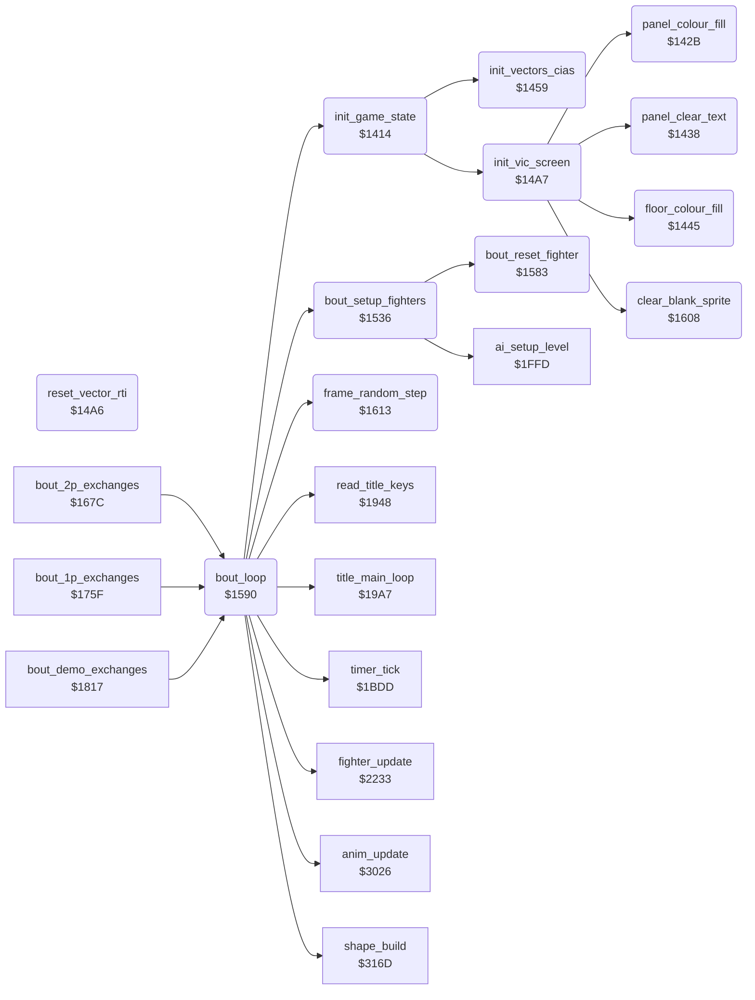

<!-- Generated by c64-docs from knowledge revision 20261021T021734.611-6rf0n2 and src/source-map.json. Do not edit: change the knowledge, generate the source again, then run docs.ts generate. -->
# init_bout_loop.asm: Start-up, VIC and CIA set-up, bout set-up and the frame loop of one exchange

Range `$1414-$161C`. Source: [init_bout_loop.asm](../../../src/init_bout_loop.asm). Index: [the reference](../index.md).

## Call graph

A solid arrow is a call, a thick arrow a table entry, a dotted arrow a jump. Rounded nodes are in this file.

## Data

| Range | Type | Name | Read by | Written by |
|---|---|---|---|---|
| [`$1607`](../../../src/init_bout_loop.asm#L256) | unused |  |  |  |

## Names

### [`init_game_state`](../../../src/init_bout_loop.asm#L6) `$1414`

*routine*

Start-up: sets game_mode, front_fighter and shape_page_offset to 0, sets the vectors and the VIC, seeds frame_random with $53, scene_shown 1. Called by cold_start.

- **Called from:** [`bout_loop`](init_bout_loop.md#bout_loop) [`$1601`](../../../src/init_bout_loop.asm#L253)
- **Calls:** [`init_vectors_cias`](init_bout_loop.md#init_vectors_cias), [`init_vic_screen`](init_bout_loop.md#init_vic_screen)
- **Writes:** [`game_mode`](../memory-map.md#game_mode), [`front_fighter`](../memory-map.md#front_fighter), [`shape_page_offset`](../memory-map.md#shape_page_offset), [`frame_random`](../memory-map.md#frame_random), [`scene_shown`](../memory-map.md#scene_shown)

### [`panel_colour_fill`](../../../src/init_bout_loop.asm#L19) `$142B`

*routine*

Fills colour RAM of the text rows 0-4 ($d800-$d8c7) with 6, blue. Called by init_vic_screen.

- **Called from:** [`init_vic_screen`](init_bout_loop.md#init_vic_screen) [`$14EE`](../../../src/init_bout_loop.asm#L121)
- **Writes:** [`figure_f67_parts+64`](shadow_sprites_facing0.md#figure_f67_parts), [`figure_f67_parts+65`](shadow_sprites_facing0.md#figure_f67_parts)

### [`panel_colour_loop`](../../../src/init_bout_loop.asm#L22) `$142F`

*label*

- **Jumped to from:** [`panel_colour_fill`](init_bout_loop.md#panel_colour_fill) [`$1435`](../../../src/init_bout_loop.asm#L26)

### [`panel_clear_text`](../../../src/init_bout_loop.asm#L29) `$1438`

*routine*

Fills screen rows 0-4 ($cc00-$ccc7) with spaces. Called by init_vic_screen.

- **Called from:** [`init_vic_screen`](init_bout_loop.md#init_vic_screen) [`$14F1`](../../../src/init_bout_loop.asm#L122)
- **Writes:** [`screen_ram`](../memory-map.md#screen_ram), [`screen_ram+1`](../memory-map.md#screen_ram)

### [`panel_clear_loop`](../../../src/init_bout_loop.asm#L32) `$143C`

*label*

- **Jumped to from:** [`panel_clear_text`](init_bout_loop.md#panel_clear_text) [`$1442`](../../../src/init_bout_loop.asm#L36)

### [`floor_colour_fill`](../../../src/init_bout_loop.asm#L39) `$1445`

*routine*

Fills screen and colour RAM of rows 17-24 with $77, so the floor bitmap shows yellow only. Called by init_vic_screen.

- **Called from:** [`init_vic_screen`](init_bout_loop.md#init_vic_screen) [`$14EB`](../../../src/init_bout_loop.asm#L120)
- **Writes:** [`figure_heads_unused+168`](shadow_sprites_facing1.md#figure_heads_unused), [`shadow_facing1+103`](shadow_sprites_facing1.md#shadow_facing1), [`figure_heads_unused+256`](shadow_sprites_facing1.md#figure_heads_unused), [`shadow_facing1+191`](shadow_sprites_facing1.md#shadow_facing1), [`screen_scene_rows+480`](../memory-map.md#screen_scene_rows), [`screen_scene_rows+735`](../memory-map.md#screen_scene_rows), [`screen_scene_rows+568`](../memory-map.md#screen_scene_rows), [`sprite_pointers+7`](../memory-map.md#sprite_pointers)

### [`floor_colour_loop`](../../../src/init_bout_loop.asm#L42) `$1449`

*label*

- **Jumped to from:** [`floor_colour_fill`](init_bout_loop.md#floor_colour_fill) [`$1456`](../../../src/init_bout_loop.asm#L48)

### [`init_vectors_cias`](../../../src/init_bout_loop.asm#L51) `$1459`

*routine*

Switches the ROMs out ($01 = $05) and stops the CIA 1 interrupts. It enables the raster IRQ, sets the IRQ, NMI and RESET vectors and arms the CIA 2 timer B NMI.

- **Called from:** [`init_game_state`](init_bout_loop.md#init_game_state) [`$141C`](../../../src/init_bout_loop.asm#L11)
- **Writes:** [`cpu_port`](../memory-map.md#cpu_port), [`CIAICR`](../memory-map.md#CIAICR), [`IRQMSK`](../memory-map.md#IRQMSK), [`hw_irq_vector`](../memory-map.md#hw_irq_vector), [`hw_irq_vector+1`](../memory-map.md#hw_irq_vector), [`hw_reset_vector`](../memory-map.md#hw_reset_vector), [`hw_reset_vector+1`](../memory-map.md#hw_reset_vector), [`CI2ICR`](../memory-map.md#CI2ICR), [`hw_nmi_vector`](../memory-map.md#hw_nmi_vector), [`hw_nmi_vector+1`](../memory-map.md#hw_nmi_vector), [`CI2TBLO`](../memory-map.md#CI2TBLO), [`CI2TBHI`](../memory-map.md#CI2TBHI), [`CIADDRA`](../memory-map.md#CIADDRA)
- **Refers to:** [`irq_frame_start`](sprite_mux_plan.md#irq_frame_start), [`reset_vector_rti`](init_bout_loop.md#reset_vector_rti), [`nmi_floor_colour`](irq_screen_split.md#nmi_floor_colour)

### [`reset_vector_rti`](../../../src/init_bout_loop.asm#L87) `$14A6`

*routine*

Lone RTI, the target of the RESET vector at $fffc. No run executes it.

- **Referred to by:** [`init_vectors_cias`](init_bout_loop.md#init_vectors_cias) [`$1478`](../../../src/init_bout_loop.asm#L67), [`init_vectors_cias`](init_bout_loop.md#init_vectors_cias) [`$147D`](../../../src/init_bout_loop.asm#L69)

### [`init_vic_screen`](../../../src/init_bout_loop.asm#L91) `$14A7`

*routine*

Sets VIC bank 3, screen $cc00 with bitmap and characters at $e000, colours, multicolour sprites and the panel. Called by init_game_state.

- **Called from:** [`init_game_state`](init_bout_loop.md#init_game_state) [`$141F`](../../../src/init_bout_loop.asm#L12)
- **Calls:** [`clear_blank_sprite`](init_bout_loop.md#clear_blank_sprite), [`floor_colour_fill`](init_bout_loop.md#floor_colour_fill), [`panel_colour_fill`](init_bout_loop.md#panel_colour_fill), [`panel_clear_text`](init_bout_loop.md#panel_clear_text)
- **Writes:** [`CI2PRA`](../memory-map.md#CI2PRA), [`VMCSB`](../memory-map.md#VMCSB), [`BGCOL0`](../memory-map.md#BGCOL0), [`EXTCOL`](../memory-map.md#EXTCOL), [`panel_bg_colour`](../memory-map.md#panel_bg_colour), [`SCROLY`](../memory-map.md#SCROLY), [`RASTER`](../memory-map.md#RASTER), [`SCROLX`](../memory-map.md#SCROLX), [`SPMC0`](../memory-map.md#SPMC0), [`SPMC1`](../memory-map.md#SPMC1), [`fighter_colour`](../memory-map.md#fighter_colour), [`fighter_colour+1`](../memory-map.md#fighter_colour), [`SPMC`](../memory-map.md#SPMC), [`SPENA`](../memory-map.md#SPENA), [`SPBGPR`](../memory-map.md#SPBGPR), [`BGCOL1`](../memory-map.md#BGCOL1), [`BGCOL2`](../memory-map.md#BGCOL2), [`figure_f67_parts+67`](shadow_sprites_facing0.md#figure_f67_parts), [`figure_f67_parts+68`](shadow_sprites_facing0.md#figure_f67_parts), [`figure_f67_parts+70`](shadow_sprites_facing0.md#figure_f67_parts), [`figure_f67_parts+71`](shadow_sprites_facing0.md#figure_f67_parts), [`figure_f67_parts+107`](shadow_sprites_facing0.md#figure_f67_parts), [`figure_f67_parts+108`](shadow_sprites_facing0.md#figure_f67_parts), [`figure_f67_parts+110`](shadow_sprites_facing0.md#figure_f67_parts), [`figure_f67_parts+111`](shadow_sprites_facing0.md#figure_f67_parts), [`figure_f67_parts+96`](shadow_sprites_facing0.md#figure_f67_parts), [`figure_f67_parts+97`](shadow_sprites_facing0.md#figure_f67_parts), [`figure_f67_parts+99`](shadow_sprites_facing0.md#figure_f67_parts), [`figure_f67_parts+100`](shadow_sprites_facing0.md#figure_f67_parts), [`figure_f67_parts+136`](shadow_sprites_facing0.md#figure_f67_parts), [`figure_f67_parts+137`](shadow_sprites_facing0.md#figure_f67_parts), [`figure_f67_parts+139`](shadow_sprites_facing0.md#figure_f67_parts), [`figure_f67_parts+140`](shadow_sprites_facing0.md#figure_f67_parts)
- **Refers to:** [`fighter_colour`](../memory-map.md#fighter_colour)

### [`bout_setup_fighters`](../../../src/init_bout_loop.asm#L148) `$1536`

*routine*

Puts both fighters at the start: x $3e and $5a, on the ground, facing each other, move and animation $17. Also red for fighter 1 and the AI set-up. Called by bout_loop.

- **Called from:** [`bout_loop`](init_bout_loop.md#bout_loop) [`$1594`](../../../src/init_bout_loop.asm#L199)
- **Calls:** [`bout_reset_fighter`](init_bout_loop.md#bout_reset_fighter), [`ai_setup_level`](ai_opponent.md#ai_setup_level)
- **Writes:** [`fighter_x`](../memory-map.md#fighter_x), [`fighter_x+1`](../memory-map.md#fighter_x), [`fighter_y`](../memory-map.md#fighter_y), [`fighter_y+1`](../memory-map.md#fighter_y), [`anim_reverse`](../memory-map.md#anim_reverse), [`anim_reverse+1`](../memory-map.md#anim_reverse), [`fighter_facing`](../memory-map.md#fighter_facing), [`fighter_facing+1`](../memory-map.md#fighter_facing), [`anim_number`](../memory-map.md#anim_number), [`anim_number+1`](../memory-map.md#anim_number), [`anim_started`](../memory-map.md#anim_started), [`anim_started+1`](../memory-map.md#anim_started), [`bout_knockdown`](../memory-map.md#bout_knockdown), [`draw_buffer`](../memory-map.md#draw_buffer), [`draw_buffer+1`](../memory-map.md#draw_buffer), [`fighter_colour+1`](../memory-map.md#fighter_colour), [`knockdown_delay`](../memory-map.md#knockdown_delay), [`knockdown_delay+1`](../memory-map.md#knockdown_delay)
- **Refers to:** [`fighter_x`](../memory-map.md#fighter_x), [`fighter_y`](../memory-map.md#fighter_y), [`anim_reverse`](../memory-map.md#anim_reverse), [`fighter_facing`](../memory-map.md#fighter_facing), [`anim_number`](../memory-map.md#anim_number), [`anim_started`](../memory-map.md#anim_started), [`draw_buffer`](../memory-map.md#draw_buffer), [`fighter_colour`](../memory-map.md#fighter_colour), [`knockdown_delay`](../memory-map.md#knockdown_delay)

### [`bout_reset_fighter`](../../../src/init_bout_loop.asm#L187) `$1583`

*routine*

Clears hit_reaction, $5c and the hold flag $69 of fighter X and sets fighter_move $17. Called by bout_setup_fighters.

- **Called from:** [`bout_setup_fighters`](init_bout_loop.md#bout_setup_fighters) [`$1560`](../../../src/init_bout_loop.asm#L170), [`bout_setup_fighters`](init_bout_loop.md#bout_setup_fighters) [`$1565`](../../../src/init_bout_loop.asm#L172)

### [`bout_loop`](../../../src/init_bout_loop.asm#L196) `$1590`

*routine*

Plays one exchange from the start positions until a fighter falls, the time ends or a start key comes. Returns A: $80 key, the reaction move, or 1 time up.
Only the bull test sets the offset nonzero.

- **Called from:** [`bout_2p_exchanges`](game_modes.md#bout_2p_exchanges) [`$167C`](../../../src/game_modes.asm#L56), [`bout_1p_exchanges`](game_modes.md#bout_1p_exchanges) [`$175F`](../../../src/game_modes.asm#L172), [`bout_demo_exchanges`](game_modes.md#bout_demo_exchanges) [`$1817`](../../../src/game_modes.asm#L271)
- **Calls:** [`bout_setup_fighters`](init_bout_loop.md#bout_setup_fighters), [`anim_update`](anim_step.md#anim_update), [`fighter_update`](fighter_moves.md#fighter_update), [`frame_random_step`](init_bout_loop.md#frame_random_step), [`read_title_keys`](title_and_scene.md#read_title_keys), [`timer_tick`](score_and_timer.md#timer_tick), [`shape_build`](shape_build.md#shape_build), [`init_game_state`](init_bout_loop.md#init_game_state), [`title_main_loop`](title_and_scene.md#title_main_loop)
- **Reads:** [`SPENA`](../memory-map.md#SPENA), [`RASTER`](../memory-map.md#RASTER), [`opponent_index`](../memory-map.md#opponent_index), [`bout_knockdown`](../memory-map.md#bout_knockdown), [`hit_reaction`](../memory-map.md#hit_reaction), [`hit_reaction+1`](../memory-map.md#hit_reaction), [`fighter_move`](../memory-map.md#fighter_move), [`time_up`](../memory-map.md#time_up)
- **Writes:** [`shape_page_offset`](../memory-map.md#shape_page_offset), [`SPENA`](../memory-map.md#SPENA), [`opponent_index`](../memory-map.md#opponent_index), [`fighter_frame`](../memory-map.md#fighter_frame), [`fighter_frame+1`](../memory-map.md#fighter_frame), [`fighter_y`](../memory-map.md#fighter_y), [`fighter_y+1`](../memory-map.md#fighter_y), [`sprite_y`](../memory-map.md#sprite_y), [`sprite_y+1`](../memory-map.md#sprite_y)
- **Refers to:** [`hit_reaction`](../memory-map.md#hit_reaction), [`fighter_frame`](../memory-map.md#fighter_frame), [`fighter_y`](../memory-map.md#fighter_y), [`sprite_y`](../memory-map.md#sprite_y)

### [`bout_frame_loop`](../../../src/init_bout_loop.asm#L208) `$15AA`

*label*

- **Jumped to from:** [`bout_loop`](init_bout_loop.md#bout_loop) [`$15AF`](../../../src/init_bout_loop.asm#L211), [`bout_loop`](init_bout_loop.md#bout_loop) [`$15E0`](../../../src/init_bout_loop.asm#L234)

### [`bout_check_time_up`](../../../src/init_bout_loop.asm#L232) `$15DE`

*label*

- **Jumped to from:** [`bout_loop`](init_bout_loop.md#bout_loop) [`$15CF`](../../../src/init_bout_loop.asm#L225), [`bout_loop`](init_bout_loop.md#bout_loop) [`$15D3`](../../../src/init_bout_loop.asm#L227), [`bout_loop`](init_bout_loop.md#bout_loop) [`$15D9`](../../../src/init_bout_loop.asm#L230)

### [`bout_loop_exit`](../../../src/init_bout_loop.asm#L249) `$1600`

*label*

- **Jumped to from:** [`bout_loop`](init_bout_loop.md#bout_loop) [`$15C7`](../../../src/init_bout_loop.asm#L221), [`bout_loop`](init_bout_loop.md#bout_loop) [`$15CB`](../../../src/init_bout_loop.asm#L223)

### [`cold_start`](../../../src/init_bout_loop.asm#L252) `$1601`

*label*

Cold start: initialises the machine and enters the title loop.

- **Jumped to from:** [`$1158`](../../../src/entry_and_tables.asm#L7)

### [`clear_blank_sprite`](../../../src/init_bout_loop.asm#L258) `$1608`

*routine*

Clears the sprite at $c000 (pointer 0), the blank sprite of empty shape parts. Called by init_vic_screen.

- **Called from:** [`init_vic_screen`](init_bout_loop.md#init_vic_screen) [`$14B1`](../../../src/init_bout_loop.asm#L96)
- **Writes:** [`sprite_blank+61`](../memory-map.md#sprite_blank), [`sprite_blank+62`](../memory-map.md#sprite_blank)

### [`clear_blank_sprite_loop`](../../../src/init_bout_loop.asm#L261) `$160C`

*label*

- **Jumped to from:** [`clear_blank_sprite`](init_bout_loop.md#clear_blank_sprite) [`$1610`](../../../src/init_bout_loop.asm#L264)

### [`frame_random_step`](../../../src/init_bout_loop.asm#L267) `$1613`

*routine*

Steps frame_random once (shift left, EOR #$1d on carry). Called each frame by bout_loop.

- **Called from:** [`bout_loop`](init_bout_loop.md#bout_loop) [`$15C1`](../../../src/init_bout_loop.asm#L219)
- **Reads:** [`frame_random`](../memory-map.md#frame_random)
- **Writes:** [`frame_random`](../memory-map.md#frame_random)

### [`frame_random_store`](../../../src/init_bout_loop.asm#L272) `$161A`

*label*

- **Jumped to from:** [`frame_random_step`](init_bout_loop.md#frame_random_step) [`$1616`](../../../src/init_bout_loop.asm#L270)
