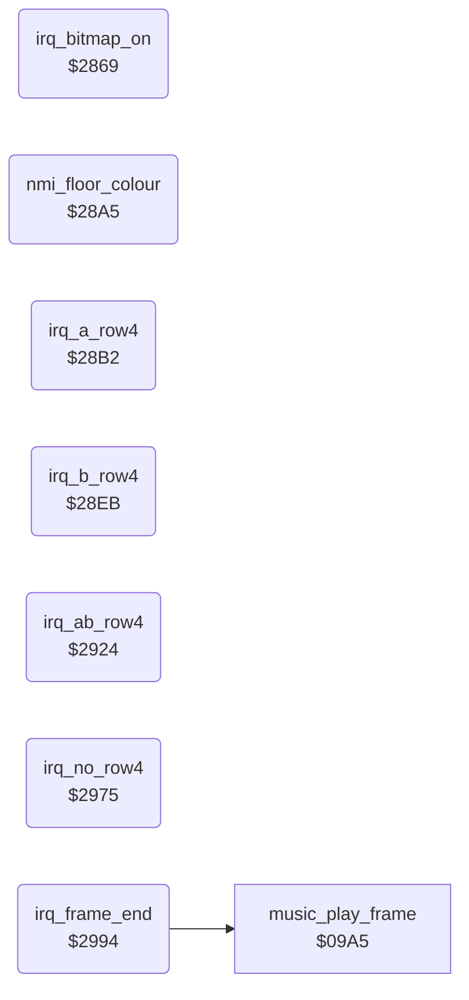

<!-- Generated by c64-docs from knowledge revision 20261025T214834.473-anyvn7 and .c64-re-tools/local/generated/src/source-map.json. Do not edit: change the knowledge, generate the source again, then run docs.ts generate. -->
# irq/irq_screen_split.asm: Bitmap-on IRQ, floor colour NMI, sprite row 4 IRQs and the frame-end IRQ with the music call

Range `$2869-$29C7`. Source: [irq/irq_screen_split.asm](../../../../src/irq/irq_screen_split.asm). Index: [the reference](../../index.md).

## Routines

| Routine | Address | Reached from | Summary |
|---|---|---|---|
| [`irq_bitmap_on`](irq_screen_split.md#irq_bitmap_on) | `$2869` |  | Raster IRQ at line $5a, under the text rows of the score panel. |
| [`nmi_floor_colour`](irq_screen_split.md#nmi_floor_colour) | `$28A5` |  | NMI of CIA2 timer B, about 92 PAL lines after irq_bitmap_on starts the timer (5820 cycles). |
| [`irq_a_row4`](irq_screen_split.md#irq_a_row4) | `$28B2` |  | Raster IRQ at line $d9 that shows a 4th sprite row for group A at Y $da. |
| [`irq_b_row4`](irq_screen_split.md#irq_b_row4) | `$28EB` |  | Raster IRQ at line $d9 that shows a 4th sprite row for group B at Y $da. |
| [`irq_ab_row4`](irq_screen_split.md#irq_ab_row4) | `$2924` |  | Raster IRQ at line $d9 that shows a 4th sprite row for both groups at Y $da. |
| [`irq_no_row4`](irq_screen_split.md#irq_no_row4) | `$2975` |  | Raster IRQ at line $d9 when both groups are at Y $a0 and no 4th sprite row is shown. |
| [`irq_frame_end`](irq_screen_split.md#irq_frame_end) | `$2994` |  | Raster IRQ at line $ff, under the playfield. |

## Call graph

A solid arrow is a call, a thick arrow a table entry. Rounded nodes are in this file.

## Details

### [`irq_bitmap_on`](../../../../src/irq/irq_screen_split.asm#L6) `$2869`

*routine*

Raster IRQ at line $5a, under the text rows of the score panel. It sets the first sprite row handler (patched). Then it switches to bitmap mode ($d011=$3b), sets the scene background colour and starts CIA2 timer B for the floor NMI.

- **Referred to by:** [`irq_frame_start`](sprite_mux_plan.md#irq_frame_start)
- **Jumps to:** [`sfx_sample_irq`](../sfx/sfx_sample_player.md#sfx_sample_irq)
- **Reads:** [`VICIRQ`](../../memory-map.md#VICIRQ)
- **Writes:** [`VICIRQ`](../../memory-map.md#VICIRQ), [`RASTER`](../../memory-map.md#RASTER), [`hw_irq_vector`](../../memory-map.md#hw_irq_vector), [`SCROLY`](../../memory-map.md#SCROLY), [`BGCOL0`](../../memory-map.md#BGCOL0), [`CI2TBLO`](../../memory-map.md#CI2TBLO), [`$DD07`](../../../../src/graphics/shadow_sprites_facing1.asm#L191), [`CI2CRB`](../../memory-map.md#CI2CRB)

| Label | Address | Comment |
|---|---|---|
| [`irq_bitmap_on_vic`](../../../../src/irq/irq_screen_split.asm#L11) | `$2871` |  |

### [`irq_bitmap_on_next_line`](../../../../src/irq/irq_screen_split.asm#L15) `$2878-$287C`

*variable*

- **Written by:** [`irq_frame_start`](sprite_mux_plan.md#irq_frame_start)

### [`irq_bitmap_on_next_lo`](../../../../src/irq/irq_screen_split.asm#L27) `$287D-$2881`

*variable*

- **Written by:** [`irq_frame_start`](sprite_mux_plan.md#irq_frame_start)

### [`irq_bitmap_on_next_hi`](../../../../src/irq/irq_screen_split.asm#L39) `$2882-$288F`

*variable*

- **Written by:** [`irq_frame_start`](sprite_mux_plan.md#irq_frame_start)

### [`irq_bitmap_on_bg_colour`](../../../../src/irq/irq_screen_split.asm#L57) `$2890-$28A4`

*variable*

- **Written by:** [`scene_draw_if_new`](../game/title_and_scene.md#scene_draw_if_new)

### [`nmi_floor_colour`](../../../../src/irq/irq_screen_split.asm#L66) `$28A5`

*routine*

NMI of CIA2 timer B, about 92 PAL lines after irq_bitmap_on starts the timer (5820 cycles). It sets the background colour to 7 (yellow) for the floor. An NMI from another source (RESTORE) only returns.

- **Referred to by:** [`init_vectors_cias`](../game/init_bout_loop.md#init_vectors_cias)
- **Reads:** [`CI2ICR`](../../memory-map.md#CI2ICR)
- **Writes:** [`BGCOL0`](../../memory-map.md#BGCOL0)

| Label | Address | Comment |
|---|---|---|
| [`nmi_done`](../../../../src/irq/irq_screen_split.asm#L73) | `$28B1` |  |

### [`irq_a_row4`](../../../../src/irq/irq_screen_split.asm#L76) `$28B2`

*routine*

Raster IRQ at line $d9 that shows a 4th sprite row for group A at Y $da. row4_irq_vector selects it when only group A is not at Y $a0. The pointers come from row4_ptr_* (patched at $2b00).

- **Referred to by:** [`irq_frame_start`](sprite_mux_plan.md#irq_frame_start)
- **Jumps to:** [`sfx_sample_irq`](../sfx/sfx_sample_player.md#sfx_sample_irq)
- **Reads:** [`VICIRQ`](../../memory-map.md#VICIRQ)
- **Writes:** [`SP0Y`](../../memory-map.md#SP0Y), [`SP1Y`](../../memory-map.md#SP1Y), [`SP2Y`](../../memory-map.md#SP2Y), [`sprite_pointers`](../../memory-map.md#sprite_pointers), [`VICIRQ`](../../memory-map.md#VICIRQ), [`RASTER`](../../memory-map.md#RASTER), [`hw_irq_vector`](../../memory-map.md#hw_irq_vector)
- **Refers to:** [`irq_frame_end`](irq_screen_split.md#irq_frame_end)

| Label | Address | Comment |
|---|---|---|
| [`irq_a_row4_vic`](../../../../src/irq/irq_screen_split.asm#L81) | `$28BA` |  |

### [`irq_a_row4_ptr_left`](../../../../src/irq/irq_screen_split.asm#L87) `$28C7-$28CB`

*variable*

- **Written by:** [`irq_frame_start`](sprite_mux_plan.md#irq_frame_start)

### [`irq_a_row4_ptr_mid`](../../../../src/irq/irq_screen_split.asm#L99) `$28CC-$28D0`

*variable*

- **Written by:** [`irq_frame_start`](sprite_mux_plan.md#irq_frame_start)

### [`irq_a_row4_ptr_right`](../../../../src/irq/irq_screen_split.asm#L111) `$28D1-$28EA`

*variable*

- **Written by:** [`irq_frame_start`](sprite_mux_plan.md#irq_frame_start)

### [`irq_b_row4`](../../../../src/irq/irq_screen_split.asm#L131) `$28EB`

*routine*

Raster IRQ at line $d9 that shows a 4th sprite row for group B at Y $da. row4_irq_vector selects it when only group B is not at Y $a0. The pointers come from row4_ptr_* (patched at $2b20).

- **Referred to by:** [`irq_frame_start`](sprite_mux_plan.md#irq_frame_start)
- **Jumps to:** [`sfx_sample_irq`](../sfx/sfx_sample_player.md#sfx_sample_irq)
- **Reads:** [`VICIRQ`](../../memory-map.md#VICIRQ)
- **Writes:** [`SP3Y`](../../memory-map.md#SP3Y), [`SP4Y`](../../memory-map.md#SP4Y), [`SP5Y`](../../memory-map.md#SP5Y), [`sprite_pointers`](../../memory-map.md#sprite_pointers), [`VICIRQ`](../../memory-map.md#VICIRQ), [`RASTER`](../../memory-map.md#RASTER), [`hw_irq_vector`](../../memory-map.md#hw_irq_vector)
- **Refers to:** [`irq_frame_end`](irq_screen_split.md#irq_frame_end)

| Label | Address | Comment |
|---|---|---|
| [`irq_b_row4_vic`](../../../../src/irq/irq_screen_split.asm#L136) | `$28F3` |  |

### [`irq_b_row4_ptr_left`](../../../../src/irq/irq_screen_split.asm#L142) `$2900-$2904`

*variable*

- **Written by:** [`irq_frame_start`](sprite_mux_plan.md#irq_frame_start)

### [`irq_b_row4_ptr_mid`](../../../../src/irq/irq_screen_split.asm#L154) `$2905-$2909`

*variable*

- **Written by:** [`irq_frame_start`](sprite_mux_plan.md#irq_frame_start)

### [`irq_b_row4_ptr_right`](../../../../src/irq/irq_screen_split.asm#L166) `$290A-$2923`

*variable*

- **Written by:** [`irq_frame_start`](sprite_mux_plan.md#irq_frame_start)

### [`irq_ab_row4`](../../../../src/irq/irq_screen_split.asm#L186) `$2924`

*routine*

Raster IRQ at line $d9 that shows a 4th sprite row for both groups at Y $da. row4_irq_vector selects it when neither group is at Y $a0. The pointers come from row4_ptr_* (patched at $2b00).

- **Referred to by:** [`irq_frame_start`](sprite_mux_plan.md#irq_frame_start)
- **Jumps to:** [`sfx_sample_irq`](../sfx/sfx_sample_player.md#sfx_sample_irq)
- **Reads:** [`VICIRQ`](../../memory-map.md#VICIRQ)
- **Writes:** [`SP0Y`](../../memory-map.md#SP0Y), [`SP1Y`](../../memory-map.md#SP1Y), [`SP2Y`](../../memory-map.md#SP2Y), [`SP3Y`](../../memory-map.md#SP3Y), [`SP4Y`](../../memory-map.md#SP4Y), [`SP5Y`](../../memory-map.md#SP5Y), [`sprite_pointers`](../../memory-map.md#sprite_pointers), [`VICIRQ`](../../memory-map.md#VICIRQ), [`RASTER`](../../memory-map.md#RASTER), [`hw_irq_vector`](../../memory-map.md#hw_irq_vector)
- **Refers to:** [`irq_frame_end`](irq_screen_split.md#irq_frame_end)

| Label | Address | Comment |
|---|---|---|
| [`irq_ab_row4_vic`](../../../../src/irq/irq_screen_split.asm#L191) | `$292C` |  |

### [`irq_ab_row4_a_ptr_left`](../../../../src/irq/irq_screen_split.asm#L200) `$2942-$2946`

*variable*

- **Written by:** [`irq_frame_start`](sprite_mux_plan.md#irq_frame_start)

### [`irq_ab_row4_a_ptr_mid`](../../../../src/irq/irq_screen_split.asm#L212) `$2947-$294B`

*variable*

- **Written by:** [`irq_frame_start`](sprite_mux_plan.md#irq_frame_start)

### [`irq_ab_row4_a_ptr_right`](../../../../src/irq/irq_screen_split.asm#L224) `$294C-$2950`

*variable*

- **Written by:** [`irq_frame_start`](sprite_mux_plan.md#irq_frame_start)

### [`irq_ab_row4_b_ptr_left`](../../../../src/irq/irq_screen_split.asm#L236) `$2951-$2955`

*variable*

- **Written by:** [`irq_frame_start`](sprite_mux_plan.md#irq_frame_start)

### [`irq_ab_row4_b_ptr_mid`](../../../../src/irq/irq_screen_split.asm#L248) `$2956-$295A`

*variable*

- **Written by:** [`irq_frame_start`](sprite_mux_plan.md#irq_frame_start)

### [`irq_ab_row4_b_ptr_right`](../../../../src/irq/irq_screen_split.asm#L260) `$295B-$2974`

*variable*

- **Written by:** [`irq_frame_start`](sprite_mux_plan.md#irq_frame_start)

### [`irq_no_row4`](../../../../src/irq/irq_screen_split.asm#L280) `$2975`

*routine*

Raster IRQ at line $d9 when both groups are at Y $a0 and no 4th sprite row is shown. It only sets irq_frame_end at line $ff.

- **Referred to by:** [`irq_frame_start`](sprite_mux_plan.md#irq_frame_start)
- **Jumps to:** [`sfx_sample_irq`](../sfx/sfx_sample_player.md#sfx_sample_irq)
- **Reads:** [`VICIRQ`](../../memory-map.md#VICIRQ)
- **Writes:** [`VICIRQ`](../../memory-map.md#VICIRQ), [`RASTER`](../../memory-map.md#RASTER), [`hw_irq_vector`](../../memory-map.md#hw_irq_vector)
- **Refers to:** [`irq_frame_end`](irq_screen_split.md#irq_frame_end)

| Label | Address | Comment |
|---|---|---|
| [`irq_no_row4_vic`](../../../../src/irq/irq_screen_split.asm#L285) | `$297D` |  |

### [`irq_frame_end`](../../../../src/irq/irq_screen_split.asm#L295) `$2994`

*routine*

Raster IRQ at line $ff, under the playfield. It sets irq_frame_start at line 0 and text mode ($d011=$1b) for the score panel. Then it sets panel_bg_colour and calls the music driver at $09a5 once per frame.

- **Referred to by:** [`irq_a_row4`](irq_screen_split.md#irq_a_row4), [`irq_b_row4`](irq_screen_split.md#irq_b_row4), [`irq_ab_row4`](irq_screen_split.md#irq_ab_row4), [`irq_no_row4`](irq_screen_split.md#irq_no_row4)
- **Calls:** [`music_play_frame`](../music/music_driver.md#music_play_frame)
- **Jumps to:** [`sfx_sample_irq`](../sfx/sfx_sample_player.md#sfx_sample_irq)
- **Reads:** [`VICIRQ`](../../memory-map.md#VICIRQ), [`panel_bg_colour`](../../memory-map.md#panel_bg_colour)
- **Writes:** [`VICIRQ`](../../memory-map.md#VICIRQ), [`RASTER`](../../memory-map.md#RASTER), [`hw_irq_vector`](../../memory-map.md#hw_irq_vector), [`SCROLY`](../../memory-map.md#SCROLY), [`BGCOL0`](../../memory-map.md#BGCOL0)
- **Refers to:** [`irq_frame_start`](sprite_mux_plan.md#irq_frame_start)

| Label | Address | Comment |
|---|---|---|
| [`irq_frame_end_vic`](../../../../src/irq/irq_screen_split.asm#L300) | `$299C` |  |
