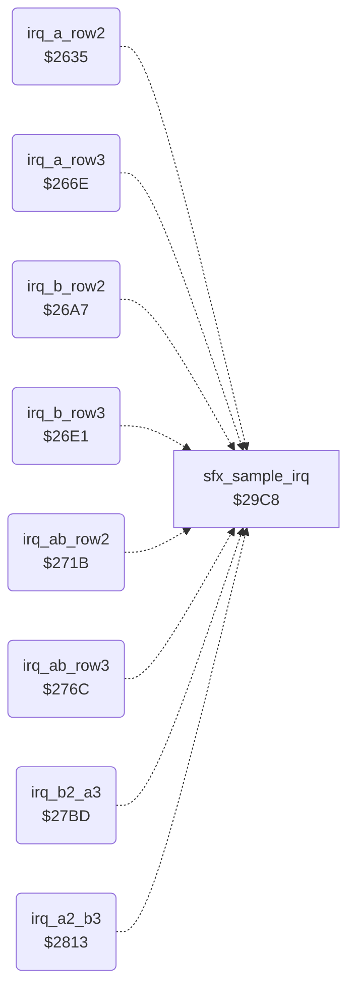

<!-- Generated by c64-docs from knowledge revision 20261022T132731.733-fztd87 and .c64-re-tools/local/generated/src/source-map.json. Do not edit: change the knowledge, generate the source again, then run docs.ts generate. -->
# irq/irq_sprite_rows.asm: Raster IRQ handlers for sprite rows 2 and 3 of the two fighters, patched each frame

Range `$2635-$2868`. Source: [irq/irq_sprite_rows.asm](../../../../src/irq/irq_sprite_rows.asm). Index: [the reference](../../index.md).

## Call graph

A solid arrow is a call, a thick arrow a table entry, a dotted arrow a jump. Rounded nodes are in this file.

## Names

### [`irq_a_row2`](../../../../src/irq/irq_sprite_rows.asm#L6) `$2635`

*routine*

Raster IRQ one line above sprite row 2 of group A (sprites 0-2). It moves sprites 0-2 down to row 2 and sets their row 2 pointers. The planner at $2b40 patches every operand each frame. A non-VIC IRQ goes to sfx_sample_irq.

- **Referred to by:** [`irq_frame_start`](sprite_mux_plan.md#irq_frame_start) [`$2BCA`](../../../../src/irq/sprite_mux_plan.asm#L178), [`irq_frame_start`](sprite_mux_plan.md#irq_frame_start) [`$2BCF`](../../../../src/irq/sprite_mux_plan.asm#L180), [`irq_frame_start`](sprite_mux_plan.md#irq_frame_start) [`$2C4A`](../../../../src/irq/sprite_mux_plan.asm#L237), [`irq_frame_start`](sprite_mux_plan.md#irq_frame_start) [`$2C4F`](../../../../src/irq/sprite_mux_plan.asm#L239), [`irq_frame_start`](sprite_mux_plan.md#irq_frame_start) [`$2CB3`](../../../../src/irq/sprite_mux_plan.asm#L287), [`irq_frame_start`](sprite_mux_plan.md#irq_frame_start) [`$2CB8`](../../../../src/irq/sprite_mux_plan.asm#L289), [`irq_frame_start`](sprite_mux_plan.md#irq_frame_start) [`$2D7A`](../../../../src/irq/sprite_mux_plan.asm#L380), [`irq_frame_start`](sprite_mux_plan.md#irq_frame_start) [`$2D7F`](../../../../src/irq/sprite_mux_plan.asm#L382), [`irq_frame_start`](sprite_mux_plan.md#irq_frame_start) [`$2E04`](../../../../src/irq/sprite_mux_plan.asm#L443), [`irq_frame_start`](sprite_mux_plan.md#irq_frame_start) [`$2E09`](../../../../src/irq/sprite_mux_plan.asm#L445)
- **Jumps to:** [`sfx_sample_irq`](../sfx/sfx_sample_player.md#sfx_sample_irq)
- **Reads:** [`VICIRQ`](../../memory-map.md#VICIRQ)
- **Writes:** [`SP0Y`](../../memory-map.md#SP0Y), [`SP1Y`](../../memory-map.md#SP1Y), [`SP2Y`](../../memory-map.md#SP2Y), [`VICIRQ`](../../memory-map.md#VICIRQ), [`RASTER`](../../memory-map.md#RASTER), [`hw_irq_vector`](../../memory-map.md#hw_irq_vector), [`sprite_pointers`](../../memory-map.md#sprite_pointers), [`sprite_pointers+1`](../../memory-map.md#sprite_pointers), [`sprite_pointers+2`](../../memory-map.md#sprite_pointers), [`hw_irq_vector+1`](../../memory-map.md#hw_irq_vector)

### [`irq_a_row2_vic`](../../../../src/irq/irq_sprite_rows.asm#L11) `$263D`

*label*

- **Jumped to from:** [`irq_a_row2`](irq_sprite_rows.md#irq_a_row2) [`$2638`](../../../../src/irq/irq_sprite_rows.asm#L8)

### [`irq_a_row2_y`](../../../../src/irq/irq_sprite_rows.asm#L13) `$263F-$264E`

*variable*

- **Written by:** [`irq_frame_start`](sprite_mux_plan.md#irq_frame_start) [`$2C06`](../../../../src/irq/sprite_mux_plan.asm#L204), [`irq_frame_start`](sprite_mux_plan.md#irq_frame_start) [`$2C94`](../../../../src/irq/sprite_mux_plan.asm#L272), [`irq_frame_start`](sprite_mux_plan.md#irq_frame_start) [`$2CE5`](../../../../src/irq/sprite_mux_plan.asm#L309), [`irq_frame_start`](sprite_mux_plan.md#irq_frame_start) [`$2DB6`](../../../../src/irq/sprite_mux_plan.asm#L406), [`irq_frame_start`](sprite_mux_plan.md#irq_frame_start) [`$2E44`](../../../../src/irq/sprite_mux_plan.asm#L474)

### [`irq_a_row2_next_line`](../../../../src/irq/irq_sprite_rows.asm#L29) `$264F-$2653`

*variable*

- **Written by:** [`irq_frame_start`](sprite_mux_plan.md#irq_frame_start) [`$2C19`](../../../../src/irq/sprite_mux_plan.asm#L214), [`irq_frame_start`](sprite_mux_plan.md#irq_frame_start) [`$2C82`](../../../../src/irq/sprite_mux_plan.asm#L262), [`irq_frame_start`](sprite_mux_plan.md#irq_frame_start) [`$2CEB`](../../../../src/irq/sprite_mux_plan.asm#L312), [`irq_frame_start`](sprite_mux_plan.md#irq_frame_start) [`$2DBC`](../../../../src/irq/sprite_mux_plan.asm#L409), [`irq_frame_start`](sprite_mux_plan.md#irq_frame_start) [`$2E4A`](../../../../src/irq/sprite_mux_plan.asm#L477)

### [`irq_a_row2_next_lo`](../../../../src/irq/irq_sprite_rows.asm#L41) `$2654-$2658`

*variable*

- **Written by:** [`irq_frame_start`](sprite_mux_plan.md#irq_frame_start) [`$2BD6`](../../../../src/irq/sprite_mux_plan.asm#L183), [`irq_frame_start`](sprite_mux_plan.md#irq_frame_start) [`$2C56`](../../../../src/irq/sprite_mux_plan.asm#L242), [`irq_frame_start`](sprite_mux_plan.md#irq_frame_start) [`$2CBF`](../../../../src/irq/sprite_mux_plan.asm#L292), [`irq_frame_start`](sprite_mux_plan.md#irq_frame_start) [`$2D86`](../../../../src/irq/sprite_mux_plan.asm#L385), [`irq_frame_start`](sprite_mux_plan.md#irq_frame_start) [`$2E10`](../../../../src/irq/sprite_mux_plan.asm#L448)

### [`irq_a_row2_ptr_left`](../../../../src/irq/irq_sprite_rows.asm#L53) `$2659-$265D`

*variable*

- **Written by:** [`mux_patch_a_row2`](sprite_mux_patch.md#mux_patch_a_row2) [`$2F10`](../../../../src/irq/sprite_mux_patch.asm#L9)

### [`irq_a_row2_ptr_mid`](../../../../src/irq/irq_sprite_rows.asm#L65) `$265E-$2662`

*variable*

- **Written by:** [`mux_patch_a_row2`](sprite_mux_patch.md#mux_patch_a_row2) [`$2F15`](../../../../src/irq/sprite_mux_patch.asm#L11)

### [`irq_a_row2_ptr_right`](../../../../src/irq/irq_sprite_rows.asm#L77) `$2663-$2667`

*variable*

- **Written by:** [`mux_patch_a_row2`](sprite_mux_patch.md#mux_patch_a_row2) [`$2F1A`](../../../../src/irq/sprite_mux_patch.asm#L13)

### [`irq_a_row2_next_hi`](../../../../src/irq/irq_sprite_rows.asm#L80) `$2668-$266D`

*variable*

- **Written by:** [`irq_frame_start`](sprite_mux_plan.md#irq_frame_start) [`$2BDB`](../../../../src/irq/sprite_mux_plan.asm#L185), [`irq_frame_start`](sprite_mux_plan.md#irq_frame_start) [`$2C5B`](../../../../src/irq/sprite_mux_plan.asm#L244), [`irq_frame_start`](sprite_mux_plan.md#irq_frame_start) [`$2CC4`](../../../../src/irq/sprite_mux_plan.asm#L294), [`irq_frame_start`](sprite_mux_plan.md#irq_frame_start) [`$2D8B`](../../../../src/irq/sprite_mux_plan.asm#L387), [`irq_frame_start`](sprite_mux_plan.md#irq_frame_start) [`$2E15`](../../../../src/irq/sprite_mux_plan.asm#L450)

### [`irq_a_row3`](../../../../src/irq/irq_sprite_rows.asm#L95) `$266E`

*routine*

Raster IRQ one line above sprite row 3 of group A (sprites 0-2). It moves sprites 0-2 down to row 3 and sets their row 3 pointers. The planner at $2b40 patches every operand each frame.

- **Referred to by:** [`irq_frame_start`](sprite_mux_plan.md#irq_frame_start) [`$2BDE`](../../../../src/irq/sprite_mux_plan.asm#L186), [`irq_frame_start`](sprite_mux_plan.md#irq_frame_start) [`$2BE3`](../../../../src/irq/sprite_mux_plan.asm#L188), [`irq_frame_start`](sprite_mux_plan.md#irq_frame_start) [`$2C5E`](../../../../src/irq/sprite_mux_plan.asm#L245), [`irq_frame_start`](sprite_mux_plan.md#irq_frame_start) [`$2C63`](../../../../src/irq/sprite_mux_plan.asm#L247), [`irq_frame_start`](sprite_mux_plan.md#irq_frame_start) [`$2D29`](../../../../src/irq/sprite_mux_plan.asm#L341), [`irq_frame_start`](sprite_mux_plan.md#irq_frame_start) [`$2D2E`](../../../../src/irq/sprite_mux_plan.asm#L343), [`irq_frame_start`](sprite_mux_plan.md#irq_frame_start) [`$2D84`](../../../../src/irq/sprite_mux_plan.asm#L384), [`irq_frame_start`](sprite_mux_plan.md#irq_frame_start) [`$2D89`](../../../../src/irq/sprite_mux_plan.asm#L386), [`irq_frame_start`](sprite_mux_plan.md#irq_frame_start) [`$2E0E`](../../../../src/irq/sprite_mux_plan.asm#L447), [`irq_frame_start`](sprite_mux_plan.md#irq_frame_start) [`$2E13`](../../../../src/irq/sprite_mux_plan.asm#L449)
- **Jumps to:** [`sfx_sample_irq`](../sfx/sfx_sample_player.md#sfx_sample_irq)
- **Reads:** [`VICIRQ`](../../memory-map.md#VICIRQ)
- **Writes:** [`SP0Y`](../../memory-map.md#SP0Y), [`SP1Y`](../../memory-map.md#SP1Y), [`SP2Y`](../../memory-map.md#SP2Y), [`VICIRQ`](../../memory-map.md#VICIRQ), [`RASTER`](../../memory-map.md#RASTER), [`hw_irq_vector`](../../memory-map.md#hw_irq_vector), [`sprite_pointers`](../../memory-map.md#sprite_pointers), [`sprite_pointers+1`](../../memory-map.md#sprite_pointers), [`sprite_pointers+2`](../../memory-map.md#sprite_pointers), [`hw_irq_vector+1`](../../memory-map.md#hw_irq_vector)

### [`irq_a_row3_vic`](../../../../src/irq/irq_sprite_rows.asm#L100) `$2676`

*label*

- **Jumped to from:** [`irq_a_row3`](irq_sprite_rows.md#irq_a_row3) [`$2671`](../../../../src/irq/irq_sprite_rows.asm#L97)

### [`irq_a_row3_y`](../../../../src/irq/irq_sprite_rows.asm#L102) `$2678-$2687`

*variable*

- **Written by:** [`irq_frame_start`](sprite_mux_plan.md#irq_frame_start) [`$2C11`](../../../../src/irq/sprite_mux_plan.asm#L210), [`irq_frame_start`](sprite_mux_plan.md#irq_frame_start) [`$2C9F`](../../../../src/irq/sprite_mux_plan.asm#L278), [`irq_frame_start`](sprite_mux_plan.md#irq_frame_start) [`$2D63`](../../../../src/irq/sprite_mux_plan.asm#L370), [`irq_frame_start`](sprite_mux_plan.md#irq_frame_start) [`$2DC1`](../../../../src/irq/sprite_mux_plan.asm#L412), [`irq_frame_start`](sprite_mux_plan.md#irq_frame_start) [`$2E4F`](../../../../src/irq/sprite_mux_plan.asm#L480)

### [`irq_a_row3_next_line`](../../../../src/irq/irq_sprite_rows.asm#L118) `$2688-$268C`

*variable*

- **Written by:** [`irq_frame_start`](sprite_mux_plan.md#irq_frame_start) [`$2C24`](../../../../src/irq/sprite_mux_plan.asm#L220), [`irq_frame_start`](sprite_mux_plan.md#irq_frame_start) [`$2CA4`](../../../../src/irq/sprite_mux_plan.asm#L280), [`irq_frame_start`](sprite_mux_plan.md#irq_frame_start) [`$2D68`](../../../../src/irq/sprite_mux_plan.asm#L372), [`irq_frame_start`](sprite_mux_plan.md#irq_frame_start) [`$2DC9`](../../../../src/irq/sprite_mux_plan.asm#L416), [`irq_frame_start`](sprite_mux_plan.md#irq_frame_start) [`$2E54`](../../../../src/irq/sprite_mux_plan.asm#L482)

### [`irq_a_row3_next_lo`](../../../../src/irq/irq_sprite_rows.asm#L130) `$268D-$2691`

*variable*

- **Written by:** [`irq_frame_start`](sprite_mux_plan.md#irq_frame_start) [`$2BEA`](../../../../src/irq/sprite_mux_plan.asm#L191), [`irq_frame_start`](sprite_mux_plan.md#irq_frame_start) [`$2C6A`](../../../../src/irq/sprite_mux_plan.asm#L250), [`irq_frame_start`](sprite_mux_plan.md#irq_frame_start) [`$2D35`](../../../../src/irq/sprite_mux_plan.asm#L346), [`irq_frame_start`](sprite_mux_plan.md#irq_frame_start) [`$2D90`](../../../../src/irq/sprite_mux_plan.asm#L389), [`irq_frame_start`](sprite_mux_plan.md#irq_frame_start) [`$2E1A`](../../../../src/irq/sprite_mux_plan.asm#L452)

### [`irq_a_row3_ptr_left`](../../../../src/irq/irq_sprite_rows.asm#L142) `$2692-$2696`

*variable*

- **Written by:** [`mux_patch_a_row3`](sprite_mux_patch.md#mux_patch_a_row3) [`$2F22`](../../../../src/irq/sprite_mux_patch.asm#L19)

### [`irq_a_row3_ptr_mid`](../../../../src/irq/irq_sprite_rows.asm#L154) `$2697-$269B`

*variable*

- **Written by:** [`mux_patch_a_row3`](sprite_mux_patch.md#mux_patch_a_row3) [`$2F27`](../../../../src/irq/sprite_mux_patch.asm#L21)

### [`irq_a_row3_ptr_right`](../../../../src/irq/irq_sprite_rows.asm#L166) `$269C-$26A0`

*variable*

- **Written by:** [`mux_patch_a_row3`](sprite_mux_patch.md#mux_patch_a_row3) [`$2F2C`](../../../../src/irq/sprite_mux_patch.asm#L23)

### [`irq_a_row3_next_hi`](../../../../src/irq/irq_sprite_rows.asm#L169) `$26A1-$26A6`

*variable*

- **Written by:** [`irq_frame_start`](sprite_mux_plan.md#irq_frame_start) [`$2BEF`](../../../../src/irq/sprite_mux_plan.asm#L193), [`irq_frame_start`](sprite_mux_plan.md#irq_frame_start) [`$2C6F`](../../../../src/irq/sprite_mux_plan.asm#L252), [`irq_frame_start`](sprite_mux_plan.md#irq_frame_start) [`$2D3A`](../../../../src/irq/sprite_mux_plan.asm#L348), [`irq_frame_start`](sprite_mux_plan.md#irq_frame_start) [`$2D95`](../../../../src/irq/sprite_mux_plan.asm#L391), [`irq_frame_start`](sprite_mux_plan.md#irq_frame_start) [`$2E1F`](../../../../src/irq/sprite_mux_plan.asm#L454)

### [`irq_b_row2`](../../../../src/irq/irq_sprite_rows.asm#L184) `$26A7`

*routine*

Raster IRQ one line above sprite row 2 of group B (sprites 3-5). It moves sprites 3-5 down to row 2 and sets their row 2 pointers. The planner at $2b40 patches every operand each frame.

- **Referred to by:** [`irq_frame_start`](sprite_mux_plan.md#irq_frame_start) [`$2BD4`](../../../../src/irq/sprite_mux_plan.asm#L182), [`irq_frame_start`](sprite_mux_plan.md#irq_frame_start) [`$2BD9`](../../../../src/irq/sprite_mux_plan.asm#L184), [`irq_frame_start`](sprite_mux_plan.md#irq_frame_start) [`$2C40`](../../../../src/irq/sprite_mux_plan.asm#L233), [`irq_frame_start`](sprite_mux_plan.md#irq_frame_start) [`$2C45`](../../../../src/irq/sprite_mux_plan.asm#L235), [`irq_frame_start`](sprite_mux_plan.md#irq_frame_start) [`$2D15`](../../../../src/irq/sprite_mux_plan.asm#L333), [`irq_frame_start`](sprite_mux_plan.md#irq_frame_start) [`$2D1A`](../../../../src/irq/sprite_mux_plan.asm#L335), [`irq_frame_start`](sprite_mux_plan.md#irq_frame_start) [`$2D8E`](../../../../src/irq/sprite_mux_plan.asm#L388), [`irq_frame_start`](sprite_mux_plan.md#irq_frame_start) [`$2D93`](../../../../src/irq/sprite_mux_plan.asm#L390), [`irq_frame_start`](sprite_mux_plan.md#irq_frame_start) [`$2DF0`](../../../../src/irq/sprite_mux_plan.asm#L435), [`irq_frame_start`](sprite_mux_plan.md#irq_frame_start) [`$2DF5`](../../../../src/irq/sprite_mux_plan.asm#L437)
- **Jumps to:** [`sfx_sample_irq`](../sfx/sfx_sample_player.md#sfx_sample_irq)
- **Reads:** [`VICIRQ`](../../memory-map.md#VICIRQ)
- **Writes:** [`SP3Y`](../../memory-map.md#SP3Y), [`SP4Y`](../../memory-map.md#SP4Y), [`SP5Y`](../../memory-map.md#SP5Y), [`VICIRQ`](../../memory-map.md#VICIRQ), [`RASTER`](../../memory-map.md#RASTER), [`hw_irq_vector`](../../memory-map.md#hw_irq_vector), [`sprite_pointers+3`](../../memory-map.md#sprite_pointers), [`sprite_pointers+4`](../../memory-map.md#sprite_pointers), [`sprite_pointers+5`](../../memory-map.md#sprite_pointers), [`hw_irq_vector+1`](../../memory-map.md#hw_irq_vector)

### [`irq_b_row2_vic`](../../../../src/irq/irq_sprite_rows.asm#L189) `$26AF`

*label*

- **Jumped to from:** [`irq_b_row2`](irq_sprite_rows.md#irq_b_row2) [`$26AA`](../../../../src/irq/irq_sprite_rows.asm#L186)

### [`irq_b_row2_y`](../../../../src/irq/irq_sprite_rows.asm#L191) `$26B1-$26C0`

*variable*

- **Written by:** [`irq_frame_start`](sprite_mux_plan.md#irq_frame_start) [`$2C1E`](../../../../src/irq/sprite_mux_plan.asm#L217), [`irq_frame_start`](sprite_mux_plan.md#irq_frame_start) [`$2C7C`](../../../../src/irq/sprite_mux_plan.asm#L259), [`irq_frame_start`](sprite_mux_plan.md#irq_frame_start) [`$2D47`](../../../../src/irq/sprite_mux_plan.asm#L355), [`irq_frame_start`](sprite_mux_plan.md#irq_frame_start) [`$2DCE`](../../../../src/irq/sprite_mux_plan.asm#L419), [`irq_frame_start`](sprite_mux_plan.md#irq_frame_start) [`$2E2C`](../../../../src/irq/sprite_mux_plan.asm#L461)

### [`irq_b_row2_next_line`](../../../../src/irq/irq_sprite_rows.asm#L207) `$26C1-$26C5`

*variable*

- **Written by:** [`irq_frame_start`](sprite_mux_plan.md#irq_frame_start) [`$2C0C`](../../../../src/irq/sprite_mux_plan.asm#L207), [`irq_frame_start`](sprite_mux_plan.md#irq_frame_start) [`$2C8F`](../../../../src/irq/sprite_mux_plan.asm#L269), [`irq_frame_start`](sprite_mux_plan.md#irq_frame_start) [`$2D4D`](../../../../src/irq/sprite_mux_plan.asm#L358), [`irq_frame_start`](sprite_mux_plan.md#irq_frame_start) [`$2DD4`](../../../../src/irq/sprite_mux_plan.asm#L422), [`irq_frame_start`](sprite_mux_plan.md#irq_frame_start) [`$2E32`](../../../../src/irq/sprite_mux_plan.asm#L464)

### [`irq_b_row2_next_lo`](../../../../src/irq/irq_sprite_rows.asm#L219) `$26C6-$26CB`

*variable*

- **Written by:** [`irq_frame_start`](sprite_mux_plan.md#irq_frame_start) [`$2BE0`](../../../../src/irq/sprite_mux_plan.asm#L187), [`irq_frame_start`](sprite_mux_plan.md#irq_frame_start) [`$2C4C`](../../../../src/irq/sprite_mux_plan.asm#L238), [`irq_frame_start`](sprite_mux_plan.md#irq_frame_start) [`$2D21`](../../../../src/irq/sprite_mux_plan.asm#L338), [`irq_frame_start`](sprite_mux_plan.md#irq_frame_start) [`$2D9A`](../../../../src/irq/sprite_mux_plan.asm#L393), [`irq_frame_start`](sprite_mux_plan.md#irq_frame_start) [`$2DFC`](../../../../src/irq/sprite_mux_plan.asm#L440)

### [`irq_b_row2_ptr_left`](../../../../src/irq/irq_sprite_rows.asm#L232) `$26CC-$26D0`

*variable*

- **Written by:** [`mux_patch_b_row2`](sprite_mux_patch.md#mux_patch_b_row2) [`$2F34`](../../../../src/irq/sprite_mux_patch.asm#L29)

### [`irq_b_row2_ptr_mid`](../../../../src/irq/irq_sprite_rows.asm#L235) `$26D1-$26D5`

*variable*

- **Written by:** [`mux_patch_b_row2`](sprite_mux_patch.md#mux_patch_b_row2) [`$2F39`](../../../../src/irq/sprite_mux_patch.asm#L31)

### [`irq_b_row2_ptr_right`](../../../../src/irq/irq_sprite_rows.asm#L247) `$26D6-$26DA`

*variable*

- **Written by:** [`mux_patch_b_row2`](sprite_mux_patch.md#mux_patch_b_row2) [`$2F3E`](../../../../src/irq/sprite_mux_patch.asm#L33)

### [`irq_b_row2_next_hi`](../../../../src/irq/irq_sprite_rows.asm#L259) `$26DB-$26E0`

*variable*

- **Written by:** [`irq_frame_start`](sprite_mux_plan.md#irq_frame_start) [`$2BE5`](../../../../src/irq/sprite_mux_plan.asm#L189), [`irq_frame_start`](sprite_mux_plan.md#irq_frame_start) [`$2C51`](../../../../src/irq/sprite_mux_plan.asm#L240), [`irq_frame_start`](sprite_mux_plan.md#irq_frame_start) [`$2D26`](../../../../src/irq/sprite_mux_plan.asm#L340), [`irq_frame_start`](sprite_mux_plan.md#irq_frame_start) [`$2D9F`](../../../../src/irq/sprite_mux_plan.asm#L395), [`irq_frame_start`](sprite_mux_plan.md#irq_frame_start) [`$2E01`](../../../../src/irq/sprite_mux_plan.asm#L442)

### [`irq_b_row3`](../../../../src/irq/irq_sprite_rows.asm#L274) `$26E1`

*routine*

Raster IRQ one line above sprite row 3 of group B (sprites 3-5). It moves sprites 3-5 down to row 3 and sets their row 3 pointers. The planner at $2b40 patches every operand each frame.

- **Referred to by:** [`irq_frame_start`](sprite_mux_plan.md#irq_frame_start) [`$2BE8`](../../../../src/irq/sprite_mux_plan.asm#L190), [`irq_frame_start`](sprite_mux_plan.md#irq_frame_start) [`$2BED`](../../../../src/irq/sprite_mux_plan.asm#L192), [`irq_frame_start`](sprite_mux_plan.md#irq_frame_start) [`$2C54`](../../../../src/irq/sprite_mux_plan.asm#L241), [`irq_frame_start`](sprite_mux_plan.md#irq_frame_start) [`$2C59`](../../../../src/irq/sprite_mux_plan.asm#L243), [`irq_frame_start`](sprite_mux_plan.md#irq_frame_start) [`$2CC7`](../../../../src/irq/sprite_mux_plan.asm#L295), [`irq_frame_start`](sprite_mux_plan.md#irq_frame_start) [`$2CCC`](../../../../src/irq/sprite_mux_plan.asm#L297), [`irq_frame_start`](sprite_mux_plan.md#irq_frame_start) [`$2D98`](../../../../src/irq/sprite_mux_plan.asm#L392), [`irq_frame_start`](sprite_mux_plan.md#irq_frame_start) [`$2D9D`](../../../../src/irq/sprite_mux_plan.asm#L394), [`irq_frame_start`](sprite_mux_plan.md#irq_frame_start) [`$2DFA`](../../../../src/irq/sprite_mux_plan.asm#L439), [`irq_frame_start`](sprite_mux_plan.md#irq_frame_start) [`$2DFF`](../../../../src/irq/sprite_mux_plan.asm#L441)
- **Jumps to:** [`sfx_sample_irq`](../sfx/sfx_sample_player.md#sfx_sample_irq)
- **Reads:** [`VICIRQ`](../../memory-map.md#VICIRQ)
- **Writes:** [`SP3Y`](../../memory-map.md#SP3Y), [`SP4Y`](../../memory-map.md#SP4Y), [`SP5Y`](../../memory-map.md#SP5Y), [`VICIRQ`](../../memory-map.md#VICIRQ), [`RASTER`](../../memory-map.md#RASTER), [`hw_irq_vector`](../../memory-map.md#hw_irq_vector), [`sprite_pointers+3`](../../memory-map.md#sprite_pointers), [`sprite_pointers+4`](../../memory-map.md#sprite_pointers), [`sprite_pointers+5`](../../memory-map.md#sprite_pointers), [`hw_irq_vector+1`](../../memory-map.md#hw_irq_vector)

### [`irq_b_row3_vic`](../../../../src/irq/irq_sprite_rows.asm#L279) `$26E9`

*label*

- **Jumped to from:** [`irq_b_row3`](irq_sprite_rows.md#irq_b_row3) [`$26E4`](../../../../src/irq/irq_sprite_rows.asm#L276)

### [`irq_b_row3_y`](../../../../src/irq/irq_sprite_rows.asm#L281) `$26EB-$26FA`

*variable*

- **Written by:** [`irq_frame_start`](sprite_mux_plan.md#irq_frame_start) [`$2C29`](../../../../src/irq/sprite_mux_plan.asm#L223), [`irq_frame_start`](sprite_mux_plan.md#irq_frame_start) [`$2C87`](../../../../src/irq/sprite_mux_plan.asm#L265), [`irq_frame_start`](sprite_mux_plan.md#irq_frame_start) [`$2D01`](../../../../src/irq/sprite_mux_plan.asm#L324), [`irq_frame_start`](sprite_mux_plan.md#irq_frame_start) [`$2DD9`](../../../../src/irq/sprite_mux_plan.asm#L425), [`irq_frame_start`](sprite_mux_plan.md#irq_frame_start) [`$2E37`](../../../../src/irq/sprite_mux_plan.asm#L467)

### [`irq_b_row3_next_line`](../../../../src/irq/irq_sprite_rows.asm#L297) `$26FB-$26FF`

*variable*

- **Written by:** [`irq_frame_start`](sprite_mux_plan.md#irq_frame_start) [`$2C2E`](../../../../src/irq/sprite_mux_plan.asm#L225), [`irq_frame_start`](sprite_mux_plan.md#irq_frame_start) [`$2C9A`](../../../../src/irq/sprite_mux_plan.asm#L275), [`irq_frame_start`](sprite_mux_plan.md#irq_frame_start) [`$2D06`](../../../../src/irq/sprite_mux_plan.asm#L326), [`irq_frame_start`](sprite_mux_plan.md#irq_frame_start) [`$2DDE`](../../../../src/irq/sprite_mux_plan.asm#L427), [`irq_frame_start`](sprite_mux_plan.md#irq_frame_start) [`$2E3F`](../../../../src/irq/sprite_mux_plan.asm#L471)

### [`irq_b_row3_next_lo`](../../../../src/irq/irq_sprite_rows.asm#L309) `$2700-$2705`

*variable*

- **Written by:** [`irq_frame_start`](sprite_mux_plan.md#irq_frame_start) [`$2BF4`](../../../../src/irq/sprite_mux_plan.asm#L195), [`irq_frame_start`](sprite_mux_plan.md#irq_frame_start) [`$2C60`](../../../../src/irq/sprite_mux_plan.asm#L246), [`irq_frame_start`](sprite_mux_plan.md#irq_frame_start) [`$2CD3`](../../../../src/irq/sprite_mux_plan.asm#L300), [`irq_frame_start`](sprite_mux_plan.md#irq_frame_start) [`$2DA4`](../../../../src/irq/sprite_mux_plan.asm#L397), [`irq_frame_start`](sprite_mux_plan.md#irq_frame_start) [`$2E06`](../../../../src/irq/sprite_mux_plan.asm#L444)

### [`irq_b_row3_ptr_left`](../../../../src/irq/irq_sprite_rows.asm#L322) `$2706-$270A`

*variable*

- **Written by:** [`mux_patch_b_row3`](sprite_mux_patch.md#mux_patch_b_row3) [`$2F46`](../../../../src/irq/sprite_mux_patch.asm#L39)

### [`irq_b_row3_ptr_mid`](../../../../src/irq/irq_sprite_rows.asm#L325) `$270B-$270F`

*variable*

- **Written by:** [`mux_patch_b_row3`](sprite_mux_patch.md#mux_patch_b_row3) [`$2F4B`](../../../../src/irq/sprite_mux_patch.asm#L41)

### [`irq_b_row3_ptr_right`](../../../../src/irq/irq_sprite_rows.asm#L337) `$2710-$2714`

*variable*

- **Written by:** [`mux_patch_b_row3`](sprite_mux_patch.md#mux_patch_b_row3) [`$2F50`](../../../../src/irq/sprite_mux_patch.asm#L43)

### [`irq_b_row3_next_hi`](../../../../src/irq/irq_sprite_rows.asm#L349) `$2715-$271A`

*variable*

- **Written by:** [`irq_frame_start`](sprite_mux_plan.md#irq_frame_start) [`$2BF9`](../../../../src/irq/sprite_mux_plan.asm#L197), [`irq_frame_start`](sprite_mux_plan.md#irq_frame_start) [`$2C65`](../../../../src/irq/sprite_mux_plan.asm#L248), [`irq_frame_start`](sprite_mux_plan.md#irq_frame_start) [`$2CD8`](../../../../src/irq/sprite_mux_plan.asm#L302), [`irq_frame_start`](sprite_mux_plan.md#irq_frame_start) [`$2DA9`](../../../../src/irq/sprite_mux_plan.asm#L399), [`irq_frame_start`](sprite_mux_plan.md#irq_frame_start) [`$2E0B`](../../../../src/irq/sprite_mux_plan.asm#L446)

### [`irq_ab_row2`](../../../../src/irq/irq_sprite_rows.asm#L364) `$271B`

*routine*

Raster IRQ one line above sprite row 2 when both groups have the same Y. It moves sprites 0-5 down to row 2 and sets the six row 2 pointers. Patched at $2b7a and $2f54.

- **Referred to by:** [`irq_frame_start`](sprite_mux_plan.md#irq_frame_start) [`$2B80`](../../../../src/irq/sprite_mux_plan.asm#L144), [`irq_frame_start`](sprite_mux_plan.md#irq_frame_start) [`$2B85`](../../../../src/irq/sprite_mux_plan.asm#L146)
- **Jumps to:** [`sfx_sample_irq`](../sfx/sfx_sample_player.md#sfx_sample_irq)
- **Reads:** [`VICIRQ`](../../memory-map.md#VICIRQ)
- **Writes:** [`SP0Y`](../../memory-map.md#SP0Y), [`SP1Y`](../../memory-map.md#SP1Y), [`SP2Y`](../../memory-map.md#SP2Y), [`SP3Y`](../../memory-map.md#SP3Y), [`SP4Y`](../../memory-map.md#SP4Y), [`SP5Y`](../../memory-map.md#SP5Y), [`VICIRQ`](../../memory-map.md#VICIRQ), [`sprite_pointers`](../../memory-map.md#sprite_pointers), [`sprite_pointers+1`](../../memory-map.md#sprite_pointers), [`sprite_pointers+2`](../../memory-map.md#sprite_pointers), [`sprite_pointers+3`](../../memory-map.md#sprite_pointers), [`sprite_pointers+4`](../../memory-map.md#sprite_pointers), [`sprite_pointers+5`](../../memory-map.md#sprite_pointers), [`RASTER`](../../memory-map.md#RASTER), [`hw_irq_vector`](../../memory-map.md#hw_irq_vector), [`hw_irq_vector+1`](../../memory-map.md#hw_irq_vector)

### [`irq_ab_row2_vic`](../../../../src/irq/irq_sprite_rows.asm#L369) `$2723`

*label*

- **Jumped to from:** [`irq_ab_row2`](irq_sprite_rows.md#irq_ab_row2) [`$271E`](../../../../src/irq/irq_sprite_rows.asm#L366)

### [`irq_ab_row2_y`](../../../../src/irq/irq_sprite_rows.asm#L371) `$2725-$273D`

*variable*

- **Written by:** [`irq_frame_start`](sprite_mux_plan.md#irq_frame_start) [`$2BA8`](../../../../src/irq/sprite_mux_plan.asm#L162)

### [`irq_ab_row2_a_ptr_left`](../../../../src/irq/irq_sprite_rows.asm#L390) `$273E-$2742`

*variable*

- **Written by:** [`mux_patch_ab_row2`](sprite_mux_patch.md#mux_patch_ab_row2) [`$2F58`](../../../../src/irq/sprite_mux_patch.asm#L49)

### [`irq_ab_row2_a_ptr_mid`](../../../../src/irq/irq_sprite_rows.asm#L393) `$2743-$2747`

*variable*

- **Written by:** [`mux_patch_ab_row2`](sprite_mux_patch.md#mux_patch_ab_row2) [`$2F5D`](../../../../src/irq/sprite_mux_patch.asm#L51)

### [`irq_ab_row2_a_ptr_right`](../../../../src/irq/irq_sprite_rows.asm#L405) `$2748-$274C`

*variable*

- **Written by:** [`mux_patch_ab_row2`](sprite_mux_patch.md#mux_patch_ab_row2) [`$2F62`](../../../../src/irq/sprite_mux_patch.asm#L53)

### [`irq_ab_row2_b_ptr_left`](../../../../src/irq/irq_sprite_rows.asm#L417) `$274D-$2751`

*variable*

- **Written by:** [`mux_patch_ab_row2`](sprite_mux_patch.md#mux_patch_ab_row2) [`$2F69`](../../../../src/irq/sprite_mux_patch.asm#L56)

### [`irq_ab_row2_b_ptr_mid`](../../../../src/irq/irq_sprite_rows.asm#L429) `$2752-$2756`

*variable*

- **Written by:** [`mux_patch_ab_row2`](sprite_mux_patch.md#mux_patch_ab_row2) [`$2F6E`](../../../../src/irq/sprite_mux_patch.asm#L58)

### [`irq_ab_row2_b_ptr_right`](../../../../src/irq/irq_sprite_rows.asm#L441) `$2757-$275B`

*variable*

- **Written by:** [`mux_patch_ab_row2`](sprite_mux_patch.md#mux_patch_ab_row2) [`$2F73`](../../../../src/irq/sprite_mux_patch.asm#L60)

### [`irq_ab_row2_next_line`](../../../../src/irq/irq_sprite_rows.asm#L444) `$275C-$2760`

*variable*

- **Written by:** [`irq_frame_start`](sprite_mux_plan.md#irq_frame_start) [`$2BAE`](../../../../src/irq/sprite_mux_plan.asm#L165)

### [`irq_ab_row2_next_lo`](../../../../src/irq/irq_sprite_rows.asm#L456) `$2761-$2765`

*variable*

- **Written by:** [`irq_frame_start`](sprite_mux_plan.md#irq_frame_start) [`$2B8C`](../../../../src/irq/sprite_mux_plan.asm#L149)

### [`irq_ab_row2_next_hi`](../../../../src/irq/irq_sprite_rows.asm#L468) `$2766-$276B`

*variable*

- **Written by:** [`irq_frame_start`](sprite_mux_plan.md#irq_frame_start) [`$2B91`](../../../../src/irq/sprite_mux_plan.asm#L151)

### [`irq_ab_row3`](../../../../src/irq/irq_sprite_rows.asm#L483) `$276C`

*routine*

Raster IRQ one line above sprite row 3 when both groups have the same Y. It moves sprites 0-5 down to row 3 and sets the six row 3 pointers. Patched at $2b7a and $2f77.

- **Referred to by:** [`irq_frame_start`](sprite_mux_plan.md#irq_frame_start) [`$2B8A`](../../../../src/irq/sprite_mux_plan.asm#L148), [`irq_frame_start`](sprite_mux_plan.md#irq_frame_start) [`$2B8F`](../../../../src/irq/sprite_mux_plan.asm#L150)
- **Jumps to:** [`sfx_sample_irq`](../sfx/sfx_sample_player.md#sfx_sample_irq)
- **Reads:** [`VICIRQ`](../../memory-map.md#VICIRQ)
- **Writes:** [`SP0Y`](../../memory-map.md#SP0Y), [`SP1Y`](../../memory-map.md#SP1Y), [`SP2Y`](../../memory-map.md#SP2Y), [`SP3Y`](../../memory-map.md#SP3Y), [`SP4Y`](../../memory-map.md#SP4Y), [`SP5Y`](../../memory-map.md#SP5Y), [`VICIRQ`](../../memory-map.md#VICIRQ), [`sprite_pointers`](../../memory-map.md#sprite_pointers), [`sprite_pointers+1`](../../memory-map.md#sprite_pointers), [`sprite_pointers+2`](../../memory-map.md#sprite_pointers), [`sprite_pointers+3`](../../memory-map.md#sprite_pointers), [`sprite_pointers+4`](../../memory-map.md#sprite_pointers), [`sprite_pointers+5`](../../memory-map.md#sprite_pointers), [`RASTER`](../../memory-map.md#RASTER), [`hw_irq_vector`](../../memory-map.md#hw_irq_vector), [`hw_irq_vector+1`](../../memory-map.md#hw_irq_vector)

### [`irq_ab_row3_vic`](../../../../src/irq/irq_sprite_rows.asm#L488) `$2774`

*label*

- **Jumped to from:** [`irq_ab_row3`](irq_sprite_rows.md#irq_ab_row3) [`$276F`](../../../../src/irq/irq_sprite_rows.asm#L485)

### [`irq_ab_row3_y`](../../../../src/irq/irq_sprite_rows.asm#L490) `$2776-$278E`

*variable*

- **Written by:** [`irq_frame_start`](sprite_mux_plan.md#irq_frame_start) [`$2BB3`](../../../../src/irq/sprite_mux_plan.asm#L168)

### [`irq_ab_row3_a_ptr_left`](../../../../src/irq/irq_sprite_rows.asm#L509) `$278F-$2793`

*variable*

- **Written by:** [`mux_patch_ab_row3`](sprite_mux_patch.md#mux_patch_ab_row3) [`$2F7B`](../../../../src/irq/sprite_mux_patch.asm#L66)

### [`irq_ab_row3_a_ptr_mid`](../../../../src/irq/irq_sprite_rows.asm#L512) `$2794-$2798`

*variable*

- **Written by:** [`mux_patch_ab_row3`](sprite_mux_patch.md#mux_patch_ab_row3) [`$2F80`](../../../../src/irq/sprite_mux_patch.asm#L68)

### [`irq_ab_row3_a_ptr_right`](../../../../src/irq/irq_sprite_rows.asm#L524) `$2799-$279D`

*variable*

- **Written by:** [`mux_patch_ab_row3`](sprite_mux_patch.md#mux_patch_ab_row3) [`$2F85`](../../../../src/irq/sprite_mux_patch.asm#L70)

### [`irq_ab_row3_b_ptr_left`](../../../../src/irq/irq_sprite_rows.asm#L536) `$279E-$27A2`

*variable*

- **Written by:** [`mux_patch_ab_row3`](sprite_mux_patch.md#mux_patch_ab_row3) [`$2F8C`](../../../../src/irq/sprite_mux_patch.asm#L73)

### [`irq_ab_row3_b_ptr_mid`](../../../../src/irq/irq_sprite_rows.asm#L548) `$27A3-$27A7`

*variable*

- **Written by:** [`mux_patch_ab_row3`](sprite_mux_patch.md#mux_patch_ab_row3) [`$2F91`](../../../../src/irq/sprite_mux_patch.asm#L75)

### [`irq_ab_row3_b_ptr_right`](../../../../src/irq/irq_sprite_rows.asm#L560) `$27A8-$27AC`

*variable*

- **Written by:** [`mux_patch_ab_row3`](sprite_mux_patch.md#mux_patch_ab_row3) [`$2F96`](../../../../src/irq/sprite_mux_patch.asm#L77)

### [`irq_ab_row3_next_line`](../../../../src/irq/irq_sprite_rows.asm#L563) `$27AD-$27B1`

*variable*

- **Written by:** [`irq_frame_start`](sprite_mux_plan.md#irq_frame_start) [`$2BB8`](../../../../src/irq/sprite_mux_plan.asm#L170)

### [`irq_ab_row3_next_lo`](../../../../src/irq/irq_sprite_rows.asm#L575) `$27B2-$27B6`

*variable*

- **Written by:** [`irq_frame_start`](sprite_mux_plan.md#irq_frame_start) [`$2B96`](../../../../src/irq/sprite_mux_plan.asm#L153)

### [`irq_ab_row3_next_hi`](../../../../src/irq/irq_sprite_rows.asm#L587) `$27B7-$27BC`

*variable*

- **Written by:** [`irq_frame_start`](sprite_mux_plan.md#irq_frame_start) [`$2B9B`](../../../../src/irq/sprite_mux_plan.asm#L155)

### [`irq_b2_a3`](../../../../src/irq/irq_sprite_rows.asm#L602) `$27BD`

*routine*

Raster IRQ for group B row 2 and group A row 3 together, when group B is exactly $14 lines below group A. The two rows start one line apart, too close for two IRQs. Patched at $2caa and $2f9a.

- **Referred to by:** [`irq_frame_start`](sprite_mux_plan.md#irq_frame_start) [`$2CBD`](../../../../src/irq/sprite_mux_plan.asm#L291), [`irq_frame_start`](sprite_mux_plan.md#irq_frame_start) [`$2CC2`](../../../../src/irq/sprite_mux_plan.asm#L293)
- **Jumps to:** [`sfx_sample_irq`](../sfx/sfx_sample_player.md#sfx_sample_irq)
- **Reads:** [`VICIRQ`](../../memory-map.md#VICIRQ)
- **Writes:** [`SP3Y`](../../memory-map.md#SP3Y), [`SP4Y`](../../memory-map.md#SP4Y), [`SP5Y`](../../memory-map.md#SP5Y), [`SP0Y`](../../memory-map.md#SP0Y), [`SP1Y`](../../memory-map.md#SP1Y), [`SP2Y`](../../memory-map.md#SP2Y), [`VICIRQ`](../../memory-map.md#VICIRQ), [`RASTER`](../../memory-map.md#RASTER), [`hw_irq_vector`](../../memory-map.md#hw_irq_vector), [`hw_irq_vector+1`](../../memory-map.md#hw_irq_vector), [`sprite_pointers+3`](../../memory-map.md#sprite_pointers), [`sprite_pointers+4`](../../memory-map.md#sprite_pointers), [`sprite_pointers+5`](../../memory-map.md#sprite_pointers), [`sprite_pointers`](../../memory-map.md#sprite_pointers), [`sprite_pointers+1`](../../memory-map.md#sprite_pointers), [`sprite_pointers+2`](../../memory-map.md#sprite_pointers)

### [`irq_b2_a3_vic`](../../../../src/irq/irq_sprite_rows.asm#L607) `$27C5`

*label*

- **Jumped to from:** [`irq_b2_a3`](irq_sprite_rows.md#irq_b2_a3) [`$27C0`](../../../../src/irq/irq_sprite_rows.asm#L604)

### [`irq_b2_a3_b_y`](../../../../src/irq/irq_sprite_rows.asm#L609) `$27C7-$27D1`

*variable*

- **Written by:** [`irq_frame_start`](sprite_mux_plan.md#irq_frame_start) [`$2CF0`](../../../../src/irq/sprite_mux_plan.asm#L315)

### [`irq_b2_a3_a_y`](../../../../src/irq/irq_sprite_rows.asm#L623) `$27D2-$27E1`

*variable*

- **Written by:** [`irq_frame_start`](sprite_mux_plan.md#irq_frame_start) [`$2CF4`](../../../../src/irq/sprite_mux_plan.asm#L317)

### [`irq_b2_a3_next_line`](../../../../src/irq/irq_sprite_rows.asm#L639) `$27E2-$27E6`

*variable*

- **Written by:** [`irq_frame_start`](sprite_mux_plan.md#irq_frame_start) [`$2CFC`](../../../../src/irq/sprite_mux_plan.asm#L321)

### [`irq_b2_a3_next_lo`](../../../../src/irq/irq_sprite_rows.asm#L651) `$27E7-$27EB`

*variable*

- **Written by:** [`irq_frame_start`](sprite_mux_plan.md#irq_frame_start) [`$2CC9`](../../../../src/irq/sprite_mux_plan.asm#L296)

### [`irq_b2_a3_next_hi`](../../../../src/irq/irq_sprite_rows.asm#L663) `$27EC-$27F0`

*variable*

- **Written by:** [`irq_frame_start`](sprite_mux_plan.md#irq_frame_start) [`$2CCE`](../../../../src/irq/sprite_mux_plan.asm#L298)

### [`irq_b2_a3_b_ptr_left`](../../../../src/irq/irq_sprite_rows.asm#L675) `$27F1-$27F5`

*variable*

- **Written by:** [`mux_patch_b2_a3`](sprite_mux_patch.md#mux_patch_b2_a3) [`$2FAF`](../../../../src/irq/sprite_mux_patch.asm#L90)

### [`irq_b2_a3_b_ptr_mid`](../../../../src/irq/irq_sprite_rows.asm#L687) `$27F6-$27FA`

*variable*

- **Written by:** [`mux_patch_b2_a3`](sprite_mux_patch.md#mux_patch_b2_a3) [`$2FB4`](../../../../src/irq/sprite_mux_patch.asm#L92)

### [`irq_b2_a3_b_ptr_right`](../../../../src/irq/irq_sprite_rows.asm#L699) `$27FB-$2802`

*variable*

- **Written by:** [`mux_patch_b2_a3`](sprite_mux_patch.md#mux_patch_b2_a3) [`$2FB9`](../../../../src/irq/sprite_mux_patch.asm#L94)

### [`irq_b2_a3_a_ptr_left`](../../../../src/irq/irq_sprite_rows.asm#L705) `$2803-$2807`

*variable*

- **Written by:** [`mux_patch_b2_a3`](sprite_mux_patch.md#mux_patch_b2_a3) [`$2F9E`](../../../../src/irq/sprite_mux_patch.asm#L83)

### [`irq_b2_a3_a_ptr_mid`](../../../../src/irq/irq_sprite_rows.asm#L708) `$2808-$280C`

*variable*

- **Written by:** [`mux_patch_b2_a3`](sprite_mux_patch.md#mux_patch_b2_a3) [`$2FA3`](../../../../src/irq/sprite_mux_patch.asm#L85)

### [`irq_b2_a3_a_ptr_right`](../../../../src/irq/irq_sprite_rows.asm#L711) `$280D-$2812`

*variable*

- **Written by:** [`mux_patch_b2_a3`](sprite_mux_patch.md#mux_patch_b2_a3) [`$2FA8`](../../../../src/irq/sprite_mux_patch.asm#L87)

### [`irq_a2_b3`](../../../../src/irq/irq_sprite_rows.asm#L717) `$2813`

*routine*

Raster IRQ for group A row 2 and group B row 3 together, when group A is exactly $14 lines below group B. The two rows start one line apart, too close for two IRQs. Patched at $2d0c and $2fe0.

- **Referred to by:** [`irq_frame_start`](sprite_mux_plan.md#irq_frame_start) [`$2D1F`](../../../../src/irq/sprite_mux_plan.asm#L337), [`irq_frame_start`](sprite_mux_plan.md#irq_frame_start) [`$2D24`](../../../../src/irq/sprite_mux_plan.asm#L339)
- **Jumps to:** [`sfx_sample_irq`](../sfx/sfx_sample_player.md#sfx_sample_irq)
- **Reads:** [`VICIRQ`](../../memory-map.md#VICIRQ)
- **Writes:** [`SP0Y`](../../memory-map.md#SP0Y), [`SP1Y`](../../memory-map.md#SP1Y), [`SP2Y`](../../memory-map.md#SP2Y), [`SP3Y`](../../memory-map.md#SP3Y), [`SP4Y`](../../memory-map.md#SP4Y), [`SP5Y`](../../memory-map.md#SP5Y), [`VICIRQ`](../../memory-map.md#VICIRQ), [`RASTER`](../../memory-map.md#RASTER), [`hw_irq_vector`](../../memory-map.md#hw_irq_vector), [`hw_irq_vector+1`](../../memory-map.md#hw_irq_vector), [`sprite_pointers`](../../memory-map.md#sprite_pointers), [`sprite_pointers+1`](../../memory-map.md#sprite_pointers), [`sprite_pointers+2`](../../memory-map.md#sprite_pointers), [`sprite_pointers+3`](../../memory-map.md#sprite_pointers), [`sprite_pointers+4`](../../memory-map.md#sprite_pointers), [`sprite_pointers+5`](../../memory-map.md#sprite_pointers)

### [`irq_a2_b3_vic`](../../../../src/irq/irq_sprite_rows.asm#L722) `$281B`

*label*

- **Jumped to from:** [`irq_a2_b3`](irq_sprite_rows.md#irq_a2_b3) [`$2816`](../../../../src/irq/irq_sprite_rows.asm#L719)

### [`irq_a2_b3_a_y`](../../../../src/irq/irq_sprite_rows.asm#L724) `$281D-$2827`

*variable*

- **Written by:** [`irq_frame_start`](sprite_mux_plan.md#irq_frame_start) [`$2D52`](../../../../src/irq/sprite_mux_plan.asm#L361)

### [`irq_a2_b3_b_y`](../../../../src/irq/irq_sprite_rows.asm#L738) `$2828-$2837`

*variable*

- **Written by:** [`irq_frame_start`](sprite_mux_plan.md#irq_frame_start) [`$2D56`](../../../../src/irq/sprite_mux_plan.asm#L363)

### [`irq_a2_b3_next_line`](../../../../src/irq/irq_sprite_rows.asm#L754) `$2838-$283C`

*variable*

- **Written by:** [`irq_frame_start`](sprite_mux_plan.md#irq_frame_start) [`$2D5E`](../../../../src/irq/sprite_mux_plan.asm#L367)

### [`irq_a2_b3_next_lo`](../../../../src/irq/irq_sprite_rows.asm#L766) `$283D-$2841`

*variable*

- **Written by:** [`irq_frame_start`](sprite_mux_plan.md#irq_frame_start) [`$2D2B`](../../../../src/irq/sprite_mux_plan.asm#L342)

### [`irq_a2_b3_next_hi`](../../../../src/irq/irq_sprite_rows.asm#L778) `$2842-$2846`

*variable*

- **Written by:** [`irq_frame_start`](sprite_mux_plan.md#irq_frame_start) [`$2D30`](../../../../src/irq/sprite_mux_plan.asm#L344)

### [`irq_a2_b3_a_ptr_left`](../../../../src/irq/irq_sprite_rows.asm#L790) `$2847-$284B`

*variable*

- **Written by:** [`mux_patch_a2_b3`](sprite_mux_patch_2fe0.md#mux_patch_a2_b3) [`$2FE4`](../../../../src/irq/sprite_mux_patch_2fe0.asm#L9)

### [`irq_a2_b3_a_ptr_mid`](../../../../src/irq/irq_sprite_rows.asm#L802) `$284C-$2850`

*variable*

- **Written by:** [`mux_patch_a2_b3`](sprite_mux_patch_2fe0.md#mux_patch_a2_b3) [`$2FE9`](../../../../src/irq/sprite_mux_patch_2fe0.asm#L11)

### [`irq_a2_b3_a_ptr_right`](../../../../src/irq/irq_sprite_rows.asm#L814) `$2851-$2858`

*variable*

- **Written by:** [`mux_patch_a2_b3`](sprite_mux_patch_2fe0.md#mux_patch_a2_b3) [`$2FEE`](../../../../src/irq/sprite_mux_patch_2fe0.asm#L13)

### [`irq_a2_b3_b_ptr_left`](../../../../src/irq/irq_sprite_rows.asm#L820) `$2859-$285D`

*variable*

- **Written by:** [`mux_patch_a2_b3`](sprite_mux_patch_2fe0.md#mux_patch_a2_b3) [`$2FF5`](../../../../src/irq/sprite_mux_patch_2fe0.asm#L16)

### [`irq_a2_b3_b_ptr_mid`](../../../../src/irq/irq_sprite_rows.asm#L823) `$285E-$2862`

*variable*

- **Written by:** [`mux_patch_a2_b3`](sprite_mux_patch_2fe0.md#mux_patch_a2_b3) [`$2FFA`](../../../../src/irq/sprite_mux_patch_2fe0.asm#L18)

### [`irq_a2_b3_b_ptr_right`](../../../../src/irq/irq_sprite_rows.asm#L826) `$2863-$2868`

*variable*

- **Written by:** [`mux_patch_a2_b3`](sprite_mux_patch_2fe0.md#mux_patch_a2_b3) [`$2FFF`](../../../../src/irq/sprite_mux_patch_2fe0.asm#L20)
