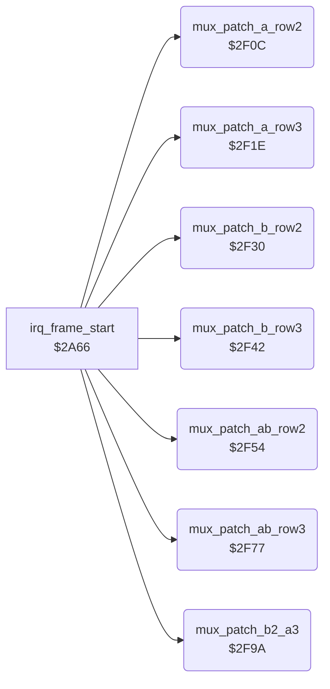

<!-- Generated by c64-docs from knowledge revision 20261022T132731.733-fztd87 and .c64-re-tools/local/generated/src/source-map.json. Do not edit: change the knowledge, generate the source again, then run docs.ts generate. -->
# irq/sprite_mux_patch.asm: Sprite multiplexer: copy the row 2/3 pointers of the fighters into the raster handler operands

Range `$2F0C-$2FBC`. Source: [irq/sprite_mux_patch.asm](../../../../src/irq/sprite_mux_patch.asm). Index: [the reference](../../index.md).

## Call graph

A solid arrow is a call, a thick arrow a table entry, a dotted arrow a jump. Rounded nodes are in this file.

## Names

### [`mux_patch_a_row2`](../../../../src/irq/sprite_mux_patch.asm#L6) `$2F0C`

*routine*

Copies the pointers of parts 3-5 (row 2) of the group A fighter into handler $2635 (sprites 0-2). Called from the layout code of irq_frame_start.

- **Called from:** [`irq_frame_start`](sprite_mux_plan.md#irq_frame_start) [`$2BBE`](../../../../src/irq/sprite_mux_plan.asm#L174), [`irq_frame_start`](sprite_mux_plan.md#irq_frame_start) [`$2C37`](../../../../src/irq/sprite_mux_plan.asm#L230), [`irq_frame_start`](sprite_mux_plan.md#irq_frame_start) [`$2CAA`](../../../../src/irq/sprite_mux_plan.asm#L284), [`irq_frame_start`](sprite_mux_plan.md#irq_frame_start) [`$2D6E`](../../../../src/irq/sprite_mux_plan.asm#L376), [`irq_frame_start`](sprite_mux_plan.md#irq_frame_start) [`$2DEA`](../../../../src/irq/sprite_mux_plan.asm#L433)
- **Reads:** [`group_a_fighter`](../../memory-map.md#group_a_fighter), [`fighter_part_ptrs+6`](../../memory-map.md#fighter_part_ptrs), [`fighter_part_ptrs+8`](../../memory-map.md#fighter_part_ptrs), [`fighter_part_ptrs+10`](../../memory-map.md#fighter_part_ptrs)
- **Writes:** [`irq_a_row2_ptr_left`](irq_sprite_rows.md#irq_a_row2_ptr_left), [`irq_a_row2_ptr_mid`](irq_sprite_rows.md#irq_a_row2_ptr_mid), [`irq_a_row2_ptr_right`](irq_sprite_rows.md#irq_a_row2_ptr_right)
- **Refers to:** [`fighter_part_ptrs`](../../memory-map.md#fighter_part_ptrs)

### [`mux_patch_a_row3`](../../../../src/irq/sprite_mux_patch.asm#L16) `$2F1E`

*routine*

Copies the pointers of parts 6-8 (row 3) of the group A fighter into handler $266e (sprites 0-2). Called from the layout code of irq_frame_start.

- **Called from:** [`irq_frame_start`](sprite_mux_plan.md#irq_frame_start) [`$2BC4`](../../../../src/irq/sprite_mux_plan.asm#L176), [`irq_frame_start`](sprite_mux_plan.md#irq_frame_start) [`$2C3D`](../../../../src/irq/sprite_mux_plan.asm#L232), [`irq_frame_start`](sprite_mux_plan.md#irq_frame_start) [`$2D12`](../../../../src/irq/sprite_mux_plan.asm#L332), [`irq_frame_start`](sprite_mux_plan.md#irq_frame_start) [`$2D71`](../../../../src/irq/sprite_mux_plan.asm#L377), [`irq_frame_start`](sprite_mux_plan.md#irq_frame_start) [`$2DED`](../../../../src/irq/sprite_mux_plan.asm#L434)
- **Reads:** [`group_a_fighter`](../../memory-map.md#group_a_fighter), [`fighter_part_ptrs+12`](../../memory-map.md#fighter_part_ptrs), [`fighter_part_ptrs+14`](../../memory-map.md#fighter_part_ptrs), [`fighter_part_ptrs+16`](../../memory-map.md#fighter_part_ptrs)
- **Writes:** [`irq_a_row3_ptr_left`](irq_sprite_rows.md#irq_a_row3_ptr_left), [`irq_a_row3_ptr_mid`](irq_sprite_rows.md#irq_a_row3_ptr_mid), [`irq_a_row3_ptr_right`](irq_sprite_rows.md#irq_a_row3_ptr_right)
- **Refers to:** [`fighter_part_ptrs`](../../memory-map.md#fighter_part_ptrs)

### [`mux_patch_b_row2`](../../../../src/irq/sprite_mux_patch.asm#L26) `$2F30`

*routine*

Copies the pointers of parts 3-5 (row 2) of the group B fighter into handler $26a7 (sprites 3-5). Called from the layout code of irq_frame_start.

- **Called from:** [`irq_frame_start`](sprite_mux_plan.md#irq_frame_start) [`$2BC1`](../../../../src/irq/sprite_mux_plan.asm#L175), [`irq_frame_start`](sprite_mux_plan.md#irq_frame_start) [`$2C34`](../../../../src/irq/sprite_mux_plan.asm#L229), [`irq_frame_start`](sprite_mux_plan.md#irq_frame_start) [`$2D0C`](../../../../src/irq/sprite_mux_plan.asm#L330), [`irq_frame_start`](sprite_mux_plan.md#irq_frame_start) [`$2D74`](../../../../src/irq/sprite_mux_plan.asm#L378), [`irq_frame_start`](sprite_mux_plan.md#irq_frame_start) [`$2DE4`](../../../../src/irq/sprite_mux_plan.asm#L431)
- **Reads:** [`group_b_fighter`](../../memory-map.md#group_b_fighter), [`fighter_part_ptrs+6`](../../memory-map.md#fighter_part_ptrs), [`fighter_part_ptrs+8`](../../memory-map.md#fighter_part_ptrs), [`fighter_part_ptrs+10`](../../memory-map.md#fighter_part_ptrs)
- **Writes:** [`irq_b_row2_ptr_left`](irq_sprite_rows.md#irq_b_row2_ptr_left), [`irq_b_row2_ptr_mid`](irq_sprite_rows.md#irq_b_row2_ptr_mid), [`irq_b_row2_ptr_right`](irq_sprite_rows.md#irq_b_row2_ptr_right)
- **Refers to:** [`fighter_part_ptrs`](../../memory-map.md#fighter_part_ptrs)

### [`mux_patch_b_row3`](../../../../src/irq/sprite_mux_patch.asm#L36) `$2F42`

*routine*

Copies the pointers of parts 6-8 (row 3) of the group B fighter into handler $26e1 (sprites 3-5). Called from the layout code of irq_frame_start.

- **Called from:** [`irq_frame_start`](sprite_mux_plan.md#irq_frame_start) [`$2BC7`](../../../../src/irq/sprite_mux_plan.asm#L177), [`irq_frame_start`](sprite_mux_plan.md#irq_frame_start) [`$2C3A`](../../../../src/irq/sprite_mux_plan.asm#L231), [`irq_frame_start`](sprite_mux_plan.md#irq_frame_start) [`$2CB0`](../../../../src/irq/sprite_mux_plan.asm#L286), [`irq_frame_start`](sprite_mux_plan.md#irq_frame_start) [`$2D77`](../../../../src/irq/sprite_mux_plan.asm#L379), [`irq_frame_start`](sprite_mux_plan.md#irq_frame_start) [`$2DE7`](../../../../src/irq/sprite_mux_plan.asm#L432)
- **Reads:** [`group_b_fighter`](../../memory-map.md#group_b_fighter), [`fighter_part_ptrs+12`](../../memory-map.md#fighter_part_ptrs), [`fighter_part_ptrs+14`](../../memory-map.md#fighter_part_ptrs), [`fighter_part_ptrs+16`](../../memory-map.md#fighter_part_ptrs)
- **Writes:** [`irq_b_row3_ptr_left`](irq_sprite_rows.md#irq_b_row3_ptr_left), [`irq_b_row3_ptr_mid`](irq_sprite_rows.md#irq_b_row3_ptr_mid), [`irq_b_row3_ptr_right`](irq_sprite_rows.md#irq_b_row3_ptr_right)
- **Refers to:** [`fighter_part_ptrs`](../../memory-map.md#fighter_part_ptrs)

### [`mux_patch_ab_row2`](../../../../src/irq/sprite_mux_patch.asm#L46) `$2F54`

*routine*

Copies the row 2 pointers (parts 3-5) of both group fighters into the combined handler $271b. Layout 1 only. Called from the layout code of irq_frame_start.

- **Called from:** [`irq_frame_start`](sprite_mux_plan.md#irq_frame_start) [`$2B7A`](../../../../src/irq/sprite_mux_plan.asm#L142)
- **Reads:** [`group_a_fighter`](../../memory-map.md#group_a_fighter), [`fighter_part_ptrs+6`](../../memory-map.md#fighter_part_ptrs), [`fighter_part_ptrs+8`](../../memory-map.md#fighter_part_ptrs), [`fighter_part_ptrs+10`](../../memory-map.md#fighter_part_ptrs), [`group_b_fighter`](../../memory-map.md#group_b_fighter)
- **Writes:** [`irq_ab_row2_a_ptr_left`](irq_sprite_rows.md#irq_ab_row2_a_ptr_left), [`irq_ab_row2_a_ptr_mid`](irq_sprite_rows.md#irq_ab_row2_a_ptr_mid), [`irq_ab_row2_a_ptr_right`](irq_sprite_rows.md#irq_ab_row2_a_ptr_right), [`irq_ab_row2_b_ptr_left`](irq_sprite_rows.md#irq_ab_row2_b_ptr_left), [`irq_ab_row2_b_ptr_mid`](irq_sprite_rows.md#irq_ab_row2_b_ptr_mid), [`irq_ab_row2_b_ptr_right`](irq_sprite_rows.md#irq_ab_row2_b_ptr_right)
- **Refers to:** [`fighter_part_ptrs`](../../memory-map.md#fighter_part_ptrs)

### [`mux_patch_ab_row3`](../../../../src/irq/sprite_mux_patch.asm#L63) `$2F77`

*routine*

Copies the row 3 pointers (parts 6-8) of both group fighters into the combined handler $276c. Layout 1 only. Called from the layout code of irq_frame_start.

- **Called from:** [`irq_frame_start`](sprite_mux_plan.md#irq_frame_start) [`$2B7D`](../../../../src/irq/sprite_mux_plan.asm#L143)
- **Reads:** [`group_a_fighter`](../../memory-map.md#group_a_fighter), [`fighter_part_ptrs+12`](../../memory-map.md#fighter_part_ptrs), [`fighter_part_ptrs+14`](../../memory-map.md#fighter_part_ptrs), [`fighter_part_ptrs+16`](../../memory-map.md#fighter_part_ptrs), [`group_b_fighter`](../../memory-map.md#group_b_fighter)
- **Writes:** [`irq_ab_row3_a_ptr_left`](irq_sprite_rows.md#irq_ab_row3_a_ptr_left), [`irq_ab_row3_a_ptr_mid`](irq_sprite_rows.md#irq_ab_row3_a_ptr_mid), [`irq_ab_row3_a_ptr_right`](irq_sprite_rows.md#irq_ab_row3_a_ptr_right), [`irq_ab_row3_b_ptr_left`](irq_sprite_rows.md#irq_ab_row3_b_ptr_left), [`irq_ab_row3_b_ptr_mid`](irq_sprite_rows.md#irq_ab_row3_b_ptr_mid), [`irq_ab_row3_b_ptr_right`](irq_sprite_rows.md#irq_ab_row3_b_ptr_right)
- **Refers to:** [`fighter_part_ptrs`](../../memory-map.md#fighter_part_ptrs)

### [`mux_patch_b2_a3`](../../../../src/irq/sprite_mux_patch.asm#L80) `$2F9A`

*routine*

Copies row 2 of the group B fighter and row 3 of the group A fighter into the combined handler $27bd. Layout 4 only. Called from the layout code of irq_frame_start.

- **Called from:** [`irq_frame_start`](sprite_mux_plan.md#irq_frame_start) [`$2CAD`](../../../../src/irq/sprite_mux_plan.asm#L285)
- **Reads:** [`group_a_fighter`](../../memory-map.md#group_a_fighter), [`fighter_part_ptrs+12`](../../memory-map.md#fighter_part_ptrs), [`fighter_part_ptrs+14`](../../memory-map.md#fighter_part_ptrs), [`fighter_part_ptrs+16`](../../memory-map.md#fighter_part_ptrs), [`group_b_fighter`](../../memory-map.md#group_b_fighter), [`fighter_part_ptrs+6`](../../memory-map.md#fighter_part_ptrs), [`fighter_part_ptrs+8`](../../memory-map.md#fighter_part_ptrs), [`fighter_part_ptrs+10`](../../memory-map.md#fighter_part_ptrs)
- **Writes:** [`irq_b2_a3_a_ptr_left`](irq_sprite_rows.md#irq_b2_a3_a_ptr_left), [`irq_b2_a3_a_ptr_mid`](irq_sprite_rows.md#irq_b2_a3_a_ptr_mid), [`irq_b2_a3_a_ptr_right`](irq_sprite_rows.md#irq_b2_a3_a_ptr_right), [`irq_b2_a3_b_ptr_left`](irq_sprite_rows.md#irq_b2_a3_b_ptr_left), [`irq_b2_a3_b_ptr_mid`](irq_sprite_rows.md#irq_b2_a3_b_ptr_mid), [`irq_b2_a3_b_ptr_right`](irq_sprite_rows.md#irq_b2_a3_b_ptr_right)
- **Refers to:** [`fighter_part_ptrs`](../../memory-map.md#fighter_part_ptrs)
