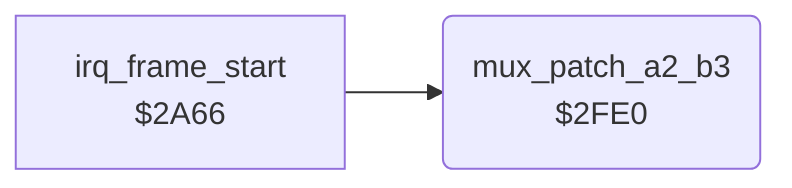

<!-- Generated by c64-docs from knowledge revision 20261025T191824.210-p015r5 and .c64-re-tools/local/generated/src/source-map.json. Do not edit: change the knowledge, generate the source again, then run docs.ts generate. -->
# irq/sprite_mux_patch_2fe0.asm

Range `$2FE0-$3025`. Source: [irq/sprite_mux_patch_2fe0.asm](../../../../src/irq/sprite_mux_patch_2fe0.asm). Index: [the reference](../../index.md).

## Routines

| Routine | Address | Reached from | Summary |
|---|---|---|---|
| [`mux_patch_a2_b3`](sprite_mux_patch_2fe0.md#mux_patch_a2_b3) | `$2FE0` | [`irq_frame_start`](sprite_mux_plan.md#irq_frame_start) | Copies row 2 of the group A fighter and row 3 of the group B fighter into the combined handler $2813. |

## Data

| Range | Type | Name | Read by | Written by |
|---|---|---|---|---|
| [`$3003`](../../../../src/irq/sprite_mux_patch_2fe0.asm#L24)-`$3025` | unused | [`mux_unused_patch_a3_b2`](../../../../src/irq/sprite_mux_patch_2fe0.asm#L23) |  |  |

## Call graph

A solid arrow is a call, a thick arrow a table entry. Rounded nodes are in this file.

## Details

### [`mux_patch_a2_b3`](../../../../src/irq/sprite_mux_patch_2fe0.asm#L6) `$2FE0`

*routine*

Copies row 2 of the group A fighter and row 3 of the group B fighter into the combined handler $2813. Layout 5 only. Called from the layout code of irq_frame_start.

- **Called from:** [`irq_frame_start`](sprite_mux_plan.md#irq_frame_start)
- **Reads:** [`group_a_fighter`](../../memory-map.md#group_a_fighter), [`fighter_part_ptrs`](../../memory-map.md#fighter_part_ptrs), [`group_b_fighter`](../../memory-map.md#group_b_fighter)
- **Writes:** [`irq_a2_b3_a_ptr_left`](irq_sprite_rows.md#irq_a2_b3_a_ptr_left), [`irq_a2_b3_a_ptr_mid`](irq_sprite_rows.md#irq_a2_b3_a_ptr_mid), [`irq_a2_b3_a_ptr_right`](irq_sprite_rows.md#irq_a2_b3_a_ptr_right), [`irq_a2_b3_b_ptr_left`](irq_sprite_rows.md#irq_a2_b3_b_ptr_left), [`irq_a2_b3_b_ptr_mid`](irq_sprite_rows.md#irq_a2_b3_b_ptr_mid), [`irq_a2_b3_b_ptr_right`](irq_sprite_rows.md#irq_a2_b3_b_ptr_right)
- **Refers to:** [`fighter_part_ptrs`](../../memory-map.md#fighter_part_ptrs)

### [`mux_unused_patch_a3_b2`](../../../../src/irq/sprite_mux_patch_2fe0.asm#L23) `$3003-$3025`

*data*

Unused code, never called: row 3 of group A into the first set of $2813, row 2 of group B into the second set, RTS. It is mux_patch_a2_b3 with the rows exchanged.
