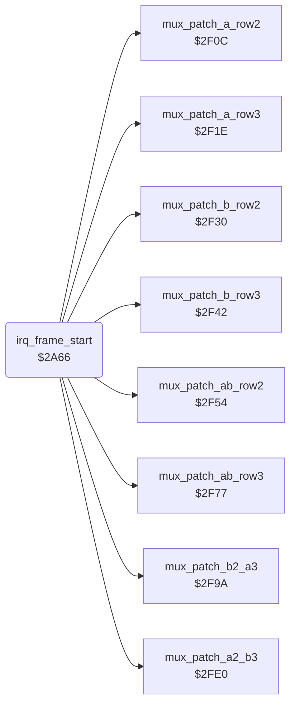

<!-- Generated by c64-docs from knowledge revision 20261025T191824.210-p015r5 and .c64-re-tools/local/generated/src/source-map.json. Do not edit: change the knowledge, generate the source again, then run docs.ts generate. -->
# irq/sprite_mux_plan.asm: Frame-start raster IRQ: sprite groups, shadow handler, 7 multiplexer layouts, sprite row 1

Range `$2A66-$2F0B`. Source: [irq/sprite_mux_plan.asm](../../../../src/irq/sprite_mux_plan.asm). Index: [the reference](../../index.md).

## Routines

| Routine | Address | Reached from | Summary |
|---|---|---|---|
| [`irq_frame_start`](sprite_mux_plan.md#irq_frame_start) | `$2A66` |  | Raster IRQ at line 0, the start of the sprite multiplexer. |

## Data

| Range | Type | Name | Read by | Written by |
|---|---|---|---|---|
| [`$2F04`](../../../../src/irq/sprite_mux_plan.asm#L571)-`$2F07` | bytes | [`mux_msb_bits_a`](../../../../src/irq/sprite_mux_plan.asm#L570) | [`irq_frame_start`](sprite_mux_plan.md#irq_frame_start) |  |
| [`$2F08`](../../../../src/irq/sprite_mux_plan.asm#L574)-`$2F0B` | bytes | [`mux_msb_bits_b`](../../../../src/irq/sprite_mux_plan.asm#L573) | [`irq_frame_start`](sprite_mux_plan.md#irq_frame_start) |  |

## Call graph

A solid arrow is a call, a thick arrow a table entry. Rounded nodes are in this file.

## Details

### [`irq_frame_start`](../../../../src/irq/sprite_mux_plan.asm#L6) `$2A66`

*routine*

Raster IRQ at line 0, the start of the sprite multiplexer. It acknowledges the VIC, sets the next IRQ to $2869 at line $5a and sets the sprite multicolours. It puts front_fighter in group A (sprites 0-2, in front) and the other fighter in group B (sprites 3-5). It selects the shadow handler, patches the row handlers for one of 7 layouts, sets sprite row 1 and returns with RTI.

- **Referred to by:** [`init_vectors_cias`](../game/init_bout_loop.md#init_vectors_cias), [`irq_frame_end`](irq_screen_split.md#irq_frame_end)
- **Calls:** [`mux_patch_ab_row2`](sprite_mux_patch.md#mux_patch_ab_row2), [`mux_patch_ab_row3`](sprite_mux_patch.md#mux_patch_ab_row3), [`mux_patch_a_row2`](sprite_mux_patch.md#mux_patch_a_row2), [`mux_patch_b_row2`](sprite_mux_patch.md#mux_patch_b_row2), [`mux_patch_a_row3`](sprite_mux_patch.md#mux_patch_a_row3), [`mux_patch_b_row3`](sprite_mux_patch.md#mux_patch_b_row3), [`mux_patch_b2_a3`](sprite_mux_patch.md#mux_patch_b2_a3), [`mux_patch_a2_b3`](sprite_mux_patch_2fe0.md#mux_patch_a2_b3)
- **Jumps to:** [`sfx_sample_irq`](../sfx/sfx_sample_player.md#sfx_sample_irq)
- **Reads:** [`VICIRQ`](../../memory-map.md#VICIRQ), [`front_fighter`](../../memory-map.md#front_fighter), [`group_a_fighter`](../../memory-map.md#group_a_fighter), [`sprite_y`](../../memory-map.md#sprite_y), [`sprite_x_lo`](../../memory-map.md#sprite_x_lo), [`sprite_x_msb`](../../memory-map.md#sprite_x_msb), [`group_b_fighter`](../../memory-map.md#group_b_fighter), [`group_y`](../../memory-map.md#group_y), [`row4_ptr_left`](../../memory-map.md#row4_ptr_left), [`row4_ptr_mid`](../../memory-map.md#row4_ptr_mid), [`row4_ptr_right`](../../memory-map.md#row4_ptr_right), [`row4_irq_vector`](../../memory-map.md#row4_irq_vector) and 5 more
- **Writes:** [`VICIRQ`](../../memory-map.md#VICIRQ), [`hw_irq_vector`](../../memory-map.md#hw_irq_vector), [`RASTER`](../../memory-map.md#RASTER), [`SPMC0`](../../memory-map.md#SPMC0), [`SPMC1`](../../memory-map.md#SPMC1), [`group_a_fighter`](../../memory-map.md#group_a_fighter), [`group_b_fighter`](../../memory-map.md#group_b_fighter), [`group_y`](../../memory-map.md#group_y), [`group_x_lo`](../../memory-map.md#group_x_lo), [`group_x_msb`](../../memory-map.md#group_x_msb), [`row4_irq_vector`](../../memory-map.md#row4_irq_vector), [`irq_a_row4_ptr_left`](irq_screen_split.md#irq_a_row4_ptr_left) and 68 more
- **Refers to:** [`irq_bitmap_on`](irq_screen_split.md#irq_bitmap_on), [`group_y`](../../memory-map.md#group_y), [`group_x_lo`](../../memory-map.md#group_x_lo), [`group_x_msb`](../../memory-map.md#group_x_msb), [`irq_b_row4`](irq_screen_split.md#irq_b_row4), [`row4_irq_vector`](../../memory-map.md#row4_irq_vector), [`irq_ab_row4`](irq_screen_split.md#irq_ab_row4), [`irq_a_row4`](irq_screen_split.md#irq_a_row4), [`irq_no_row4`](irq_screen_split.md#irq_no_row4), [`irq_ab_row2`](irq_sprite_rows.md#irq_ab_row2), [`irq_ab_row3`](irq_sprite_rows.md#irq_ab_row3), [`irq_a_row2`](irq_sprite_rows.md#irq_a_row2) and 6 more

| Label | Address | Comment |
|---|---|---|
| [`irq_frame_start_vic`](../../../../src/irq/sprite_mux_plan.asm#L11) | `$2A6E` |  |
| [`mux_front_is_fighter1`](../../../../src/irq/sprite_mux_plan.asm#L35) | `$2AA2` |  |
| [`mux_copy_group_pos`](../../../../src/irq/sprite_mux_plan.asm#L41) | `$2AAA` | Copies sprite_y, sprite_x_lo and sprite_x_msb of the group A fighter to $1c/$1a/$1e and of the group B fighter to $1d/$1b/$1f. |
| [`mux_a_off_ground`](../../../../src/irq/sprite_mux_plan.asm#L64) | `$2ADB` |  |
| [`mux_row4_a_only`](../../../../src/irq/sprite_mux_plan.asm#L69) | `$2AEA` |  |
| [`mux_no_row4`](../../../../src/irq/sprite_mux_plan.asm#L72) | `$2AF5` |  |
| [`mux_patch_row4_ptrs`](../../../../src/irq/sprite_mux_plan.asm#L76) | `$2B00` | Copies the row 4 (floor shadow) pointers row4_ptr_left/mid/right of group A into handlers $28b2 and $2924, and of group B into $2924 and $28eb. |
| [`mux_choose_layout`](../../../../src/irq/sprite_mux_plan.asm#L104) | `$2B40` | Selects one of 7 layouts from the Y gap between group A ($1c) and group B ($1d). Sprite Y is fighter_y*2 and all script dy values are even, thus the gap is a multiple of 4. Of these gaps, only $14 puts two row IRQs one raster line apart; it gets a combined handler. |
| [`mux_y_differ`](../../../../src/irq/sprite_mux_plan.asm#L110) | `$2B4A` |  |
| [`mux_a_above_b`](../../../../src/irq/sprite_mux_plan.asm#L113) | `$2B4F` |  |
| [`mux_a_above_gap_test`](../../../../src/irq/sprite_mux_plan.asm#L119) | `$2B58` |  |
| [`mux_a_above_near`](../../../../src/irq/sprite_mux_plan.asm#L122) | `$2B5D` |  |
| [`mux_a_above_interleave`](../../../../src/irq/sprite_mux_plan.asm#L126) | `$2B64` |  |
| [`mux_b_above_a`](../../../../src/irq/sprite_mux_plan.asm#L128) | `$2B67` |  |
| [`mux_b_above_gap_test`](../../../../src/irq/sprite_mux_plan.asm#L131) | `$2B6B` |  |
| [`mux_b_above_near`](../../../../src/irq/sprite_mux_plan.asm#L134) | `$2B70` |  |
| [`mux_b_above_interleave`](../../../../src/irq/sprite_mux_plan.asm#L138) | `$2B77` |  |
| [`mux_layout_same_y`](../../../../src/irq/sprite_mux_plan.asm#L141) | `$2B7A` | Layout 1, both groups at the same Y. Handler $271b at line Y+$14 starts row 2 of both groups. Handler $276c at line Y+$29 starts row 3 of both, then the shadow handler follows at line $d9. |
| [`mux_layout_a_interleave`](../../../../src/irq/sprite_mux_plan.asm#L173) | `$2BBE` | Layout 2, group A above group B by 4 to $10 (any gap below $16 except $14). IRQ chain: A row 2 ($2635), B row 2 ($26a7), A row 3 ($266e), B row 3 ($26e1), shadow handler at line $d9. |
| [`mux_layout_b_interleave`](../../../../src/irq/sprite_mux_plan.asm#L228) | `$2C34` | Layout 3, group B above group A by 4 to $10. IRQ chain: B row 2 ($26a7), A row 2 ($2635), B row 3 ($26e1), A row 3 ($266e), shadow handler at line $d9. |
| [`mux_layout_a_gap14`](../../../../src/irq/sprite_mux_plan.asm#L283) | `$2CAA` | Layout 4, group A above group B by exactly $14: B row 2 starts one line before A row 3. IRQ chain: A row 2 ($2635), $27bd at line A+$28 for B row 2 and A row 3, B row 3 ($26e1), shadow handler. |
| [`mux_layout_b_gap14`](../../../../src/irq/sprite_mux_plan.asm#L329) | `$2D0C` | Layout 5, group B above group A by exactly $14. IRQ chain: B row 2 ($26a7), $2813 at line B+$28 for A row 2 and B row 3, A row 3 ($266e), shadow handler. |
| [`mux_layout_a_apart`](../../../../src/irq/sprite_mux_plan.asm#L375) | `$2D6E` | Layout 6, group A above group B by $16 or more: the rows of B start after row 3 of A. IRQ chain: A row 2, A row 3, B row 2, B row 3, shadow handler. |
| [`mux_layout_b_apart`](../../../../src/irq/sprite_mux_plan.asm#L430) | `$2DE4` | Layout 7, group B above group A by $16 or more. IRQ chain: B row 2, B row 3, A row 2, A row 3, shadow handler. |
| [`mux_set_row1`](../../../../src/irq/sprite_mux_plan.asm#L485) | `$2E5A` | Sets sprite row 1 of both groups: pointers $cff8-$cffd from parts 0-2, Y and colours. X is group X +0, +$18 and +$30, with X bit 8 from mux_msb_bits_a/b. Then it restores X, Y and A and returns from the IRQ. |
| [`mux_a_col2_x`](../../../../src/irq/sprite_mux_plan.asm#L533) | `$2EC4` |  |
| [`mux_a_set_msb`](../../../../src/irq/sprite_mux_plan.asm#L538) | `$2ECD` |  |
| [`mux_b_col2_x`](../../../../src/irq/sprite_mux_plan.asm#L554) | `$2EEC` |  |
| [`mux_b_set_msb`](../../../../src/irq/sprite_mux_plan.asm#L559) | `$2EF5` |  |

### [`mux_msb_bits_a`](../../../../src/irq/sprite_mux_plan.asm#L570) `$2F04-$2F07`

*data*

X bit 8 masks of sprites 0-2: index 0 none, 1 all three (group X >= 256), 2 sprites 1-2, 3 sprite 2.

- **Read by:** [`irq_frame_start`](sprite_mux_plan.md#irq_frame_start)

### [`mux_msb_bits_b`](../../../../src/irq/sprite_mux_plan.asm#L573) `$2F08-$2F0B`

*data*

X bit 8 masks of sprites 3-5, the same order as mux_msb_bits_a.

- **Read by:** [`irq_frame_start`](sprite_mux_plan.md#irq_frame_start)
