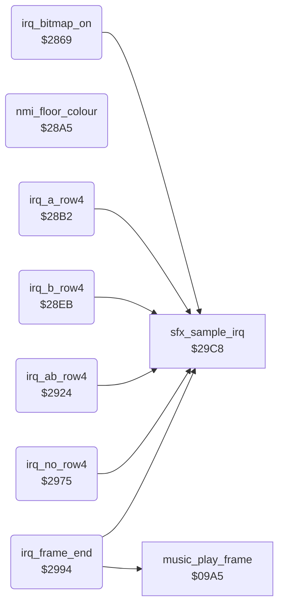

<!-- Generated by c64-docs from knowledge revision 20261021T021734.611-6rf0n2 and src/source-map.json. Do not edit: change the knowledge, generate the source again, then run docs.ts generate. -->
# irq_screen_split.asm: Bitmap-on IRQ, floor colour NMI, sprite row 4 IRQs and the frame-end IRQ with the music call

Range `$2869-$29C7`. Source: [irq_screen_split.asm](../../../src/irq_screen_split.asm). Index: [the reference](../index.md).

## Call graph

A solid arrow is a call, a thick arrow a table entry, a dotted arrow a jump. Rounded nodes are in this file.

## Names

### [`irq_bitmap_on`](../../../src/irq_screen_split.asm#L6) `$2869`

*routine*

Raster IRQ at line $5a, under the text rows of the score panel. It sets the first sprite row handler (patched). Then it switches to bitmap mode ($d011=$3b), sets the scene background colour and starts CIA2 timer B for the floor NMI.

- **Referred to by:** [`irq_frame_start`](sprite_mux_plan.md#irq_frame_start) [`$2A74`](../../../src/sprite_mux_plan.asm#L15), [`irq_frame_start`](sprite_mux_plan.md#irq_frame_start) [`$2A79`](../../../src/sprite_mux_plan.asm#L17)
- **Calls:** [`sfx_sample_irq`](sfx_sample_player.md#sfx_sample_irq)
- **Reads:** [`VICIRQ`](../memory-map.md#VICIRQ)
- **Writes:** [`VICIRQ`](../memory-map.md#VICIRQ), [`RASTER`](../memory-map.md#RASTER), [`hw_irq_vector`](../memory-map.md#hw_irq_vector), [`hw_irq_vector+1`](../memory-map.md#hw_irq_vector), [`SCROLY`](../memory-map.md#SCROLY), [`BGCOL0`](../memory-map.md#BGCOL0), [`CI2TBLO`](../memory-map.md#CI2TBLO), [`CI2TBHI`](../memory-map.md#CI2TBHI), [`CI2CRB`](../memory-map.md#CI2CRB)

### [`irq_bitmap_on_vic`](../../../src/irq_screen_split.asm#L11) `$2871`

*label*

- **Jumped to from:** [`irq_bitmap_on`](irq_screen_split.md#irq_bitmap_on) [`$286C`](../../../src/irq_screen_split.asm#L8)

### [`irq_bitmap_on_next_line`](../../../src/irq_screen_split.asm#L15) `$2878-$287C`

*variable*

- **Written by:** [`mux_layout_same_y`](sprite_mux_plan.md#mux_layout_same_y) [`$2BA3`](../../../src/sprite_mux_plan.asm#L174), [`mux_layout_same_y`](sprite_mux_plan.md#mux_layout_same_y) [`$2C01`](../../../src/sprite_mux_plan.asm#L216), [`mux_layout_b_interleave`](sprite_mux_plan.md#mux_layout_b_interleave) [`$2C77`](../../../src/sprite_mux_plan.asm#L271), [`mux_layout_a_gap14`](sprite_mux_plan.md#mux_layout_a_gap14) [`$2CE0`](../../../src/sprite_mux_plan.asm#L321), [`mux_layout_b_gap14`](sprite_mux_plan.md#mux_layout_b_gap14) [`$2D42`](../../../src/sprite_mux_plan.asm#L367), [`mux_layout_a_apart`](sprite_mux_plan.md#mux_layout_a_apart) [`$2DB1`](../../../src/sprite_mux_plan.asm#L418), [`mux_layout_b_apart`](sprite_mux_plan.md#mux_layout_b_apart) [`$2E27`](../../../src/sprite_mux_plan.asm#L473)

### [`irq_bitmap_on_next_lo`](../../../src/irq_screen_split.asm#L27) `$287D-$2881`

*variable*

- **Written by:** [`mux_layout_same_y`](sprite_mux_plan.md#mux_layout_same_y) [`$2B82`](../../../src/sprite_mux_plan.asm#L160), [`mux_layout_same_y`](sprite_mux_plan.md#mux_layout_same_y) [`$2BCC`](../../../src/sprite_mux_plan.asm#L194), [`mux_layout_b_interleave`](sprite_mux_plan.md#mux_layout_b_interleave) [`$2C42`](../../../src/sprite_mux_plan.asm#L249), [`mux_layout_a_gap14`](sprite_mux_plan.md#mux_layout_a_gap14) [`$2CB5`](../../../src/sprite_mux_plan.asm#L303), [`mux_layout_b_gap14`](sprite_mux_plan.md#mux_layout_b_gap14) [`$2D17`](../../../src/sprite_mux_plan.asm#L349), [`mux_layout_a_apart`](sprite_mux_plan.md#mux_layout_a_apart) [`$2D7C`](../../../src/sprite_mux_plan.asm#L396), [`mux_layout_b_apart`](sprite_mux_plan.md#mux_layout_b_apart) [`$2DF2`](../../../src/sprite_mux_plan.asm#L451)

### [`irq_bitmap_on_next_hi`](../../../src/irq_screen_split.asm#L39) `$2882-$288F`

*variable*

- **Written by:** [`mux_layout_same_y`](sprite_mux_plan.md#mux_layout_same_y) [`$2B87`](../../../src/sprite_mux_plan.asm#L162), [`mux_layout_same_y`](sprite_mux_plan.md#mux_layout_same_y) [`$2BD1`](../../../src/sprite_mux_plan.asm#L196), [`mux_layout_b_interleave`](sprite_mux_plan.md#mux_layout_b_interleave) [`$2C47`](../../../src/sprite_mux_plan.asm#L251), [`mux_layout_a_gap14`](sprite_mux_plan.md#mux_layout_a_gap14) [`$2CBA`](../../../src/sprite_mux_plan.asm#L305), [`mux_layout_b_gap14`](sprite_mux_plan.md#mux_layout_b_gap14) [`$2D1C`](../../../src/sprite_mux_plan.asm#L351), [`mux_layout_a_apart`](sprite_mux_plan.md#mux_layout_a_apart) [`$2D81`](../../../src/sprite_mux_plan.asm#L398), [`mux_layout_b_apart`](sprite_mux_plan.md#mux_layout_b_apart) [`$2DF7`](../../../src/sprite_mux_plan.asm#L453)

### [`irq_bitmap_on_bg_colour`](../../../src/irq_screen_split.asm#L57) `$2890-$28A4`

*variable*

- **Written by:** [`scene_draw_if_new`](title_and_scene.md#scene_draw_if_new) [`$1A6F`](../../../src/title_and_scene.asm#L180), [`scene_draw_if_new`](title_and_scene.md#scene_draw_if_new) [`$1A7D`](../../../src/title_and_scene.asm#L185)

### [`nmi_floor_colour`](../../../src/irq_screen_split.asm#L69) `$28A5`

*routine*

NMI of CIA2 timer B, about 92 PAL lines after irq_bitmap_on starts the timer (5820 cycles). It sets the background colour to 7 (yellow) for the floor. An NMI from another source (RESTORE) only returns.

- **Referred to by:** [`init_vectors_cias`](init_bout_loop.md#init_vectors_cias) [`$1487`](../../../src/init_bout_loop.asm#L73), [`init_vectors_cias`](init_bout_loop.md#init_vectors_cias) [`$148C`](../../../src/init_bout_loop.asm#L75)
- **Reads:** [`CI2ICR`](../memory-map.md#CI2ICR)
- **Writes:** [`BGCOL0`](../memory-map.md#BGCOL0)

### [`nmi_done`](../../../src/irq_screen_split.asm#L76) `$28B1`

*label*

- **Jumped to from:** [`nmi_floor_colour`](irq_screen_split.md#nmi_floor_colour) [`$28A8`](../../../src/irq_screen_split.asm#L71)

### [`irq_a_row4`](../../../src/irq_screen_split.asm#L79) `$28B2`

*routine*

Raster IRQ at line $d9 that shows a 4th sprite row for group A at Y $da. row4_irq_vector selects it when only group A is not at Y $a0. The pointers come from row4_ptr_* (patched at $2b00).

- **Referred to by:** [`irq_frame_start`](sprite_mux_plan.md#irq_frame_start) [`$2AEA`](../../../src/sprite_mux_plan.asm#L79), [`irq_frame_start`](sprite_mux_plan.md#irq_frame_start) [`$2AEE`](../../../src/sprite_mux_plan.asm#L81)
- **Calls:** [`sfx_sample_irq`](sfx_sample_player.md#sfx_sample_irq)
- **Reads:** [`VICIRQ`](../memory-map.md#VICIRQ)
- **Writes:** [`SP0Y`](../memory-map.md#SP0Y), [`SP1Y`](../memory-map.md#SP1Y), [`SP2Y`](../memory-map.md#SP2Y), [`sprite_pointers`](../memory-map.md#sprite_pointers), [`sprite_pointers+1`](../memory-map.md#sprite_pointers), [`sprite_pointers+2`](../memory-map.md#sprite_pointers), [`VICIRQ`](../memory-map.md#VICIRQ), [`RASTER`](../memory-map.md#RASTER), [`hw_irq_vector`](../memory-map.md#hw_irq_vector), [`hw_irq_vector+1`](../memory-map.md#hw_irq_vector)
- **Refers to:** [`irq_frame_end`](irq_screen_split.md#irq_frame_end)

### [`irq_a_row4_vic`](../../../src/irq_screen_split.asm#L84) `$28BA`

*label*

- **Jumped to from:** [`irq_a_row4`](irq_screen_split.md#irq_a_row4) [`$28B5`](../../../src/irq_screen_split.asm#L81)

### [`irq_a_row4_ptr_left`](../../../src/irq_screen_split.asm#L90) `$28C7-$28CB`

*variable*

- **Written by:** [`irq_frame_start`](sprite_mux_plan.md#irq_frame_start) [`$2B04`](../../../src/sprite_mux_plan.asm#L94)

### [`irq_a_row4_ptr_mid`](../../../src/irq_screen_split.asm#L102) `$28CC-$28D0`

*variable*

- **Written by:** [`irq_frame_start`](sprite_mux_plan.md#irq_frame_start) [`$2B09`](../../../src/sprite_mux_plan.asm#L96)

### [`irq_a_row4_ptr_right`](../../../src/irq_screen_split.asm#L114) `$28D1-$28EA`

*variable*

- **Written by:** [`irq_frame_start`](sprite_mux_plan.md#irq_frame_start) [`$2B0E`](../../../src/sprite_mux_plan.asm#L98)

### [`irq_b_row4`](../../../src/irq_screen_split.asm#L137) `$28EB`

*routine*

Raster IRQ at line $d9 that shows a 4th sprite row for group B at Y $da. row4_irq_vector selects it when only group B is not at Y $a0. The pointers come from row4_ptr_* (patched at $2b20).

- **Referred to by:** [`irq_frame_start`](sprite_mux_plan.md#irq_frame_start) [`$2AD0`](../../../src/sprite_mux_plan.asm#L65), [`irq_frame_start`](sprite_mux_plan.md#irq_frame_start) [`$2AD4`](../../../src/sprite_mux_plan.asm#L67)
- **Calls:** [`sfx_sample_irq`](sfx_sample_player.md#sfx_sample_irq)
- **Reads:** [`VICIRQ`](../memory-map.md#VICIRQ)
- **Writes:** [`SP3Y`](../memory-map.md#SP3Y), [`SP4Y`](../memory-map.md#SP4Y), [`SP5Y`](../memory-map.md#SP5Y), [`sprite_pointers+3`](../memory-map.md#sprite_pointers), [`sprite_pointers+4`](../memory-map.md#sprite_pointers), [`sprite_pointers+5`](../memory-map.md#sprite_pointers), [`VICIRQ`](../memory-map.md#VICIRQ), [`RASTER`](../memory-map.md#RASTER), [`hw_irq_vector`](../memory-map.md#hw_irq_vector), [`hw_irq_vector+1`](../memory-map.md#hw_irq_vector)
- **Refers to:** [`irq_frame_end`](irq_screen_split.md#irq_frame_end)

### [`irq_b_row4_vic`](../../../src/irq_screen_split.asm#L142) `$28F3`

*label*

- **Jumped to from:** [`irq_b_row4`](irq_screen_split.md#irq_b_row4) [`$28EE`](../../../src/irq_screen_split.asm#L139)

### [`irq_b_row4_ptr_left`](../../../src/irq_screen_split.asm#L148) `$2900-$2904`

*variable*

- **Written by:** [`irq_frame_start`](sprite_mux_plan.md#irq_frame_start) [`$2B33`](../../../src/sprite_mux_plan.asm#L113)

### [`irq_b_row4_ptr_mid`](../../../src/irq_screen_split.asm#L160) `$2905-$2909`

*variable*

- **Written by:** [`irq_frame_start`](sprite_mux_plan.md#irq_frame_start) [`$2B38`](../../../src/sprite_mux_plan.asm#L115)

### [`irq_b_row4_ptr_right`](../../../src/irq_screen_split.asm#L172) `$290A-$2923`

*variable*

- **Written by:** [`irq_frame_start`](sprite_mux_plan.md#irq_frame_start) [`$2B3D`](../../../src/sprite_mux_plan.asm#L117)

### [`irq_ab_row4`](../../../src/irq_screen_split.asm#L195) `$2924`

*routine*

Raster IRQ at line $d9 that shows a 4th sprite row for both groups at Y $da. row4_irq_vector selects it when neither group is at Y $a0. The pointers come from row4_ptr_* (patched at $2b00).

- **Referred to by:** [`irq_frame_start`](sprite_mux_plan.md#irq_frame_start) [`$2ADF`](../../../src/sprite_mux_plan.asm#L73), [`irq_frame_start`](sprite_mux_plan.md#irq_frame_start) [`$2AE3`](../../../src/sprite_mux_plan.asm#L75)
- **Calls:** [`sfx_sample_irq`](sfx_sample_player.md#sfx_sample_irq)
- **Reads:** [`VICIRQ`](../memory-map.md#VICIRQ)
- **Writes:** [`SP0Y`](../memory-map.md#SP0Y), [`SP1Y`](../memory-map.md#SP1Y), [`SP2Y`](../memory-map.md#SP2Y), [`SP3Y`](../memory-map.md#SP3Y), [`SP4Y`](../memory-map.md#SP4Y), [`SP5Y`](../memory-map.md#SP5Y), [`sprite_pointers`](../memory-map.md#sprite_pointers), [`sprite_pointers+1`](../memory-map.md#sprite_pointers), [`sprite_pointers+2`](../memory-map.md#sprite_pointers), [`sprite_pointers+3`](../memory-map.md#sprite_pointers), [`sprite_pointers+4`](../memory-map.md#sprite_pointers), [`sprite_pointers+5`](../memory-map.md#sprite_pointers), [`VICIRQ`](../memory-map.md#VICIRQ), [`RASTER`](../memory-map.md#RASTER), [`hw_irq_vector`](../memory-map.md#hw_irq_vector), [`hw_irq_vector+1`](../memory-map.md#hw_irq_vector)
- **Refers to:** [`irq_frame_end`](irq_screen_split.md#irq_frame_end)

### [`irq_ab_row4_vic`](../../../src/irq_screen_split.asm#L200) `$292C`

*label*

- **Jumped to from:** [`irq_ab_row4`](irq_screen_split.md#irq_ab_row4) [`$2927`](../../../src/irq_screen_split.asm#L197)

### [`irq_ab_row4_a_ptr_left`](../../../src/irq_screen_split.asm#L209) `$2942-$2946`

*variable*

- **Written by:** [`irq_frame_start`](sprite_mux_plan.md#irq_frame_start) [`$2B13`](../../../src/sprite_mux_plan.asm#L100)

### [`irq_ab_row4_a_ptr_mid`](../../../src/irq_screen_split.asm#L221) `$2947-$294B`

*variable*

- **Written by:** [`irq_frame_start`](sprite_mux_plan.md#irq_frame_start) [`$2B18`](../../../src/sprite_mux_plan.asm#L102)

### [`irq_ab_row4_a_ptr_right`](../../../src/irq_screen_split.asm#L233) `$294C-$2950`

*variable*

- **Written by:** [`irq_frame_start`](sprite_mux_plan.md#irq_frame_start) [`$2B1D`](../../../src/sprite_mux_plan.asm#L104)

### [`irq_ab_row4_b_ptr_left`](../../../src/irq_screen_split.asm#L245) `$2951-$2955`

*variable*

- **Written by:** [`irq_frame_start`](sprite_mux_plan.md#irq_frame_start) [`$2B24`](../../../src/sprite_mux_plan.asm#L107)

### [`irq_ab_row4_b_ptr_mid`](../../../src/irq_screen_split.asm#L257) `$2956-$295A`

*variable*

- **Written by:** [`irq_frame_start`](sprite_mux_plan.md#irq_frame_start) [`$2B29`](../../../src/sprite_mux_plan.asm#L109)

### [`irq_ab_row4_b_ptr_right`](../../../src/irq_screen_split.asm#L269) `$295B-$2974`

*variable*

- **Written by:** [`irq_frame_start`](sprite_mux_plan.md#irq_frame_start) [`$2B2E`](../../../src/sprite_mux_plan.asm#L111)

### [`irq_no_row4`](../../../src/irq_screen_split.asm#L292) `$2975`

*routine*

Raster IRQ at line $d9 when both groups are at Y $a0 and no 4th sprite row is shown. It only sets irq_frame_end at line $ff.

- **Referred to by:** [`irq_frame_start`](sprite_mux_plan.md#irq_frame_start) [`$2AF5`](../../../src/sprite_mux_plan.asm#L85), [`irq_frame_start`](sprite_mux_plan.md#irq_frame_start) [`$2AF9`](../../../src/sprite_mux_plan.asm#L87)
- **Calls:** [`sfx_sample_irq`](sfx_sample_player.md#sfx_sample_irq)
- **Reads:** [`VICIRQ`](../memory-map.md#VICIRQ)
- **Writes:** [`VICIRQ`](../memory-map.md#VICIRQ), [`RASTER`](../memory-map.md#RASTER), [`hw_irq_vector`](../memory-map.md#hw_irq_vector), [`hw_irq_vector+1`](../memory-map.md#hw_irq_vector)
- **Refers to:** [`irq_frame_end`](irq_screen_split.md#irq_frame_end)

### [`irq_no_row4_vic`](../../../src/irq_screen_split.asm#L297) `$297D`

*label*

- **Jumped to from:** [`irq_no_row4`](irq_screen_split.md#irq_no_row4) [`$2978`](../../../src/irq_screen_split.asm#L294)

### [`irq_frame_end`](../../../src/irq_screen_split.asm#L310) `$2994`

*routine*

Raster IRQ at line $ff, under the playfield. It sets irq_frame_start at line 0 and text mode ($d011=$1b) for the score panel. Then it sets panel_bg_colour and calls the music driver at $09a5 once per frame.

- **Referred to by:** [`irq_a_row4`](irq_screen_split.md#irq_a_row4) [`$28DF`](../../../src/irq_screen_split.asm#L130), [`irq_a_row4`](irq_screen_split.md#irq_a_row4) [`$28E4`](../../../src/irq_screen_split.asm#L132), [`irq_b_row4`](irq_screen_split.md#irq_b_row4) [`$2918`](../../../src/irq_screen_split.asm#L188), [`irq_b_row4`](irq_screen_split.md#irq_b_row4) [`$291D`](../../../src/irq_screen_split.asm#L190), [`irq_ab_row4`](irq_screen_split.md#irq_ab_row4) [`$2969`](../../../src/irq_screen_split.asm#L285), [`irq_ab_row4`](irq_screen_split.md#irq_ab_row4) [`$296E`](../../../src/irq_screen_split.asm#L287), [`irq_no_row4`](irq_screen_split.md#irq_no_row4) [`$2988`](../../../src/irq_screen_split.asm#L303), [`irq_no_row4`](irq_screen_split.md#irq_no_row4) [`$298D`](../../../src/irq_screen_split.asm#L305)
- **Calls:** [`sfx_sample_irq`](sfx_sample_player.md#sfx_sample_irq), [`music_play_frame`](music_driver.md#music_play_frame)
- **Reads:** [`VICIRQ`](../memory-map.md#VICIRQ), [`panel_bg_colour`](../memory-map.md#panel_bg_colour)
- **Writes:** [`VICIRQ`](../memory-map.md#VICIRQ), [`RASTER`](../memory-map.md#RASTER), [`hw_irq_vector`](../memory-map.md#hw_irq_vector), [`hw_irq_vector+1`](../memory-map.md#hw_irq_vector), [`SCROLY`](../memory-map.md#SCROLY), [`BGCOL0`](../memory-map.md#BGCOL0)
- **Refers to:** [`irq_frame_start`](sprite_mux_plan.md#irq_frame_start)

### [`irq_frame_end_vic`](../../../src/irq_screen_split.asm#L315) `$299C`

*label*

- **Jumped to from:** [`irq_frame_end`](irq_screen_split.md#irq_frame_end) [`$2997`](../../../src/irq_screen_split.asm#L312)
