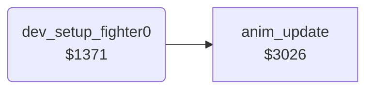

<!-- Generated by c64-docs from knowledge revision 20261022T132731.733-fztd87 and .c64-re-tools/local/generated/src/source-map.json. Do not edit: change the knowledge, generate the source again, then run docs.ts generate. -->
# leftovers/leftover_1371.asm

Range `$1371-$138E`. Source: [leftovers/leftover_1371.asm](../../../../src/leftovers/leftover_1371.asm). Index: [the reference](../../index.md).

## Call graph

A solid arrow is a call, a thick arrow a table entry, a dotted arrow a jump. Rounded nodes are in this file.

## Names

### [`dev_setup_fighter0`](../../../../src/leftovers/leftover_1371.asm#L6) `$1371`

*routine*

Development code: puts fighter 0 alone at x $3e on the ground, facing right, in move and animation 1 (stand), and steps it once.

- **Calls:** [`anim_update`](../fighter/anim_step.md#anim_update)
- **Writes:** [`fighter_x`](../../memory-map.md#fighter_x), [`fighter_y`](../../memory-map.md#fighter_y), [`fighter_facing`](../../memory-map.md#fighter_facing), [`anim_reverse`](../../memory-map.md#anim_reverse), [`pose_held`](../../memory-map.md#pose_held), [`anim_started`](../../memory-map.md#anim_started), [`anim_number`](../../memory-map.md#anim_number), [`fighter_move`](../../memory-map.md#fighter_move)
