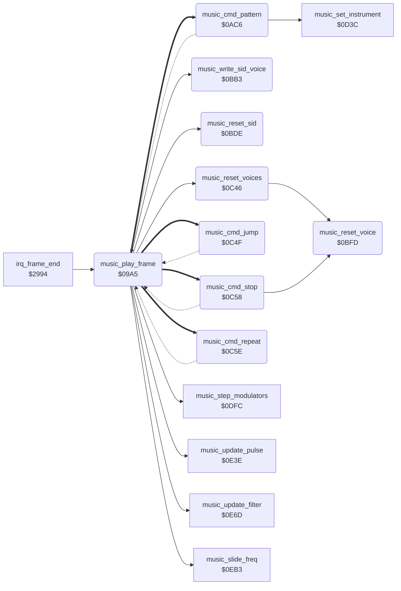

<!-- Generated by c64-docs from knowledge revision 20261022T132731.733-fztd87 and .c64-re-tools/local/generated/src/source-map.json. Do not edit: change the knowledge, generate the source again, then run docs.ts generate. -->
# music/music_driver.asm: Music driver: frame entry, tune start, order lists and pattern reader

Range `$09A5-$0C8B`. Source: [music/music_driver.asm](../../../../src/music/music_driver.asm). Index: [the reference](../../index.md).

## Call graph

A solid arrow is a call, a thick arrow a table entry, a dotted arrow a jump. Rounded nodes are in this file.

## Names

### [`music_play_frame`](../../../../src/music/music_driver.asm#L6) `$09A5`

*routine*

Plays one frame of music. The frame-end raster IRQ calls it at $29bf. game_mode is the tune: 0 silences the SID, a new value starts that tune.

- **Called from:** [`irq_frame_end`](../irq/irq_screen_split.md#irq_frame_end) [`$29BF`](../../../../src/irq/irq_screen_split.asm#L315)
- **Calls:** [`music_reset_sid`](music_driver.md#music_reset_sid), [`music_reset_voices`](music_driver.md#music_reset_voices), [`music_slide_freq`](music_effects.md#music_slide_freq), [`music_step_modulators`](music_effects.md#music_step_modulators), [`music_update_pulse`](music_effects.md#music_update_pulse), [`music_update_filter`](music_effects.md#music_update_filter), [`music_write_sid_voice`](music_driver.md#music_write_sid_voice)
- **Jumps to:** [`music_cmd_stop`](music_driver.md#music_cmd_stop)
- **Reads:** [`game_mode`](../../memory-map.md#game_mode), [`music_current_tune`](music_workspace_0cdb.md#music_current_tune), [`music_volume`](music_workspace_0cdb.md#music_volume), [`music_resonance`](music_workspace_0cdb.md#music_resonance), [`music_cutoff_lo`](music_workspace.md#music_cutoff_lo), [`music_cutoff_hi`](music_workspace.md#music_cutoff_hi), [`music_tune_volumes`](music_tables.md#music_tune_volumes), [`music_tune_tempos`](music_tables.md#music_tune_tempos), [`music_tune_bases`](music_tables.md#music_tune_bases), [`music_tune_bases+1`](music_tables.md#music_tune_bases), [`music_tune_pattern_tables`](music_tables.md#music_tune_pattern_tables), [`music_tune_pattern_tables+1`](music_tables.md#music_tune_pattern_tables), [`music_ptab_hi_operand`](music_driver.md#music_ptab_hi_operand), [`music_ptab_hi_page`](music_driver.md#music_ptab_hi_page), [`music_tune_orders_v0`](music_tables.md#music_tune_orders_v0), [`music_tune_orders_v0+1`](music_tables.md#music_tune_orders_v0), [`music_tune_orders_v1`](music_tables.md#music_tune_orders_v1), [`music_tune_orders_v1+1`](music_tables.md#music_tune_orders_v1), [`music_tune_orders_v2`](music_tables.md#music_tune_orders_v2), [`music_tune_orders_v2+1`](music_tables.md#music_tune_orders_v2), [`music_voice_on`](music_workspace.md#music_voice_on), [`music_tempo_count`](music_workspace.md#music_tempo_count), [`music_tempo`](music_workspace.md#music_tempo), [`music_order_lo`](music_workspace.md#music_order_lo), [`music_order_hi`](music_workspace.md#music_order_hi), [`music_pattern_lo`](music_workspace.md#music_pattern_lo), [`music_pattern_hi`](music_workspace.md#music_pattern_hi), [`music_order_pos`](music_workspace.md#music_order_pos), [`music_order_ptr`](../../memory-map.md#music_order_ptr), [`music_order_commands`](music_workspace_0cdb.md#music_order_commands), [`music_order_commands+1`](music_workspace_0cdb.md#music_order_commands), [`music_work_ptr`](../../memory-map.md#music_work_ptr), [`music_slide_on`](music_workspace_0cdb.md#music_slide_on), [`music_freq_lo`](music_workspace.md#music_freq_lo), [`music_freq_hi`](music_workspace.md#music_freq_hi)
- **Writes:** [`SIGVOL`](../../memory-map.md#SIGVOL), [`RESON`](../../memory-map.md#RESON), [`CUTLO`](../../memory-map.md#CUTLO), [`CUTHI`](../../memory-map.md#CUTHI), [`music_current_tune`](music_workspace_0cdb.md#music_current_tune), [`music_voice_on`](music_workspace.md#music_voice_on), [`music_voice_on+1`](music_workspace.md#music_voice_on), [`music_voice_on+2`](music_workspace.md#music_voice_on), [`music_volume`](music_workspace_0cdb.md#music_volume), [`music_tempo_count`](music_workspace.md#music_tempo_count), [`music_tempo_count+1`](music_workspace.md#music_tempo_count), [`music_tempo_count+2`](music_workspace.md#music_tempo_count), [`music_tempo`](music_workspace.md#music_tempo), [`music_tempo+1`](music_workspace.md#music_tempo), [`music_tempo+2`](music_workspace.md#music_tempo), [`music_pattern_base`](music_tables.md#music_pattern_base), [`music_pattern_base+1`](music_tables.md#music_pattern_base), [`music_ptab_hi_operand`](music_driver.md#music_ptab_hi_operand), [`music_ptab_lo_operand`](music_driver.md#music_ptab_lo_operand), [`music_ptab_hi_page`](music_driver.md#music_ptab_hi_page), [`music_ptab_lo_page`](music_driver.md#music_ptab_lo_page), [`music_order_lo`](music_workspace.md#music_order_lo), [`music_order_hi`](music_workspace.md#music_order_hi), [`music_order_lo+1`](music_workspace.md#music_order_lo), [`music_order_hi+1`](music_workspace.md#music_order_hi), [`music_order_lo+2`](music_workspace.md#music_order_lo), [`music_order_hi+2`](music_workspace.md#music_order_hi), [`music_order_ptr`](../../memory-map.md#music_order_ptr), [`music_order_ptr+1`](../../memory-map.md#music_order_ptr), [`music_pattern_ptr`](../../memory-map.md#music_pattern_ptr), [`music_pattern_ptr+1`](../../memory-map.md#music_pattern_ptr), [`music_work_ptr`](../../memory-map.md#music_work_ptr), [`music_work_ptr+1`](../../memory-map.md#music_work_ptr), [`music_cur_freq_lo`](music_workspace_0cdb.md#music_cur_freq_lo), [`music_cur_freq_hi`](music_workspace_0cdb.md#music_cur_freq_hi)
- **Refers to:** [`music_voice_on`](music_workspace.md#music_voice_on), [`music_tempo_count`](music_workspace.md#music_tempo_count), [`music_tempo`](music_workspace.md#music_tempo), [`music_tune_bases`](music_tables.md#music_tune_bases), [`music_pattern_base`](music_tables.md#music_pattern_base), [`music_tune_pattern_tables`](music_tables.md#music_tune_pattern_tables), [`music_ptab_hi_operand`](music_driver.md#music_ptab_hi_operand), [`music_ptab_lo_operand`](music_driver.md#music_ptab_lo_operand), [`music_tune_orders_v0`](music_tables.md#music_tune_orders_v0), [`music_order_lo`](music_workspace.md#music_order_lo), [`music_tune_orders_v1`](music_tables.md#music_tune_orders_v1), [`music_order_hi`](music_workspace.md#music_order_hi), [`music_tune_orders_v2`](music_tables.md#music_tune_orders_v2), [`music_order_ptr`](../../memory-map.md#music_order_ptr), [`music_pattern_ptr`](../../memory-map.md#music_pattern_ptr), [`music_order_commands`](music_workspace_0cdb.md#music_order_commands), [`music_work_ptr`](../../memory-map.md#music_work_ptr)

### [`music_silence`](../../../../src/music/music_driver.asm#L9) `$09A9`

*label*

### [`music_check_tune`](../../../../src/music/music_driver.asm#L14) `$09AF`

*label*

- **Jumped to from:** [`music_play_frame`](music_driver.md#music_play_frame) [`$09A7`](../../../../src/music/music_driver.asm#L8)

### [`music_write_globals`](../../../../src/music/music_driver.asm#L18) `$09B4`

*label*

Same tune: writes volume, resonance and cutoff base to the SID, then steps the voices.

### [`music_start_tune`](../../../../src/music/music_driver.asm#L26) `$09CF`

*label*

Starts tune A: resets the SID and the voices, sets volume and tempo, and copies the pattern base, pattern table and order lists. It does not play in this frame.

- **Jumped to from:** [`music_play_frame`](music_driver.md#music_play_frame) [`$09B2`](../../../../src/music/music_driver.asm#L16)

### [`music_set_order_ptrs`](../../../../src/music/music_driver.asm#L58) `$0A2C`

*label*

- **Jumped to from:** [`music_play_frame`](music_driver.md#music_play_frame) [`$0A27`](../../../../src/music/music_driver.asm#L57)

### [`music_play_voices`](../../../../src/music/music_driver.asm#L73) `$0A51`

*label*

Steps voices 2 to 0. A voice reads its order list and pattern when its tempo counter reaches 0. In the other frames only its frequency changes.

- **Jumped to from:** [`music_play_frame`](music_driver.md#music_play_frame) [`$09CC`](../../../../src/music/music_driver.asm#L24)

### [`music_voice_loop`](../../../../src/music/music_driver.asm#L75) `$0A53`

*label*

- **Jumped to from:** [`music_play_frame`](music_driver.md#music_play_frame) [`$0AA6`](../../../../src/music/music_driver.asm#L115)

### [`music_read_order`](../../../../src/music/music_driver.asm#L91) `$0A77`

*label*

Reads the order list command at music_order_pos and jumps through music_order_commands: 0 stop, 1 pattern, 2 jump, 3 repeat.

- **Jumped to from:** [`music_cmd_pattern`](music_driver.md#music_cmd_pattern) [`$0B32`](../../../../src/music/music_driver.asm#L208), [`music_cmd_jump`](music_driver.md#music_cmd_jump) [`$0C55`](../../../../src/music/music_driver.asm#L352), [`music_cmd_repeat`](music_driver.md#music_cmd_repeat) [`$0C6F`](../../../../src/music/music_driver.asm#L368), [`music_cmd_repeat`](music_driver.md#music_cmd_repeat) [`$0C7D`](../../../../src/music/music_driver.asm#L376), [`music_cmd_repeat`](music_driver.md#music_cmd_repeat) [`$0C89`](../../../../src/music/music_driver.asm#L381)

### [`music_voice_freq`](../../../../src/music/music_driver.asm#L103) `$0A8E`

*label*

Frequency of this frame: a slide instrument moves toward the note frequency, other instruments get the note frequency at once.

- **Jumped to from:** [`music_play_frame`](music_driver.md#music_play_frame) [`$0A5B`](../../../../src/music/music_driver.asm#L79), [`music_cmd_pattern`](music_driver.md#music_cmd_pattern) [`$0AF7`](../../../../src/music/music_driver.asm#L180), [`music_cmd_pattern`](music_driver.md#music_cmd_pattern) [`$0B16`](../../../../src/music/music_driver.asm#L194), [`music_cmd_pattern`](music_driver.md#music_cmd_pattern) [`$0BB0`](../../../../src/music/music_driver.asm#L277)

### [`music_set_freq_now`](../../../../src/music/music_driver.asm#L108) `$0A99`

*label*

- **Jumped to from:** [`music_play_frame`](music_driver.md#music_play_frame) [`$0A91`](../../../../src/music/music_driver.asm#L105)

### [`music_next_voice`](../../../../src/music/music_driver.asm#L113) `$0AA5`

*label*

- **Jumped to from:** [`music_play_frame`](music_driver.md#music_play_frame) [`$0A56`](../../../../src/music/music_driver.asm#L77), [`music_play_frame`](music_driver.md#music_play_frame) [`$0A96`](../../../../src/music/music_driver.asm#L107), [`music_cmd_stop`](music_driver.md#music_cmd_stop) [`$0C5B`](../../../../src/music/music_driver.asm#L357)

### [`music_write_loop`](../../../../src/music/music_driver.asm#L121) `$0AB5`

*label*

- **Jumped to from:** [`music_play_frame`](music_driver.md#music_play_frame) [`$0AC3`](../../../../src/music/music_driver.asm#L131)

### [`music_write_next`](../../../../src/music/music_driver.asm#L125) `$0ABD`

*label*

- **Jumped to from:** [`music_play_frame`](music_driver.md#music_play_frame) [`$0AB8`](../../../../src/music/music_driver.asm#L123)

### [`music_cmd_pattern`](../../../../src/music/music_driver.asm#L134) `$0AC6`

*label*

Order command 1, pattern: on a new entry it sets the pattern address (offset + music_pattern_base) and reads the first byte. Else the note counts down.

- **Entry of:** [`music_order_commands`](../../tables.md#music_order_commands)
- **Calls:** [`music_set_instrument`](music_effects.md#music_set_instrument)
- **Jumps to:** [`music_voice_freq`](music_driver.md#music_voice_freq), [`music_read_order`](music_driver.md#music_read_order)
- **Reads:** [`music_need_pattern`](music_workspace.md#music_need_pattern), [`music_order_ptr`](../../memory-map.md#music_order_ptr), [`screen_scene_rows+568`](../../memory-map.md#screen_scene_rows), [`music_pattern_base`](music_tables.md#music_pattern_base), [`screen_scene_rows+569`](../../memory-map.md#screen_scene_rows), [`music_pattern_base+1`](music_tables.md#music_pattern_base), [`music_note_timer`](music_workspace.md#music_note_timer), [`music_note_released`](music_workspace.md#music_note_released), [`music_note_flags`](music_workspace.md#music_note_flags), [`music_ctrl`](music_workspace.md#music_ctrl), [`music_pattern_pos`](music_workspace.md#music_pattern_pos), [`music_pattern_ptr`](../../memory-map.md#music_pattern_ptr), [`music_order_pos`](music_workspace.md#music_order_pos), [`music_note_freqs`](music_workspace_0cdb.md#music_note_freqs), [`music_inst_octave`](music_workspace.md#music_inst_octave), [`music_freq_lo`](music_workspace.md#music_freq_lo), [`music_freq_hi`](music_workspace.md#music_freq_hi), [`music_durations`](music_workspace_0cdb.md#music_durations), [`music_note_value`](music_workspace.md#music_note_value)
- **Writes:** [`music_pattern_lo`](music_workspace.md#music_pattern_lo), [`music_pattern_ptr`](../../memory-map.md#music_pattern_ptr), [`music_pattern_hi`](music_workspace.md#music_pattern_hi), [`music_pattern_ptr+1`](../../memory-map.md#music_pattern_ptr), [`music_pattern_pos`](music_workspace.md#music_pattern_pos), [`music_need_pattern`](music_workspace.md#music_need_pattern), [`music_note_timer`](music_workspace.md#music_note_timer), [`music_note_released`](music_workspace.md#music_note_released), [`music_ctrl`](music_workspace.md#music_ctrl), [`music_order_pos`](music_workspace.md#music_order_pos), [`music_note_value`](music_workspace.md#music_note_value), [`music_freq_lo`](music_workspace.md#music_freq_lo), [`music_freq_hi`](music_workspace.md#music_freq_hi), [`music_note_octave`](music_workspace.md#music_note_octave), [`music_cur_freq_lo`](music_workspace_0cdb.md#music_cur_freq_lo), [`music_cur_freq_hi`](music_workspace_0cdb.md#music_cur_freq_hi), [`music_note_flags`](music_workspace.md#music_note_flags)
- **Refers to:** [`music_pattern_base`](music_tables.md#music_pattern_base), [`music_pattern_ptr`](../../memory-map.md#music_pattern_ptr)

### [`music_ptab_lo_operand`](../../../../src/music/music_driver.asm#L141) `$0AD1`

*variable*

- **Written by:** [`music_play_frame`](music_driver.md#music_play_frame) [`$0A18`](../../../../src/music/music_driver.asm#L53)
- **Referred to by:** [`music_play_frame`](music_driver.md#music_play_frame) [`$0A21`](../../../../src/music/music_driver.asm#L56)

### [`music_ptab_lo_page`](../../../../src/music/music_driver.asm#L142) `$0AD2-$0ADC`

*variable*

- **Written by:** [`music_play_frame`](music_driver.md#music_play_frame) [`$0A21`](../../../../src/music/music_driver.asm#L56)

### [`music_ptab_hi_operand`](../../../../src/music/music_driver.asm#L157) `$0ADD`

*variable*

- **Read by:** [`music_play_frame`](music_driver.md#music_play_frame) [`$0A24`](../../../../src/music/music_driver.asm#L57)
- **Written by:** [`music_play_frame`](music_driver.md#music_play_frame) [`$0A15`](../../../../src/music/music_driver.asm#L52), [`music_play_frame`](music_driver.md#music_play_frame) [`$0A24`](../../../../src/music/music_driver.asm#L57)
- **Referred to by:** [`music_play_frame`](music_driver.md#music_play_frame) [`$0A1E`](../../../../src/music/music_driver.asm#L55), [`music_play_frame`](music_driver.md#music_play_frame) [`$0A29`](../../../../src/music/music_driver.asm#L57)

### [`music_ptab_hi_page`](../../../../src/music/music_driver.asm#L158) `$0ADE-$0AF1`

*variable*

- **Read by:** [`music_play_frame`](music_driver.md#music_play_frame) [`$0A29`](../../../../src/music/music_driver.asm#L57)
- **Written by:** [`music_play_frame`](music_driver.md#music_play_frame) [`$0A1E`](../../../../src/music/music_driver.asm#L55), [`music_play_frame`](music_driver.md#music_play_frame) [`$0A29`](../../../../src/music/music_driver.asm#L57)

### [`music_note_tick`](../../../../src/music/music_driver.asm#L177) `$0AF2`

*label*

Counts the note down. At 0 the note gets one release tick with the gate off. Duration flag bit 6 keeps the gate on.

- **Jumped to from:** [`music_cmd_pattern`](music_driver.md#music_cmd_pattern) [`$0AC9`](../../../../src/music/music_driver.asm#L136)

### [`music_note_ended`](../../../../src/music/music_driver.asm#L181) `$0AFA`

*label*

- **Jumped to from:** [`music_cmd_pattern`](music_driver.md#music_cmd_pattern) [`$0AF5`](../../../../src/music/music_driver.asm#L179)

### [`music_release_started`](../../../../src/music/music_driver.asm#L193) `$0B16`

*label*

- **Jumped to from:** [`music_cmd_pattern`](music_driver.md#music_cmd_pattern) [`$0B0C`](../../../../src/music/music_driver.asm#L189)

### [`music_next_byte`](../../../../src/music/music_driver.asm#L196) `$0B19`

*label*

Reads the next pattern byte: $ff ends the pattern, $80-$fe selects an instrument, other values start a note of two bytes.

- **Jumped to from:** [`music_cmd_pattern`](music_driver.md#music_cmd_pattern) [`$0AFD`](../../../../src/music/music_driver.asm#L183), [`music_cmd_pattern`](music_driver.md#music_cmd_pattern) [`$0B3A`](../../../../src/music/music_driver.asm#L212)

### [`music_read_pattern`](../../../../src/music/music_driver.asm#L198) `$0B1C`

*label*

- **Jumped to from:** [`music_cmd_pattern`](music_driver.md#music_cmd_pattern) [`$0AEF`](../../../../src/music/music_driver.asm#L175)

### [`music_pattern_instrument`](../../../../src/music/music_driver.asm#L209) `$0B35`

*label*

$80-$fe: instrument number

- **Jumped to from:** [`music_cmd_pattern`](music_driver.md#music_cmd_pattern) [`$0B25`](../../../../src/music/music_driver.asm#L203)

### [`music_read_note`](../../../../src/music/music_driver.asm#L214) `$0B3D`

*label*

Note byte: bits 0-3 note (0 rest, 1-12 C to B), bits 4-6 octave. Frequency = (music_note_freqs + $100) << (octave + instrument octave).

- **Jumped to from:** [`music_cmd_pattern`](music_driver.md#music_cmd_pattern) [`$0B21`](../../../../src/music/music_driver.asm#L201)

### [`music_set_note_freq`](../../../../src/music/music_driver.asm#L222) `$0B4A`

*label*

- **Jumped to from:** [`music_cmd_pattern`](music_driver.md#music_cmd_pattern) [`$0B44`](../../../../src/music/music_driver.asm#L219)

### [`music_octave_shift`](../../../../src/music/music_driver.asm#L238) `$0B66`

*label*

- **Jumped to from:** [`music_cmd_pattern`](music_driver.md#music_cmd_pattern) [`$0B6D`](../../../../src/music/music_driver.asm#L242)

### [`music_read_duration`](../../../../src/music/music_driver.asm#L244) `$0B6F`

*label*

Duration byte: bits 0-3 index music_durations, bits 6-7 go to music_note_flags. A note lasts the table value + 1 ticks.
Y is always 0 here, thus the release flag clears

- **Jumped to from:** [`music_cmd_pattern`](music_driver.md#music_cmd_pattern) [`$0B47`](../../../../src/music/music_driver.asm#L221), [`music_cmd_pattern`](music_driver.md#music_cmd_pattern) [`$0B64`](../../../../src/music/music_driver.asm#L237)

### [`music_check_glide`](../../../../src/music/music_driver.asm#L260) `$0B8C`

*label*

If the previous note had flags, the current frequency stays. Thus a slide instrument glides into the new note.

- **Jumped to from:** [`music_cmd_pattern`](music_driver.md#music_cmd_pattern) [`$0B87`](../../../../src/music/music_driver.asm#L256)

### [`music_store_flags`](../../../../src/music/music_driver.asm#L267) `$0B9D`

*label*

- **Jumped to from:** [`music_cmd_pattern`](music_driver.md#music_cmd_pattern) [`$0B8F`](../../../../src/music/music_driver.asm#L262)

### [`music_note_done`](../../../../src/music/music_driver.asm#L276) `$0BB0`

*label*

- **Jumped to from:** [`music_cmd_pattern`](music_driver.md#music_cmd_pattern) [`$0BA6`](../../../../src/music/music_driver.asm#L272)

### [`music_write_sid_voice`](../../../../src/music/music_driver.asm#L279) `$0BB3`

*routine*

Writes frequency, pulse width, ADSR and control of voice X to the SID voice at $d400+Y. Called from $0aba with Y = 14, 7 and 0.

- **Called from:** [`music_play_frame`](music_driver.md#music_play_frame) [`$0ABA`](../../../../src/music/music_driver.asm#L124)
- **Reads:** [`music_cur_freq_lo`](music_workspace_0cdb.md#music_cur_freq_lo), [`music_cur_freq_hi`](music_workspace_0cdb.md#music_cur_freq_hi), [`music_pw_lo`](music_workspace_0cdb.md#music_pw_lo), [`music_pw_hi`](music_workspace_0cdb.md#music_pw_hi), [`music_attack_decay`](music_workspace.md#music_attack_decay), [`music_sustain_release`](music_workspace.md#music_sustain_release), [`music_ctrl`](music_workspace.md#music_ctrl)
- **Writes:** [`figure_parts_unused`](../graphics/figure_sprites_d000.md#figure_parts_unused), [`FREHI1`](../../memory-map.md#FREHI1), [`PWLO1`](../../memory-map.md#PWLO1), [`PWHI1`](../../memory-map.md#PWHI1), [`ATDCY1`](../../memory-map.md#ATDCY1), [`SUREL1`](../../memory-map.md#SUREL1), [`VCREG1`](../../memory-map.md#VCREG1)

### [`music_reset_sid`](../../../../src/music/music_driver.asm#L296) `$0BDE`

*routine*

Clears the SID registers, the volume, the resonance and the filter sweep values, and sets the cutoff base to $6400. Called at tune start ($09d4).

- **Called from:** [`music_play_frame`](music_driver.md#music_play_frame) [`$09D4`](../../../../src/music/music_driver.asm#L30)
- **Writes:** [`figure_parts_unused`](../graphics/figure_sprites_d000.md#figure_parts_unused), [`music_resonance`](music_workspace_0cdb.md#music_resonance), [`music_volume`](music_workspace_0cdb.md#music_volume), [`music_filter_shift`](music_workspace.md#music_filter_shift), [`music_filter_down`](music_workspace.md#music_filter_down), [`music_cutoff_lo`](music_workspace.md#music_cutoff_lo), [`music_cutoff_hi`](music_workspace.md#music_cutoff_hi)

### [`music_clear_sid_loop`](../../../../src/music/music_driver.asm#L299) `$0BE2`

*label*

- **Jumped to from:** [`music_reset_sid`](music_driver.md#music_reset_sid) [`$0BE6`](../../../../src/music/music_driver.asm#L302)

### [`music_reset_voice`](../../../../src/music/music_driver.asm#L312) `$0BFD`

*routine*

Clears the state of voice X and switches the voice off. Sets the tempo counters and the new-pattern flag to 1. Called from $0c48 and $0c58.

- **Called from:** [`music_reset_voices`](music_driver.md#music_reset_voices) [`$0C48`](../../../../src/music/music_driver.asm#L343), [`music_cmd_stop`](music_driver.md#music_cmd_stop) [`$0C58`](../../../../src/music/music_driver.asm#L356)
- **Writes:** [`music_voice_on`](music_workspace.md#music_voice_on), [`music_repeat_count`](music_workspace_0cdb.md#music_repeat_count), [`music_order_pos`](music_workspace.md#music_order_pos), [`music_inst_octave`](music_workspace.md#music_inst_octave), [`music_note_flags`](music_workspace.md#music_note_flags), [`music_ctrl`](music_workspace.md#music_ctrl), [`music_mod_values`](music_workspace_0cdb.md#music_mod_values), [`music_lfo_speed`](music_workspace_0cdb.md#music_lfo_speed), [`music_lfo_falling`](music_workspace_0cdb.md#music_lfo_falling), [`music_pwm_shift`](music_workspace_0cdb.md#music_pwm_shift), [`music_pw_base_lo`](music_workspace.md#music_pw_base_lo), [`music_pw_base_hi`](music_workspace.md#music_pw_base_hi), [`music_pw_lo`](music_workspace_0cdb.md#music_pw_lo), [`music_pw_hi`](music_workspace_0cdb.md#music_pw_hi), [`music_slide_on`](music_workspace_0cdb.md#music_slide_on), [`music_slide_step_lo`](music_workspace_0cdb.md#music_slide_step_lo), [`music_slide_step_hi`](music_workspace_0cdb.md#music_slide_step_hi), [`music_need_pattern`](music_workspace.md#music_need_pattern), [`music_tempo`](music_workspace.md#music_tempo), [`music_tempo_count`](music_workspace.md#music_tempo_count), [`music_pwm_source`](music_workspace_0cdb.md#music_pwm_source), [`music_filter_source`](music_workspace.md#music_filter_source)

### [`music_reset_voices`](../../../../src/music/music_driver.asm#L340) `$0C46`

*routine*

Resets voices 2 to 0 with music_reset_voice. Called at tune start ($09d7).

- **Called from:** [`music_play_frame`](music_driver.md#music_play_frame) [`$09D7`](../../../../src/music/music_driver.asm#L31)
- **Calls:** [`music_reset_voice`](music_driver.md#music_reset_voice)

### [`music_reset_voices_loop`](../../../../src/music/music_driver.asm#L342) `$0C48`

*label*

- **Jumped to from:** [`music_reset_voices`](music_driver.md#music_reset_voices) [`$0C4C`](../../../../src/music/music_driver.asm#L345)

### [`music_cmd_jump`](../../../../src/music/music_driver.asm#L348) `$0C4F`

*label*

Order command 2, position: the order list continues at that byte position.

- **Entry of:** [`music_order_commands`](../../tables.md#music_order_commands)
- **Jumps to:** [`music_read_order`](music_driver.md#music_read_order)
- **Reads:** [`music_order_ptr`](../../memory-map.md#music_order_ptr)
- **Writes:** [`music_order_pos`](music_workspace.md#music_order_pos)

### [`music_cmd_stop`](../../../../src/music/music_driver.asm#L354) `$0C58`

*label*

Order command 0: resets and switches off the voice. Only tune 4 uses it, and no run executed it.

- **Jumped to from:** [`music_play_frame`](music_driver.md#music_play_frame) [`$0A8B`](../../../../src/music/music_driver.asm#L101)
- **Entry of:** [`music_order_commands`](../../tables.md#music_order_commands)
- **Calls:** [`music_reset_voice`](music_driver.md#music_reset_voice)
- **Jumps to:** [`music_next_voice`](music_driver.md#music_next_voice)

### [`music_cmd_repeat`](../../../../src/music/music_driver.asm#L359) `$0C5E`

*label*

Order command 3, position, count: jumps to the position count more times, then skips its 3 bytes. Each voice has one repeat counter.

- **Entry of:** [`music_order_commands`](../../tables.md#music_order_commands)
- **Jumps to:** [`music_read_order`](music_driver.md#music_read_order)
- **Reads:** [`music_repeat_count`](music_workspace_0cdb.md#music_repeat_count), [`music_order_ptr`](../../memory-map.md#music_order_ptr), [`music_order_pos`](music_workspace.md#music_order_pos)
- **Writes:** [`music_order_pos`](music_workspace.md#music_order_pos), [`music_repeat_count`](music_workspace_0cdb.md#music_repeat_count)

### [`music_repeat_again`](../../../../src/music/music_driver.asm#L369) `$0C72`

*label*

- **Jumped to from:** [`music_cmd_repeat`](music_driver.md#music_cmd_repeat) [`$0C61`](../../../../src/music/music_driver.asm#L361)

### [`music_repeat_done`](../../../../src/music/music_driver.asm#L377) `$0C80`

*label*

- **Jumped to from:** [`music_cmd_repeat`](music_driver.md#music_cmd_repeat) [`$0C75`](../../../../src/music/music_driver.asm#L371)
