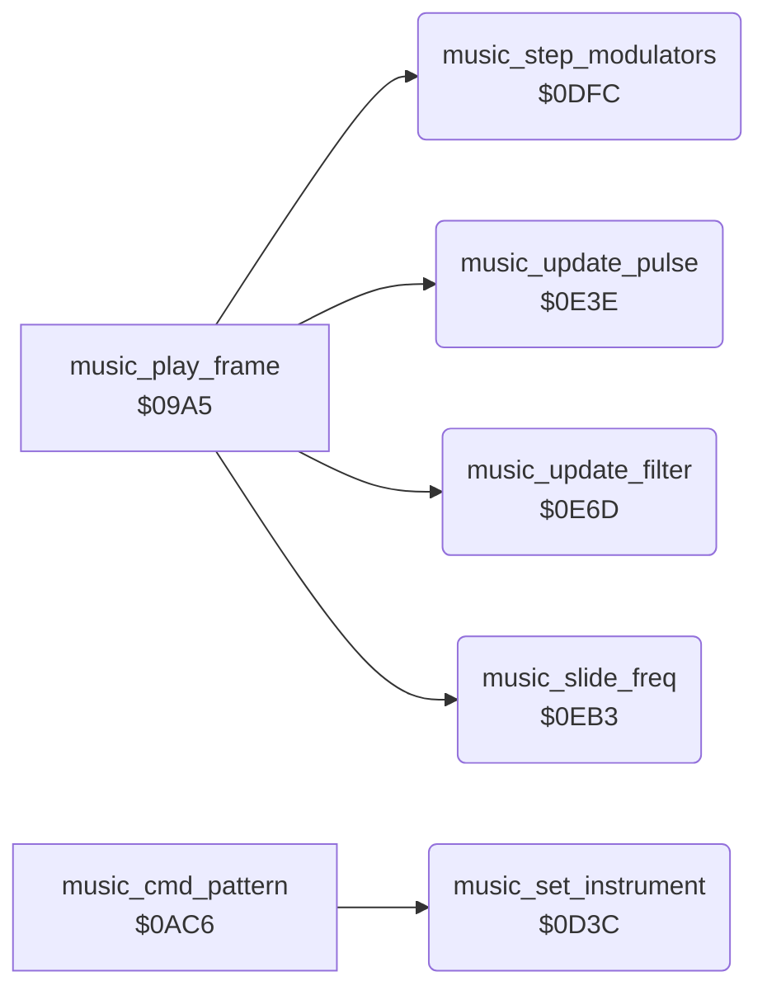

<!-- Generated by c64-docs from knowledge revision 20261022T132731.733-fztd87 and .c64-re-tools/local/generated/src/source-map.json. Do not edit: change the knowledge, generate the source again, then run docs.ts generate. -->
# music/music_effects.asm: Music driver: instruments, modulators, pulse width, filter and slides

Range `$0D3C-$0F51`. Source: [music/music_effects.asm](../../../../src/music/music_effects.asm). Index: [the reference](../../index.md).

## Call graph

A solid arrow is a call, a thick arrow a table entry, a dotted arrow a jump. Rounded nodes are in this file.

## Names

### [`music_set_instrument`](../../../../src/music/music_effects.asm#L6) `$0D3C`

*routine*

Sets instrument A on voice X from music_instrument_ptrs: waveform, pulse width and modulation, ADSR, slide, octave and filter. Called from the pattern reader at $0b37.

- **Called from:** [`music_cmd_pattern`](music_driver.md#music_cmd_pattern) [`$0B37`](../../../../src/music/music_driver.asm#L211)
- **Reads:** [`music_instrument_ptrs`](music_tables.md#music_instrument_ptrs), [`music_instrument_ptrs+1`](music_tables.md#music_instrument_ptrs), [`music_ctrl`](music_workspace.md#music_ctrl), [`music_work_ptr`](../../memory-map.md#music_work_ptr), [`music_resonance`](music_workspace_0cdb.md#music_resonance), [`music_voice_bit_masks`](music_workspace_0cdb.md#music_voice_bit_masks), [`music_volume`](music_workspace_0cdb.md#music_volume), [`music_voice_clear_masks`](music_workspace_0cdb.md#music_voice_clear_masks)
- **Writes:** [`music_work_ptr`](../../memory-map.md#music_work_ptr), [`music_work_ptr+1`](../../memory-map.md#music_work_ptr), [`music_ctrl`](music_workspace.md#music_ctrl), [`music_pw_base_lo`](music_workspace.md#music_pw_base_lo), [`music_pw_lo`](music_workspace_0cdb.md#music_pw_lo), [`music_pw_base_hi`](music_workspace.md#music_pw_base_hi), [`music_pw_hi`](music_workspace_0cdb.md#music_pw_hi), [`music_pwm_source`](music_workspace_0cdb.md#music_pwm_source), [`music_pwm_shift`](music_workspace_0cdb.md#music_pwm_shift), [`music_lfo_speed`](music_workspace_0cdb.md#music_lfo_speed), [`music_attack_decay`](music_workspace.md#music_attack_decay), [`music_sustain_release`](music_workspace.md#music_sustain_release), [`music_slide_step_lo`](music_workspace_0cdb.md#music_slide_step_lo), [`music_slide_on`](music_workspace_0cdb.md#music_slide_on), [`music_inst_octave`](music_workspace.md#music_inst_octave), [`music_resonance`](music_workspace_0cdb.md#music_resonance), [`music_volume`](music_workspace_0cdb.md#music_volume), [`music_cutoff_lo`](music_workspace.md#music_cutoff_lo), [`CUTLO`](../../memory-map.md#CUTLO), [`music_cutoff_hi`](music_workspace.md#music_cutoff_hi), [`CUTHI`](../../memory-map.md#CUTHI), [`music_filter_source`](music_workspace.md#music_filter_source), [`music_filter_shift`](music_workspace.md#music_filter_shift), [`music_filter_down`](music_workspace.md#music_filter_down), [`RESON`](../../memory-map.md#RESON), [`SIGVOL`](../../memory-map.md#SIGVOL)
- **Refers to:** [`music_instrument_ptrs`](music_tables.md#music_instrument_ptrs), [`music_work_ptr`](../../memory-map.md#music_work_ptr)

### [`music_store_pwm_source`](../../../../src/music/music_effects.asm#L32) `$0D70`

*label*

- **Jumped to from:** [`music_set_instrument`](music_effects.md#music_set_instrument) [`$0D6D`](../../../../src/music/music_effects.asm#L30)

### [`music_read_envelope`](../../../../src/music/music_effects.asm#L41) `$0D7F`

*label*

Envelope, slide step, octave offset and filter flag. Without filter the voice leaves the filter.

- **Jumped to from:** [`music_set_instrument`](music_effects.md#music_set_instrument) [`$0D56`](../../../../src/music/music_effects.asm#L19)

### [`music_filter_off`](../../../../src/music/music_effects.asm#L93) `$0DEF`

*label*

- **Jumped to from:** [`music_set_instrument`](music_effects.md#music_set_instrument) [`$0D9D`](../../../../src/music/music_effects.asm#L57)

### [`music_step_modulators`](../../../../src/music/music_effects.asm#L100) `$0DFC`

*routine*

Steps the three triangle LFOs in music_mod_values between 0 and $ff, and copies ENV3 and OSC3 into slots 3 and 4. Called each frame from $0aa8.

- **Called from:** [`music_play_frame`](music_driver.md#music_play_frame) [`$0AA8`](../../../../src/music/music_driver.asm#L116)
- **Reads:** [`ENV3`](../../memory-map.md#ENV3), [`RANDOM`](../../memory-map.md#RANDOM), [`music_lfo_falling`](music_workspace_0cdb.md#music_lfo_falling), [`music_mod_values`](music_workspace_0cdb.md#music_mod_values), [`music_lfo_speed`](music_workspace_0cdb.md#music_lfo_speed)
- **Writes:** [`music_mod_env3`](music_workspace_0cdb.md#music_mod_env3), [`music_mod_osc3`](music_workspace_0cdb.md#music_mod_osc3), [`music_mod_values`](music_workspace_0cdb.md#music_mod_values), [`music_lfo_falling`](music_workspace_0cdb.md#music_lfo_falling)

### [`sfx_period_lo_old`](../../../../src/music/music_effects.asm#L102) `$0E00`

*label*

- **Read by:** [`sfx_sample_irq`](../sfx/sfx_sample_player.md#sfx_sample_irq) [`$29DD`](../../../../src/sfx/sfx_sample_player.asm#L20)

### [`music_modulator_loop`](../../../../src/music/music_effects.asm#L107) `$0E0A`

*label*

- **Jumped to from:** [`music_step_modulators`](music_effects.md#music_step_modulators) [`$0E3B`](../../../../src/music/music_effects.asm#L130)

### [`music_modulator_down`](../../../../src/music/music_effects.asm#L119) `$0E26`

*label*

- **Jumped to from:** [`music_step_modulators`](music_effects.md#music_step_modulators) [`$0E0D`](../../../../src/music/music_effects.asm#L109)

### [`music_modulator_next`](../../../../src/music/music_effects.asm#L128) `$0E3A`

*label*

- **Jumped to from:** [`music_step_modulators`](music_effects.md#music_step_modulators) [`$0E19`](../../../../src/music/music_effects.asm#L114), [`music_step_modulators`](music_effects.md#music_step_modulators) [`$0E23`](../../../../src/music/music_effects.asm#L118), [`music_step_modulators`](music_effects.md#music_step_modulators) [`$0E30`](../../../../src/music/music_effects.asm#L124)

### [`music_update_pulse`](../../../../src/music/music_effects.asm#L133) `$0E3E`

*routine*

Sets the pulse width of each modulated voice to base + (LFO << music_pwm_shift). Called each frame from $0aab.

- **Called from:** [`music_play_frame`](music_driver.md#music_play_frame) [`$0AAB`](../../../../src/music/music_driver.asm#L117)
- **Reads:** [`music_pwm_source`](music_workspace_0cdb.md#music_pwm_source), [`music_mod_values`](music_workspace_0cdb.md#music_mod_values), [`music_pwm_shift`](music_workspace_0cdb.md#music_pwm_shift), [`music_temp_hi`](music_workspace.md#music_temp_hi), [`music_pw_base_lo`](music_workspace.md#music_pw_base_lo), [`music_pw_base_hi`](music_workspace.md#music_pw_base_hi)
- **Writes:** [`music_temp_hi`](music_workspace.md#music_temp_hi), [`music_pw_lo`](music_workspace_0cdb.md#music_pw_lo), [`music_pw_hi`](music_workspace_0cdb.md#music_pw_hi)

### [`music_pulse_loop`](../../../../src/music/music_effects.asm#L135) `$0E40`

*label*

- **Jumped to from:** [`music_update_pulse`](music_effects.md#music_update_pulse) [`$0E6A`](../../../../src/music/music_effects.asm#L157)

### [`music_pulse_shift`](../../../../src/music/music_effects.asm#L143) `$0E52`

*label*

- **Jumped to from:** [`music_update_pulse`](music_effects.md#music_update_pulse) [`$0E57`](../../../../src/music/music_effects.asm#L147)

### [`music_pulse_add`](../../../../src/music/music_effects.asm#L148) `$0E59`

*label*

- **Jumped to from:** [`music_update_pulse`](music_effects.md#music_update_pulse) [`$0E50`](../../../../src/music/music_effects.asm#L142)

### [`music_pulse_next`](../../../../src/music/music_effects.asm#L155) `$0E69`

*label*

- **Jumped to from:** [`music_update_pulse`](music_effects.md#music_update_pulse) [`$0E43`](../../../../src/music/music_effects.asm#L137)

### [`music_update_filter`](../../../../src/music/music_effects.asm#L160) `$0E6D`

*routine*

Writes the cutoff: base plus or minus (modulator << music_filter_shift) when music_filter_source is positive. Called each frame from $0aae.

- **Called from:** [`music_play_frame`](music_driver.md#music_play_frame) [`$0AAE`](../../../../src/music/music_driver.asm#L118)
- **Reads:** [`music_filter_source`](music_workspace.md#music_filter_source), [`music_mod_values`](music_workspace_0cdb.md#music_mod_values), [`music_filter_shift`](music_workspace.md#music_filter_shift), [`music_temp_hi`](music_workspace.md#music_temp_hi), [`music_filter_down`](music_workspace.md#music_filter_down), [`music_work_ptr`](../../memory-map.md#music_work_ptr), [`music_cutoff_lo`](music_workspace.md#music_cutoff_lo), [`music_cutoff_hi`](music_workspace.md#music_cutoff_hi)
- **Writes:** [`music_temp_hi`](music_workspace.md#music_temp_hi), [`music_work_ptr`](../../memory-map.md#music_work_ptr), [`CUTLO`](../../memory-map.md#CUTLO), [`CUTHI`](../../memory-map.md#CUTHI)

### [`music_filter_shift_loop`](../../../../src/music/music_effects.asm#L168) `$0E7F`

*label*

- **Jumped to from:** [`music_update_filter`](music_effects.md#music_update_filter) [`$0E84`](../../../../src/music/music_effects.asm#L172)

### [`music_filter_apply`](../../../../src/music/music_effects.asm#L173) `$0E86`

*label*

- **Jumped to from:** [`music_update_filter`](music_effects.md#music_update_filter) [`$0E7D`](../../../../src/music/music_effects.asm#L167)

### [`music_filter_subtract`](../../../../src/music/music_effects.asm#L185) `$0EA0`

*label*

- **Jumped to from:** [`music_update_filter`](music_effects.md#music_update_filter) [`$0E8B`](../../../../src/music/music_effects.asm#L176)

### [`music_filter_done`](../../../../src/music/music_effects.asm#L194) `$0EB2`

*label*

- **Jumped to from:** [`music_update_filter`](music_effects.md#music_update_filter) [`$0E70`](../../../../src/music/music_effects.asm#L162)

### [`music_slide_freq`](../../../../src/music/music_effects.asm#L197) `$0EB3`

*routine*

Moves the current frequency of voice X toward the note frequency by (slide step << note octave) and stops at the note. Called from $0a93.

- **Called from:** [`music_play_frame`](music_driver.md#music_play_frame) [`$0A93`](../../../../src/music/music_driver.asm#L106)
- **Reads:** [`music_cur_freq_hi`](music_workspace_0cdb.md#music_cur_freq_hi), [`music_freq_hi`](music_workspace.md#music_freq_hi), [`music_cur_freq_lo`](music_workspace_0cdb.md#music_cur_freq_lo), [`music_freq_lo`](music_workspace.md#music_freq_lo), [`music_slide_step_hi`](music_workspace_0cdb.md#music_slide_step_hi), [`music_slide_step_lo`](music_workspace_0cdb.md#music_slide_step_lo), [`music_note_octave`](music_workspace.md#music_note_octave), [`music_temp_hi`](music_workspace.md#music_temp_hi), [`music_temp_lo`](music_workspace.md#music_temp_lo)
- **Writes:** [`music_temp_hi`](music_workspace.md#music_temp_hi), [`music_cur_freq_lo`](music_workspace_0cdb.md#music_cur_freq_lo), [`music_cur_freq_hi`](music_workspace_0cdb.md#music_cur_freq_hi), [`music_temp_lo`](music_workspace.md#music_temp_lo)

### [`music_slide_up`](../../../../src/music/music_effects.asm#L207) `$0EC8`

*label*

- **Jumped to from:** [`music_slide_freq`](music_effects.md#music_slide_freq) [`$0EB9`](../../../../src/music/music_effects.asm#L200), [`music_slide_freq`](music_effects.md#music_slide_freq) [`$0EC3`](../../../../src/music/music_effects.asm#L204)

### [`music_slide_up_shift`](../../../../src/music/music_effects.asm#L213) `$0ED6`

*label*

- **Jumped to from:** [`music_slide_freq`](music_effects.md#music_slide_freq) [`$0EDB`](../../../../src/music/music_effects.asm#L217)

### [`music_slide_up_add`](../../../../src/music/music_effects.asm#L218) `$0EDD`

*label*

- **Jumped to from:** [`music_slide_freq`](music_effects.md#music_slide_freq) [`$0ED4`](../../../../src/music/music_effects.asm#L212)

### [`music_slide_up_exit`](../../../../src/music/music_effects.asm#L228) `$0EF4`

*label*

- **Jumped to from:** [`music_slide_freq`](music_effects.md#music_slide_freq) [`$0EFB`](../../../../src/music/music_effects.asm#L233)

### [`music_slide_up_check_lo`](../../../../src/music/music_effects.asm#L230) `$0EF5`

*label*

- **Jumped to from:** [`music_slide_freq`](music_effects.md#music_slide_freq) [`$0EF0`](../../../../src/music/music_effects.asm#L226)

### [`music_slide_up_clamp`](../../../../src/music/music_effects.asm#L234) `$0EFD`

*label*

- **Jumped to from:** [`music_slide_freq`](music_effects.md#music_slide_freq) [`$0EF2`](../../../../src/music/music_effects.asm#L227)

### [`sfx_period_hi_old`](../../../../src/music/music_effects.asm#L236) `$0F00`

*label*

- **Read by:** [`sfx_sample_irq`](../sfx/sfx_sample_player.md#sfx_sample_irq) [`$29E3`](../../../../src/sfx/sfx_sample_player.asm#L22)

### [`music_slide_down`](../../../../src/music/music_effects.asm#L241) `$0F0A`

*label*

- **Jumped to from:** [`music_slide_freq`](music_effects.md#music_slide_freq) [`$0EBB`](../../../../src/music/music_effects.asm#L201), [`music_slide_freq`](music_effects.md#music_slide_freq) [`$0EC5`](../../../../src/music/music_effects.asm#L205)

### [`music_slide_down_shift`](../../../../src/music/music_effects.asm#L247) `$0F18`

*label*

- **Jumped to from:** [`music_slide_freq`](music_effects.md#music_slide_freq) [`$0F1D`](../../../../src/music/music_effects.asm#L251)

### [`music_slide_down_sub`](../../../../src/music/music_effects.asm#L252) `$0F1F`

*label*

- **Jumped to from:** [`music_slide_freq`](music_effects.md#music_slide_freq) [`$0F16`](../../../../src/music/music_effects.asm#L246)

### [`music_slide_down_exit`](../../../../src/music/music_effects.asm#L264) `$0F3C`

*label*

- **Jumped to from:** [`music_slide_freq`](music_effects.md#music_slide_freq) [`$0F43`](../../../../src/music/music_effects.asm#L269)

### [`music_slide_down_check_lo`](../../../../src/music/music_effects.asm#L266) `$0F3D`

*label*

- **Jumped to from:** [`music_slide_freq`](music_effects.md#music_slide_freq) [`$0F3A`](../../../../src/music/music_effects.asm#L263)

### [`music_slide_down_clamp`](../../../../src/music/music_effects.asm#L270) `$0F45`

*label*

- **Jumped to from:** [`music_slide_freq`](music_effects.md#music_slide_freq) [`$0F38`](../../../../src/music/music_effects.asm#L262)
