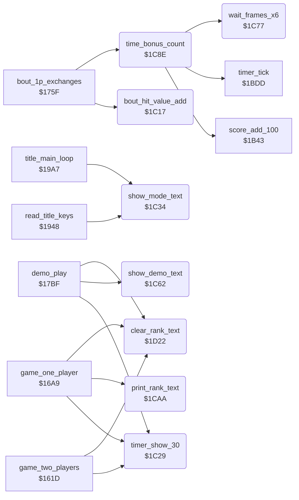

<!-- Generated by c64-docs from knowledge revision 20261021T021734.611-6rf0n2 and src/source-map.json. Do not edit: change the knowledge, generate the source again, then run docs.ts generate. -->
# panel_texts.asm: Tie-break value, panel texts, waits, time bonus and rank texts

Range `$1C17-$1D47`. Source: [panel_texts.asm](../../../src/panel_texts.asm). Index: [the reference](../index.md).

## Call graph

A solid arrow is a call, a thick arrow a table entry, a dotted arrow a jump. Rounded nodes are in this file.

## Data

| Range | Type | Name | Read by | Written by |
|---|---|---|---|---|
| [`$1D2D`](../../../src/panel_texts.asm#L193)-`$1D33` | petscii | [`rank_text_novice`](../../../src/panel_texts.asm#L192) | [`print_rank_text`](panel_texts.md#print_rank_text) |  |
| [`$1D34`](../../../src/panel_texts.asm#L195)-`$1D3B` | petscii | [`rank_text_10th_dan`](../../../src/panel_texts.asm#L194) | [`print_rank_text`](panel_texts.md#print_rank_text) |  |
| [`$1D3C`](../../../src/panel_texts.asm#L198)-`$1D47` | bytes | [`rank_number_table`](../../../src/panel_texts.asm#L197) |  |  |

## Names

### [`bout_hit_value_add`](../../../src/panel_texts.asm#L6) `$1C17`

*routine*

Adds the score value of scoring_move (half for a half point) to bout_hit_value of fighter X, the tie-break at time up. Called by bout_1p_exchanges.

- **Called from:** [`bout_1p_exchanges`](game_modes.md#bout_1p_exchanges) [`$1772`](../../../src/game_modes.asm#L182), [`bout_1p_exchanges`](game_modes.md#bout_1p_exchanges) [`$1784`](../../../src/game_modes.asm#L190)
- **Reads:** [`scoring_move`](../memory-map.md#scoring_move), [`text_1_player+7`](entry_and_tables.md#text_1_player), [`hit_points`](../memory-map.md#hit_points)

### [`bout_hit_value_sum`](../../../src/panel_texts.asm#L13) `$1C23`

*label*

- **Jumped to from:** [`bout_hit_value_add`](panel_texts.md#bout_hit_value_add) [`$1C20`](../../../src/panel_texts.asm#L11)

### [`timer_show_30`](../../../src/panel_texts.asm#L19) `$1C29`

*routine*

Writes 30 into the clock digits at $cc3b. Called before each bout.

- **Called from:** [`game_two_players`](game_modes.md#game_two_players) [`$1650`](../../../src/game_modes.asm#L31), [`game_one_player`](game_modes.md#game_one_player) [`$1702`](../../../src/game_modes.asm#L124), [`demo_play`](game_modes.md#demo_play) [`$1803`](../../../src/game_modes.asm#L259)
- **Writes:** [`panel_timer_digits`](../memory-map.md#panel_timer_digits), [`panel_timer_digits+1`](../memory-map.md#panel_timer_digits)

### [`show_mode_text`](../../../src/panel_texts.asm#L26) `$1C34`

*routine*

Writes 1 PLAYER or 2 PLAYER at $ccbf for two_player_mode. Called by the title loop and the F3 key.

- **Called from:** [`read_title_keys`](title_and_scene.md#read_title_keys) [`$1998`](../../../src/title_and_scene.asm#L52), [`title_main_loop`](title_and_scene.md#title_main_loop) [`$19AE`](../../../src/title_and_scene.asm#L69)
- **Reads:** [`two_player_mode`](../memory-map.md#two_player_mode), [`text_1_player+6`](entry_and_tables.md#text_1_player), [`text_1_player+7`](entry_and_tables.md#text_1_player), [`text_2_player+6`](entry_and_tables.md#text_2_player), [`text_2_player+7`](entry_and_tables.md#text_2_player)
- **Writes:** [`panel_mode_text+6`](../memory-map.md#panel_mode_text), [`panel_mode_text+7`](../memory-map.md#panel_mode_text)

### [`mode_text_test_2p`](../../../src/panel_texts.asm#L30) `$1C3A`

*label*

### [`mode_text_bad_mode`](../../../src/panel_texts.asm#L33) `$1C3E`

*label*

### [`mode_text_1p_loop`](../../../src/panel_texts.asm#L36) `$1C3F`

*label*

- **Jumped to from:** [`show_mode_text`](panel_texts.md#show_mode_text) [`$1C38`](../../../src/panel_texts.asm#L29), [`show_mode_text`](panel_texts.md#show_mode_text) [`$1C46`](../../../src/panel_texts.asm#L40)

### [`mode_text_2p_loop`](../../../src/panel_texts.asm#L42) `$1C49`

*label*

- **Jumped to from:** [`show_mode_text`](panel_texts.md#show_mode_text) [`$1C3C`](../../../src/panel_texts.asm#L32), [`show_mode_text`](panel_texts.md#show_mode_text) [`$1C50`](../../../src/panel_texts.asm#L46)

### [`mode_text_done`](../../../src/panel_texts.asm#L47) `$1C52`

*label*

### [`clear_demo_text_old`](../../../src/panel_texts.asm#L50) `$1C53-$1C61`

*data*

Unused old routine: LDA #$20 and four STA $cca0-$cca3, RTS. It erases DEMO; clear_rank_text erases 8 characters in its place.

### [`show_demo_text`](../../../src/panel_texts.asm#L59) `$1C62`

*routine*

Writes DEMO at $cca0, the place of the rank text. Called by demo_play.

- **Called from:** [`demo_play`](game_modes.md#demo_play) [`$17D8`](../../../src/game_modes.asm#L238)
- **Writes:** [`panel_row4`](../memory-map.md#panel_row4), [`panel_row4+1`](../memory-map.md#panel_row4), [`panel_row4+2`](../memory-map.md#panel_row4), [`panel_row4+3`](../memory-map.md#panel_row4)

### [`wait_frames_x6`](../../../src/panel_texts.asm#L70) `$1C77`

*routine*

Waits X times 6 frames: it counts passes of raster line $fe. Called by time_bonus_count.

- **Called from:** [`time_bonus_count`](panel_texts.md#time_bonus_count) [`$1CA2`](../../../src/panel_texts.asm#L97)
- **Reads:** [`RASTER`](../memory-map.md#RASTER)

### [`wait_line_reach`](../../../src/panel_texts.asm#L72) `$1C79`

*label*

- **Jumped to from:** [`wait_frames_x6`](panel_texts.md#wait_frames_x6) [`$1C7E`](../../../src/panel_texts.asm#L75), [`wait_frames_x6`](panel_texts.md#wait_frames_x6) [`$1C88`](../../../src/panel_texts.asm#L81)

### [`wait_line_leave`](../../../src/panel_texts.asm#L76) `$1C80`

*label*

- **Jumped to from:** [`wait_frames_x6`](panel_texts.md#wait_frames_x6) [`$1C85`](../../../src/panel_texts.asm#L79)

### [`time_bonus_count`](../../../src/panel_texts.asm#L86) `$1C8E`

*routine*

After a one-player win: counts the clock down second by second and adds 100 points per second, with a 6-frame pause. Called by bout_1p_exchanges.

- **Called from:** [`bout_1p_exchanges`](game_modes.md#bout_1p_exchanges) [`$17AB`](../../../src/game_modes.asm#L211)
- **Calls:** [`timer_tick`](score_and_timer.md#timer_tick), [`score_add_100`](score_and_timer.md#score_add_100), [`wait_frames_x6`](panel_texts.md#wait_frames_x6)
- **Reads:** [`time_up`](../memory-map.md#time_up), [`timer_frames`](../memory-map.md#timer_frames)

### [`time_bonus_loop`](../../../src/panel_texts.asm#L89) `$1C92`

*label*

Runs the clock without a frame wait up to the next whole second.

- **Jumped to from:** [`time_bonus_count`](panel_texts.md#time_bonus_count) [`$1C99`](../../../src/panel_texts.asm#L93), [`time_bonus_count`](panel_texts.md#time_bonus_count) [`$1CA7`](../../../src/panel_texts.asm#L99)

### [`time_bonus_exit`](../../../src/panel_texts.asm#L100) `$1CA9`

*label*

- **Jumped to from:** [`time_bonus_count`](panel_texts.md#time_bonus_count) [`$1C90`](../../../src/panel_texts.asm#L88)

### [`print_rank_text`](../../../src/panel_texts.asm#L103) `$1CAA`

*routine*

Writes the rank X at text_dest_ptr: 0 NOVICE, 1-9 the digit with ST, ND, RD or TH and DAN, 10 the text 10TH DAN. Called by game_one_player.

- **Called from:** [`game_one_player`](game_modes.md#game_one_player) [`$16DB`](../../../src/game_modes.asm#L105), [`game_one_player`](game_modes.md#game_one_player) [`$172E`](../../../src/game_modes.asm#L145)
- **Reads:** [`rank_text_novice+5`](panel_texts.md#rank_text_novice), [`rank_text_novice+6`](panel_texts.md#rank_text_novice), [`text_dest_ptr`](../memory-map.md#text_dest_ptr), [`rank_text_10th_dan+6`](panel_texts.md#rank_text_10th_dan), [`rank_text_10th_dan+7`](panel_texts.md#rank_text_10th_dan)

### [`rank_novice_loop`](../../../src/panel_texts.asm#L107) `$1CB0`

*label*

- **Jumped to from:** [`print_rank_text`](panel_texts.md#print_rank_text) [`$1CB6`](../../../src/panel_texts.asm#L111)

### [`rank_number_text`](../../../src/panel_texts.asm#L113) `$1CB9`

*label*

- **Jumped to from:** [`print_rank_text`](panel_texts.md#print_rank_text) [`$1CAC`](../../../src/panel_texts.asm#L105)

### [`rank_suffix_st`](../../../src/panel_texts.asm#L123) `$1CC9`

*label*

### [`rank_test_2nd`](../../../src/panel_texts.asm#L131) `$1CD6`

*label*

- **Jumped to from:** [`print_rank_text`](panel_texts.md#print_rank_text) [`$1CC7`](../../../src/panel_texts.asm#L122)

### [`rank_suffix_nd`](../../../src/panel_texts.asm#L134) `$1CDA`

*label*

### [`rank_test_3rd`](../../../src/panel_texts.asm#L142) `$1CE7`

*label*

- **Jumped to from:** [`print_rank_text`](panel_texts.md#print_rank_text) [`$1CD8`](../../../src/panel_texts.asm#L133)

### [`rank_suffix_rd`](../../../src/panel_texts.asm#L145) `$1CEB`

*label*

### [`rank_suffix_th`](../../../src/panel_texts.asm#L153) `$1CF8`

*label*

- **Jumped to from:** [`print_rank_text`](panel_texts.md#print_rank_text) [`$1CE9`](../../../src/panel_texts.asm#L144)

### [`rank_suffix_dan`](../../../src/panel_texts.asm#L160) `$1D02`

*label*

- **Jumped to from:** [`print_rank_text`](panel_texts.md#print_rank_text) [`$1CD3`](../../../src/panel_texts.asm#L130), [`print_rank_text`](panel_texts.md#print_rank_text) [`$1CE4`](../../../src/panel_texts.asm#L141), [`print_rank_text`](panel_texts.md#print_rank_text) [`$1CF5`](../../../src/panel_texts.asm#L152)

### [`rank_10th_dan`](../../../src/panel_texts.asm#L174) `$1D17`

*label*

- **Jumped to from:** [`print_rank_text`](panel_texts.md#print_rank_text) [`$1CBB`](../../../src/panel_texts.asm#L115)

### [`rank_10th_dan_loop`](../../../src/panel_texts.asm#L176) `$1D19`

*label*

- **Jumped to from:** [`print_rank_text`](panel_texts.md#print_rank_text) [`$1D1F`](../../../src/panel_texts.asm#L180)

### [`clear_rank_text`](../../../src/panel_texts.asm#L183) `$1D22`

*routine*

Fills the 8 cells of the rank text at $cca0 with spaces. Called at the start of each mode.

- **Called from:** [`game_two_players`](game_modes.md#game_two_players) [`$1625`](../../../src/game_modes.asm#L11), [`game_one_player`](game_modes.md#game_one_player) [`$16B1`](../../../src/game_modes.asm#L86), [`demo_play`](game_modes.md#demo_play) [`$17D5`](../../../src/game_modes.asm#L237)
- **Writes:** [`panel_row4+6`](../memory-map.md#panel_row4), [`panel_row4+7`](../memory-map.md#panel_row4)

### [`clear_rank_text_loop`](../../../src/panel_texts.asm#L186) `$1D26`

*label*

- **Jumped to from:** [`clear_rank_text`](panel_texts.md#clear_rank_text) [`$1D2A`](../../../src/panel_texts.asm#L189)

### [`rank_text_novice`](../../../src/panel_texts.asm#L192) `$1D2D-$1D33`

*data*

Rank texts in the ASCII order of the panel characters. NOVICE has 7 characters, with a space.

- **Read by:** [`print_rank_text`](panel_texts.md#print_rank_text) [`$1CB0`](../../../src/panel_texts.asm#L108) (+5), [`print_rank_text`](panel_texts.md#print_rank_text) [`$1CB0`](../../../src/panel_texts.asm#L108) (+6)

### [`rank_text_10th_dan`](../../../src/panel_texts.asm#L194) `$1D34-$1D3B`

*data*

- **Read by:** [`print_rank_text`](panel_texts.md#print_rank_text) [`$1D19`](../../../src/panel_texts.asm#L177) (+6), [`print_rank_text`](panel_texts.md#print_rank_text) [`$1D19`](../../../src/panel_texts.asm#L177) (+7)

### [`rank_number_table`](../../../src/panel_texts.asm#L197) `$1D3C-$1D47`

*data*

Rank number of each rank index: 0, 1-10, 10. Only 12 entries; the rank index goes up to 22, so ranks 12-22 read the code of ai_update.

- **Referred to by:** [`game_one_player`](game_modes.md#game_one_player) [`$172B`](../../../src/game_modes.asm#L144) (+1)
