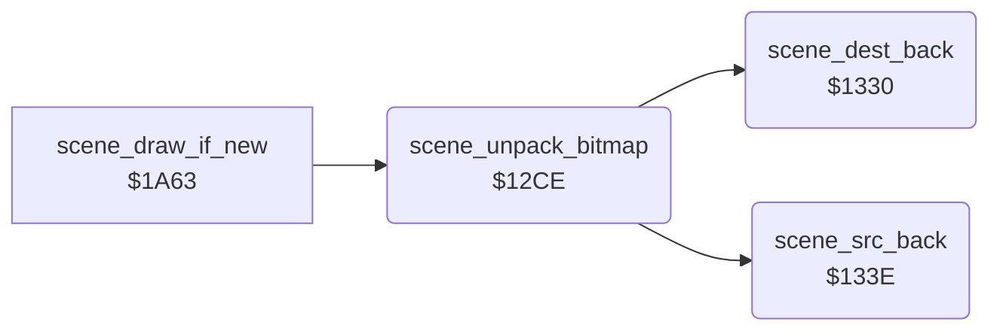

<!-- Generated by c64-docs from knowledge revision 20261021T021734.611-6rf0n2 and src/source-map.json. Do not edit: change the knowledge, generate the source again, then run docs.ts generate. -->
# scene_unpack.asm: Backward RLE unpacker of the scene bitmaps and the packed scene pointers

Range `$12CE-$1353`. Source: [scene_unpack.asm](../../../src/scene_unpack.asm). Index: [the reference](../index.md).

## Call graph

A solid arrow is a call, a thick arrow a table entry, a dotted arrow a jump. Rounded nodes are in this file.

## Data

| Range | Type | Name | Read by | Written by |
|---|---|---|---|---|
| [`$134C`](../../../src/scene_unpack.asm#L85)-`$1353` | addresses | [`scene_packed_ptrs`](../../../src/scene_unpack.asm#L84) | [`scene_unpack_bitmap`](scene_unpack.md#scene_unpack_bitmap) |  |

## Names

### [`scene_unpack_bitmap`](../../../src/scene_unpack.asm#L6) `$12CE`

*routine*

Unpacks the bitmap of scene stage_counter AND 3 backwards into $e640-$f53f. The data starts with its length. Called by scene_draw_if_new.

- **Called from:** [`scene_draw_if_new`](title_and_scene.md#scene_draw_if_new) [`$1A75`](../../../src/title_and_scene.asm#L182)
- **Calls:** [`scene_dest_back`](scene_unpack.md#scene_dest_back), [`scene_src_back`](scene_unpack.md#scene_src_back)
- **Reads:** [`stage_counter`](../memory-map.md#stage_counter), [`scene_packed_ptrs+6`](scene_unpack.md#scene_packed_ptrs), [`scene_packed_ptrs+7`](scene_unpack.md#scene_packed_ptrs), [`scene_src_ptr`](../memory-map.md#scene_src_ptr), [`scene_src_ptr+1`](../memory-map.md#scene_src_ptr), [`scene_run_length`](../memory-map.md#scene_run_length), [`scene_dest_ptr`](../memory-map.md#scene_dest_ptr)
- **Writes:** [`scene_src_ptr`](../memory-map.md#scene_src_ptr), [`scene_src_ptr+1`](../memory-map.md#scene_src_ptr), [`scene_dest_ptr`](../memory-map.md#scene_dest_ptr), [`scene_dest_ptr+1`](../memory-map.md#scene_dest_ptr), [`scene_run_length`](../memory-map.md#scene_run_length)
- **Refers to:** [`scene_packed_ptrs`](scene_unpack.md#scene_packed_ptrs), [`scene_src_ptr`](../memory-map.md#scene_src_ptr), [`scene_dest_ptr`](../memory-map.md#scene_dest_ptr)

### [`scene_unpack_loop`](../../../src/scene_unpack.asm#L30) `$12F8`

*label*

- **Jumped to from:** [`scene_unpack_bitmap`](scene_unpack.md#scene_unpack_bitmap) [`$1311`](../../../src/scene_unpack.asm#L44), [`scene_unpack_bitmap`](scene_unpack.md#scene_unpack_bitmap) [`$132D`](../../../src/scene_unpack.asm#L60)

### [`scene_unpack_copy`](../../../src/scene_unpack.asm#L39) `$130A`

*label*

- **Jumped to from:** [`scene_unpack_bitmap`](scene_unpack.md#scene_unpack_bitmap) [`$130F`](../../../src/scene_unpack.asm#L43)

### [`scene_unpack_run`](../../../src/scene_unpack.asm#L45) `$1313`

*label*

- **Jumped to from:** [`scene_unpack_bitmap`](scene_unpack.md#scene_unpack_bitmap) [`$12FE`](../../../src/scene_unpack.asm#L34)

### [`scene_unpack_fill`](../../../src/scene_unpack.asm#L56) `$1328`

*label*

- **Jumped to from:** [`scene_unpack_bitmap`](scene_unpack.md#scene_unpack_bitmap) [`$132B`](../../../src/scene_unpack.asm#L59)

### [`scene_unpack_done`](../../../src/scene_unpack.asm#L61) `$132F`

*label*

- **Jumped to from:** [`scene_unpack_bitmap`](scene_unpack.md#scene_unpack_bitmap) [`$12FC`](../../../src/scene_unpack.asm#L33)

### [`scene_dest_back`](../../../src/scene_unpack.asm#L64) `$1330`

*routine*

Moves scene_dest_ptr down by scene_run_length. Called by scene_unpack_bitmap.

- **Called from:** [`scene_unpack_bitmap`](scene_unpack.md#scene_unpack_bitmap) [`$1302`](../../../src/scene_unpack.asm#L36), [`scene_unpack_bitmap`](scene_unpack.md#scene_unpack_bitmap) [`$131F`](../../../src/scene_unpack.asm#L52)
- **Reads:** [`scene_dest_ptr`](../memory-map.md#scene_dest_ptr), [`scene_run_length`](../memory-map.md#scene_run_length), [`scene_dest_ptr+1`](../memory-map.md#scene_dest_ptr)
- **Writes:** [`scene_dest_ptr`](../memory-map.md#scene_dest_ptr), [`scene_dest_ptr+1`](../memory-map.md#scene_dest_ptr)
- **Refers to:** [`scene_dest_ptr`](../memory-map.md#scene_dest_ptr)

### [`scene_src_back`](../../../src/scene_unpack.asm#L74) `$133E`

*routine*

Moves scene_src_ptr down by scene_run_length plus 1 (CLC before SBC). Called by scene_unpack_bitmap.

- **Called from:** [`scene_unpack_bitmap`](scene_unpack.md#scene_unpack_bitmap) [`$1305`](../../../src/scene_unpack.asm#L37), [`scene_unpack_bitmap`](scene_unpack.md#scene_unpack_bitmap) [`$131A`](../../../src/scene_unpack.asm#L50)
- **Reads:** [`scene_src_ptr`](../memory-map.md#scene_src_ptr), [`scene_run_length`](../memory-map.md#scene_run_length), [`scene_src_ptr+1`](../memory-map.md#scene_src_ptr)
- **Writes:** [`scene_src_ptr`](../memory-map.md#scene_src_ptr), [`scene_src_ptr+1`](../memory-map.md#scene_src_ptr)
- **Refers to:** [`scene_src_ptr`](../memory-map.md#scene_src_ptr)

### [`scene_packed_ptrs`](../../../src/scene_unpack.asm#L84) `$134C-$1353`

*data*

Start of the packed bitmap of each scene. The first word of each block is its length.

- **Read by:** [`scene_unpack_bitmap`](scene_unpack.md#scene_unpack_bitmap) [`$12D4`](../../../src/scene_unpack.asm#L11) (+6), [`scene_unpack_bitmap`](scene_unpack.md#scene_unpack_bitmap) [`$12D9`](../../../src/scene_unpack.asm#L13) (+7)
