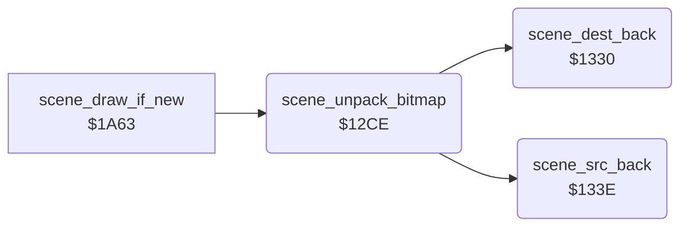

<!-- Generated by c64-docs from knowledge revision 20261025T191824.210-p015r5 and .c64-re-tools/local/generated/src/source-map.json. Do not edit: change the knowledge, generate the source again, then run docs.ts generate. -->
# scenes/scene_unpack.asm: Backward RLE unpacker of the scene bitmaps and the packed scene pointers

Range `$12CE-$1353`. Source: [scenes/scene_unpack.asm](../../../../src/scenes/scene_unpack.asm). Index: [the reference](../../index.md).

## Routines

| Routine | Address | Reached from | Summary |
|---|---|---|---|
| [`scene_unpack_bitmap`](scene_unpack.md#scene_unpack_bitmap) | `$12CE` | [`scene_draw_if_new`](../game/title_and_scene.md#scene_draw_if_new) | Unpacks the bitmap of scene stage_counter AND 3 backwards into $e640-$f53f. |
| [`scene_dest_back`](scene_unpack.md#scene_dest_back) | `$1330` | [`scene_unpack_bitmap`](scene_unpack.md#scene_unpack_bitmap) | Moves scene_dest_ptr down by scene_run_length. |
| [`scene_src_back`](scene_unpack.md#scene_src_back) | `$133E` | [`scene_unpack_bitmap`](scene_unpack.md#scene_unpack_bitmap) | Moves scene_src_ptr down by scene_run_length plus 1 (CLC before SBC). |

## Data

| Range | Type | Name | Read by | Written by |
|---|---|---|---|---|
| [`$134C`](../../../../src/scenes/scene_unpack.asm#L82)-`$1353` | addresses | [`scene_packed_ptrs`](../../../../src/scenes/scene_unpack.asm#L81) | [`scene_unpack_bitmap`](scene_unpack.md#scene_unpack_bitmap) |  |

## Call graph

A solid arrow is a call, a thick arrow a table entry. Rounded nodes are in this file.

## Details

### [`scene_unpack_bitmap`](../../../../src/scenes/scene_unpack.asm#L6) `$12CE`

*routine*

Unpacks the bitmap of scene stage_counter AND 3 backwards into $e640-$f53f. The data starts with its length. Called by scene_draw_if_new.

- **Called from:** [`scene_draw_if_new`](../game/title_and_scene.md#scene_draw_if_new)
- **Calls:** [`scene_dest_back`](scene_unpack.md#scene_dest_back), [`scene_src_back`](scene_unpack.md#scene_src_back)
- **Reads:** [`stage_counter`](../../memory-map.md#stage_counter), [`scene_packed_ptrs`](scene_unpack.md#scene_packed_ptrs), [`scene_src_ptr`](../../memory-map.md#scene_src_ptr), [`scene_run_length`](../../memory-map.md#scene_run_length), [`scene_dest_ptr`](../../memory-map.md#scene_dest_ptr)
- **Writes:** [`scene_src_ptr`](../../memory-map.md#scene_src_ptr), [`scene_dest_ptr`](../../memory-map.md#scene_dest_ptr), [`scene_run_length`](../../memory-map.md#scene_run_length)
- **Refers to:** [`scene_packed_ptrs`](scene_unpack.md#scene_packed_ptrs), [`scene_src_ptr`](../../memory-map.md#scene_src_ptr), [`scene_dest_ptr`](../../memory-map.md#scene_dest_ptr)

| Label | Address | Comment |
|---|---|---|
| [`scene_unpack_loop`](../../../../src/scenes/scene_unpack.asm#L27) | `$12F8` |  |
| [`scene_unpack_copy`](../../../../src/scenes/scene_unpack.asm#L36) | `$130A` |  |
| [`scene_unpack_run`](../../../../src/scenes/scene_unpack.asm#L42) | `$1313` |  |
| [`scene_unpack_fill`](../../../../src/scenes/scene_unpack.asm#L53) | `$1328` |  |
| [`scene_unpack_done`](../../../../src/scenes/scene_unpack.asm#L58) | `$132F` |  |

### [`scene_dest_back`](../../../../src/scenes/scene_unpack.asm#L61) `$1330`

*routine*

Moves scene_dest_ptr down by scene_run_length. Called by scene_unpack_bitmap.

- **Called from:** [`scene_unpack_bitmap`](scene_unpack.md#scene_unpack_bitmap)
- **Reads:** [`scene_dest_ptr`](../../memory-map.md#scene_dest_ptr), [`scene_run_length`](../../memory-map.md#scene_run_length)
- **Writes:** [`scene_dest_ptr`](../../memory-map.md#scene_dest_ptr)
- **Refers to:** [`scene_dest_ptr`](../../memory-map.md#scene_dest_ptr)

### [`scene_src_back`](../../../../src/scenes/scene_unpack.asm#L71) `$133E`

*routine*

Moves scene_src_ptr down by scene_run_length plus 1 (CLC before SBC). Called by scene_unpack_bitmap.

- **Called from:** [`scene_unpack_bitmap`](scene_unpack.md#scene_unpack_bitmap)
- **Reads:** [`scene_src_ptr`](../../memory-map.md#scene_src_ptr), [`scene_run_length`](../../memory-map.md#scene_run_length)
- **Writes:** [`scene_src_ptr`](../../memory-map.md#scene_src_ptr)
- **Refers to:** [`scene_src_ptr`](../../memory-map.md#scene_src_ptr)

### [`scene_packed_ptrs`](../../../../src/scenes/scene_unpack.asm#L81) `$134C-$1353`

*data*

Start of the packed bitmap of each scene. The first word of each block is its length.

- **Read by:** [`scene_unpack_bitmap`](scene_unpack.md#scene_unpack_bitmap)
