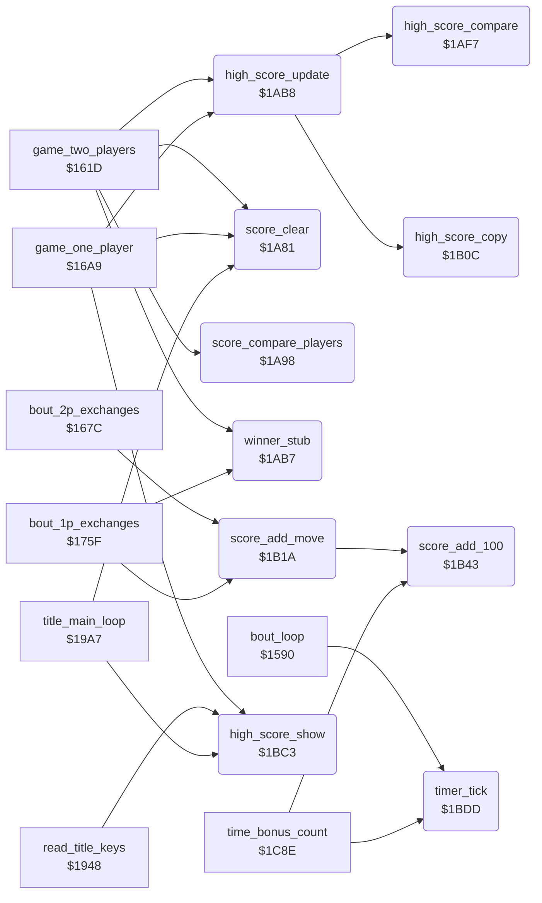

<!-- Generated by c64-docs from knowledge revision 20261021T021734.611-6rf0n2 and src/source-map.json. Do not edit: change the knowledge, generate the source again, then run docs.ts generate. -->
# score_and_timer.asm: Score digits, score compare, high scores and the bout timer

Range `$1A81-$1C16`. Source: [score_and_timer.asm](../../../src/score_and_timer.asm). Index: [the reference](../index.md).

## Call graph

A solid arrow is a call, a thick arrow a table entry, a dotted arrow a jump. Rounded nodes are in this file.

## Names

### [`score_clear`](../../../src/score_and_timer.asm#L6) `$1A81`

*routine*

Sets the score of the player at $cc28+X to five spaces and a 0. X = 9 for player 1, $19 for player 2.

- **Called from:** [`game_two_players`](game_modes.md#game_two_players) [`$1638`](../../../src/game_modes.asm#L19), [`game_two_players`](game_modes.md#game_two_players) [`$163D`](../../../src/game_modes.asm#L21), [`game_one_player`](game_modes.md#game_one_player) [`$16C0`](../../../src/game_modes.asm#L93), [`game_one_player`](game_modes.md#game_one_player) [`$16C5`](../../../src/game_modes.asm#L95), [`title_main_loop`](title_and_scene.md#title_main_loop) [`$19B7`](../../../src/title_and_scene.asm#L73), [`title_main_loop`](title_and_scene.md#title_main_loop) [`$19BC`](../../../src/title_and_scene.asm#L75)
- **Refers to:** [`panel_row1`](../memory-map.md#panel_row1), [`panel_row1+1`](../memory-map.md#panel_row1), [`panel_row1+2`](../memory-map.md#panel_row1), [`panel_row1+3`](../memory-map.md#panel_row1), [`panel_row1+4`](../memory-map.md#panel_row1), [`panel_row1+5`](../memory-map.md#panel_row1)

### [`score_compare_players`](../../../src/score_and_timer.asm#L17) `$1A98`

*routine*

Compares the six score digits of both players. Returns X = 0 when player 1 is higher, 1 when player 2 is higher, $80 when equal. Called by game_two_players.

- **Called from:** [`game_two_players`](game_modes.md#game_two_players) [`$1663`](../../../src/game_modes.asm#L39)
- **Reads:** [`panel_row1+9`](../memory-map.md#panel_row1), [`panel_row1+10`](../memory-map.md#panel_row1), [`panel_timer_digits+6`](../memory-map.md#panel_timer_digits), [`panel_timer_digits+7`](../memory-map.md#panel_timer_digits)

### [`score_compare_loop`](../../../src/score_and_timer.asm#L20) `$1A9C`

*label*

- **Jumped to from:** [`score_compare_players`](score_and_timer.md#score_compare_players) [`$1AAC`](../../../src/score_and_timer.asm#L31)

### [`score_compare_differ`](../../../src/score_and_timer.asm#L24) `$1AA4`

*label*

### [`score_compare_next`](../../../src/score_and_timer.asm#L27) `$1AA8`

*label*

- **Jumped to from:** [`score_compare_players`](score_and_timer.md#score_compare_players) [`$1AA2`](../../../src/score_and_timer.asm#L23)

### [`score_compare_equal`](../../../src/score_and_timer.asm#L32) `$1AAE`

*label*

### [`score_p1_higher`](../../../src/score_and_timer.asm#L36) `$1AB1`

*label*

- **Jumped to from:** [`score_compare_players`](score_and_timer.md#score_compare_players) [`$1AA4`](../../../src/score_and_timer.asm#L25)

### [`score_p2_higher`](../../../src/score_and_timer.asm#L39) `$1AB4`

*label*

- **Jumped to from:** [`score_compare_players`](score_and_timer.md#score_compare_players) [`$1AA6`](../../../src/score_and_timer.asm#L26)

### [`winner_stub`](../../../src/score_and_timer.asm#L43) `$1AB7`

*routine*

Lone RTS. Called with the winner in X after a decision by time or by score. It is the place of a removed winner action.

- **Called from:** [`game_two_players`](game_modes.md#game_two_players) [`$1670`](../../../src/game_modes.asm#L47), [`bout_1p_exchanges`](game_modes.md#bout_1p_exchanges) [`$17A5`](../../../src/game_modes.asm#L208), [`bout_1p_exchanges`](game_modes.md#bout_1p_exchanges) [`$17B3`](../../../src/game_modes.asm#L217)

### [`high_score_update`](../../../src/score_and_timer.asm#L46) `$1AB8`

*routine*

Copies the score of the player in X to the high score of the mode when it is higher. Called at the end of a game.

- **Called from:** [`game_two_players`](game_modes.md#game_two_players) [`$1676`](../../../src/game_modes.asm#L50), [`game_one_player`](game_modes.md#game_one_player) [`$1740`](../../../src/game_modes.asm#L154)
- **Calls:** [`high_score_compare`](score_and_timer.md#high_score_compare), [`high_score_copy`](score_and_timer.md#high_score_copy)
- **Reads:** [`two_player_mode`](../memory-map.md#two_player_mode)
- **Writes:** [`text_dest_ptr`](../memory-map.md#text_dest_ptr), [`text_dest_ptr+1`](../memory-map.md#text_dest_ptr)
- **Refers to:** [`high_score_1p`](entry_and_tables.md#high_score_1p), [`text_dest_ptr`](../memory-map.md#text_dest_ptr), [`high_score_2p`](entry_and_tables.md#high_score_2p)

### [`high_score_set_1p`](../../../src/score_and_timer.asm#L56) `$1ACB`

*label*

### [`high_score_exit`](../../../src/score_and_timer.asm#L59) `$1AD0`

*label*

- **Jumped to from:** [`high_score_update`](score_and_timer.md#high_score_update) [`$1AC9`](../../../src/score_and_timer.asm#L55), [`high_score_update`](score_and_timer.md#high_score_update) [`$1AE2`](../../../src/score_and_timer.asm#L72), [`high_score_update`](score_and_timer.md#high_score_update) [`$1AEF`](../../../src/score_and_timer.asm#L80)

### [`high_score_2p_mode`](../../../src/score_and_timer.asm#L61) `$1AD1`

*label*

- **Jumped to from:** [`high_score_update`](score_and_timer.md#high_score_update) [`$1ABA`](../../../src/score_and_timer.asm#L48)

### [`high_score_2p_p1`](../../../src/score_and_timer.asm#L68) `$1ADD`

*label*

### [`high_score_set_2p_p1`](../../../src/score_and_timer.asm#L73) `$1AE4`

*label*

### [`high_score_2p_p2`](../../../src/score_and_timer.asm#L77) `$1AEA`

*label*

- **Jumped to from:** [`high_score_update`](score_and_timer.md#high_score_update) [`$1ADB`](../../../src/score_and_timer.asm#L67)

### [`high_score_set_2p_p2`](../../../src/score_and_timer.asm#L81) `$1AF1`

*label*

### [`high_score_compare`](../../../src/score_and_timer.asm#L86) `$1AF7`

*routine*

Compares the high score at text_dest_ptr with the score at $cc28+X. Returns C clear when the score is higher. Called by high_score_update.

- **Called from:** [`high_score_update`](score_and_timer.md#high_score_update) [`$1AC6`](../../../src/score_and_timer.asm#L54), [`high_score_update`](score_and_timer.md#high_score_update) [`$1ADF`](../../../src/score_and_timer.asm#L71), [`high_score_update`](score_and_timer.md#high_score_update) [`$1AEC`](../../../src/score_and_timer.asm#L79)
- **Reads:** [`text_dest_ptr`](../memory-map.md#text_dest_ptr)
- **Refers to:** [`panel_row1`](../memory-map.md#panel_row1)

### [`high_score_cmp_loop`](../../../src/score_and_timer.asm#L88) `$1AF9`

*label*

- **Jumped to from:** [`high_score_compare`](score_and_timer.md#high_score_compare) [`$1B08`](../../../src/score_and_timer.asm#L100)

### [`high_score_cmp_differ`](../../../src/score_and_timer.asm#L92) `$1B00`

*label*

### [`high_score_cmp_next`](../../../src/score_and_timer.asm#L96) `$1B04`

*label*

- **Jumped to from:** [`high_score_compare`](score_and_timer.md#high_score_compare) [`$1B00`](../../../src/score_and_timer.asm#L93)

### [`high_score_cmp_equal`](../../../src/score_and_timer.asm#L101) `$1B0A`

*label*

### [`high_score_cmp_exit`](../../../src/score_and_timer.asm#L104) `$1B0B`

*label*

- **Jumped to from:** [`high_score_compare`](score_and_timer.md#high_score_compare) [`$1AFE`](../../../src/score_and_timer.asm#L91)

### [`high_score_copy`](../../../src/score_and_timer.asm#L107) `$1B0C`

*routine*

Copies the six score digits at $cc28+X to the high score at text_dest_ptr. Called by high_score_update.

- **Called from:** [`high_score_update`](score_and_timer.md#high_score_update) [`$1ACD`](../../../src/score_and_timer.asm#L58), [`high_score_update`](score_and_timer.md#high_score_update) [`$1AE6`](../../../src/score_and_timer.asm#L75), [`high_score_update`](score_and_timer.md#high_score_update) [`$1AF3`](../../../src/score_and_timer.asm#L83)
- **Reads:** [`text_dest_ptr`](../memory-map.md#text_dest_ptr)
- **Refers to:** [`panel_row1`](../memory-map.md#panel_row1)

### [`high_score_copy_loop`](../../../src/score_and_timer.asm#L109) `$1B0E`

*label*

- **Jumped to from:** [`high_score_copy`](score_and_timer.md#high_score_copy) [`$1B17`](../../../src/score_and_timer.asm#L115)

### [`score_add_move`](../../../src/score_and_timer.asm#L118) `$1B1A`

*routine*

Adds move_score_values of scoring_move times 100 to the player at $cc28+X, half of it for a half point. X = 9 or $19.

- **Called from:** [`bout_2p_exchanges`](game_modes.md#bout_2p_exchanges) [`$168F`](../../../src/game_modes.asm#L66), [`bout_2p_exchanges`](game_modes.md#bout_2p_exchanges) [`$1697`](../../../src/game_modes.asm#L70), [`bout_1p_exchanges`](game_modes.md#bout_1p_exchanges) [`$177F`](../../../src/game_modes.asm#L188)
- **Calls:** [`score_add_100`](score_and_timer.md#score_add_100)
- **Reads:** [`scoring_move`](../memory-map.md#scoring_move), [`text_1_player+7`](entry_and_tables.md#text_1_player), [`hit_points`](../memory-map.md#hit_points), [`hit_points+1`](../memory-map.md#hit_points)
- **Refers to:** [`hit_points`](../memory-map.md#hit_points), [`panel_row1+4`](../memory-map.md#panel_row1)

### [`score_hits_p1`](../../../src/score_and_timer.asm#L123) `$1B23`

*label*

### [`score_hits_p2`](../../../src/score_and_timer.asm#L126) `$1B28`

*label*

- **Jumped to from:** [`score_add_move`](score_and_timer.md#score_add_move) [`$1B21`](../../../src/score_and_timer.asm#L122)

### [`score_test_full`](../../../src/score_and_timer.asm#L128) `$1B2A`

*label*

- **Jumped to from:** [`score_add_move`](score_and_timer.md#score_add_move) [`$1B25`](../../../src/score_and_timer.asm#L125)

### [`score_halve`](../../../src/score_and_timer.asm#L131) `$1B2E`

*label*

A half point gives half the value.

### [`score_add_value`](../../../src/score_and_timer.asm#L133) `$1B2F`

*label*

- **Jumped to from:** [`score_add_move`](score_and_timer.md#score_add_move) [`$1B2C`](../../../src/score_and_timer.asm#L130)

### [`score_set_tens`](../../../src/score_and_timer.asm#L138) `$1B37`

*label*

The first points change the tens digit from space to 0.

### [`score_add_loop`](../../../src/score_and_timer.asm#L141) `$1B3C`

*label*

- **Jumped to from:** [`score_add_move`](score_and_timer.md#score_add_move) [`$1B35`](../../../src/score_and_timer.asm#L137), [`score_add_move`](score_and_timer.md#score_add_move) [`$1B40`](../../../src/score_and_timer.asm#L144)

### [`score_add_done`](../../../src/score_and_timer.asm#L145) `$1B42`

*label*

### [`score_add_100`](../../../src/score_and_timer.asm#L148) `$1B43`

*routine*

Adds 100 points to the score at $cc28+X: increments the hundreds digit with carry. A space digit becomes 1. Called by score_add_move, time_bonus_count and the bull test.

- **Called from:** [`score_add_move`](score_and_timer.md#score_add_move) [`$1B3C`](../../../src/score_and_timer.asm#L142), [`time_bonus_count`](panel_texts.md#time_bonus_count) [`$1C9D`](../../../src/panel_texts.asm#L95)
- **Refers to:** [`panel_row1+3`](../memory-map.md#panel_row1), [`panel_row1+2`](../memory-map.md#panel_row1), [`panel_row1+1`](../memory-map.md#panel_row1), [`panel_row1`](../memory-map.md#panel_row1), [`panel_row1+4`](../memory-map.md#panel_row1), [`panel_row1+5`](../memory-map.md#panel_row1)

### [`score_new_100s`](../../../src/score_and_timer.asm#L152) `$1B4A`

*label*

### [`score_inc_100s`](../../../src/score_and_timer.asm#L156) `$1B50`

*label*

- **Jumped to from:** [`score_add_100`](score_and_timer.md#score_add_100) [`$1B48`](../../../src/score_and_timer.asm#L151)

### [`score_carry_1000s`](../../../src/score_and_timer.asm#L161) `$1B5A`

*label*

### [`score_new_1000s`](../../../src/score_and_timer.asm#L167) `$1B66`

*label*

### [`score_inc_1000s`](../../../src/score_and_timer.asm#L171) `$1B6C`

*label*

- **Jumped to from:** [`score_add_100`](score_and_timer.md#score_add_100) [`$1B64`](../../../src/score_and_timer.asm#L166)

### [`score_carry_10000s`](../../../src/score_and_timer.asm#L176) `$1B76`

*label*

### [`score_new_10000s`](../../../src/score_and_timer.asm#L182) `$1B82`

*label*

### [`score_inc_10000s`](../../../src/score_and_timer.asm#L186) `$1B88`

*label*

- **Jumped to from:** [`score_add_100`](score_and_timer.md#score_add_100) [`$1B80`](../../../src/score_and_timer.asm#L181)

### [`score_carry_100000s`](../../../src/score_and_timer.asm#L191) `$1B92`

*label*

### [`score_new_100000s`](../../../src/score_and_timer.asm#L197) `$1B9E`

*label*

### [`score_inc_100000s`](../../../src/score_and_timer.asm#L201) `$1BA4`

*label*

- **Jumped to from:** [`score_add_100`](score_and_timer.md#score_add_100) [`$1B9C`](../../../src/score_and_timer.asm#L196)

### [`score_overflow`](../../../src/score_and_timer.asm#L207) `$1BAE`

*label*

Above 999900 the score becomes 000000.

### [`score_add_exit`](../../../src/score_and_timer.asm#L215) `$1BC2`

*label*

- **Jumped to from:** [`score_add_100`](score_and_timer.md#score_add_100) [`$1B58`](../../../src/score_and_timer.asm#L160), [`score_add_100`](score_and_timer.md#score_add_100) [`$1B74`](../../../src/score_and_timer.asm#L175), [`score_add_100`](score_and_timer.md#score_add_100) [`$1B90`](../../../src/score_and_timer.asm#L190), [`score_add_100`](score_and_timer.md#score_add_100) [`$1BAC`](../../../src/score_and_timer.asm#L206)

### [`high_score_show`](../../../src/score_and_timer.asm#L218) `$1BC3`

*routine*

Shows the high score of the current mode at $ccb1. Called by the title loop, the F3 key and the end of the one-player game.

- **Called from:** [`game_one_player`](game_modes.md#game_one_player) [`$1743`](../../../src/game_modes.asm#L155), [`read_title_keys`](title_and_scene.md#read_title_keys) [`$199B`](../../../src/title_and_scene.asm#L53), [`title_main_loop`](title_and_scene.md#title_main_loop) [`$19AB`](../../../src/title_and_scene.asm#L68)
- **Reads:** [`two_player_mode`](../memory-map.md#two_player_mode), [`high_score_2p+4`](entry_and_tables.md#high_score_2p), [`high_score_2p+5`](entry_and_tables.md#high_score_2p), [`high_score_1p+4`](entry_and_tables.md#high_score_1p), [`high_score_1p+5`](entry_and_tables.md#high_score_1p)
- **Writes:** [`panel_hiscore_digits+4`](../memory-map.md#panel_hiscore_digits), [`panel_hiscore_digits+5`](../memory-map.md#panel_hiscore_digits)

### [`high_score_show_2p`](../../../src/score_and_timer.asm#L222) `$1BC9`

*label*

- **Jumped to from:** [`high_score_show`](score_and_timer.md#high_score_show) [`$1BD0`](../../../src/score_and_timer.asm#L226)

### [`high_score_show_done`](../../../src/score_and_timer.asm#L227) `$1BD2`

*label*

### [`high_score_show_1p`](../../../src/score_and_timer.asm#L229) `$1BD3`

*label*

- **Jumped to from:** [`high_score_show`](score_and_timer.md#high_score_show) [`$1BC7`](../../../src/score_and_timer.asm#L221), [`high_score_show`](score_and_timer.md#high_score_show) [`$1BDA`](../../../src/score_and_timer.asm#L233)

### [`timer_tick`](../../../src/score_and_timer.asm#L236) `$1BDD`

*routine*

Counts one frame of the bout clock. Each 50 frames it decrements the digits at $cc3b and timer_seconds; at 0 it sets time_up. Called by bout_loop and time_bonus_count.

- **Called from:** [`bout_loop`](init_bout_loop.md#bout_loop) [`$15DB`](../../../src/init_bout_loop.asm#L231), [`time_bonus_count`](panel_texts.md#time_bonus_count) [`$1C92`](../../../src/panel_texts.asm#L90)
- **Reads:** [`timer_frames`](../memory-map.md#timer_frames), [`panel_timer_digits+1`](../memory-map.md#panel_timer_digits), [`panel_timer_digits`](../memory-map.md#panel_timer_digits), [`timer_seconds`](../memory-map.md#timer_seconds)
- **Writes:** [`timer_frames`](../memory-map.md#timer_frames), [`panel_timer_digits`](../memory-map.md#panel_timer_digits), [`panel_timer_digits+1`](../memory-map.md#panel_timer_digits), [`timer_seconds`](../memory-map.md#timer_seconds), [`time_up`](../memory-map.md#time_up)

### [`timer_next_second`](../../../src/score_and_timer.asm#L239) `$1BE1`

*label*

### [`timer_units_zero`](../../../src/score_and_timer.asm#L245) `$1BEC`

*label*

### [`timer_dec_tens`](../../../src/score_and_timer.asm#L249) `$1BF3`

*label*

### [`timer_tens_blank`](../../../src/score_and_timer.asm#L254) `$1BFE`

*label*

From 10 to 9: the tens digit becomes a space.

- **Jumped to from:** [`timer_tick`](score_and_timer.md#timer_tick) [`$1BF1`](../../../src/score_and_timer.asm#L248)

### [`timer_dec_units`](../../../src/score_and_timer.asm#L260) `$1C0B`

*label*

- **Jumped to from:** [`timer_tick`](score_and_timer.md#timer_tick) [`$1BEA`](../../../src/score_and_timer.asm#L244)

### [`timer_dec_seconds`](../../../src/score_and_timer.asm#L262) `$1C0E`

*label*

- **Jumped to from:** [`timer_tick`](score_and_timer.md#timer_tick) [`$1BFB`](../../../src/score_and_timer.asm#L253), [`timer_tick`](score_and_timer.md#timer_tick) [`$1C08`](../../../src/score_and_timer.asm#L259)

### [`timer_set_time_up`](../../../src/score_and_timer.asm#L265) `$1C12`

*label*

### [`timer_exit`](../../../src/score_and_timer.asm#L268) `$1C16`

*label*

- **Jumped to from:** [`timer_tick`](score_and_timer.md#timer_tick) [`$1BDF`](../../../src/score_and_timer.asm#L238), [`timer_tick`](score_and_timer.md#timer_tick) [`$1C10`](../../../src/score_and_timer.asm#L264)
