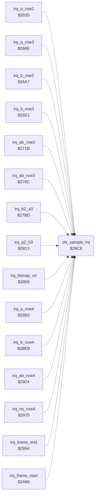

<!-- Generated by c64-docs from knowledge revision 20261022T132731.733-fztd87 and .c64-re-tools/local/generated/src/source-map.json. Do not edit: change the knowledge, generate the source again, then run docs.ts generate. -->
# sfx/sfx_sample_player.asm: Unused 1-bit sample player on the CIA1 timer B IRQ, and its unused set-up

Range `$29C8-$2A09`. Source: [sfx/sfx_sample_player.asm](../../../../src/sfx/sfx_sample_player.asm). Index: [the reference](../../index.md).

## Call graph

A solid arrow is a call, a thick arrow a table entry, a dotted arrow a jump. Rounded nodes are in this file.

## Names

### [`sfx_sample_irq`](../../../../src/sfx/sfx_sample_player.asm#L6) `$29C8`

*routine*

Unreachable CIA1 timer B IRQ of a 1-bit sample player: CIA1 IRQs are off and nothing calls sfx_sample_start. Each IRQ toggles the SID volume between 0 and 15, then reads one sample byte through sfx_sample_ptr. The byte selects the timer B count to the next toggle from $0e00 (low) and $0f00 (high). Every raster handler jumps here on a non-VIC IRQ.
Acknowledge CIA1

- **Jumped to from:** [`irq_a_row2`](../irq/irq_sprite_rows.md#irq_a_row2) [`$263A`](../../../../src/irq/irq_sprite_rows.asm#L10), [`irq_a_row3`](../irq/irq_sprite_rows.md#irq_a_row3) [`$2673`](../../../../src/irq/irq_sprite_rows.asm#L99), [`irq_b_row2`](../irq/irq_sprite_rows.md#irq_b_row2) [`$26AC`](../../../../src/irq/irq_sprite_rows.asm#L188), [`irq_b_row3`](../irq/irq_sprite_rows.md#irq_b_row3) [`$26E6`](../../../../src/irq/irq_sprite_rows.asm#L278), [`irq_ab_row2`](../irq/irq_sprite_rows.md#irq_ab_row2) [`$2720`](../../../../src/irq/irq_sprite_rows.asm#L368), [`irq_ab_row3`](../irq/irq_sprite_rows.md#irq_ab_row3) [`$2771`](../../../../src/irq/irq_sprite_rows.asm#L487), [`irq_b2_a3`](../irq/irq_sprite_rows.md#irq_b2_a3) [`$27C2`](../../../../src/irq/irq_sprite_rows.asm#L606), [`irq_a2_b3`](../irq/irq_sprite_rows.md#irq_a2_b3) [`$2818`](../../../../src/irq/irq_sprite_rows.asm#L721), [`irq_bitmap_on`](../irq/irq_screen_split.md#irq_bitmap_on) [`$286E`](../../../../src/irq/irq_screen_split.asm#L10), [`irq_a_row4`](../irq/irq_screen_split.md#irq_a_row4) [`$28B7`](../../../../src/irq/irq_screen_split.asm#L80), [`irq_b_row4`](../irq/irq_screen_split.md#irq_b_row4) [`$28F0`](../../../../src/irq/irq_screen_split.asm#L135), [`irq_ab_row4`](../irq/irq_screen_split.md#irq_ab_row4) [`$2929`](../../../../src/irq/irq_screen_split.asm#L190), [`irq_no_row4`](../irq/irq_screen_split.md#irq_no_row4) [`$297A`](../../../../src/irq/irq_screen_split.asm#L284), [`irq_frame_end`](../irq/irq_screen_split.md#irq_frame_end) [`$2999`](../../../../src/irq/irq_screen_split.asm#L299), [`irq_frame_start`](../irq/sprite_mux_plan.md#irq_frame_start) [`$2A6B`](../../../../src/irq/sprite_mux_plan.asm#L10)
- **Reads:** [`CIAICR`](../../memory-map.md#CIAICR), [`sfx_volume`](../../memory-map.md#sfx_volume), [`sfx_sample_ptr`](../../memory-map.md#sfx_sample_ptr), [`sfx_period_lo_old`](../music/music_effects.md#sfx_period_lo_old), [`sfx_period_hi_old`](../music/music_effects.md#sfx_period_hi_old), [`sfx_sample_ptr+1`](../../memory-map.md#sfx_sample_ptr), [`sfx_sample_end`](../../memory-map.md#sfx_sample_end), [`sfx_sample_end+1`](../../memory-map.md#sfx_sample_end)
- **Writes:** [`SIGVOL`](../../memory-map.md#SIGVOL), [`sfx_volume`](../../memory-map.md#sfx_volume), [`CIATBLO`](../../memory-map.md#CIATBLO), [`CIATBHI`](../../memory-map.md#CIATBHI), [`sfx_sample_ptr`](../../memory-map.md#sfx_sample_ptr), [`sfx_sample_ptr+1`](../../memory-map.md#sfx_sample_ptr), [`sfx_done`](../../memory-map.md#sfx_done), [`CIACRB`](../../memory-map.md#CIACRB)
- **Refers to:** [`sfx_sample_ptr`](../../memory-map.md#sfx_sample_ptr), [`sfx_sample_end`](../../memory-map.md#sfx_sample_end)

### [`sfx_check_end`](../../../../src/sfx/sfx_sample_player.asm#L25) `$29EF`

*label*

Continue while sfx_sample_end >= sfx_sample_ptr

- **Jumped to from:** [`sfx_sample_irq`](sfx_sample_player.md#sfx_sample_irq) [`$29EB`](../../../../src/sfx/sfx_sample_player.asm#L24)

### [`sfx_next_period`](../../../../src/sfx/sfx_sample_player.asm#L37) `$2A01`

*label*

Timer B: start, one-shot, load the latch, count timer A underflows

- **Jumped to from:** [`sfx_sample_irq`](sfx_sample_player.md#sfx_sample_irq) [`$29F7`](../../../../src/sfx/sfx_sample_player.asm#L30)
