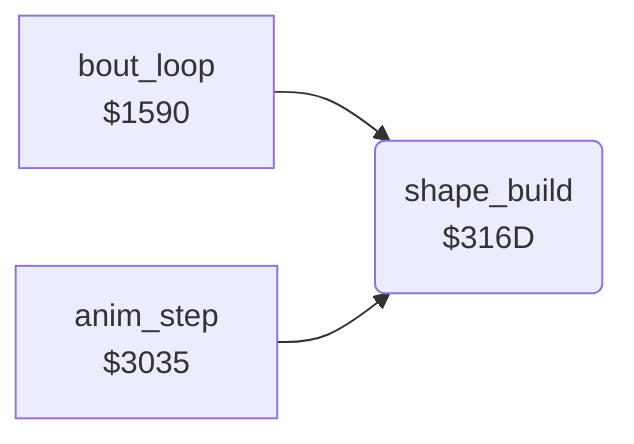

<!-- Generated by c64-docs from knowledge revision 20261021T021734.611-6rf0n2 and src/source-map.json. Do not edit: change the knowledge, generate the source again, then run docs.ts generate. -->
# shape_build.asm: Shape builder tables and normal copy of the 9 sprite parts of a frame, shadow pointers

Range `$3109-$33E6`. Source: [shape_build.asm](../../../src/shape_build.asm). Index: [the reference](../index.md).

## Call graph

A solid arrow is a call, a thick arrow a table entry, a dotted arrow a jump. Rounded nodes are in this file.

## Data

| Range | Type | Name | Read by | Written by |
|---|---|---|---|---|
| [`$3109`](../../../src/shape_build.asm#L7)-`$310C` | bytes | [`shape_part_lo`](../../../src/shape_build.asm#L6) |  |  |
| [`$310D`](../../../src/shape_build.asm#L10)-`$3130` | bytes of 9 | [`shape_ptr_lists`](../../../src/shape_build.asm#L9) |  |  |
| [`$3131`](../../../src/shape_build.asm#L16)-`$3154` | unused | [`shape_unused_mirror_lists`](../../../src/shape_build.asm#L15) |  |  |
| [`$3155`](../../../src/shape_build.asm#L23)-`$315C` | addresses-split | [`shape_ptr_list_lo`](../../../src/shape_build.asm#L22) |  |  |
| [`$315D`](../../../src/shape_build.asm#L28)-`$3164` | unused | [`shape_unused_mlist_lo`](../../../src/shape_build.asm#L27) |  |  |
| [`$3165`](../../../src/shape_build.asm#L33)-`$316C` | addresses-split | [`shape_buffer_lo`](../../../src/shape_build.asm#L32) |  |  |
| [`$33AF`](../../../src/shape_build.asm#L479)-`$33B6` | bytes | [`shape_row4_frames`](../../../src/shape_build.asm#L478) | [`shape_build`](shape_build.md#shape_build) |  |
| [`$33B7`](../../../src/shape_build.asm#L482)-`$33C6` | bytes of 8 | [`shape_row4_left`](../../../src/shape_build.asm#L481) | [`shape_build`](shape_build.md#shape_build) |  |
| [`$33C7`](../../../src/shape_build.asm#L485)-`$33D6` | bytes of 8 | [`shape_row4_mid`](../../../src/shape_build.asm#L484) | [`shape_build`](shape_build.md#shape_build) |  |
| [`$33D7`](../../../src/shape_build.asm#L488)-`$33E6` | bytes of 8 | [`shape_row4_right`](../../../src/shape_build.asm#L487) | [`shape_build`](shape_build.md#shape_build) |  |

## Names

### [`shape_part_lo`](../../../src/shape_build.asm#L6) `$3109-$310C`

*data*

Low byte of a 64-byte part in its page, indexed by part AND 3. With the page table $7f00 the source is $8000 + part*64.

- **Referred to by:** [`shape_build`](shape_build.md#shape_build) [`$31B5`](../../../src/shape_build.asm#L87), [`shape_build`](shape_build.md#shape_build) [`$31E9`](../../../src/shape_build.asm#L128), [`shape_build`](shape_build.md#shape_build) [`$321D`](../../../src/shape_build.asm#L169), [`shape_build`](shape_build.md#shape_build) [`$3251`](../../../src/shape_build.asm#L210), [`shape_build`](shape_build.md#shape_build) [`$3285`](../../../src/shape_build.asm#L251), [`shape_build`](shape_build.md#shape_build) [`$32B9`](../../../src/shape_build.asm#L292), [`shape_build`](shape_build.md#shape_build) [`$32ED`](../../../src/shape_build.asm#L333), [`shape_build`](shape_build.md#shape_build) [`$3321`](../../../src/shape_build.asm#L374), [`shape_build`](shape_build.md#shape_build) [`$3355`](../../../src/shape_build.asm#L415), [`shape_copy_mirrored_part`](shape_build_mirror.md#shape_copy_mirrored_part) [`$3673`](../../../src/shape_build_mirror.asm#L308)

### [`shape_ptr_lists`](../../../src/shape_build.asm#L9) `$310D-$3130`

*data*

The 9 sprite pointers of each frame buffer (VIC bank $c000): buffer 0 $01-$09 ($c040), 1 $0a-$12 ($c280), 2 $13-$1b ($c4c0), 3 $1c-$24 ($c700).

- **Entry of:** [`shape_ptr_list_lo`](../tables.md#shape_ptr_list_lo)

### [`shape_unused_mirror_lists`](../../../src/shape_build.asm#L15) `$3131-$3154`

*data*

Unused: the 4 pointer lists of shape_ptr_lists with columns 1 and 3 of each row exchanged. Nothing reads them; the mirrored copy changes the part order instead.

### [`shape_ptr_list_lo`](../../../src/shape_build.asm#L22) `$3155-$3158`

*data*

Address of the pointer list of each buffer in shape_ptr_lists: low bytes $3155, high bytes $3159.

- **Referred to by:** [`shape_build`](shape_build.md#shape_build) [`$3185`](../../../src/shape_build.asm#L51), [`$3413`](../../../src/shape_build_mirror.asm#L23)

### [`shape_ptr_list_hi`](../../../src/shape_build.asm#L24) `$3159-$315C`

*data*

- **Referred to by:** [`shape_build`](shape_build.md#shape_build) [`$318B`](../../../src/shape_build.asm#L53), [`$3419`](../../../src/shape_build_mirror.asm#L25)

### [`shape_unused_mlist_lo`](../../../src/shape_build.asm#L27) `$315D-$3160`

*data*

Unused address table of shape_unused_mirror_lists ($3131, $313a, $3143, $314c): low bytes $315d, high bytes $3161. Nothing reads it.

### [`shape_unused_mlist_hi`](../../../src/shape_build.asm#L29) `$3161-$3164`

*data*

### [`shape_buffer_lo`](../../../src/shape_build.asm#L32) `$3165-$3168`

*data*

Start of the 9 x 64 byte sprite buffer of each draw_buffer value: $c040, $c280, $c4c0, $c700. Low bytes $3165, high bytes $3169.

- **Referred to by:** [`shape_build`](shape_build.md#shape_build) [`$317B`](../../../src/shape_build.asm#L47), [`$33E7`](../../../src/shape_build_mirror.asm#L7)

### [`shape_buffer_hi`](../../../src/shape_build.asm#L34) `$3169-$316C`

*data*

- **Referred to by:** [`shape_build`](shape_build.md#shape_build) [`$3180`](../../../src/shape_build.asm#L49), [`$33F3`](../../../src/shape_build_mirror.asm#L11)

### [`shape_build`](../../../src/shape_build.asm#L37) `$316D`

*routine*

Builds the 9 sprites of fighter_frame of fighter X into its hidden buffer, then publishes the 9 pointers. It toggles draw_buffer (0/1 fighter 0, 2/3 fighter 1). Facing 1 uses the mirrored copy at $33e7. Callers: anim_step and the time-up code $15f6.

- **Called from:** [`bout_loop`](init_bout_loop.md#bout_loop) [`$15F6`](../../../src/init_bout_loop.asm#L245), [`bout_loop`](init_bout_loop.md#bout_loop) [`$15FB`](../../../src/init_bout_loop.asm#L247), [`anim_step`](anim_step.md#anim_step) [`$309D`](../../../src/anim_step.asm#L80)
- **Jumps to:** [`shape_build_mirrored`](shape_build_mirror.md#shape_build_mirrored)
- **Reads:** [`shape_parts+7`](fighter_shapes_8000.md#shape_parts), [`shape_parts+8`](fighter_shapes_8000.md#shape_parts), [`shape_page_offset`](../memory-map.md#shape_page_offset), [`shape_parts+62`](fighter_shapes_8000.md#shape_parts), [`shape_parts+63`](fighter_shapes_8000.md#shape_parts), [`shape_dest_ptr`](../memory-map.md#shape_dest_ptr), [`shape_dest_ptr+1`](../memory-map.md#shape_dest_ptr), [`part_ptr_build`](../memory-map.md#part_ptr_build), [`part_ptr_build+1`](../memory-map.md#part_ptr_build), [`part_ptr_build+2`](../memory-map.md#part_ptr_build), [`part_ptr_build+3`](../memory-map.md#part_ptr_build), [`part_ptr_build+4`](../memory-map.md#part_ptr_build), [`part_ptr_build+5`](../memory-map.md#part_ptr_build), [`part_ptr_build+6`](../memory-map.md#part_ptr_build), [`part_ptr_build+7`](../memory-map.md#part_ptr_build), [`part_ptr_build+8`](../memory-map.md#part_ptr_build)
- **Writes:** [`shape_dest_ptr`](../memory-map.md#shape_dest_ptr), [`shape_dest_ptr+1`](../memory-map.md#shape_dest_ptr), [`part_ptr_build+7`](../memory-map.md#part_ptr_build), [`part_ptr_build+8`](../memory-map.md#part_ptr_build), [`part_ptr_build`](../memory-map.md#part_ptr_build), [`part_ptr_build+1`](../memory-map.md#part_ptr_build), [`part_ptr_build+2`](../memory-map.md#part_ptr_build), [`part_ptr_build+3`](../memory-map.md#part_ptr_build), [`part_ptr_build+4`](../memory-map.md#part_ptr_build), [`part_ptr_build+5`](../memory-map.md#part_ptr_build), [`part_ptr_build+6`](../memory-map.md#part_ptr_build)
- **Refers to:** [`shape_buffer_lo`](shape_build.md#shape_buffer_lo), [`shape_buffer_hi`](shape_build.md#shape_buffer_hi), [`shape_dest_ptr`](../memory-map.md#shape_dest_ptr), [`shape_ptr_list_lo`](shape_build.md#shape_ptr_list_lo), [`shape_ptr_list_hi`](shape_build.md#shape_ptr_list_hi), [`frame_parts_top_left`](frame_part_tables.md#frame_parts_top_left), [`shape_part_page_table`](shape_lookup_tables.md#shape_part_page_table), [`shape_part_lo`](shape_build.md#shape_part_lo), [`frame_parts_top_mid`](frame_part_tables.md#frame_parts_top_mid), [`part_ptr_build`](../memory-map.md#part_ptr_build), [`frame_parts_top_right`](frame_part_tables.md#frame_parts_top_right), [`frame_parts_mid_left`](frame_part_tables.md#frame_parts_mid_left), [`frame_parts_mid_mid`](frame_part_tables.md#frame_parts_mid_mid), [`frame_parts_mid_right`](frame_part_tables.md#frame_parts_mid_right), [`frame_parts_low_left`](frame_part_tables.md#frame_parts_low_left), [`frame_parts_low_mid`](frame_part_tables.md#frame_parts_low_mid), [`frame_parts_low_right`](frame_part_tables.md#frame_parts_low_right), [`fighter_part_ptrs`](../memory-map.md#fighter_part_ptrs)

### [`shape_build_normal`](../../../src/shape_build.asm#L46) `$317B`

*label*

Normal copy: slot n gets part table n ($7ae0 + n*$48) at fighter_frame. Slots 0-2 are row 1, 3-5 row 2, 6-8 row 3, left to right.

- **Jumped to from:** [`shape_build`](shape_build.md#shape_build) [`$3176`](../../../src/shape_build.asm#L43)

### [`shape_copy_ptr_list`](../../../src/shape_build.asm#L56) `$3193`

*label*

- **Jumped to from:** [`shape_build`](shape_build.md#shape_build) [`$319A`](../../../src/shape_build.asm#L71)

### [`shape_ptr_src_lo`](../../../src/shape_build.asm#L57) `$3194`

*variable*

- **Written by:** [`shape_build`](shape_build.md#shape_build) [`$3188`](../../../src/shape_build.asm#L52)

### [`shape_ptr_src_hi`](../../../src/shape_build.asm#L58) `$3195-$31A7`

*variable*

- **Written by:** [`shape_build`](shape_build.md#shape_build) [`$318E`](../../../src/shape_build.asm#L54)

### [`shape_part0_copy`](../../../src/shape_build.asm#L79) `$31A8`

*label*

Source page = $7f00[part] + shape_page_offset

- **Jumped to from:** [`shape_build`](shape_build.md#shape_build) [`$31A2`](../../../src/shape_build.asm#L76)

### [`shape_part0_loop`](../../../src/shape_build.asm#L90) `$31BD`

*label*

- **Jumped to from:** [`shape_build`](shape_build.md#shape_build) [`$31C3`](../../../src/shape_build.asm#L105)

### [`shape_part0_src_lo`](../../../src/shape_build.asm#L91) `$31BE`

*variable*

- **Written by:** [`shape_build`](shape_build.md#shape_build) [`$31B8`](../../../src/shape_build.asm#L88)

### [`shape_part0_src_hi`](../../../src/shape_build.asm#L92) `$31BF-$31C4`

*variable*

- **Written by:** [`shape_build`](shape_build.md#shape_build) [`$31AE`](../../../src/shape_build.asm#L83)

### [`shape_part0_next`](../../../src/shape_build.asm#L106) `$31C5`

*label*

Next 64-byte sprite in the buffer, also for an empty slot

- **Jumped to from:** [`shape_build`](shape_build.md#shape_build) [`$31A6`](../../../src/shape_build.asm#L78)

### [`shape_part1`](../../../src/shape_build.asm#L113) `$31D0`

*label*

- **Jumped to from:** [`shape_build`](shape_build.md#shape_build) [`$31CC`](../../../src/shape_build.asm#L111)

### [`shape_part1_copy`](../../../src/shape_build.asm#L120) `$31DC`

*label*

- **Jumped to from:** [`shape_build`](shape_build.md#shape_build) [`$31D6`](../../../src/shape_build.asm#L117)

### [`shape_part1_loop`](../../../src/shape_build.asm#L131) `$31F1`

*label*

- **Jumped to from:** [`shape_build`](shape_build.md#shape_build) [`$31F7`](../../../src/shape_build.asm#L146)

### [`shape_part1_src_lo`](../../../src/shape_build.asm#L132) `$31F2`

*variable*

- **Written by:** [`shape_build`](shape_build.md#shape_build) [`$31EC`](../../../src/shape_build.asm#L129)

### [`shape_part1_src_hi`](../../../src/shape_build.asm#L133) `$31F3-$31F8`

*variable*

- **Written by:** [`shape_build`](shape_build.md#shape_build) [`$31E2`](../../../src/shape_build.asm#L124)

### [`shape_part1_next`](../../../src/shape_build.asm#L147) `$31F9`

*label*

- **Jumped to from:** [`shape_build`](shape_build.md#shape_build) [`$31DA`](../../../src/shape_build.asm#L119)

### [`shape_part2`](../../../src/shape_build.asm#L154) `$3204`

*label*

- **Jumped to from:** [`shape_build`](shape_build.md#shape_build) [`$3200`](../../../src/shape_build.asm#L152)

### [`shape_part2_copy`](../../../src/shape_build.asm#L161) `$3210`

*label*

- **Jumped to from:** [`shape_build`](shape_build.md#shape_build) [`$320A`](../../../src/shape_build.asm#L158)

### [`shape_part2_loop`](../../../src/shape_build.asm#L172) `$3225`

*label*

- **Jumped to from:** [`shape_build`](shape_build.md#shape_build) [`$322B`](../../../src/shape_build.asm#L187)

### [`shape_part2_src_lo`](../../../src/shape_build.asm#L173) `$3226`

*variable*

- **Written by:** [`shape_build`](shape_build.md#shape_build) [`$3220`](../../../src/shape_build.asm#L170)

### [`shape_part2_src_hi`](../../../src/shape_build.asm#L174) `$3227-$322C`

*variable*

- **Written by:** [`shape_build`](shape_build.md#shape_build) [`$3216`](../../../src/shape_build.asm#L165)

### [`shape_part2_next`](../../../src/shape_build.asm#L188) `$322D`

*label*

- **Jumped to from:** [`shape_build`](shape_build.md#shape_build) [`$320E`](../../../src/shape_build.asm#L160)

### [`shape_part3`](../../../src/shape_build.asm#L195) `$3238`

*label*

- **Jumped to from:** [`shape_build`](shape_build.md#shape_build) [`$3234`](../../../src/shape_build.asm#L193)

### [`shape_part3_copy`](../../../src/shape_build.asm#L202) `$3244`

*label*

- **Jumped to from:** [`shape_build`](shape_build.md#shape_build) [`$323E`](../../../src/shape_build.asm#L199)

### [`shape_part3_loop`](../../../src/shape_build.asm#L213) `$3259`

*label*

- **Jumped to from:** [`shape_build`](shape_build.md#shape_build) [`$325F`](../../../src/shape_build.asm#L228)

### [`shape_part3_src_lo`](../../../src/shape_build.asm#L214) `$325A`

*variable*

- **Written by:** [`shape_build`](shape_build.md#shape_build) [`$3254`](../../../src/shape_build.asm#L211)

### [`shape_part3_src_hi`](../../../src/shape_build.asm#L215) `$325B-$3260`

*variable*

- **Written by:** [`shape_build`](shape_build.md#shape_build) [`$324A`](../../../src/shape_build.asm#L206)

### [`shape_part3_next`](../../../src/shape_build.asm#L229) `$3261`

*label*

- **Jumped to from:** [`shape_build`](shape_build.md#shape_build) [`$3242`](../../../src/shape_build.asm#L201)

### [`shape_part4`](../../../src/shape_build.asm#L236) `$326C`

*label*

- **Jumped to from:** [`shape_build`](shape_build.md#shape_build) [`$3268`](../../../src/shape_build.asm#L234)

### [`shape_part4_copy`](../../../src/shape_build.asm#L243) `$3278`

*label*

- **Jumped to from:** [`shape_build`](shape_build.md#shape_build) [`$3272`](../../../src/shape_build.asm#L240)

### [`shape_part4_loop`](../../../src/shape_build.asm#L254) `$328D`

*label*

- **Jumped to from:** [`shape_build`](shape_build.md#shape_build) [`$3293`](../../../src/shape_build.asm#L269)

### [`shape_part4_src_lo`](../../../src/shape_build.asm#L255) `$328E`

*variable*

- **Written by:** [`shape_build`](shape_build.md#shape_build) [`$3288`](../../../src/shape_build.asm#L252)

### [`shape_part4_src_hi`](../../../src/shape_build.asm#L256) `$328F-$3294`

*variable*

- **Written by:** [`shape_build`](shape_build.md#shape_build) [`$327E`](../../../src/shape_build.asm#L247)

### [`shape_part4_next`](../../../src/shape_build.asm#L270) `$3295`

*label*

- **Jumped to from:** [`shape_build`](shape_build.md#shape_build) [`$3276`](../../../src/shape_build.asm#L242)

### [`shape_part5`](../../../src/shape_build.asm#L277) `$32A0`

*label*

- **Jumped to from:** [`shape_build`](shape_build.md#shape_build) [`$329C`](../../../src/shape_build.asm#L275)

### [`shape_part5_copy`](../../../src/shape_build.asm#L284) `$32AC`

*label*

- **Jumped to from:** [`shape_build`](shape_build.md#shape_build) [`$32A6`](../../../src/shape_build.asm#L281)

### [`shape_part5_loop`](../../../src/shape_build.asm#L295) `$32C1`

*label*

- **Jumped to from:** [`shape_build`](shape_build.md#shape_build) [`$32C7`](../../../src/shape_build.asm#L310)

### [`shape_part5_src_lo`](../../../src/shape_build.asm#L296) `$32C2`

*variable*

- **Written by:** [`shape_build`](shape_build.md#shape_build) [`$32BC`](../../../src/shape_build.asm#L293)

### [`shape_part5_src_hi`](../../../src/shape_build.asm#L297) `$32C3-$32C8`

*variable*

- **Written by:** [`shape_build`](shape_build.md#shape_build) [`$32B2`](../../../src/shape_build.asm#L288)

### [`shape_part5_next`](../../../src/shape_build.asm#L311) `$32C9`

*label*

- **Jumped to from:** [`shape_build`](shape_build.md#shape_build) [`$32AA`](../../../src/shape_build.asm#L283)

### [`shape_part6`](../../../src/shape_build.asm#L318) `$32D4`

*label*

- **Jumped to from:** [`shape_build`](shape_build.md#shape_build) [`$32D0`](../../../src/shape_build.asm#L316)

### [`shape_part6_copy`](../../../src/shape_build.asm#L325) `$32E0`

*label*

- **Jumped to from:** [`shape_build`](shape_build.md#shape_build) [`$32DA`](../../../src/shape_build.asm#L322)

### [`shape_part6_loop`](../../../src/shape_build.asm#L336) `$32F5`

*label*

- **Jumped to from:** [`shape_build`](shape_build.md#shape_build) [`$32FB`](../../../src/shape_build.asm#L351)

### [`shape_part6_src_lo`](../../../src/shape_build.asm#L337) `$32F6`

*variable*

- **Written by:** [`shape_build`](shape_build.md#shape_build) [`$32F0`](../../../src/shape_build.asm#L334)

### [`shape_part6_src_hi`](../../../src/shape_build.asm#L338) `$32F7-$32FC`

*variable*

- **Written by:** [`shape_build`](shape_build.md#shape_build) [`$32E6`](../../../src/shape_build.asm#L329)

### [`shape_part6_next`](../../../src/shape_build.asm#L352) `$32FD`

*label*

- **Jumped to from:** [`shape_build`](shape_build.md#shape_build) [`$32DE`](../../../src/shape_build.asm#L324)

### [`shape_part7`](../../../src/shape_build.asm#L359) `$3308`

*label*

- **Jumped to from:** [`shape_build`](shape_build.md#shape_build) [`$3304`](../../../src/shape_build.asm#L357)

### [`shape_part7_copy`](../../../src/shape_build.asm#L366) `$3314`

*label*

- **Jumped to from:** [`shape_build`](shape_build.md#shape_build) [`$330E`](../../../src/shape_build.asm#L363)

### [`shape_part7_loop`](../../../src/shape_build.asm#L377) `$3329`

*label*

- **Jumped to from:** [`shape_build`](shape_build.md#shape_build) [`$332F`](../../../src/shape_build.asm#L392)

### [`shape_part7_src_lo`](../../../src/shape_build.asm#L378) `$332A`

*variable*

- **Written by:** [`shape_build`](shape_build.md#shape_build) [`$3324`](../../../src/shape_build.asm#L375)

### [`shape_part7_src_hi`](../../../src/shape_build.asm#L379) `$332B-$3330`

*variable*

- **Written by:** [`shape_build`](shape_build.md#shape_build) [`$331A`](../../../src/shape_build.asm#L370)

### [`shape_part7_next`](../../../src/shape_build.asm#L393) `$3331`

*label*

- **Jumped to from:** [`shape_build`](shape_build.md#shape_build) [`$3312`](../../../src/shape_build.asm#L365)

### [`shape_part8`](../../../src/shape_build.asm#L400) `$333C`

*label*

- **Jumped to from:** [`shape_build`](shape_build.md#shape_build) [`$3338`](../../../src/shape_build.asm#L398)

### [`shape_part8_copy`](../../../src/shape_build.asm#L407) `$3348`

*label*

- **Jumped to from:** [`shape_build`](shape_build.md#shape_build) [`$3342`](../../../src/shape_build.asm#L404)

### [`shape_part8_loop`](../../../src/shape_build.asm#L418) `$335D`

*label*

- **Jumped to from:** [`shape_build`](shape_build.md#shape_build) [`$3363`](../../../src/shape_build.asm#L433)

### [`shape_part8_src_lo`](../../../src/shape_build.asm#L419) `$335E`

*variable*

- **Written by:** [`shape_build`](shape_build.md#shape_build) [`$3358`](../../../src/shape_build.asm#L416)

### [`shape_part8_src_hi`](../../../src/shape_build.asm#L420) `$335F-$3364`

*variable*

- **Written by:** [`shape_build`](shape_build.md#shape_build) [`$334E`](../../../src/shape_build.asm#L411)

### [`shape_publish_ptrs`](../../../src/shape_build.asm#L435) `$3365`

*label*

Copies the 9 new pointers to fighter_part_ptrs ($02+2n+X); the IRQ at line 0 reads them. Then it looks for fighter_frame in shape_row4_frames.

- **Jumped to from:** [`shape_build`](shape_build.md#shape_build) [`$3346`](../../../src/shape_build.asm#L406), [`$365C`](../../../src/shape_build_mirror.asm#L295)

### [`shape_find_row4_frame`](../../../src/shape_build.asm#L455) `$338B`

*label*

- **Jumped to from:** [`shape_build`](shape_build.md#shape_build) [`$3393`](../../../src/shape_build.asm#L460)

### [`shape_set_row4`](../../../src/shape_build.asm#L462) `$3396`

*label*

Not in the list: row4_ptr_* keep their old values

- **Jumped to from:** [`shape_build`](shape_build.md#shape_build) [`$3390`](../../../src/shape_build.asm#L458)

### [`shape_row4_load`](../../../src/shape_build.asm#L469) `$339F`

*label*

- **Jumped to from:** [`shape_build`](shape_build.md#shape_build) [`$3398`](../../../src/shape_build.asm#L464)

### [`shape_row4_frames`](../../../src/shape_build.asm#L478) `$33AF-$33B6`

*data*

The 8 frames of the jumps and somersaults (animations 5, 8, 9 and $0e) that have a floor shadow in sprite row 4.

- **Read by:** [`shape_build`](shape_build.md#shape_build) [`$338B`](../../../src/shape_build.asm#L456) (+6), [`shape_build`](shape_build.md#shape_build) [`$338B`](../../../src/shape_build.asm#L456) (+7)

### [`shape_row4_left`](../../../src/shape_build.asm#L481) `$33B7-$33C6`

*data*

Shadow sprite pointers of the left, middle and right column ($33b7, $33c7, $33d7): entries 0-7 facing 0, 8-15 facing 1. Pointers $55-$7b are fixed sprites at $d540-$deff; 0 is the blank sprite.

- **Read by:** [`shape_build`](shape_build.md#shape_build) [`$339F`](../../../src/shape_build.asm#L470) (+6)

### [`shape_row4_mid`](../../../src/shape_build.asm#L484) `$33C7-$33D6`

*data*

- **Read by:** [`shape_build`](shape_build.md#shape_build) [`$339F`](../../../src/shape_build.asm#L470) (+4), [`shape_build`](shape_build.md#shape_build) [`$33A4`](../../../src/shape_build.asm#L472) (+6)

### [`shape_row4_right`](../../../src/shape_build.asm#L487) `$33D7-$33E6`

*data*

- **Read by:** [`shape_build`](shape_build.md#shape_build) [`$33A4`](../../../src/shape_build.asm#L472) (+4), [`shape_build`](shape_build.md#shape_build) [`$33A9`](../../../src/shape_build.asm#L474) (+6)
