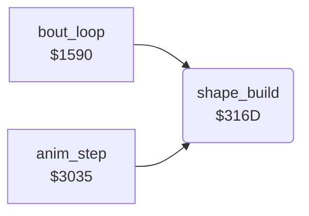

<!-- Generated by c64-docs from knowledge revision 20261025T214834.473-anyvn7 and .c64-re-tools/local/generated/src/source-map.json. Do not edit: change the knowledge, generate the source again, then run docs.ts generate. -->
# shapes/shape_build_3165.asm

Range `$3165-$33E6`. Source: [shapes/shape_build_3165.asm](../../../../src/shapes/shape_build_3165.asm). Index: [the reference](../../index.md).

## Routines

| Routine | Address | Reached from | Summary |
|---|---|---|---|
| [`shape_build`](shape_build_3165.md#shape_build) | `$316D` | [`bout_loop`](../game/init_bout_loop.md#bout_loop), [`anim_step`](../fighter/anim_step.md#anim_step) | Builds the 9 sprites of fighter_frame of fighter X into its hidden buffer, then publishes the 9 pointers. |
| [`shape_publish_ptrs`](shape_build_3165.md#shape_publish_ptrs) | `$3365` | [`$365C`](../../../../src/shapes/shape_build_mirror.asm#L295) | Copies the 9 new pointers to fighter_part_ptrs ($02+2n+X); the IRQ at line 0 reads them. |

## Data

| Range | Type | Name | Read by | Written by |
|---|---|---|---|---|
| [`$3165`](../../../../src/shapes/shape_build_3165.asm#L7)-`$316C` | addresses-split | [`shape_buffer_lo`](../../../../src/shapes/shape_build_3165.asm#L6) | [`shape_build`](shape_build_3165.md#shape_build), `$33E7`, `$33F3` |  |
| [`$33AF`](../../../../src/shapes/shape_build_3165.asm#L453)-`$33B6` | bytes | [`shape_row4_frames`](../../../../src/shapes/shape_build_3165.asm#L452) | [`shape_build`](shape_build_3165.md#shape_build) |  |
| [`$33B7`](../../../../src/shapes/shape_build_3165.asm#L456)-`$33C6` | bytes of 8 | [`shape_row4_left`](../../../../src/shapes/shape_build_3165.asm#L455) | [`shape_build`](shape_build_3165.md#shape_build) |  |
| [`$33C7`](../../../../src/shapes/shape_build_3165.asm#L459)-`$33D6` | bytes of 8 | [`shape_row4_mid`](../../../../src/shapes/shape_build_3165.asm#L458) | [`shape_build`](shape_build_3165.md#shape_build) |  |
| [`$33D7`](../../../../src/shapes/shape_build_3165.asm#L462)-`$33E6` | bytes of 8 | [`shape_row4_right`](../../../../src/shapes/shape_build_3165.asm#L461) | [`shape_build`](shape_build_3165.md#shape_build) |  |

## Call graph

A solid arrow is a call, a thick arrow a table entry. Rounded nodes are in this file.

## Details

### [`shape_buffer_lo`](../../../../src/shapes/shape_build_3165.asm#L6) `$3165-$3168`

*data*

Start of the 9 x 64 byte sprite buffer of each draw_buffer value: $c040, $c280, $c4c0, $c700. Low bytes $3165, high bytes $3169.

- **Read by:** [`shape_build`](shape_build_3165.md#shape_build), [`$33E7`](../../../../src/shapes/shape_build_mirror.asm#L7)

### [`shape_buffer_hi`](../../../../src/shapes/shape_build_3165.asm#L8) `$3169-$316C`

*data*

- **Read by:** [`shape_build`](shape_build_3165.md#shape_build), [`$33F3`](../../../../src/shapes/shape_build_mirror.asm#L11)

### [`shape_build`](../../../../src/shapes/shape_build_3165.asm#L11) `$316D`

*routine*

Builds the 9 sprites of fighter_frame of fighter X into its hidden buffer, then publishes the 9 pointers. It toggles draw_buffer (0/1 fighter 0, 2/3 fighter 1). Facing 1 uses the mirrored copy at $33e7. Callers: anim_step and the time-up code $15f6.

- **Called from:** [`bout_loop`](../game/init_bout_loop.md#bout_loop), [`anim_step`](../fighter/anim_step.md#anim_step)
- **Jumps to:** [`shape_build_mirrored`](shape_build_mirror.md#shape_build_mirrored)
- **Reads:** [`draw_buffer`](../../memory-map.md#draw_buffer), [`fighter_facing`](../../memory-map.md#fighter_facing), [`shape_buffer_lo`](shape_build_3165.md#shape_buffer_lo), [`shape_buffer_hi`](shape_build_3165.md#shape_buffer_hi), [`shape_ptr_list_lo`](shape_build_3155.md#shape_ptr_list_lo), [`shape_ptr_list_hi`](shape_build_3155.md#shape_ptr_list_hi), [`shape_parts`](../graphics/fighter_shapes_8000.md#shape_parts), [`fighter_frame`](../../memory-map.md#fighter_frame), [`frame_parts_top_left`](frame_part_tables.md#frame_parts_top_left), [`shape_part_page_table`](shape_lookup_tables.md#shape_part_page_table), [`shape_page_offset`](../../memory-map.md#shape_page_offset), [`shape_part_lo`](shape_build.md#shape_part_lo) and 10 more
- **Writes:** [`draw_buffer`](../../memory-map.md#draw_buffer), [`shape_dest_ptr`](../../memory-map.md#shape_dest_ptr), [`part_ptr_build`](../../memory-map.md#part_ptr_build), [`fighter_part_ptrs`](../../memory-map.md#fighter_part_ptrs), [`row4_ptr_left`](../../memory-map.md#row4_ptr_left), [`row4_ptr_mid`](../../memory-map.md#row4_ptr_mid), [`row4_ptr_right`](../../memory-map.md#row4_ptr_right)
- **Refers to:** [`shape_dest_ptr`](../../memory-map.md#shape_dest_ptr), [`part_ptr_build`](../../memory-map.md#part_ptr_build), [`fighter_part_ptrs`](../../memory-map.md#fighter_part_ptrs)

| Label | Address | Comment |
|---|---|---|
| [`shape_build_normal`](../../../../src/shapes/shape_build_3165.asm#L20) | `$317B` | Normal copy: slot n gets part table n ($7ae0 + n*$48) at fighter_frame. Slots 0-2 are row 1, 3-5 row 2, 6-8 row 3, left to right. |
| [`shape_copy_ptr_list`](../../../../src/shapes/shape_build_3165.asm#L30) | `$3193` |  |
| [`shape_part0_copy`](../../../../src/shapes/shape_build_3165.asm#L53) | `$31A8` | Source page = $7f00[part] + shape_page_offset |
| [`shape_part0_loop`](../../../../src/shapes/shape_build_3165.asm#L64) | `$31BD` |  |
| [`shape_part0_next`](../../../../src/shapes/shape_build_3165.asm#L80) | `$31C5` | Next 64-byte sprite in the buffer, also for an empty slot |
| [`shape_part1`](../../../../src/shapes/shape_build_3165.asm#L87) | `$31D0` |  |
| [`shape_part1_copy`](../../../../src/shapes/shape_build_3165.asm#L94) | `$31DC` |  |
| [`shape_part1_loop`](../../../../src/shapes/shape_build_3165.asm#L105) | `$31F1` |  |
| [`shape_part1_next`](../../../../src/shapes/shape_build_3165.asm#L121) | `$31F9` |  |
| [`shape_part2`](../../../../src/shapes/shape_build_3165.asm#L128) | `$3204` |  |
| [`shape_part2_copy`](../../../../src/shapes/shape_build_3165.asm#L135) | `$3210` |  |
| [`shape_part2_loop`](../../../../src/shapes/shape_build_3165.asm#L146) | `$3225` |  |
| [`shape_part2_next`](../../../../src/shapes/shape_build_3165.asm#L162) | `$322D` |  |
| [`shape_part3`](../../../../src/shapes/shape_build_3165.asm#L169) | `$3238` |  |
| [`shape_part3_copy`](../../../../src/shapes/shape_build_3165.asm#L176) | `$3244` |  |
| [`shape_part3_loop`](../../../../src/shapes/shape_build_3165.asm#L187) | `$3259` |  |
| [`shape_part3_next`](../../../../src/shapes/shape_build_3165.asm#L203) | `$3261` |  |
| [`shape_part4`](../../../../src/shapes/shape_build_3165.asm#L210) | `$326C` |  |
| [`shape_part4_copy`](../../../../src/shapes/shape_build_3165.asm#L217) | `$3278` |  |
| [`shape_part4_loop`](../../../../src/shapes/shape_build_3165.asm#L228) | `$328D` |  |
| [`shape_part4_next`](../../../../src/shapes/shape_build_3165.asm#L244) | `$3295` |  |
| [`shape_part5`](../../../../src/shapes/shape_build_3165.asm#L251) | `$32A0` |  |
| [`shape_part5_copy`](../../../../src/shapes/shape_build_3165.asm#L258) | `$32AC` |  |
| [`shape_part5_loop`](../../../../src/shapes/shape_build_3165.asm#L269) | `$32C1` |  |
| [`shape_part5_next`](../../../../src/shapes/shape_build_3165.asm#L285) | `$32C9` |  |
| [`shape_part6`](../../../../src/shapes/shape_build_3165.asm#L292) | `$32D4` |  |
| [`shape_part6_copy`](../../../../src/shapes/shape_build_3165.asm#L299) | `$32E0` |  |
| [`shape_part6_loop`](../../../../src/shapes/shape_build_3165.asm#L310) | `$32F5` |  |
| [`shape_part6_next`](../../../../src/shapes/shape_build_3165.asm#L326) | `$32FD` |  |
| [`shape_part7`](../../../../src/shapes/shape_build_3165.asm#L333) | `$3308` |  |
| [`shape_part7_copy`](../../../../src/shapes/shape_build_3165.asm#L340) | `$3314` |  |
| [`shape_part7_loop`](../../../../src/shapes/shape_build_3165.asm#L351) | `$3329` |  |
| [`shape_part7_next`](../../../../src/shapes/shape_build_3165.asm#L367) | `$3331` |  |
| [`shape_part8`](../../../../src/shapes/shape_build_3165.asm#L374) | `$333C` |  |
| [`shape_part8_copy`](../../../../src/shapes/shape_build_3165.asm#L381) | `$3348` |  |
| [`shape_part8_loop`](../../../../src/shapes/shape_build_3165.asm#L392) | `$335D` |  |
| [`shape_find_row4_frame`](../../../../src/shapes/shape_build_3165.asm#L429) | `$338B` |  |
| [`shape_set_row4`](../../../../src/shapes/shape_build_3165.asm#L436) | `$3396` | Not in the list: row4_ptr_* keep their old values |
| [`shape_row4_load`](../../../../src/shapes/shape_build_3165.asm#L443) | `$339F` |  |

### [`shape_ptr_src_lo`](../../../../src/shapes/shape_build_3165.asm#L31) `$3194`

*variable*

- **Written by:** [`shape_build`](shape_build_3165.md#shape_build)

### [`shape_ptr_src_hi`](../../../../src/shapes/shape_build_3165.asm#L32) `$3195-$31A7`

*variable*

- **Written by:** [`shape_build`](shape_build_3165.md#shape_build)

### [`shape_part0_src_lo`](../../../../src/shapes/shape_build_3165.asm#L65) `$31BE`

*variable*

- **Written by:** [`shape_build`](shape_build_3165.md#shape_build)

### [`shape_part0_src_hi`](../../../../src/shapes/shape_build_3165.asm#L66) `$31BF-$31C4`

*variable*

- **Written by:** [`shape_build`](shape_build_3165.md#shape_build)

### [`shape_part1_src_lo`](../../../../src/shapes/shape_build_3165.asm#L106) `$31F2`

*variable*

- **Written by:** [`shape_build`](shape_build_3165.md#shape_build)

### [`shape_part1_src_hi`](../../../../src/shapes/shape_build_3165.asm#L107) `$31F3-$31F8`

*variable*

- **Written by:** [`shape_build`](shape_build_3165.md#shape_build)

### [`shape_part2_src_lo`](../../../../src/shapes/shape_build_3165.asm#L147) `$3226`

*variable*

- **Written by:** [`shape_build`](shape_build_3165.md#shape_build)

### [`shape_part2_src_hi`](../../../../src/shapes/shape_build_3165.asm#L148) `$3227-$322C`

*variable*

- **Written by:** [`shape_build`](shape_build_3165.md#shape_build)

### [`shape_part3_src_lo`](../../../../src/shapes/shape_build_3165.asm#L188) `$325A`

*variable*

- **Written by:** [`shape_build`](shape_build_3165.md#shape_build)

### [`shape_part3_src_hi`](../../../../src/shapes/shape_build_3165.asm#L189) `$325B-$3260`

*variable*

- **Written by:** [`shape_build`](shape_build_3165.md#shape_build)

### [`shape_part4_src_lo`](../../../../src/shapes/shape_build_3165.asm#L229) `$328E`

*variable*

- **Written by:** [`shape_build`](shape_build_3165.md#shape_build)

### [`shape_part4_src_hi`](../../../../src/shapes/shape_build_3165.asm#L230) `$328F-$3294`

*variable*

- **Written by:** [`shape_build`](shape_build_3165.md#shape_build)

### [`shape_part5_src_lo`](../../../../src/shapes/shape_build_3165.asm#L270) `$32C2`

*variable*

- **Written by:** [`shape_build`](shape_build_3165.md#shape_build)

### [`shape_part5_src_hi`](../../../../src/shapes/shape_build_3165.asm#L271) `$32C3-$32C8`

*variable*

- **Written by:** [`shape_build`](shape_build_3165.md#shape_build)

### [`shape_part6_src_lo`](../../../../src/shapes/shape_build_3165.asm#L311) `$32F6`

*variable*

- **Written by:** [`shape_build`](shape_build_3165.md#shape_build)

### [`shape_part6_src_hi`](../../../../src/shapes/shape_build_3165.asm#L312) `$32F7-$32FC`

*variable*

- **Written by:** [`shape_build`](shape_build_3165.md#shape_build)

### [`shape_part7_src_lo`](../../../../src/shapes/shape_build_3165.asm#L352) `$332A`

*variable*

- **Written by:** [`shape_build`](shape_build_3165.md#shape_build)

### [`shape_part7_src_hi`](../../../../src/shapes/shape_build_3165.asm#L353) `$332B-$3330`

*variable*

- **Written by:** [`shape_build`](shape_build_3165.md#shape_build)

### [`shape_part8_src_lo`](../../../../src/shapes/shape_build_3165.asm#L393) `$335E`

*variable*

- **Written by:** [`shape_build`](shape_build_3165.md#shape_build)

### [`shape_part8_src_hi`](../../../../src/shapes/shape_build_3165.asm#L394) `$335F-$3364`

*variable*

- **Written by:** [`shape_build`](shape_build_3165.md#shape_build)

### [`shape_publish_ptrs`](../../../../src/shapes/shape_build_3165.asm#L409) `$3365`

*label*

Copies the 9 new pointers to fighter_part_ptrs ($02+2n+X); the IRQ at line 0 reads them. Then it looks for fighter_frame in shape_row4_frames.

- **Jumped to from:** [`shape_build`](shape_build_3165.md#shape_build), [`$365C`](../../../../src/shapes/shape_build_mirror.asm#L295)

### [`shape_row4_frames`](../../../../src/shapes/shape_build_3165.asm#L452) `$33AF-$33B6`

*data*

The 8 frames of the jumps and somersaults (animations 5, 8, 9 and $0e) that have a floor shadow in sprite row 4.

- **Read by:** [`shape_build`](shape_build_3165.md#shape_build)

### [`shape_row4_left`](../../../../src/shapes/shape_build_3165.asm#L455) `$33B7-$33C6`

*data*

Shadow sprite pointers of the left, middle and right column ($33b7, $33c7, $33d7): entries 0-7 facing 0, 8-15 facing 1. Pointers $55-$7b are fixed sprites at $d540-$deff; 0 is the blank sprite.

- **Read by:** [`shape_build`](shape_build_3165.md#shape_build)

### [`shape_row4_mid`](../../../../src/shapes/shape_build_3165.asm#L458) `$33C7-$33D6`

*data*

- **Read by:** [`shape_build`](shape_build_3165.md#shape_build)

### [`shape_row4_right`](../../../../src/shapes/shape_build_3165.asm#L461) `$33D7-$33E6`

*data*

- **Read by:** [`shape_build`](shape_build_3165.md#shape_build)
