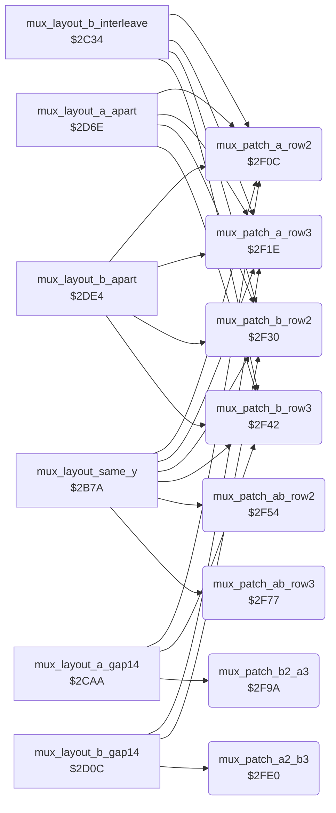

<!-- Generated by c64-docs from knowledge revision 20261021T021734.611-6rf0n2 and src/source-map.json. Do not edit: change the knowledge, generate the source again, then run docs.ts generate. -->
# sprite_mux_patch.asm: Sprite multiplexer: copy the row 2/3 pointers of the fighters into the raster handler operands

Range `$2F0C-$3025`. Source: [sprite_mux_patch.asm](../../../src/sprite_mux_patch.asm). Index: [the reference](../index.md).

## Call graph

A solid arrow is a call, a thick arrow a table entry, a dotted arrow a jump. Rounded nodes are in this file.

## Data

| Range | Type | Name | Read by | Written by |
|---|---|---|---|---|
| [`$2FBD`](../../../src/sprite_mux_patch.asm#L98)-`$2FDF` | unused | [`mux_unused_patch_b3_a2`](../../../src/sprite_mux_patch.asm#L97) |  |  |
| [`$3003`](../../../src/sprite_mux_patch.asm#L122)-`$3025` | unused | [`mux_unused_patch_a3_b2`](../../../src/sprite_mux_patch.asm#L121) |  |  |

## Names

### [`mux_patch_a_row2`](../../../src/sprite_mux_patch.asm#L6) `$2F0C`

*routine*

Copies the pointers of parts 3-5 (row 2) of the group A fighter into handler $2635 (sprites 0-2). Called from the layout code of irq_frame_start.

- **Called from:** [`mux_layout_same_y`](sprite_mux_plan.md#mux_layout_same_y) [`$2BBE`](../../../src/sprite_mux_plan.asm#L189), [`mux_layout_b_interleave`](sprite_mux_plan.md#mux_layout_b_interleave) [`$2C37`](../../../src/sprite_mux_plan.asm#L245), [`mux_layout_a_gap14`](sprite_mux_plan.md#mux_layout_a_gap14) [`$2CAA`](../../../src/sprite_mux_plan.asm#L299), [`mux_layout_a_apart`](sprite_mux_plan.md#mux_layout_a_apart) [`$2D6E`](../../../src/sprite_mux_plan.asm#L391), [`mux_layout_b_apart`](sprite_mux_plan.md#mux_layout_b_apart) [`$2DEA`](../../../src/sprite_mux_plan.asm#L448)
- **Reads:** [`group_a_fighter`](../memory-map.md#group_a_fighter)
- **Writes:** [`irq_a_row2_ptr_left`](irq_sprite_rows.md#irq_a_row2_ptr_left), [`irq_a_row2_ptr_mid`](irq_sprite_rows.md#irq_a_row2_ptr_mid), [`irq_a_row2_ptr_right`](irq_sprite_rows.md#irq_a_row2_ptr_right)
- **Refers to:** [`fighter_part_ptrs`](../memory-map.md#fighter_part_ptrs)

### [`mux_patch_a_row3`](../../../src/sprite_mux_patch.asm#L16) `$2F1E`

*routine*

Copies the pointers of parts 6-8 (row 3) of the group A fighter into handler $266e (sprites 0-2). Called from the layout code of irq_frame_start.

- **Called from:** [`mux_layout_same_y`](sprite_mux_plan.md#mux_layout_same_y) [`$2BC4`](../../../src/sprite_mux_plan.asm#L191), [`mux_layout_b_interleave`](sprite_mux_plan.md#mux_layout_b_interleave) [`$2C3D`](../../../src/sprite_mux_plan.asm#L247), [`mux_layout_b_gap14`](sprite_mux_plan.md#mux_layout_b_gap14) [`$2D12`](../../../src/sprite_mux_plan.asm#L347), [`mux_layout_a_apart`](sprite_mux_plan.md#mux_layout_a_apart) [`$2D71`](../../../src/sprite_mux_plan.asm#L392), [`mux_layout_b_apart`](sprite_mux_plan.md#mux_layout_b_apart) [`$2DED`](../../../src/sprite_mux_plan.asm#L449)
- **Reads:** [`group_a_fighter`](../memory-map.md#group_a_fighter)
- **Writes:** [`irq_a_row3_ptr_left`](irq_sprite_rows.md#irq_a_row3_ptr_left), [`irq_a_row3_ptr_mid`](irq_sprite_rows.md#irq_a_row3_ptr_mid), [`irq_a_row3_ptr_right`](irq_sprite_rows.md#irq_a_row3_ptr_right)
- **Refers to:** [`fighter_part_ptrs`](../memory-map.md#fighter_part_ptrs)

### [`mux_patch_b_row2`](../../../src/sprite_mux_patch.asm#L26) `$2F30`

*routine*

Copies the pointers of parts 3-5 (row 2) of the group B fighter into handler $26a7 (sprites 3-5). Called from the layout code of irq_frame_start.

- **Called from:** [`mux_layout_same_y`](sprite_mux_plan.md#mux_layout_same_y) [`$2BC1`](../../../src/sprite_mux_plan.asm#L190), [`mux_layout_b_interleave`](sprite_mux_plan.md#mux_layout_b_interleave) [`$2C34`](../../../src/sprite_mux_plan.asm#L244), [`mux_layout_b_gap14`](sprite_mux_plan.md#mux_layout_b_gap14) [`$2D0C`](../../../src/sprite_mux_plan.asm#L345), [`mux_layout_a_apart`](sprite_mux_plan.md#mux_layout_a_apart) [`$2D74`](../../../src/sprite_mux_plan.asm#L393), [`mux_layout_b_apart`](sprite_mux_plan.md#mux_layout_b_apart) [`$2DE4`](../../../src/sprite_mux_plan.asm#L446)
- **Reads:** [`group_b_fighter`](../memory-map.md#group_b_fighter)
- **Writes:** [`irq_b_row2_ptr_left`](irq_sprite_rows.md#irq_b_row2_ptr_left), [`irq_b_row2_ptr_mid`](irq_sprite_rows.md#irq_b_row2_ptr_mid), [`irq_b_row2_ptr_right`](irq_sprite_rows.md#irq_b_row2_ptr_right)
- **Refers to:** [`fighter_part_ptrs`](../memory-map.md#fighter_part_ptrs)

### [`mux_patch_b_row3`](../../../src/sprite_mux_patch.asm#L36) `$2F42`

*routine*

Copies the pointers of parts 6-8 (row 3) of the group B fighter into handler $26e1 (sprites 3-5). Called from the layout code of irq_frame_start.

- **Called from:** [`mux_layout_same_y`](sprite_mux_plan.md#mux_layout_same_y) [`$2BC7`](../../../src/sprite_mux_plan.asm#L192), [`mux_layout_b_interleave`](sprite_mux_plan.md#mux_layout_b_interleave) [`$2C3A`](../../../src/sprite_mux_plan.asm#L246), [`mux_layout_a_gap14`](sprite_mux_plan.md#mux_layout_a_gap14) [`$2CB0`](../../../src/sprite_mux_plan.asm#L301), [`mux_layout_a_apart`](sprite_mux_plan.md#mux_layout_a_apart) [`$2D77`](../../../src/sprite_mux_plan.asm#L394), [`mux_layout_b_apart`](sprite_mux_plan.md#mux_layout_b_apart) [`$2DE7`](../../../src/sprite_mux_plan.asm#L447)
- **Reads:** [`group_b_fighter`](../memory-map.md#group_b_fighter)
- **Writes:** [`irq_b_row3_ptr_left`](irq_sprite_rows.md#irq_b_row3_ptr_left), [`irq_b_row3_ptr_mid`](irq_sprite_rows.md#irq_b_row3_ptr_mid), [`irq_b_row3_ptr_right`](irq_sprite_rows.md#irq_b_row3_ptr_right)
- **Refers to:** [`fighter_part_ptrs`](../memory-map.md#fighter_part_ptrs)

### [`mux_patch_ab_row2`](../../../src/sprite_mux_patch.asm#L46) `$2F54`

*routine*

Copies the row 2 pointers (parts 3-5) of both group fighters into the combined handler $271b. Layout 1 only. Called from the layout code of irq_frame_start.

- **Called from:** [`mux_layout_same_y`](sprite_mux_plan.md#mux_layout_same_y) [`$2B7A`](../../../src/sprite_mux_plan.asm#L157)
- **Reads:** [`group_a_fighter`](../memory-map.md#group_a_fighter), [`group_b_fighter`](../memory-map.md#group_b_fighter)
- **Writes:** [`irq_ab_row2_a_ptr_left`](irq_sprite_rows.md#irq_ab_row2_a_ptr_left), [`irq_ab_row2_a_ptr_mid`](irq_sprite_rows.md#irq_ab_row2_a_ptr_mid), [`irq_ab_row2_a_ptr_right`](irq_sprite_rows.md#irq_ab_row2_a_ptr_right), [`irq_ab_row2_b_ptr_left`](irq_sprite_rows.md#irq_ab_row2_b_ptr_left), [`irq_ab_row2_b_ptr_mid`](irq_sprite_rows.md#irq_ab_row2_b_ptr_mid), [`irq_ab_row2_b_ptr_right`](irq_sprite_rows.md#irq_ab_row2_b_ptr_right)
- **Refers to:** [`fighter_part_ptrs`](../memory-map.md#fighter_part_ptrs)

### [`mux_patch_ab_row3`](../../../src/sprite_mux_patch.asm#L63) `$2F77`

*routine*

Copies the row 3 pointers (parts 6-8) of both group fighters into the combined handler $276c. Layout 1 only. Called from the layout code of irq_frame_start.

- **Called from:** [`mux_layout_same_y`](sprite_mux_plan.md#mux_layout_same_y) [`$2B7D`](../../../src/sprite_mux_plan.asm#L158)
- **Reads:** [`group_a_fighter`](../memory-map.md#group_a_fighter), [`group_b_fighter`](../memory-map.md#group_b_fighter)
- **Writes:** [`irq_ab_row3_a_ptr_left`](irq_sprite_rows.md#irq_ab_row3_a_ptr_left), [`irq_ab_row3_a_ptr_mid`](irq_sprite_rows.md#irq_ab_row3_a_ptr_mid), [`irq_ab_row3_a_ptr_right`](irq_sprite_rows.md#irq_ab_row3_a_ptr_right), [`irq_ab_row3_b_ptr_left`](irq_sprite_rows.md#irq_ab_row3_b_ptr_left), [`irq_ab_row3_b_ptr_mid`](irq_sprite_rows.md#irq_ab_row3_b_ptr_mid), [`irq_ab_row3_b_ptr_right`](irq_sprite_rows.md#irq_ab_row3_b_ptr_right)
- **Refers to:** [`fighter_part_ptrs`](../memory-map.md#fighter_part_ptrs)

### [`mux_patch_b2_a3`](../../../src/sprite_mux_patch.asm#L80) `$2F9A`

*routine*

Copies row 2 of the group B fighter and row 3 of the group A fighter into the combined handler $27bd. Layout 4 only. Called from the layout code of irq_frame_start.

- **Called from:** [`mux_layout_a_gap14`](sprite_mux_plan.md#mux_layout_a_gap14) [`$2CAD`](../../../src/sprite_mux_plan.asm#L300)
- **Reads:** [`group_a_fighter`](../memory-map.md#group_a_fighter), [`group_b_fighter`](../memory-map.md#group_b_fighter)
- **Writes:** [`irq_b2_a3_a_ptr_left`](irq_sprite_rows.md#irq_b2_a3_a_ptr_left), [`irq_b2_a3_a_ptr_mid`](irq_sprite_rows.md#irq_b2_a3_a_ptr_mid), [`irq_b2_a3_a_ptr_right`](irq_sprite_rows.md#irq_b2_a3_a_ptr_right), [`irq_b2_a3_b_ptr_left`](irq_sprite_rows.md#irq_b2_a3_b_ptr_left), [`irq_b2_a3_b_ptr_mid`](irq_sprite_rows.md#irq_b2_a3_b_ptr_mid), [`irq_b2_a3_b_ptr_right`](irq_sprite_rows.md#irq_b2_a3_b_ptr_right)
- **Refers to:** [`fighter_part_ptrs`](../memory-map.md#fighter_part_ptrs)

### [`mux_unused_patch_b3_a2`](../../../src/sprite_mux_patch.asm#L97) `$2FBD-$2FDF`

*data*

Unused code, never called: row 2 of group A into the second set of $27bd, row 3 of group B into the first set. It is mux_patch_b2_a3 with the rows exchanged.

### [`mux_patch_a2_b3`](../../../src/sprite_mux_patch.asm#L104) `$2FE0`

*routine*

Copies row 2 of the group A fighter and row 3 of the group B fighter into the combined handler $2813. Layout 5 only. Called from the layout code of irq_frame_start.

- **Called from:** [`mux_layout_b_gap14`](sprite_mux_plan.md#mux_layout_b_gap14) [`$2D0F`](../../../src/sprite_mux_plan.asm#L346)
- **Reads:** [`group_a_fighter`](../memory-map.md#group_a_fighter), [`group_b_fighter`](../memory-map.md#group_b_fighter)
- **Writes:** [`irq_a2_b3_a_ptr_left`](irq_sprite_rows.md#irq_a2_b3_a_ptr_left), [`irq_a2_b3_a_ptr_mid`](irq_sprite_rows.md#irq_a2_b3_a_ptr_mid), [`irq_a2_b3_a_ptr_right`](irq_sprite_rows.md#irq_a2_b3_a_ptr_right), [`irq_a2_b3_b_ptr_left`](irq_sprite_rows.md#irq_a2_b3_b_ptr_left), [`irq_a2_b3_b_ptr_mid`](irq_sprite_rows.md#irq_a2_b3_b_ptr_mid), [`irq_a2_b3_b_ptr_right`](irq_sprite_rows.md#irq_a2_b3_b_ptr_right)
- **Refers to:** [`fighter_part_ptrs`](../memory-map.md#fighter_part_ptrs)

### [`mux_unused_patch_a3_b2`](../../../src/sprite_mux_patch.asm#L121) `$3003-$3025`

*data*

Unused code, never called: row 3 of group A into the first set of $2813, row 2 of group B into the second set, RTS. It is mux_patch_a2_b3 with the rows exchanged.
