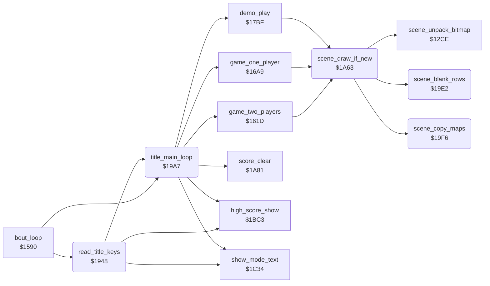

<!-- Generated by c64-docs from knowledge revision 20261021T021734.611-6rf0n2 and src/source-map.json. Do not edit: change the knowledge, generate the source again, then run docs.ts generate. -->
# title_and_scene.asm: Function keys, title loop and the scene drawing

Range `$1948-$1A80`. Source: [title_and_scene.asm](../../../src/title_and_scene.asm). Index: [the reference](../index.md).

## Call graph

A solid arrow is a call, a thick arrow a table entry, a dotted arrow a jump. Rounded nodes are in this file.

## Names

### [`read_title_keys`](../../../src/title_and_scene.asm#L6) `$1948`

*routine*

Reads keyboard column 0 and fire on port 2. F1 or fire starts a game from the demo, F3 changes 1 or 2 players, F5 goes to the title. Returns A = $80 to start.

- **Called from:** [`bout_loop`](init_bout_loop.md#bout_loop) [`$15C4`](../../../src/init_bout_loop.asm#L220)
- **Calls:** [`show_mode_text`](panel_texts.md#show_mode_text), [`high_score_show`](score_and_timer.md#high_score_show), [`title_main_loop`](title_and_scene.md#title_main_loop)
- **Reads:** [`CIAPRB`](../memory-map.md#CIAPRB), [`last_key_row`](../memory-map.md#last_key_row), [`in_game`](../memory-map.md#in_game), [`CIAPRA`](../memory-map.md#CIAPRA), [`two_player_mode`](../memory-map.md#two_player_mode)
- **Writes:** [`CIADDRA`](../memory-map.md#CIADDRA), [`CIADDRB`](../memory-map.md#CIADDRB), [`CIAPRA`](../memory-map.md#CIAPRA), [`last_key_row`](../memory-map.md#last_key_row), [`two_player_mode`](../memory-map.md#two_player_mode)

### [`title_keys_fire`](../../../src/title_and_scene.asm#L25) `$1970`

*label*

- **Jumped to from:** [`read_title_keys`](title_and_scene.md#read_title_keys) [`$195C`](../../../src/title_and_scene.asm#L15), [`read_title_keys`](title_and_scene.md#read_title_keys) [`$1983`](../../../src/title_and_scene.asm#L39)

### [`title_keys_none`](../../../src/title_and_scene.asm#L33) `$197E`

*label*

- **Jumped to from:** [`read_title_keys`](title_and_scene.md#read_title_keys) [`$1972`](../../../src/title_and_scene.asm#L27), [`read_title_keys`](title_and_scene.md#read_title_keys) [`$1979`](../../../src/title_and_scene.asm#L30)

### [`title_key_f1`](../../../src/title_and_scene.asm#L36) `$1981`

*label*

- **Jumped to from:** [`read_title_keys`](title_and_scene.md#read_title_keys) [`$1962`](../../../src/title_and_scene.asm#L18)

### [`title_key_f3`](../../../src/title_and_scene.asm#L42) `$1988`

*label*

- **Jumped to from:** [`read_title_keys`](title_and_scene.md#read_title_keys) [`$1966`](../../../src/title_and_scene.asm#L20)

### [`title_f3_show`](../../../src/title_and_scene.asm#L51) `$1998`

*label*

- **Jumped to from:** [`read_title_keys`](title_and_scene.md#read_title_keys) [`$1992`](../../../src/title_and_scene.asm#L48)

### [`title_f3_done`](../../../src/title_and_scene.asm#L54) `$199E`

*label*

- **Jumped to from:** [`read_title_keys`](title_and_scene.md#read_title_keys) [`$198A`](../../../src/title_and_scene.asm#L44)

### [`title_key_f7`](../../../src/title_and_scene.asm#L57) `$19A1`

*label*

F7 does nothing.

- **Jumped to from:** [`read_title_keys`](title_and_scene.md#read_title_keys) [`$196E`](../../../src/title_and_scene.asm#L24)

### [`title_key_f5`](../../../src/title_and_scene.asm#L60) `$19A4`

*label*

F5 works also during a game; the stack is not reset.

- **Jumped to from:** [`read_title_keys`](title_and_scene.md#read_title_keys) [`$196A`](../../../src/title_and_scene.asm#L22)

### [`title_main_loop`](../../../src/title_and_scene.asm#L64) `$19A7`

*label*

Title loop: one player, then the high score, the mode text and the demo again and again. A start key or fire starts the game of two_player_mode.

- **Called from:** [`bout_loop`](init_bout_loop.md#bout_loop) [`$1604`](../../../src/init_bout_loop.asm#L254), [`read_title_keys`](title_and_scene.md#read_title_keys) [`$19A4`](../../../src/title_and_scene.asm#L62)
- **Calls:** [`high_score_show`](score_and_timer.md#high_score_show), [`show_mode_text`](panel_texts.md#show_mode_text), [`score_clear`](score_and_timer.md#score_clear), [`demo_play`](game_modes.md#demo_play), [`game_one_player`](game_modes.md#game_one_player), [`game_two_players`](game_modes.md#game_two_players)
- **Reads:** [`two_player_mode`](../memory-map.md#two_player_mode), [`CIAPRA`](../memory-map.md#CIAPRA)
- **Writes:** [`two_player_mode`](../memory-map.md#two_player_mode), [`in_game`](../memory-map.md#in_game)

### [`title_demo_loop`](../../../src/title_and_scene.asm#L67) `$19AB`

*label*

- **Jumped to from:** [`title_main_loop`](title_and_scene.md#title_main_loop) [`$19C2`](../../../src/title_and_scene.asm#L77), [`title_main_loop`](title_and_scene.md#title_main_loop) [`$19D7`](../../../src/title_and_scene.asm#L92), [`title_main_loop`](title_and_scene.md#title_main_loop) [`$19DF`](../../../src/title_and_scene.asm#L96)

### [`title_test_2p`](../../../src/title_and_scene.asm#L80) `$19C8`

*label*

### [`title_bad_mode`](../../../src/title_and_scene.asm#L83) `$19CC`

*label*

No mode 2 or more exists.

### [`title_start_1p`](../../../src/title_and_scene.asm#L86) `$19CD`

*label*

- **Jumped to from:** [`title_main_loop`](title_and_scene.md#title_main_loop) [`$19C6`](../../../src/title_and_scene.asm#L79), [`title_main_loop`](title_and_scene.md#title_main_loop) [`$19D5`](../../../src/title_and_scene.asm#L91)

### [`title_1p_again`](../../../src/title_and_scene.asm#L88) `$19D0`

*label*

Fire held at the end starts a new one-player game.

### [`title_start_2p`](../../../src/title_and_scene.asm#L93) `$19DA`

*label*

- **Jumped to from:** [`title_main_loop`](title_and_scene.md#title_main_loop) [`$19CA`](../../../src/title_and_scene.asm#L82), [`title_main_loop`](title_and_scene.md#title_main_loop) [`$19DD`](../../../src/title_and_scene.asm#L95)

### [`scene_blank_rows`](../../../src/title_and_scene.asm#L98) `$19E2`

*routine*

Fills screen and colour RAM of rows 5-16 with $33, so the scene area shows one colour while it is drawn. Called by scene_draw_if_new.

- **Called from:** [`scene_draw_if_new`](title_and_scene.md#scene_draw_if_new) [`$1A72`](../../../src/title_and_scene.asm#L181)
- **Writes:** [`shadow_facing0_b+8`](shadow_sprites_facing0.md#shadow_facing0_b), [`shadow_facing0_b+263`](shadow_sprites_facing0.md#shadow_facing0_b), [`shadow_facing0_b+232`](shadow_sprites_facing0.md#shadow_facing0_b), [`figure_heads_unused+167`](shadow_sprites_facing1.md#figure_heads_unused), [`screen_scene_rows`](../memory-map.md#screen_scene_rows), [`screen_scene_rows+255`](../memory-map.md#screen_scene_rows), [`screen_scene_rows+224`](../memory-map.md#screen_scene_rows), [`screen_scene_rows+479`](../memory-map.md#screen_scene_rows)

### [`scene_blank_loop`](../../../src/title_and_scene.asm#L101) `$19E6`

*label*

- **Jumped to from:** [`scene_blank_rows`](title_and_scene.md#scene_blank_rows) [`$19F3`](../../../src/title_and_scene.asm#L107)

### [`scene_copy_maps`](../../../src/title_and_scene.asm#L110) `$19F6`

*routine*

Copies the 480-byte colour map and screen map of scene_shown to $d8c8 and $ccc8. Called by scene_draw_if_new.

- **Called from:** [`scene_draw_if_new`](title_and_scene.md#scene_draw_if_new) [`$1A78`](../../../src/title_and_scene.asm#L183)
- **Reads:** [`scene_shown`](../memory-map.md#scene_shown), [`copy_src_ptr`](../memory-map.md#copy_src_ptr), [`copy_dest_ptr`](../memory-map.md#copy_dest_ptr), [`copy_src_ptr+1`](../memory-map.md#copy_src_ptr), [`copy_dest_ptr+1`](../memory-map.md#copy_dest_ptr)
- **Writes:** [`copy_src_ptr`](../memory-map.md#copy_src_ptr), [`copy_src_ptr+1`](../memory-map.md#copy_src_ptr), [`copy_dest_ptr`](../memory-map.md#copy_dest_ptr), [`copy_dest_ptr+1`](../memory-map.md#copy_dest_ptr)
- **Refers to:** [`scene_colour_map_ptrs`](entry_and_tables.md#scene_colour_map_ptrs), [`scene_colour_map_ptrs+1`](entry_and_tables.md#scene_colour_map_ptrs), [`copy_src_ptr`](../memory-map.md#copy_src_ptr), [`copy_dest_ptr`](../memory-map.md#copy_dest_ptr), [`scene_screen_map_ptrs`](entry_and_tables.md#scene_screen_map_ptrs), [`scene_screen_map_ptrs+1`](entry_and_tables.md#scene_screen_map_ptrs)

### [`scene_copy_colour_page`](../../../src/title_and_scene.asm#L123) `$1A0E`

*label*

- **Jumped to from:** [`scene_copy_maps`](title_and_scene.md#scene_copy_maps) [`$1A13`](../../../src/title_and_scene.asm#L127), [`scene_copy_maps`](title_and_scene.md#scene_copy_maps) [`$1A1D`](../../../src/title_and_scene.asm#L132)

### [`scene_copy_colour_rest`](../../../src/title_and_scene.asm#L134) `$1A21`

*label*

- **Jumped to from:** [`scene_copy_maps`](title_and_scene.md#scene_copy_maps) [`$1A26`](../../../src/title_and_scene.asm#L138)

### [`scene_copy_screen_page`](../../../src/title_and_scene.asm#L153) `$1A44`

*label*

- **Jumped to from:** [`scene_copy_maps`](title_and_scene.md#scene_copy_maps) [`$1A49`](../../../src/title_and_scene.asm#L157), [`scene_copy_maps`](title_and_scene.md#scene_copy_maps) [`$1A53`](../../../src/title_and_scene.asm#L162)

### [`scene_copy_screen_rest`](../../../src/title_and_scene.asm#L164) `$1A57`

*label*

- **Jumped to from:** [`scene_copy_maps`](title_and_scene.md#scene_copy_maps) [`$1A5C`](../../../src/title_and_scene.asm#L168)

### [`scene_draw_if_new`](../../../src/title_and_scene.asm#L173) `$1A63`

*routine*

Draws scene stage_counter AND 3 when it is not on the screen: blank, unpack, maps. Called before each bout.

- **Called from:** [`game_two_players`](game_modes.md#game_two_players) [`$1653`](../../../src/game_modes.asm#L32), [`game_one_player`](game_modes.md#game_one_player) [`$1705`](../../../src/game_modes.asm#L125), [`demo_play`](game_modes.md#demo_play) [`$1806`](../../../src/game_modes.asm#L260)
- **Calls:** [`scene_blank_rows`](title_and_scene.md#scene_blank_rows), [`scene_unpack_bitmap`](scene_unpack.md#scene_unpack_bitmap), [`scene_copy_maps`](title_and_scene.md#scene_copy_maps)
- **Reads:** [`stage_counter`](../memory-map.md#stage_counter), [`scene_shown`](../memory-map.md#scene_shown)
- **Writes:** [`scene_shown`](../memory-map.md#scene_shown), [`irq_bitmap_on_bg_colour`](irq_screen_split.md#irq_bitmap_on_bg_colour)

### [`scene_draw_exit`](../../../src/title_and_scene.asm#L186) `$1A80`

*label*

- **Jumped to from:** [`scene_draw_if_new`](title_and_scene.md#scene_draw_if_new) [`$1A69`](../../../src/title_and_scene.asm#L177)
