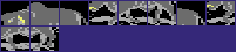

# The bull round

Version II adds a bonus round to the 1-player game. After the player wins the two bouts of scene 3, a brown bull runs in from the right. The player stands alone at the left and must stop the bull with a low blow at the right moment. A stop gives 3000 points. A player who stays on his feet until the bull leaves gets 500 points. A player whom the bull hits falls and gets nothing. Version I has the same bull as test code that nothing calls. The last part of this page tells how that test code became the round. The full list of the changes between the versions is on [versions.md](../../docs/versions.md).

**Conventions.**
- Addresses are C64 addresses. Names are the names of the knowledge. A name with the label `v1:` is a name of version I.
- A *frame* is one pass of the frame loop of the round, 1/50 second on a PAL C64. The loop waits for raster line `$FD` once in each frame.
- The *fighter* is fighter 0, the white fighter of player 1. The *bull* is fighter 1. The round uses the zero-page pairs of fighter 1 for the bull.
- A *unit* is one step of `fighter_x`, 2 pixels on the screen.
- The *distance* is the x of the bull minus the x of the fighter, in units.
- A *run* is one pass of animation `$1C`, the run cycle of the bull. A run moves the bull 22 units to the left.
- A *stage* is one value of `stage_counter`: the two bouts that the player must win for the next rank.
- **Observed** marks a fact that a run showed. **Code** marks a fact from the code only. **Conclusion** marks an interpretation.

The image shows a round at 3RD DAN, with the score 24700. The recording `cpu_ranks` ([../tests/README.md](../tests/README.md)) plays the 1-player game with the computer for player 1 through several rounds. (**Observed**)

## When the round comes

The round comes after the second won bout of each stage with `stage_counter` AND 3 = 3. [`game_one_player` `$1C24`](../src/game/game_modes.asm#L145) makes the test and calls the round. After the round, the game promotes the player as after each other stage. The value that the round returns in A has no effect. (**Code**)

The scene of a stage is `stage_counter` AND 3. Thus the round always comes in scene 3, the scene with the Buddha statue. The round draws no scene of its own. The bull runs over the bitmap of the last bout. (**Code**) The image above shows scene 3. (**Observed**)

The bull comes at `stage_counter` 3 and 7, at 3RD DAN and 7TH DAN. After 10TH DAN, `game_1p_rank_wrap` makes `stage_counter` = `$20` + (n+1 AND 3). The first value after 10 is `$23`, so the bull comes again at once. Then it comes at each fourth stage: `$20`, `$21`, `$22`, `$23`. Thus the round comes at the 4th, 8th, 12th, 16th stage and so on. (**Code**) The scenario `one_player_cpu_bull.json` reaches the round at 3RD DAN. (**Observed**)

## How it works

~~~mermaid
flowchart TB
  A["Second win in scene 3 (game_one_player)"] --> B["Prepare: fighter at x $3E, bull at x $B0, colour 9"]
  B --> C["Wait for raster line $FD"]
  C --> D{"Frame $0D new and distance $19-$1D?"}
  D -- yes --> E["3000 points, the bull falls (animation $1D)"]
  D -- no --> F{"Bull in reach of this frame?"}
  F -- yes --> G["The fighter falls, sample 1"]
  F -- no --> H["Step the fighter (only before a fall)"]
  E --> H
  G --> H
  H --> I["Step the bull, test the end of a run (bull_step)"]
  I -- "round not at its end" --> C
  I -- "at its end" --> J["500 points when no hit, return"]
~~~

[`bull_bonus_round` `$132C`](../src/game/bull_round_12f8.asm#L36) is the round. It does these steps in this order:

1. **It shows only the six sprites of the fighters.** It writes `$3F` to `SPENA`, so the sprites 6 and 7 of the judge are off. (**Code**)
2. **It puts the fighter alone at the left.** `bull_setup_fighter0` puts the fighter at x `$3E`, on the ground, facing right, in the stance. (**Code**)
3. **It puts the bull at the right.** The bull gets `front_fighter` 1, so the bull uses the front sprites 0-2. The bull gets x `$B0`, y `$50`, facing 0, animation `$1C` and colour 9, brown. `shape_page_offset` = `$40` tells the shape code that the bull is on the screen. (**Code**)
4. **It clears the state of the round.** It writes 0 to `bout_knockdown` and `bull_state`, and `$7F` to `sfx_done`. The value `$7F` is not 0, so the first run sound can start. (**Code**)
5. **It waits for raster line `$FD` in each frame.** The bout loop uses the same line, so the round has the timing of a bout. (**Code**)
6. **It tests the stop and the hit while `bull_state` is 0.** The next two sections explain the two tests. After a stop or a hit, the round makes no more tests. (**Code**)
7. **It steps the fighter until he falls.** `bull_fighter0_update` reads the joystick, the keyboard or the computer player and steps the moves of the fighter. When `bout_knockdown` is not 0, the round does not step the fighter: the fighter stays on the ground. (**Code**)
8. **It steps the bull.** `bull_step` steps the animation of the bull and chooses the next animation at the end of a run. It returns 0 at the end of the round. (**Code**)

The fighter update of the round has no hit test and no choice of the front fighter. `solo_fighter_update` calls the input, the low punch fix-up, the move state, the animation start and the animation end. The bout calls the full `fighter_update` instead. The fighter thus has the moves of a bout. But only the stop of the next section has an effect on the bull. (**Code**)

### The stop: frame `$0D` at distance `$19-$1D`

The only way to stop the bull is frame `$0D`, the single frame of animation 7. Move 7 is joystick down and forward from a crouch. From the stance, down and forward gives move `$18` instead. Thus the player must pull the joystick down first and then push it down and forward. (**Code**)

The test at [`bull_bonus_round` `$136C`](../src/game/bull_round_12f8.asm#L68) needs three conditions in the same frame. (**Code**)

1. `fighter_frame` is `$0D`.
2. `anim_frame_tick` is not 0: the animation stepper showed frame `$0D` in this frame. A held crouching attack keeps frame `$0D`, but `anim_frame_tick` is then 0. Thus the attack must start in the frame of the right distance.
3. The distance is `$19-$1D`, 25 to 29 units.

When the three conditions are true, the round adds 30 times 100 points to the score of player 1 with `score_add_100`. Then it writes `$80` to `bull_state` and starts animation `$1D` for the bull: the bull falls and lies on the ground. When that animation ends, `bull_stopped_step` returns 0 and the round ends at once. The bull does not run to the left edge after a stop. (**Code**)

No run reached the stop. The code from `$1372` to `$139C` and `bull_stopped_step` at `$1425-$142E` are in the list of code that no run executed. (**Observed**: `.c64-re-tools/local/generated/src/not_executed.json`)

### The hit: the reach table at `$142F`

When there is no stop, the round tests whether the bull reaches the fighter. The test at `$139D` first compares the x values. When the x of the bull is less than the x of the fighter, the bull is past the fighter and nothing happens. Else the distance goes to `fighter_distance`. (**Code**)

[`bull_reach_by_frame` `$142F`](../src/game/bull_round_12f8.asm#L185) gives the reach of the bull for each frame of the fighter, `$00-$3A`. A value of `$80` means that the bull cannot reach the fighter in that frame. Else the bull hits when the reach is not less than the distance. The table replaces the sprite collision test of version I. (**Code**)

The hit writes `$16` to `hit_reaction`, the hit reaction of a fall. It plays sample 1 and writes 1 to `bull_state`. The fighter falls with animation `$16`. At the end of the fall, `move_anim_end` sets `bout_knockdown`, and the round stops the fighter update. The bull continues its runs and leaves at the left edge. (**Code**) In each round of the scenarios and the recordings, the bull hit the fighter. No run executed the 500 points at `$1402-$140F`. (**Observed**: `.c64-re-tools/local/generated/src/not_executed.json`)

**Conclusion**: the fall starts about 8 frames after the hit. `bout_setup_fighters` writes 8 to `knockdown_delay` at each exchange, and only a hit of the fighter in the bout counts it down.

### The end of the round at the left edge

`bull_step` acts only at the end of a run, when `anim_finished` of the bull is 1. Then the x of the bull selects the next animation. (**Code**)

| x of the bull | Next x | Next animation | Frames of the bull |
|---|---|---|---|
| `$00` | `$0C` | `$1E`, the exit with two columns, 10 units | `$44`, `$46`, `$45` |
| `$02` | `$0E` | `$1F`, the exit with one column, 13 units | `$4C`, `$48` |
| `$01` | - | none: the round ends | - |
| other | the same | `$1C`, the next run | `$3C`, `$3E`, `$3D`, `$3F`, `$3B` |

The numbers fit exactly. A run moves 22 units, and `$B0` is 176 = 8 x 22. Thus the bull reaches x 0 at the end of the 8th run. Animation `$1E` from x `$0C` ends at x 2. Animation `$1F` from x `$0E` ends at x 1, and the round ends. The frames of the exits show only the right part of the bull, so the bull leaves the screen at the left edge. Frames from `$3B` on skip the x limits of the fighters, so the bull can go below x `$0C`. (**Code**) The runs executed both exits at `$13EA` and `$13F2` and the end at `$13FA`. (**Observed**: coverage of the source)

At x 1, [`bull_step` `$13FA`](../src/game/bull_round_12f8.asm#L148) gives 500 points when `hit_reaction` of the fighter and `bout_knockdown` are 0. Before that, it writes 0 to `group_x_lo+1`. The interrupt at the start of the frame writes `group_x_lo` again before a read, so this store has no effect. (**Code**) **Conclusion**: a leftover, perhaps for another variable.

### The sound

The round uses two samples of the sample player. (**Code**)

- Sample 1, [sample1_hit.wav](assets/sample1_hit.wav) (0.46 s), plays when the bull hits the fighter. The hit reactions `$1A` and `$1B` of a bout use the same sample.
- Sample 3, [sample3_floor.wav](assets/sample3_floor.wav) (0.18 s), plays at the start of each new run and each exit. `bull_step` starts it only when `sfx_done` is not 0, so it does not cut sample 1. The first run of the round has no sound, because the start of the round sets animation `$1C` directly.
- The fall of the fighter also plays sample 3 at frame `$2C`, as in a bout.

The sample player is on [sound_music.md](sound_music.md). When `samples_off` is not 0 (DEL on the title), no sample starts. (**Code**)

## The data

### The reach table

`bull_reach_by_frame` has 59 bytes, one for each fighter frame `$00-$3A`. The table gives the largest distance at which the bull hits the fighter. (**Code**)

| Frames | Bytes | Values `$80` (out of reach) |
|---|---|---|
| `$00-$07` | `$12 $12 $13 $12 $13 $0F $18 $14` | - |
| `$08-$0F` | `$0F $14 $80 $12 $13 $05 $13 $10` | `$0A` |
| `$10-$17` | `$11 $0F $05 $14 $80 $80 $80 $80` | `$14-$17` |
| `$18-$1F` | `$11 $15 $1A $12 $15 $17 $12 $1A` | - |
| `$20-$27` | `$80 $80 $0A $10 $13 $80 $80 $80` | `$20`, `$21`, `$25-$27` |
| `$28-$2F` | `$80 $80 $80 $80 $80 $80 $80 $80` | all |
| `$30-$37` | `$15 $15 $12 $16 $0D $80 $80 $80` | `$35-$37` |
| `$38-$3A` | `$80 $04 $80` | `$38`, `$3A` |

These values tell the player what helps. (**Code**)

- The stance, frame `$00`, has reach `$12`, 18 units.
- The frames `$14-$17` and `$20` are the frames of the somersaults, moves 8 and 9. In these frames the bull passes the fighter. The somersaults start and end with frame `$19`, reach `$15`, so the timing counts.
- The frames `$0A` and `$3A` belong to the jump kick, move `$0E`. They are out of reach too.
- The plain jump, frames `$19` and `$09`, does not help: both have a reach.
- Frame `$0D` itself has reach 5. A crouching attack too late is safe only for a moment.
- The frames `$25-$2F` are the frames of the hit reactions `$1A`, `$16` and `$1B`.

### The state of the round

`bull_state` at `$C2` is a new variable of version II. 0 means that the bull runs and the tests are on. 1 means that the bull hit the fighter. `$80` means that the fighter stopped the bull. Bit 7 sends `bull_step` to `bull_stopped_step`. (**Code**)

### The bull graphics

The bull is a fighter with other frames. The run uses frames `$3B-$3F`, the fall after a stop `$40-$42`, and the exits `$44-$46`, `$48` and `$4C`. The part tables hold sprite pointers for these frames. (**Code**)

When `shape_page_offset` is not 0, [`shape_build` `$3914`](../src/shapes/shape_build_390c.asm#L11) jumps to `shape_direct_ptrs`. That routine writes the 9 part values of the frame directly into `fighter_part_ptrs`. It makes no copy into a shape buffer, no mirror and no shadow. The fighters use the copy path instead. (**Code**)

The bull blocks are at `$C940-$CBFF`, `$DC40-$DFFF`, `$E000-$E0FF` and `$E300-$E5BF`, VIC pointers `$25-$2F`, `$71-$7F`, `$80-$83` and `$8C-$96`. The VIC reads them directly, so blocks under the I/O area and in the charset are possible. The blocks are the bull of version I, byte for byte. The images of the blocks are on [graphics.md](reference/graphics.md), for example `bull_f59_parts`. (**Code**) The sprite layout is on [graphics.md](graphics.md).

The image shows the 10 blocks of `bull_f59_parts` at `$DC40-$DEBF` in the colours of the reference, not in the colours of the round.

## The state machine of the round

The round has a state for the bull and a state for the tests. `bull_bonus_round` makes the tests, and `bull_step` changes the animation of the bull.

~~~mermaid
stateDiagram-v2
  state "Run, tests on (bull_state 0)" as Run
  state "Run, fighter down (bull_state 1)" as Down
  state "Bull falls (bull_state $80, animation $1D)" as Stopped
  state "Exit, two columns (animation $1E)" as Exit1
  state "Exit, one column (animation $1F)" as Exit2
  [*] --> Run
  Run --> Stopped: frame $0D new, distance $19-$1D
  Run --> Down: reach >= distance
  Run --> Run: end of run, x not 0
  Down --> Down: end of run, x not 0
  Run --> Exit1: end of run at x 0
  Down --> Exit1: end of run at x 0
  Exit1 --> Exit2: end at x 2
  Exit2 --> [*]: end at x 1, 500 points when no hit
  Stopped --> [*]: animation $1D ended
~~~

| State | Condition | Next state | Code |
|---|---|---|---|
| Run, `bull_state` 0 | `fighter_frame` = `$0D`, `anim_frame_tick` not 0, distance `$19-$1D` | Bull falls, `bull_state` = `$80`, 3000 points | `bull_bonus_round` |
| Run, `bull_state` 0 | reach of the fighter frame not `$80` and not less than the distance | Run, fighter down, `bull_state` 1 | `bull_bonus_round` |
| Run or fighter down | end of a run, x of the bull not 0, 1 or 2 | the same state, a new run, sample 3 | `bull_step` |
| Run or fighter down | end of a run at x 0 | Exit with two columns, x `$0C` | `bull_step` |
| Exit with two columns | end of the animation at x 2 | Exit with one column, x `$0E` | `bull_step` |
| Exit with one column | end of the animation at x 1 | end, 500 points when no hit | `bull_step` |
| Bull falls | `anim_finished` of the bull is 1 | end | `bull_stopped_step` |

The exits also occur from the state "Run" when the fighter dodges each attack of the bull. The tests stay on during the exits. (**Code**)

## The worked example: the stop window of a fighter who does not move

The fighter starts at x `$3E` = 62. The stop needs a distance of 25 to 29, so the bull must be at x 87 to 91. (**Code**)

The run cycle of animation `$1C` has 9 steps of 4 bytes: delay, frame, dx, dy. Four steps move the bull by -6, -4, -5 and -7 units. Each of these steps has a delay of 1. The steps between them hold a pose for 4 frames and do not move. A run thus takes 24 frames. (**Code**)

| Run | x at the start | x after each moving step |
|---|---|---|
| 1 | 176 (`$B0`) | 170, 166, 161, 154 |
| 2 | 154 | 148, 144, 139, 132 |
| 3 | 132 | 126, 122, 117, 110 |
| 4 | 110 | 104, 100, 95, 88 |
| 5 | 88 | 82, 78, 73, 66 |

Only x 88 is in the window: distance 26. The x before it, 95, gives 33, and the x after it, 82, gives 20. The bull stays at x 88 from the last step of run 4 to the first step of run 5. Those are the two poses of 4 frames, frames `$3B` and `$3C`. (**Code**) **Conclusion**: a fighter who does not move has a window of about 9 frames, a little less than 0.2 seconds. Frame `$0D` must appear in one of these frames, and the crouch must come before it.

When the fighter misses the window and stays in the crouch, frame `$0C` has reach `$13`, 19. The bull hits him at x 78 in run 5, distance 16. A fighter in the stance has reach 18 and gets the same hit. (**Code**)

## From the bull test of version I to the bull round

Version I already has the bull. [`v1:dev_bull_test` `$138F`](../../v1/src/dev/dev_bull_test_138f.asm#L6) is a frame loop that lets a brown bull run at fighter 0. No code of version I calls it. The M.XSPRITES file at `$F540` holds the bull graphics, and the animation table has the scripts `$1C` and `$1D`. The details of this leftover are on [development.md](../../docs/development.md). (**Code**)

A test calls the code from a stub at `$0200` while a demo bout runs: [bull_test.json](../../v1/tests/bull_test.json). The stub calls `v1:dev_clear_part_ptrs`, `v1:dev_setup_fighter0` and `v1:dev_bull_test`. The brown bull runs at the white fighter, hits him with hit reaction `$16` and runs over him. (**Observed**)

The image shows the run of `bull_test.json` 90 frames after the stub started. (**Observed**)

Version II keeps the four routines of the test in the same order and makes a round of them. The source file `bull_round.asm` starts with the same bytes as version I. (**Code**)

| Routine | Version I | Version II | Change |
|---|---|---|---|
| Clear the part pointers | `$1354-$135E` | `$12ED-$12F7` | none, and still no caller |
| Fighter update without opponent | `$135F-$1370` | `$12FC-$130D` | none in the body, a new entry at `$12F8` |
| Put fighter 0 at the start | `$1371-$138E` | `$130E-$132B` | none, now called at `$1331` |
| Bull loop | `$138F-$1413` | `$132C-$142E` | the round, see below |
| Reach table | - | `$142F-$1469` | new |

**Conclusion**: the authors kept the test file and built the round on it. The clear routine `dev_clear_part_ptrs` was not necessary for the round. It stays in version II, 11 bytes before the bull code that it belonged to.

The table below lists each change of the bull loop. The sections after it explain the changes. (**Code**)

| Point | Version I | Version II | Effect |
|---|---|---|---|
| Caller | none | `$1C24`, each stage with AND 3 = 3 | a real bonus round |
| Preparation | only the bull, `$138F-$13AD` | sprites, fighter 0, front fighter, state, `$132C-$135E` | a complete round |
| Frame wait | raster `$FE`, `$13B3` | raster `$FD`, `$1361` | the timing of a bout |
| Contact | sprite collision, `$13C0` | reach table, `$139D-$13B1` | the frame of the fighter decides |
| Stop window | distance `$1A-$1E`, any frame, `$13E7-$13F8` | distance `$19-$1D`, a new frame only, `$136C-$1381` | a held attack does not stop the bull |
| After a stop | animation `$1D`, then the run again, `$1404` and `$13DA` | the round ends after `$1D`, `$138D` and `$1425` | no restart |
| Hit | `$16` in each contact frame, `$140E` | `$16` once, sample 1, `$13B3-$13BC` | the fighter stays down |
| End | x = 0 after any frame, `$13E2` | at the end of a run only, two exits, `$13D8-$13FA` | a clean exit at the left edge |
| Points | 3000, `$13FA-$1402` | 3000 at `$1383`, 500 at `$1406` | a new bonus for a dodge |
| Sound | none | sample 1 at `$13B7`, sample 3 at `$141F` | the new sample player |
| Animations | `$1C` delay 10, `$1D` 3 steps | `$1C` delay 4, `$1D` 7 steps, new `$1E` and `$1F` | a faster bull |
| Graphics | a copy from `$F540` | direct sprite pointers, `$3914` | the samples take `$F540` |

### A caller and a complete preparation

In version I, nothing calls the test. The stub of the test must call three routines, and the bull loop prepares only the bull. Version II calls the round at `$1C24`. `bull_bonus_round` calls [`bull_setup_fighter0` `$130E`](../src/game/bull_round_12f8.asm#L19) itself at `$1331`. It also writes `SPENA`, `front_fighter`, `bout_knockdown`, `bull_state` and `sfx_done`. Version I has none of these stores. (**Code**)

The fighter update changed in one place only. Version I writes 0 to `shape_page_offset` at the call, at [`v1:dev_bull_test` `$13C7`](../../v1/src/dev/dev_bull_test_138f.asm#L38). Version II moved these two instructions into the routine: [`bull_fighter0_update` `$12F8`](../src/game/bull_round_12f8.asm#L6) writes 0, and `solo_fighter_update` at `$12FC` is the body of [`v1:dev_update_fighter` `$135F`](../../v1/src/dev/dev_bull_test_135f.asm#L6). (**Code**)

### The contact: from the sprite collision to the reach table

Version I reads the sprite collision register `SPSPCL` at `$13C0` and tests the bits of sprites 3 and 4. A collision of any pixels counts as a contact. Then the frame of the fighter decides between the stop and the hit. (**Code**)

Version II reads no collision register. It compares the distance with the reach of the current fighter frame, at `$13AA`. **Conclusion**: the authors needed a test that they could control frame by frame. A table can let a somersault pass under the bull, which a pixel test cannot promise. The sprite multiplexer of the fighters can also make a collision of two sprite numbers an uncertain test.

### The stop window

Version I accepts frame `$0D` at the distances `$1A-$1E`, in each frame of a contact, at `$13E7-$13F8`. Version II accepts the distances `$19-$1D`, one unit nearer. It also tests `anim_frame_tick` at `$1372`, so only the first frame of the attack counts. In version I, a player can hold the crouching attack and wait for the bull. In version II, the attack must start at the right moment. (**Code**)

### After a stop

In version I, the stop starts animation `$1D` at `$1404`. The loop skips the collision test while animation `$1D` runs, at `$13BA`. At the end of `$1D`, `$13DA` starts the run `$1C` again from its first step. The stop does not end the test. (**Code**)

**Conclusion**: this is a defect of the test. A stop can come at an x that is not on the steps of the runs from `$B0`. Then the new runs can pass x 0 without the value 0, and x wraps to a large value. The loop at `$13E2` ends only at x 0.

Version II writes `$80` to `bull_state` at `$138D`, and `bull_step` sends the bull to `bull_stopped_step` at `$1425`. The animation `$1D` has 7 steps in version II, so the bull changes three times between the frames `$40` and `$41` on the ground. Then the round ends. (**Code**)

### The hit

Version I writes `$16` to `hit_reaction` in each frame of a contact, at [`v1:dev_bull_test` `$140E`](../../v1/src/dev/dev_bull_test_138f.asm#L79). It has no test of `bout_knockdown`, so the update of the fighter continues after the fall. (**Code**) The test run shows the fall and the bull, which runs over the fighter. (**Observed**)

Version II gives the hit once, with sample 1 and `bull_state` 1, at `$13B3-$13BC`. After the fall, `$13BE` stops the fighter update. The fighter stays on the ground until the bull leaves. (**Code**)

### The end at the left edge

Version I ends the loop when the x of the bull is 0 after any frame, at `$13E2`. Version II tests the x only at the end of a run, at `$13D8`. Then it chooses an exit at `$13EA` or `$13F2`, and the end at `$13FA`. The exits `$1E` and `$1F` are new animations with the new frames `$44-$46`, `$48` and `$4C`. In version I, the frames `$43-$47` had no animation. (**Code**)

### The points

Version I gives 3000 points for the stop at `$13FA-$1402`, with 30 calls of `score_add_100`. Version II has the same loop at `$1383-$138B`. It adds a second loop at `$1406-$140E`: 5 calls, 500 points for a run without a hit. (**Code**)

### The sound

The bull of version I has no sound, because version I plays no samples in the game. The sample player of version I is in the program but nothing starts it. Version II starts sample 1 at `$13B7` and sample 3 at `$141F`. (**Code**) The sample player of version I is on [sound_music.md](../../v1/docs/sound_music.md).

### The animations

The run `$1C` has the same frames and steps in both versions. Only the delay of each pose changed: 10 frames in version I, 4 in version II. A run takes 54 frames in version I and 24 frames in version II. The bull is thus more than twice as fast. (**Code**) The scripts are `v1:script_bull_charge` at `$797E` and `script_bull_charge` at `$7982`. The fall `$1D` has 3 steps in version I and 7 steps in version II. (**Code**)

### The graphics

Version I shows the bull through the normal shape copy. `shape_page_offset` = `$40` adds `$40` to the source page of each part. Thus the copy reads the parts `$D5-$FD` from M.XSPRITES at `$F540-$FF7F`. That area is also the floor of the scene bitmap. The floor shows only yellow there, so the bull graphics hide in it. (**Code**)

Version II keeps the flag but gives it a new meaning. `shape_build` at `$3914` tests it and takes the sprite pointers directly from the part tables. The 41 blocks of the bull moved to the VIC bank, byte for byte, in five groups. The area `$F540` now holds the sample table and the samples. The details are on [graphics.md](graphics.md). (**Code**)

**Conclusion**: the copy source of version I is `$C000` + part x 64. That is the address of the sprite with the pointer "part" in the VIC bank at `$C000`. Version II thus shows the same picture without the copy of 9 x 64 bytes in each step.

## Still open

- The stop. No run reached frame `$0D` in the round. A recording with a crouch and down and forward at bull x 88 can show the 3000 points, animation `$1D` and the end of the round.
- The 500 points. No run dodged the bull to the end. A recording with a somersault at the right moment can show the 500 points and the two exits without a hit.
- The exact window of the stop. The 9 frames of the worked example are a count by hand from the scripts. A trace of `fighter_x+1` and `anim_frame_tick` in each frame can give the exact frames.
- The delay of the fall. A trace of `knockdown_delay` in the round can show whether the fall starts 8 frames after the hit.
- The store at `$13FC`. A watch on `group_x_lo+1` in the last frame of the round can show that the screen does not change.
