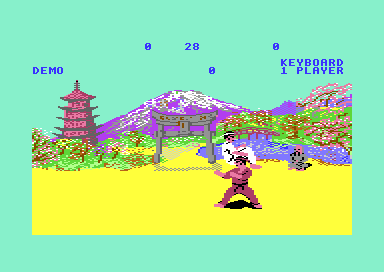

# The fighters (version II)

Each frame of a bout, the game reads the control of each fighter, selects the next move and plays one frame of its animation. A fighter has three possible controls: the joystick, the keyboard (new in version II) or the computer. The control gives a direction and a fire state. The game changes this pair into a move: a walk, a jump, a kick, a punch or a block. A move then plays an animation script that sets the pose, moves the fighter and starts a digitized sound.

This page tells how version II does it. The parts that are the same as in version I are on [the fighters page of version I](../../v1/docs/fighters.md). The full list of the changes is on [versions.md](../../docs/versions.md).

**Conventions.**
- Addresses are C64 addresses. Names are the names of the knowledge.
- A *frame* is one pass of the bout loop. The bout loop waits for raster line `$FD`, so a frame is one video frame (1/50 s on a PAL C64).
- *Fighter 0* is player 1 (white). *Fighter 1* is player 2 (red), the computer opponent, or the bull in the bull round. A pair of bytes holds the value of fighter 0 first.
- The *input* is the move that the control asks for in this frame (`fighter_input`). The *move* is the state of the fighter (`fighter_move`). Both are move numbers `$00-$18`.
- A *joystick value* has 5 bits. A bit is 0 when its line is active: bit 0 up, bit 1 down, bit 2 left, bit 3 right, bit 4 fire.
- *Facing 0* is a fighter that faces right. *Facing 1* is a fighter that faces left. *Forward* is the direction of the facing.
- A *unit* of `fighter_x` is 2 pixels. Sprite X is `fighter_x` × 2.
- A *script* is an animation script: a list of 4-byte *steps* (delay, frame, dx, dy).
- A *column* of the keyboard is a bit of `$DC00` that the code sets to 0. A *row* is a bit of `$DC01` that reads 0 when the key is down.
- **Observed** marks a fact that a run showed. **Code** marks a fact from the code only. **Conclusion** marks an interpretation.

## How it works

The bout loop calls [`fighter_update` `$2808`](../src/fighter/fighter_input.asm#L6) for fighter 1 and then for fighter 0 in each frame. The routine is the same as in version I. The changes are in the routines that it calls. **Code**.

~~~mermaid
flowchart TB
  A["Test the hits of the opponent (hit_check)"] --> B["Read the control (fighter_get_input)"]
  B --> C["Change back into a block, down-forward into move $18 (move_fix_input)"]
  C --> D["Select the next move (move_update_state)"]
  D --> E["Start or continue the animation, start the attack sound (move_start_anim)"]
  E --> F["Act on the end of an animation (move_anim_end)"]
  F --> G["Put the attacker in front of the other fighter"]
~~~

1. **The hit test runs first.** It finds a hit of the opponent and sets `hit_reaction` of the fighter that the hit touches. The details are on [combat.md](combat.md). **Code**.
2. **The control gives the input.** [`fighter_get_input` `$2834`](../src/fighter/fighter_input.asm#L30) takes the first source that applies: a hit reaction, the computer ([ai.md](ai.md)), the keyboard when `keyboard_control` is not 0, else the joystick. **Code**.
3. **The input gets two corrections.** [`move_fix_input` `$2AF2`](../src/fighter/fighter_moves.asm#L214) changes "back" into a block when an attack of the opponent is in range. It changes down-forward into move `$18` when the fighter does not crouch. **Code**.
4. **The state machine selects the move.** [`move_update_state` `$29B4`](../src/fighter/fighter_moves.asm#L6) compares the input with the move. The section [The state machine of the moves](#the-state-machine-of-the-moves) gives the rules. **Code**.
5. **The animation plays one frame.** `move_start_anim` starts the script of a new move, freezes a held pose, or lets the script continue. It then jumps to `anim_update`. **Code**.
6. **The end of a script changes the move.** `move_anim_end` ends the bout after a hit reaction. Else it returns the fighter to the stance or keeps the end pose. **Code**.
7. **The attacker comes to the front.** A fighter in an attack move gets the sprites with the higher priority. The code keeps the old priority while the sprites touch. **Code**.

The bull round uses only a part of this chain. `solo_fighter_update` reads the input of fighter 0, makes the down-forward correction, runs the state machine and the animation. It does not run the hit test or the priority code. The bull has its own hit test. The details are on [bull_round.md](bull_round.md). **Code**.

## The input

### The joystick

[`joystick_read_move` `$284C`](../src/fighter/fighter_input.asm#L46) reads port 2 (`$DC00`) for fighter 0 and port 1 (`$DC01`) for fighter 1. It keeps bits 0-4. Version I set `$DC02` to `$FF` again after the read. Version II leaves port A as an input, and each keyboard reader sets `$DC02` itself. **Code**.

[`joystick_apply_value` `$2856`](../src/fighter/fighter_input.asm#L52) changes the joystick value into the input. For facing 1, it exchanges the left and right bits. Then "forward" is always the direction of the facing. It does not exchange the bits when left and right are both 1 (no horizontal direction). Then it reads `joystick_move_table`. This table has the same 32 bytes as in version I. **Code**.

The table below decodes the table for a fighter that faces right. The 16 values with no move (no direction, up with down, left with right) give `$01`, the stance. **Code**.

| Direction | Without fire | With fire |
|---|---|---|
| None | `$01` stance | `$01` stance |
| Up | `$05` jump | `$0E` flying kick |
| Up-forward | `$06` | `$0D` high kick |
| Forward | `$02` walk forward | `$0C` mid kick |
| Down-forward | `$07` (from the crouch), else `$18` | `$0B` low kick |
| Down | `$04` crouch | `$0A` foot sweep (from the crouch) |
| Down-back | `$08` somersault backwards | `$10` back sweep (from the crouch) |
| Back | `$03` walk back, or a block | `$11` back kick (after the about turn `$12`) |
| Up-back | `$09` somersault | `$0F` attack to the back |

### The keyboard

Version II adds a keyboard control. F7 on the title screen changes `keyboard_control` (`$C6`) between 0 and 1. The title shows JOYSTICK or KEYBOARD above "1 PLAYER". The details of the title keys are on [game_flow.md](game_flow.md). **Observed** in the recording `title_keys` and the run [../runs/title_keys](../runs/title_keys). The option applies to each fighter that the computer does not control. **Code**.

The title screen after F7: KEYBOARD above 1 PLAYER.

[`kbd_read_move` `$288C`](../src/fighter/fighter_input.asm#L75) sets port A to output (`$DC02` = `$FF`) and port B to input (`$DC03` = 0). It reads the fire keys and the direction keys of the fighter. The direction keys give the bits 0-3 of a joystick value. The fire keys set `kbd_fire_bit` to 0 (fire) or `$10` (no fire). The routine adds the two parts and jumps to `joystick_apply_value`. Thus a key works exactly as the joystick line with the same direction. **Code**.

The keys of each fighter make a block of 3 × 3 keys. The centre key is the fire key. Fighter 0 uses `Q W E`, `A S D` and `Z X C` on the left side. Fighter 1 uses `P @ *`, `L : ;` and `, . /` on the right side. A direction key gives a screen direction, as the joystick does. Thus for facing 1 the left keys mean "forward". **Code**.

| Fighter | Key | Column (`$DC00`) | Row (`$DC01` bit) | Value | Direction or fire |
|---|---|---|---|---|---|
| 0 | `Q` | 7 (`$7F`) | 6 (`$40`) | `$0A` | up-left |
| 0 | `W` | 1 (`$FD`) | 1 (`$02`) | `$0E` | up |
| 0 | `E` | 1 (`$FD`) | 6 (`$40`) | `$06` | up-right |
| 0 | `A` | 1 (`$FD`) | 2 (`$04`) | `$0B` | left |
| 0 | `S` | 1 (`$FD`) | 5 (`$20`) | - | fire |
| 0 | `LEFT SHIFT` | 1 (`$FD`) | 7 (`$80`) | - | fire |
| 0 | `D` | 2 (`$FB`) | 2 (`$04`) | `$07` | right |
| 0 | `Z` | 1 (`$FD`) | 4 (`$10`) | `$09` | down-left |
| 0 | `X` | 2 (`$FB`) | 7 (`$80`) | `$0D` | down |
| 0 | `C` | 2 (`$FB`) | 4 (`$10`) | `$05` | down-right |
| 1 | `P` | 5 (`$DF`) | 1 (`$02`) | `$0A` | up-left |
| 1 | `@` | 5 (`$DF`) | 6 (`$40`) | `$0E` | up |
| 1 | `*` | 6 (`$BF`) | 1 (`$02`) | `$06` | up-right |
| 1 | `L` | 5 (`$DF`) | 2 (`$04`) | `$0B` | left |
| 1 | `:` | 5 (`$DF`) | 5 (`$20`) | - | fire |
| 1 | `RIGHT SHIFT` | 6 (`$BF`) | 4 (`$10`) | - | fire |
| 1 | `;` | 6 (`$BF`) | 2 (`$04`) | `$07` | right |
| 1 | `,` | 5 (`$DF`) | 7 (`$80`) | `$09` | down-left |
| 1 | `.` | 5 (`$DF`) | 4 (`$10`) | `$0D` | down |
| 1 | `/` | 6 (`$BF`) | 7 (`$80`) | `$05` | down-right |

Two keys never make a diagonal together. [`kbd0_read_direction` `$28CA`](../src/fighter/fighter_input.asm#L110) tests the keys in a fixed order and returns at the first key that is down. The order is Q, E, Z, W, C, X, D, A. Thus W with D gives "up", not "up-right". The diagonals have their own keys. With no direction key, the routine returns `$0F`. **Code**.

The two fighters have different code. [`kbd0_read_fire` `$28B2`](../src/fighter/fighter_input.asm#L95) tests S and LEFT SHIFT with one read, because both keys are in column 1. [`kbd1_read_fire` `$2931`](../src/fighter/fighter_input.asm#L172) needs two reads: RIGHT SHIFT in column 6 and the colon in column 5. Fighter 1 tests its direction keys in the order /, *, P, @, comma, period, L, semicolon. **Code**. Conclusion: the authors wrote the code of each fighter by hand, not from a table.

The recording [keyboard.json](../tests/record/keyboard.json) plays a 1-player game in keyboard mode with the keys Q W E A D Z X C and S. Its reads of `$DC01` in the fighter 0 code show the row bit of each of these keys at 0. The replay on the rebuild gives the same state (6787 checkpoints, PASS). No run used the keys of fighter 1: the code at `$28A6-$28B1` and `$2931-$29B3` has no coverage. **Observed**.

A joystick in port 1 shares the lines of `$DC01` with the keyboard rows. Its lines down, left and fire pull the rows 1, 2 and 4 low. In keyboard mode, the code then reads a key of the selected column, for example W, A or Z. No code prevents this. **Conclusion**.

## The moves

A move is a number `$00-$18`. The same number selects the animation script, the hit zones and the points of the move. `move_return_flags` gives the behaviour of each move when its script ends or the input changes. `move_attack_flags` marks the 11 attack moves. The version I study gave the names from the frames, the points and the move list of the game. **Code** for the numbers and the flags, **Conclusion** for the names.

| Move | Input | Return flag | Attack | Name |
|---|---|---|---|---|
| `$01` | no direction, or fire only | 1 | no | stance |
| `$02` | forward | `$80` | no | walk forward |
| `$03` | back | `$80` | no | walk back |
| `$04` | down | 0 | no | crouch |
| `$05` | up | 1 | no | jump |
| `$06` | up-forward | 0 | yes | high punch |
| `$07` | down-forward in the crouch | 0 | yes | low punch from the crouch |
| `$08` | down-back | 1 | no | somersault backwards |
| `$09` | up-back | 1 | no | somersault |
| `$0A` | fire + down in the crouch | 0 | yes | foot sweep |
| `$0B` | fire + down-forward | 0 | yes | low kick |
| `$0C` | fire + forward | 0 | yes | mid kick |
| `$0D` | fire + up-forward | 0 | yes | high kick |
| `$0E` | fire + up | 1 | yes | flying kick |
| `$0F` | fire + up-back | 0 | yes | roundhouse (hits behind) |
| `$10` | fire + down-back in the crouch | 0 | yes | back sweep |
| `$11` | fire + back, after `$12` | 0 | yes | back kick |
| `$12` | fire + back from the stance | 0 | no | about turn |
| `$13` | back against `$07`, `$0B`, `$0C`, `$18` | 0 | no | low block |
| `$14` | back against `$06`, `$0D`, `$0E`, `$0F`, `$11` | 0 | no | high block |
| `$15` | after a held `$11` | 0 | no | return from the back kick |
| `$16`, `$1A`, `$1B` | a hit of the opponent | 1 for `$16` | no | hit reactions |
| `$17` | the start of a bout | 1 | no | bow |
| `$18` | down-forward from the stance | 0 | yes | stepping low punch |

The return flag has three values. `$80` changes the move at once when the input changes (the walks). 0 holds the end pose while the input stays, and plays the script backwards when the input changes. 1 plays the script to its end, and the fighter then returns to the stance. Move `$00` has no script, and no input gives it. **Code**.

## The state machine of the moves

[`move_update_state` `$29B4`](../src/fighter/fighter_moves.asm#L6) runs once in each frame, after the input. It changes the move only at the points that the rules below give. [`move_anim_end` `$2A8F`](../src/fighter/fighter_moves.asm#L150) makes the changes at the end of a script. The diagram leaves out the walks and the moves with return flag 1. **Code**.

~~~mermaid
stateDiagram-v2
  state "Stance ($01)" as Stand
  state "Crouch ($04)" as Crouch
  state "Low attack ($07, $0A, $10)" as Low
  state "About turn ($12)" as Turn
  state "Back kick ($11)" as Kick
  state "Return ($15)" as Ret
  state "Other move, block" as Other
  state "Hit reaction ($16, $1A, $1B)" as Hit
  [*] --> Stand
  Stand --> Crouch: low input
  Crouch --> Low: low input, crouch held
  Low --> Crouch: script ends backwards
  Crouch --> Stand: crouch ends backwards
  Stand --> Turn: fire + back
  Turn --> Kick: fire + back, turn held
  Kick --> Ret: input changes, kick held
  Ret --> Stand: script ends backwards
  Stand --> Other: other input
  Other --> Stand: script ends
  Stand --> Hit: hit, delay 0
  Hit --> [*]: script ends, bout ends
~~~

| State | Condition | Next state | Code |
|---|---|---|---|
| Any move | Input is a hit reaction and `knockdown_delay` is 0. While the delay counts, the pose is frozen. | The hit reaction, `fighter_y` = `$50` | `move_update_state` |
| Stance `$01` | Input `$11` (fire + back) | About turn `$12` | `move_update_state` |
| Stance `$01` | Input `$0A` or `$10` | Crouch `$04` | `move_update_state` |
| Stance `$01` | Other new input | The input | `move_update_state` |
| Crouch `$04` | Input `$07`, `$0A` or `$10`, and the crouch holds its end pose | The input | `move_update_state` |
| About turn `$12` | Input `$07`, `$0A` or `$10` | `$12` plays backwards | `move_update_state` |
| About turn `$12` | Input `$11` and the turn holds its end pose | Back kick `$11` | `move_update_state` |
| Back kick `$11` | New input and the kick holds its end pose | `$15`, played backwards | `move_update_state` |
| Other move, not `$04` or `$12` | Input `$07`, `$0A` or `$10` | No change: the move continues or holds its pose | `move_update_state` |
| Other move | New input, return flag `$80` | The input (`$11` gives `$12`) | `move_update_state` |
| Other move | New input, return flag 0 | The same move, played backwards | `move_update_state` |
| Other move | New input, return flag 1 | No change until the script ends | `move_update_state` |
| Hit reaction | The script ends | The code sets `bout_knockdown`, and the bout loop ends | `move_anim_end` |
| `$07`, `$0A`, `$10` | The script ends backwards | Crouch `$04` at its last step | `anim_end_back_to_crouch` |
| `$11` | The script ends backwards | Stance `$01`, the facing changes | `move_anim_end` |
| Other move | The script ends backwards | Stance `$01` | `move_anim_end` |
| Move with return flag 0 | The script ends forwards | The same move holds its end pose | `move_anim_end` |
| Move with return flag 1 | The script ends forwards | Stance `$01` | `move_anim_end` |

The `$11` row has an effect that a player can use. A back kick that the player releases before its end pose plays backwards. At its end, the fighter faces the other way. **Code**.

The stance row for input `$07` never applies. `move_fix_input` changes input `$07` into `$18` before the state machine runs, when the move is not `$04` or `$07`. **Code**. Conclusion: the test of `$07` in the stance code is a remain of an older version of the rules.

### The change after a low attack: the fighter stays in the crouch

The foot sweep `$0A`, the back sweep `$10` and the low punch `$07` start from the crouch. When the player changes the input, the attack plays backwards. At its end, the fighter returns to the crouch. Version I and version II do this in different ways. **Code**.

[`anim_end_back_to_crouch` `$2AE4`](../src/fighter/fighter_moves.asm#L205) sets move `$04` and prepares the crouch script. Then it sets `anim_step_offset` to 8. The next step adds 4, so the script continues at its last step: 7 frames of frame `$0C`. Then the crouch holds its end pose, and a new low attack can start at once. **Code**.

Version I played its crouch script backwards: 15 frames of frame `$0C`, then the stance. A second sweep then needed a new crouch of 15 frames from the stance. **Code** ([`v1:anim_end_rise_crouch` `$23D6`](../../v1/src/fighter/fighter_moves.asm#L260)).

| | Version I | Version II |
|---|---|---|
| After the end of a low attack | 15 frames crouch backwards, then stance | 7 frames crouch, then crouch held |
| Frames from the end of the attack to the next low attack | about 30 (rise, crouch again) | about 7 |
| Crouch from the stance | 15 frames | 18 frames (2 frames of the stance first) |

Conclusion: the pause between two low attacks is about four times shorter, for a player and for the computer. The low punch `$07` shows frame `$0D`, and the bull round needs frame `$0D` to stop the bull. A run must still measure the frame counts.

## The animation scripts

[`anim_step` `$37CC`](../src/fighter/anim_step.asm#L17) plays the scripts. It is the same as in version I, except for the X limits below. `anim_script_table` holds 33 words: a null word, the scripts `$01-$1F` and an end word. `anim_setup` gets the length of a script from the next word in the table. **Code**.

| Byte | Meaning |
|---|---|
| 0 | Delay: the number of frames of the step. |
| 1 | The shape frame (`fighter_frame`). |
| 2 | dx: a signed value that the stepper adds to `fighter_x` in each frame of the step. Facing 1 or backwards play subtracts it. |
| 3 | dy: a signed value that the stepper adds to `fighter_y` in each frame of the step. Backwards play does not negate it. |

The stepper adds dx and dy in each frame, not once for each step. Thus a step with delay 8 and dx -1 moves the fighter 8 units. Most scripts use a step with delay 1 for a large movement, then a step with dx 0 for the pose. **Code**.

### The changed scripts

Version II changes four scripts of the fighters and adds two scripts for the bull. The other fighter scripts have the same bytes as in version I. **Code**.

| Script | Version I | Version II | Effect |
|---|---|---|---|
| `$04` crouch | 15 frames of frame `$0C` | 2 frames of frame `$00`, then 8 + 1 + 7 frames of frame `$0C` | 18 frames, the crouch starts 2 frames later |
| `$08` down-back | 9 steps, with a step of dx -11 at frame `$17` and +11 at frame `$15` | 7 steps, dx -1 in each frame | -40 units in 60 frames (version I: -39 in 63) |
| `$09` up-back | 9 steps, with a step of dx -11 at frame `$20` and +11 at the end | 8 steps, dx +1 in each frame | +40 units in 60 frames (version I: +39 in 61) |
| `$16` hit reaction | poses `$29`, `$2A`, `$2B` for 15 frames each | the same poses for 8 frames each | 98 frames (version I: 119) |

The somersault scripts `$08` and `$09` show the frames `$16`, `$17` and `$20`. In version I, these three frames had their parts one sprite column (24 pixels) to the right. The two steps of dx -11 and +11 moved the fighter back for these frames. In version II, the frame part tables put these frames one column to the left. Thus the scripts need no compensation steps. **Code**. The details of the frames are on [graphics.md](graphics.md).

Conclusion: the authors removed the compensation because of the X limits. Near a limit, the code of version I refused the -11 step and accepted the +11 step. A somersault at the edge of the screen could then move the fighter 11 units.

[`script_hit_reaction_16` `$7912`](../src/fighter/anim_scripts.asm#L169) keeps the dx values: -29, +6, -9, +4 (net -28 units). Only the delays are shorter. The fighter thus falls 21 frames faster, and the next exchange starts earlier. **Code**.

### The two new bull scripts

The bull runs to the left with script `$1C` (22 units for each run). At `fighter_x` 0 the bull is at the left edge, and two new scripts take it off the screen. `bull_step` selects them at the end of each run. **Code**.

| Script | Frames | dx per run | Starts at | Set by |
|---|---|---|---|---|
| `$1E` | `$44`, `$46`, `$45` | -6, -4: -10 | bull x 0, x set to `$0C` | `bull_exit_anim_1e` |
| `$1F` | `$4C`, `$48` | -5, -7, -1: -13 | bull x 2, x set to `$0E` | `bull_exit_anim_1f` |

1. The bull starts at x `$B0` and runs 8 times with script `$1C`. Then x is 0.
2. [`bull_exit_anim_1e` `$13EA`](../src/game/bull_round_12f8.asm#L137) adds 12 units (x `$0C`) and starts [`script_bull_exit_two_cols` `$79C2`](../src/fighter/anim_scripts.asm#L229). Its frames show only the two right columns of the bull.
3. At x 2, [`bull_exit_anim_1f` `$13F2`](../src/game/bull_round_12f8.asm#L142) adds 12 units again (x `$0E`) and starts [`script_bull_exit_one_col` `$79D6`](../src/fighter/anim_scripts.asm#L236). Its frames show only the right column.
4. At x 1, the bull is off the screen, and the round ends.

**Code**. Conclusion: each jump of 12 units is one sprite column. The bull loses its left column at the edge, and the remaining columns stay at the same screen position. Version II also changes script `$1C` (delay 4, not 10) and script `$1D` (7 steps, not 3). The bull round is on [bull_round.md](bull_round.md).

## The X limits by facing

[`anim_check_x_limits` `$384C`](../src/fighter/anim_step_37d8.asm#L74) keeps `fighter_x` in a range after each dx. Version II reads the limits from two new tables, by the facing of the fighter: [`fighter_x_min` `$12E9`](../src/game/entry_and_tables_1299.asm#L32) and [`fighter_x_max` `$12EB`](../src/game/entry_and_tables_1299.asm#L35). A value of `$C8-$FF` is a wrap below 0, and the code sets the minimum. Frames `$3B` and higher (the bull) have no limits. **Code**.

| Facing | `fighter_x_min` | `fighter_x_max` | Sprite X | Version I |
|---|---|---|---|---|
| 0 (right) | `$0C` | `$95` | `$018-$12A` | `$0C-$94` |
| 1 (left) | `$00` | `$89` | `$000-$112` | `$0C-$94` |

Version I refused a step out of its range: the fighter kept its old X ([`v1:anim_check_x_limits` `$30B5`](../../v1/src/fighter/anim_step_3041.asm#L74)). Version II sets the limit value. Thus a long step at the edge moves the fighter to the edge, not zero units. The largest step, dx -29 of the hit reaction, cannot make a false wrap: from `$95`, the value stays below `$C8`. **Code**.

Conclusion: the mirrored frames put the body 12 units further to the right in the frame of 72 pixels. The limits of facing 1 are 12 units lower, so that the body has the same screen limits for the two facings.

## The samples of the moves

Version II plays four digitized samples. The sample player was dead code in version I. Four entries of the player start them, and the moves call the entries. A new sample stops the sample that plays. DEL on the title screen sets `samples_off`, and then no sample starts. The player is on [sound_music.md](sound_music.md). **Code**.

| Sample | Data | Length | Starts when | Called at | Asset |
|---|---|---|---|---|---|
| 0 | `$F580-$F663` | 0.08 s | the opponent gets hit reaction `$16` | `hit_reaction_16` | [sample0_knockdown.wav](assets/sample0_knockdown.wav) |
| 1 | `$F663-$F979` | 0.46 s | the opponent gets hit reaction `$1A` or `$1B`, or the bull hits fighter 0 | `hit_reaction_1b`, `hit_reaction_1a`, `bull_bonus_round` | [sample1_hit.wav](assets/sample1_hit.wav) |
| 2 | `$F979-$FCD3` | 0.36 s | an attack move starts its script | `move_start_anim` | [sample2_attack.wav](assets/sample2_attack.wav) |
| 3 | `$FED3-$FFDD` | 0.18 s | a fighter reaches frame `$28` or `$2C` (on the floor), or a bull run starts | `move_start_hit_reaction`, `bull_step` | [sample3_floor.wav](assets/sample3_floor.wav) |

The lengths come from renders of the sample data. **Observed**.

The calls of the moves are new code in version II. [`anim_start_new_move` `$2B4C`](../src/fighter/fighter_moves.asm#L267) reads `move_attack_flags` of the new move and calls [`sfx_play_sample_2` `$3164`](../src/sfx/sfx_sample_player.asm#L52). Thus each of the 11 attack moves starts the swish, also an attack that misses. [`hit_record` `$2CA8`](../src/fighter/hit_test.asm#L175) starts sample 0 or 1 with the hit reaction of the opponent. **Code**.

[`move_hit_fall_sample` `$29E9`](../src/fighter/fighter_moves.asm#L36) starts sample 3 when a fighter in a hit reaction gets a new step with frame `$2C` or `$28`. These are the last poses of the reactions `$16` and `$1A`. The state machine runs before the animation, so the sound starts one frame after the pose. Reaction `$1B` ends with frame `$2F` and has no floor sound. **Code**.

The data of sample 2 continues for 511 bytes after the end of its table entry. The file [sample2_attack_uncut.wav](assets/sample2_attack_uncut.wav) plays the full data (0.54 s). Conclusion: the authors cut sample 2 after they placed the samples. **Observed** (render).

## Worked example: W and S on the keyboard

Fighter 0 faces right. The player holds W and S in keyboard mode. W is row 1 and S is row 5 of column 1. **Code**.

1. `kbd_read_move` writes `$FF` to `$DC02` and 0 to `$DC03`.
2. `kbd0_read_fire` writes `$FD` to `$DC00` (column 1) and reads `$DC01` = `%11011101` = `$DD`. `$DD` AND `$A0` = `$80`, not `$A0`. A fire key is down, so `kbd_fire_bit` = 0.
3. `kbd0_read_direction` writes `$7F` (column 7) and reads `$FF`. Bit 6 is 1, so Q is up.
4. It writes `$FD` again and reads `$DD`. Bit 6 (E) and bit 4 (Z) are 1. Bit 1 (W) is 0, so it returns `$0E` (up).
5. `$0E` + `kbd_fire_bit` 0 = `$0E`. This is the joystick value "up with fire".
6. `joystick_apply_value`: facing is 0, so no exchange. `joystick_move_table` at index `$0E` holds `$0E`. Thus `fighter_input` = `$0E`, the flying kick.
7. From the stance, the state machine sets move `$0E`. `move_start_anim` finds `move_attack_flags` = 1 for `$0E` and starts sample 2.

With A in place of W, step 4 finds E, Z and W at 1. Column 2 gives C, X and D at 1. Then column 1 gives A (bit 2) at 0. The result is `$0B` + 0 = `$0B`, "left with fire". The table gives `$11` at index `$0B`. From the stance, the fighter starts the about turn `$12`. **Code**.

## Still open

- The frame counts of the repeated sweep in version I and version II (about 30 and 7 frames). — A recording with fire + down held in the crouch on both versions, with a watch of `fighter_move`.
- The keys of fighter 1 and the fire key colon. — A 2-player game in keyboard mode that presses each key of fighter 1 and reads `fighter_input` (`$64`).
- A joystick in port 1 in keyboard mode: which false keys does it give? — A run with keyboard mode and a joystick input on port 1.
- The comments of `script_down_back` and `script_up_back` in the knowledge give a movement of 5 and 6 units. The code adds dx in each frame of a step, which gives -40 and +40 units. — A run that reads `fighter_x` before and after a somersault.
- The comment of `joystick_apply_value` in the knowledge names the wrong case for the skip of the exchange ("both pressed"). The code skips it when both bits are 1, thus when neither line is active. — A correction of the comment in the knowledge.
- A somersault at the left limit in version I: does the fighter move 11 units? — A run of script `$08` from `fighter_x` = `$0C` on version I.
