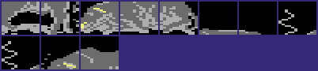
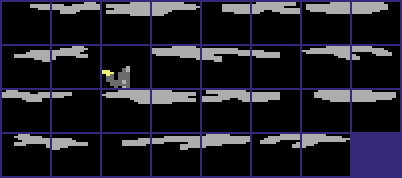
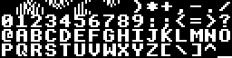

# The graphics (version II)

Version II shows the same fighters, the same four scene pictures and the same score panel as version I. The changes are in the places of the data and in two new paths. The bull of the bonus round gets its sprites without a copy. A new packer format holds the colour and screen maps of the scenes. The judge is a new sprite. The new samples need the top of memory. Thus the bull blocks, the floor shadows and the panel charset moved to other places in VIC bank 3. This page tells what changed. The shape builder, the sprite multiplexer and the bitmap RLE format work as in version I: see [the graphics of version I](../../v1/docs/graphics.md). The full list of changes is on [the changes between the versions](../../docs/versions.md).

**Conventions.**
- Addresses are C64 addresses. Names are the names of the knowledge.
- A *frame* is one picture of a fighter or of the bull: a value `$00-$4E` of `fighter_frame`. A *video frame* is one pass of the raster interrupts.
- A *part* is one sprite block of 64 bytes. A frame has 9 parts in 3 rows of 3 columns. A *pointer* is a VIC sprite pointer `p`. In VIC bank 3 its block is at `$C000 + p*64`.
- A *cell* is one 4x8 multicolour cell of the scene: one screen byte and one colour RAM nibble. A *pass* is one of the three nibble streams of a packed scene map.
- **Observed** marks a fact that a run showed. **Code** marks a fact from the code only. **Conclusion** marks an interpretation.

## How it works

The game draws a fighter frame in one of two ways. The flag `shape_page_offset` selects the way. It is 0 for the fighters and `$40` while the bull round steps the bull.

~~~mermaid
flowchart TB
  A["A new frame starts (anim_step)"] --> B{"shape_page_offset = 0?"}
  B -- "yes: a fighter" --> C["Toggle the buffer and copy 9 parts (shape_build_copy)"]
  C --> D["Normal or mirrored copy, by the facing"]
  D --> E["Publish the 9 pointers and the shadow pointers"]
  B -- "no: the bull" --> F["Copy 9 part numbers to the pointers (shape_direct_ptrs)"]
  E --> G["The raster IRQs show the sprites"]
  F --> G
~~~

1. **The new entry selects the path.** [`shape_build` `$3914`](../src/shapes/shape_build_390c.asm#L11) is 7 new bytes. Version I started the builder with the buffer toggle. Now `shape_build` tests `shape_page_offset` first. (**Code**)
2. **The fighters use the copy of version I.** [`shape_build_copy` `$391B`](../src/shapes/shape_build_390c.asm#L16) toggles `draw_buffer`, copies the 9 parts into the hidden buffer and publishes the pointers. Facing 1 uses the mirrored copy through `shape_mirror_table`. The code is the same as in version I, with new addresses. (**Code**)
3. **The bull uses direct pointers.** [`shape_direct_ptrs` `$3B95`](../src/shapes/shape_build_390c.asm#L381) reads the 9 part tables at `fighter_frame` and writes the values straight into `fighter_part_ptrs`. There is no copy, no buffer toggle, no mirror and no shadow. (**Code**)

The direct path is the main change. A value in a part table is a part number for a fighter, but a VIC pointer for the bull. Version I showed the bull through the normal copy with the source page `$7F00[part] + $40`, that is `$C000 + part*64`. That source is the block of pointer `part` in VIC bank 3. Version II shows the same picture and saves the copy of 9 x 64 bytes in each new bull frame. (**Code**, and the equivalence is a **Conclusion**)

The copy code still adds `shape_page_offset` to the source page in each of the 9 slots and in the mirror helper. `shape_build` only sends offset 0 to this code, so each addition adds 0. The addition is a remainder of the method of version I. (**Code**, and the reason is a **Conclusion**)

### The frame tables: 79 frames

The 9 part tables start at [`frame_parts_top_left` `$7AE0`](../src/shapes/frame_part_tables.asm#L6), one table for each slot. Each table now has 79 frames, so slot n is at `$7AE0 + n*$4F`. Version I had 72 frames with the stride `$48`. Each of the three paths reads the tables with the new stride. The tables end at `$7DA6`, and `$7DA7-$7DFF` holds a RAM pattern. (**Code**)

| Frames | What they show | Animation |
|---|---|---|
| `$00-$3A` | The fighters. Frames `$16`, `$17` and `$20` moved one column left. | the fighter scripts |
| `$3B-$3F` | The bull runs, 5 poses. | `$1C` |
| `$40-$42` | The bull falls after a stop. | `$1D` |
| `$43-$47` | The run poses `$3B-$3F` without the left column. | `$1E` uses `$44-$46` |
| `$48-$4C` | The run poses with only the right column. | `$1F` uses `$48` and `$4C` |
| `$4D-$4E` | A small standing figure, the version I frames `$44` and `$45` with new pointers. | none |

The clipped frames let the bull run out at the left edge. The bull round selects animation `$1E` at bull x 0 and animation `$1F` at bull x 2. A sprite column that leaves the screen at the left thus gets no part. (**Code**)

Frame `$49` holds the parts `$58` and `$5F`. They are two shadow blocks, not bull parts. No animation names frames `$43`, `$47`, `$49`, `$4A`, `$4B`, `$4D` or `$4E`, so no run shows them. The authors made the full set of clipped frames and used only the frames that the run reaches. (**Code**. **Observed** in the coverage: no run read these frames. The reason is a **Conclusion**.)

Frames `$16`, `$17` and `$20` are somersault frames. Version I drew them one column to the right and moved `fighter_x` by -11 and +11 in 1-frame script steps to hide the offset. Version II moved the parts one column left in the tables and removed these steps. The shadow tables follow the same move. The details of the scripts are on [the fighters](fighters.md). (**Code**)

### The bull: direct sprite pointers

The bull round [`bull_bonus_round` `$132C`](../src/game/bull_round_12f8.asm#L36) sets `shape_page_offset` to `$40` and makes the bull fighter 1. The bull gets the front sprites 0-2 and the colour 9, brown. The rules of the round are on [the bull round](bull_round.md). (**Code**)

The screen capture shows the bull round in scene 3. (**Observed**)

Version I kept the bull in M.XSPRITES at `$F540-$FF7F`. Version II puts the 4 samples at `$F580-$FFDD`, so the bull had to move. All 41 blocks of version I are in version II, byte for byte, in 4 places of VIC bank 3. (**Observed** in a byte compare)

| Range | Pointers | Blocks of version I |
|---|---|---|
| `$C940-$CBFF` | `$25-$2F` | parts `$E0-$EA` |
| `$DC40-$DFFF` | `$71-$7F` | parts `$FA-$FD`, then `$D5-$DF` |
| `$E000-$E0FF` | `$80-$83` | parts `$F6-$F9` |
| `$E300-$E5BF` | `$8C-$96` | parts `$EB-$F5` |

Each range fills a space that no other graphic uses:

- [`bull_f62_parts` `$C940`](../src/graphics/bull_sprites_c900.asm#L16) starts just after shape buffer 3, which ends at `$C93F`. In version I, buffer 3 overwrote the first block of the `$C900` segment.
- [`bull_f59_parts` `$DC40`](../src/graphics/bull_sprites_dc40.asm#L6) is in the RAM under the I/O area. The CPU cannot read it while I/O is on, but the VIC always reads the RAM.
- [`bull_f66_parts` `$E000`](../src/graphics/bull_sprites_e000.asm#L6) and [`bull_f63_parts_b` `$E300`](../src/graphics/bull_sprites_e300.asm#L6) are in the charset area of the panel. The panel uses only the characters `$20-$5F` (`$E100-$E2FF`). The characters `$00-$1F` and `$60-$B7` hold bull parts.

(**Code**) The direct pointers make these places possible: the CPU never reads the bull blocks. (**Conclusion**)

The image shows the 15 bull blocks under the I/O area, in the pattern colours of the reference.

The image shows the bull blocks in the characters `$60-$B7` of the panel charset area.

Two unused blocks came with the move. Pointer `$97` at `$E5C0` is a copy of `$E000`. Pointer `$7B` at `$DEC0` is the old hind quarter of version I. No frame names them. (**Code**)

The direct path never sets the shadow pointers of the fourth sprite row. The bull stays on the ground, so no shadow handler runs for it. (**Code**)

### The judge

Version I enabled sprites 6 and 7 but never set them. Version II shows a judge with a flag. [`judge_show_winner` `$1F93`](../src/game/score_and_judge.asm#L43) runs at a decision when the time is up in a one-player bout, and at the end of a two-player game with a winner. (**Code**)

1. Sprite 6 is the judge, colour `$0C` grey. Its pointer comes from [`judge_ptr_by_scene` `$1FFA`](../src/game/score_and_judge.asm#L90): `$5C` in scenes 0 and 1, `$50` in scenes 2 and 3.
2. Sprite 7 is the flag, pointer `$51`. Its colour is the winner colour: 1 white for fighter 0, 2 red for fighter 1.
3. The X and Y of the judge come from three more tables by scene. The judge stands at a different place in each picture.
4. With pointer `$5C` the flag goes 2 pixels left and 6 lines down from the judge. With pointer `$50` it goes 4 pixels right.

(**Code**) The coverage of the runs has both branches of the flag position. (**Observed**)

| Pointer | Block | Name | Use |
|---|---|---|---|
| `$50` | `$D400-$D43F` | `judge_sprite_scene23` | The judge in scenes 2 and 3. New in version II. |
| `$51` | `$D440-$D47F` | `judge_flag_sprite` | The flag. Version I had the same block, unused, at `$D500`. |
| `$5C` | `$D700-$D73F` | `judge_sprite_scene01` | A smaller judge in scenes 0 and 1. New in version II. |

[`judge_sprite_scene23` `$D400`](../src/graphics/judge_sprites_d000_d3c0.asm#L30), [`judge_flag_sprite` `$D440`](../src/graphics/judge_sprites_d000_d3c0.asm#L54) and [`judge_sprite_scene01` `$D700`](../src/graphics/shadow_sprites_d480.asm#L222) are the three blocks. No block of version I matches the two judge blocks. The block `$D700` is in the run of the floor shadows. (**Code**)

The image shows the judge at `$D400` and the flag at `$D440`.

`$D000-$D3FF` holds the small figure of frames `$4D` and `$4E` and pieces of version I that nothing uses. The figure is the prototype of a judge in version I. The final judge is one new sprite and the old flag block. (**Code**, and the prototype is a **Conclusion**)

### The floor shadows

A jump or a somersault shows a shadow on the floor in the fourth sprite row. [`shape_row4_frames` `$3B5D`](../src/shapes/shape_build_390c.asm#L367) lists the 8 frames with a shadow, as in version I. [`shape_row4_left` `$3B65`](../src/shapes/shape_build_390c.asm#L370) and the two tables after it give the pointers of the left, middle and right column. (**Code**)

The 30 shadow blocks are the same graphics as in version I. They moved from the pointers `$55-$7B` (`$D540-$DEFF`) to `$52-$70` (`$D480-$DC3F`). The judge block `$5C` sits between the shadows of facing 0. (**Code**)

| Pointers | Range | Contents |
|---|---|---|
| `$52-$5B` | `$D480-$D6FF` | Shadows for facing 0 |
| `$5C` | `$D700-$D73F` | The judge of scenes 0 and 1 |
| `$5D-$61` | `$D740-$D87F` | Shadows for facing 0 |
| `$62-$70` | `$D880-$DC3F` | Shadows for facing 1, the mirror images of facing 0 |

The entries of frames `$20`, `$17` and `$16` moved one column with their frames. Facing 0 now uses the left and middle column for entries 3-7. Facing 1 uses the middle and right column. (**Code**)

The image shows the shadow blocks of both facings and the small judge at pointer `$5C`.

### The panel charset

The score panel uses text mode with the character base `$E000`. Version I loaded 128 characters at `$E000-$E3FF`. Version II keeps only the characters `$20-$5F` at [`panel_font` `$E100`](../src/graphics/panel_charset.asm#L6). The other character places hold bull parts. (**Code**)

The yin-yang symbols moved from the characters `$01-$08` to [`panel_yinyang_chars` `$E108`](../src/graphics/panel_charset.asm#L9), the characters `$21-$28`. They are in the place of the characters `! " # $ % & ' (`. [`draw_yin_yang_full` `$1DDE`](../src/game/game_modes.asm#L382) draws the full symbol with `$21-$24`. `draw_yin_yang_half` draws the half symbol with `$25-$28`. The characters `$29-$5F` are the same bytes as in version I. (**Code**)

The image shows the space, the yin-yang characters, the punctuation, the digits and the upper case letters.

No text of the game can show a character outside `$20-$5F`. The rank stops at 10TH DAN, and the name entry gives only the space, the digits and the letters. Version I showed garbage after 10TH DAN. The cut font is thus safe. (**Observed** in `tests/rank_cap.json`, and the key mask is **Code**)

### The scene pictures

[`scene_draw_if_new` `$1F3F`](../src/game/title_and_scene.asm#L135) draws the scene `stage_counter AND 3` when it is not on the screen. It clears the bitmap, unpacks the colour and screen maps, and then unpacks the bitmap. Version I copied the maps after the bitmap. (**Code**)

1. **The bitmap.** [`scene_unpack_bitmap` `$17BB`](../src/scenes/scene_unpack.asm#L6) is the code of version I without a change. It unpacks backward from `$F53F` down to `$E640`, the bitmap rows 5-16. The format is on [the graphics of version I](../../v1/docs/graphics.md). (**Code**)
2. **The colour and screen maps.** [`scene_unpack_maps` `$1849`](../src/scenes/scene_unpack.asm#L87) is new. It unpacks a nibble RLE stream into the colour RAM and the screen of rows 5-16. The format is in [the packed scene maps](#the-packed-scene-maps). (**Code**)

The four packed bitmaps are byte for byte the bitmaps of version I. They moved up by `$5CB` bytes, from `$3994-$62FF` to `$3F5F-$68CA`. `scene_packed_ptrs` holds the new addresses. Unpacked, the four colour maps and the four screen maps are the maps of version I. (**Observed** in a byte compare and a model of the unpackers)

| Data | Version I | Version II | Bytes |
|---|---|---|---|
| Scene bitmaps, packed | `$3994-$62FF` | `$3F5F-$68CA` | 10604 in both |
| Colour and screen maps | `$6300-$71FF`, not packed | `$68CB-$71FF`, packed | 3840, then 2357 |

The packed maps are 3840 - 2357 = 1483 bytes smaller. 1483 is `$5CB`, exactly the move of the bitmaps. The maps still end at `$71FF`, below the hit-zone tables at `$7200`. The bitmaps moved up against the maps. (**Observed** in a byte compare)

The authors packed the maps to make room for the larger code. The code of version II ends at `$3E7F`. The free bytes `$3E80-$3F5E` hold a RAM pattern. (**Conclusion**)

The old pointer words [`old_scene_colour_ptrs` `$1289`](../src/leftovers/leftover_1281.asm#L9) and `old_scene_screen_ptrs` still hold the version I addresses `$6300` to `$7020`. Nothing reads them in version II. In version II these addresses point into the packed bitmap of scene 3 and into the packed maps. (**Code**)

## The packed scene maps

### Where the data is

[`scene_map_packed_ptrs` `$1841`](../src/scenes/scene_unpack.asm#L84) holds one address for each scene. [`scene_unpack_maps` `$1849`](../src/scenes/scene_unpack.asm#L87) reads the data of the scene `stage_counter AND 3`. (**Code**)

| Scene | Picture | Data | Bytes |
|---|---|---|---|
| 0 | Pagoda, Mount Fuji, torii gate, lake | `$68CB-$6B40` | 630 |
| 1 | Lake with a sun and mountains | `$6B41-$6D95` | 597 |
| 2 | Dojo interior with a lantern | `$6D96-$6FDF` | 586 |
| 3 | Buddha statue and temple | `$6FE0-$71FF` | 544 |

Version I stored 960 bytes for each scene: 480 bytes of colour and 480 bytes of screen. (**Code**)

### The byte layout

The data is a stream of nibbles. The unpacker reads the low nibble of a byte first, then its high nibble, then the next byte. The stream has three passes, one after the other, with no length and no padding between them. (**Code**)

| Pass | Destination | Bits that the pass writes | Bits that it keeps |
|---|---|---|---|
| 1 | Colour RAM `$D8C8` up | 0-3: the colour of the bit pair 11 | 4-7 |
| 2 | Screen `$CCC8` up | 4-7: the colour of the bit pair 01 | 0-3 |
| 3 | Screen `$CCC8` up | 0-3: the colour of the bit pair 10 | 4-7 |

Each pass gives the 480 cells of the rows 5-16, left to right and top to bottom. The background colour of the bit pair 00 comes from `$D021`. (**Code**)

A pass is a sequence of tokens. Each token starts with a control nibble n.

| Control nibble n | Meaning |
|---|---|
| `$0` or `$8` | The count n AND 7 is 0: the pass ends. |
| `$1-$7` | Bit 3 is 0: the next n nibbles are literal cells. |
| `$9-$F` | Bit 3 is 1: the next nibble goes into n AND 7 cells. |

The unpacker does not count the cells. Only the 0 count ends a pass. In all 4 scenes each pass gives exactly 480 cells. (**Code**, and the count of 480 is **Observed** in a model of the unpacker)

The packer was simple. It writes a fill for each pair of equal nibbles and never a fill of 1. Scene 0 has 182 literal tokens and 313 fill tokens. Scenes 1 and 2 end in a low nibble, and the high nibble of the last byte is the pad value `$A`. (**Observed** in a model of the unpacker)

The colour maps of version I had random high nibbles in most bytes, for example in 434 of the 480 bytes of scene 0. The colour RAM has only 4 bits, so these nibbles had no effect. The packed maps of version II do not have them. (**Observed** in a byte compare. A read of the colour RAM as the source of the nibbles is a **Conclusion**.)

### The decoder

[`map_unpack_pass` `$188B`](../src/scenes/scene_unpack.asm#L112) unpacks one pass. [`map_read_nibble` `$18AE`](../src/scenes/scene_unpack.asm#L135) gives the next nibble. [`map_write_nibble` `$18CB`](../src/scenes/scene_unpack.asm#L153) merges a nibble into the destination byte and steps the pointer. (**Code**)

~~~text
src = scene_map_packed_ptrs[stage_counter AND 3]
low_first = true                       ; map_src_mask = $0F
for pass in (colour RAM $D8C8, keep $F0, nibble in bits 0-3),
            (screen $CCC8,     keep $0F, nibble in bits 4-7),
            (screen $CCC8,     keep $F0, nibble in bits 0-3):
    dest = start of the pass
    loop:
        n = read_nibble()
        count = n AND 7
        if count == 0: break           ; end of the pass
        if n == count:                 ; bit 3 clear
            repeat count: write(read_nibble())
        else:                          ; bit 3 set
            v = read_nibble()
            repeat count: write(v)
~~~

The source pointer does not go back between the passes. A pass can thus start in the high nibble of a byte. The code tests bit 3 with `CMP map_nibble` against n AND 7. The two values are equal only when bit 3 is clear. (**Code**)

### A worked example: the first cells of scene 0

The data of scene 0 starts at `$68CB` with the bytes `$0D $31 $0B $6A $01 $6A $22 $A0`. Pass 1 gives the colour RAM of the cells 0-15 of row 5. (**Code**, and the bytes are from the release SCC)

| Token | Nibbles | Meaning | Cells |
|---|---|---|---|
| `$68CB` low, high | `$D`, `$0` | Fill 5 with 0 | 0-4 = 0 |
| `$68CC` low, high | `$1`, `$3` | 1 literal: 3 | 5 = 3 |
| `$68CD` low, high | `$B`, `$0` | Fill 3 with 0 | 6-8 = 0 |
| `$68CE` low, high | `$A`, `$6` | Fill 2 with 6 | 9-10 = 6 |
| `$68CF` low, high | `$1`, `$0` | 1 literal: 0 | 11 = 0 |
| `$68D0` low, high | `$A`, `$6` | Fill 2 with 6 | 12-13 = 6 |
| `$68D1` low, high, `$68D2` low | `$2`, `$2`, `$0` | 2 literals: 2, 0 | 14 = 2, 15 = 0 |

The cells 9-13 need three tokens: a fill of 6, a literal 0 and a fill of 6. The packer writes a fill for each pair of equal nibbles. (**Code**)

Pass 1 ends with the 0 nibble in the high half of `$699C`. Pass 2 thus starts at `$699D` with `$3D $01 $3B $3F`. Its tokens are fill 5 with 3, 1 literal 0, fill 3 with 3 and fill 7 with 3. They give the high nibbles 3, 3, 3, 3, 3, 0, 3, 3, 3, 3, 3, 3, 3, 3, 3, 3 for the cells 0-15. (**Code**)

Pass 2 ends with the low nibble of `$6A6E`. Pass 3 thus starts in the high nibble of `$6A6E` with `$F0 $F2 $22 $26`. Its tokens are fill 7 with 2, fill 7 with 2 and 2 literals 6, 2. They give the low nibbles 2 for the cells 0-13, 6 for cell 14 and 2 for cell 15. (**Code**)

| Cell | 0-4 | 5 | 6-8 | 9-10 | 11 | 12-13 | 14 | 15 |
|---|---|---|---|---|---|---|---|---|
| Colour RAM `$D8C8+` | 0 | 3 | 0 | 6 | 0 | 6 | 2 | 0 |
| Screen `$CCC8+` | `$32` | `$02` | `$32` | `$32` | `$32` | `$32` | `$36` | `$32` |

The screen bytes and the colour nibbles are the same as the version I maps at `$6A80` and `$6300`. Pass 3 of scene 0 ends with the high nibble of `$6B40`, the last byte of the scene. (**Observed** in a model of the unpacker on the image of SCC)

### The assets

The project has no extracted image of the scene pictures of version II. The pictures are the pictures of version I. [The graphics of version I](../../v1/docs/graphics.md) shows them.

## Still open

- The bull falls with frames `$40-$42` (animation `$1D`). No run read these frames. A run can stop the bull with frame `$0D` at a distance of `$19-$1D` and capture the screen.
- No screen capture shows the judge. A run can capture a time-up decision in scene 0 and in scene 2. It can then compare the judge, the flag colour and the flag position with the code.
- Frames `$4D` and `$4E` have no script. A run can write `$4D` to `fighter_frame` of fighter 1 in the bull round and capture the figure.
- A run can confirm that `draw_buffer` does not change in the bull round while `shape_page_offset` is `$40`.
