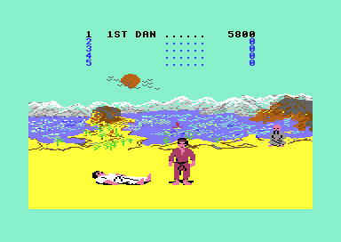

# The high score table

Version II adds a table of the 5 best scores of the 1-player game. Each entry has a score, the rank that the player got and a name of 6 characters. When a 1-player game ends, the game shows the table in the panel above the scene. When the score is high enough, the player types a name, and tune 4 plays. Version I has only one high score for each mode and no names. The full list of the changes is on [versions.md](../../docs/versions.md).

**Conventions.**
- Addresses are C64 addresses. Names are the names of the knowledge.
- A *frame* is one pass of the raster beam, 1/50 second on a PAL C64.
- The *panel* is screen rows 0-4 (`$CC00-$CCC7`), the text area above the scene.
- A *place* is the position of an entry in the table: place 0 has the highest score, place 4 the lowest.
- An *entry* is the score, the rank and the name of one place. The *new entry* is the entry of the game that ended.
- A *key code* is the column of the keyboard matrix times 8, plus the row bit: `$00-$3F`.
- **Observed** marks a fact that a run showed. **Code** marks a fact from the code only. **Conclusion** marks an interpretation.

## When the table shows

The table shows only at the end of a 1-player game. The title loop calls `game_one_player` and then [`hs_table_update` `$146A`](../src/high_score_table.asm#L6) at [`title_start_1p` `$1F0A`](../src/title_and_scene.asm#L105). After the table, the loop clears the panel with `hs_clear_panel` and starts the demo again. (**Code**)

A 2-player game does not show the table. `game_two_players` calls only `high_score_update`, the code of version I that keeps one high score for each mode at `$1299` and `$129F`. The 1-player game also updates its single high score before it returns. Thus a 1-player score goes into two places: the single high score of the title and the table. (**Code**)

Version I has a different end of the 1-player game. At the same place, it started a new game at once when the player held the fire button. Version II replaced that code with the call of the table. The version I flow is on [game_flow.md](../../v1/docs/game_flow.md). (**Code**)

## How it works

~~~mermaid
flowchart TB
  A["1-player game ends"] --> B["Find the place, move the lower entries down, write score, rank and '......' (hs_find_place)"]
  B --> C{"Fire on port 2 held?"}
  C -- yes --> X["Return: no table, the name stays '......'"]
  C -- no --> D{"Place 5 (not in the table)?"}
  D -- yes --> E["Show the table, wait 250 frames, fire or F1 (hs_show_and_wait)"]
  D -- no --> F["Show the table, colour the new row black"]
  F --> G["Name entry, tune 4 (hs_name_entry)"]
  G --> H["Colour the row blue again"]
~~~

`hs_table_update` is the entry of the table. It does these steps in this order:

1. **It puts the new score into the table first.** `hs_find_place` finds the place, moves the lower entries down and writes the score, `player_rank` and the name "......". The table changes before the player sees it. (**Code**)
2. **It reads the fire button of port 2.** When the player holds fire, the routine returns at once. The next section tells what this does to the name. (**Code**)
3. **It tests the place.** At place 5, the score is not in the table. Then `hs_show_and_wait` shows the table and waits. (**Code**)
4. **It shows the table.** It keeps `text_dest_ptr`, which points to the name of the new entry, while the code shows the table. (**Code**)
5. **It calculates the screen address of the new name.** The name of place 0 is at `$CC13`, column 19 of row 0. Each place adds 40. The code writes the address into the operand of `hs_put_char`. (**Code**)
6. **It marks the row.** It writes colour 0 (black) into 24 cells of colour RAM from column 8. Then the name entry runs, and colour 6 (blue) comes back. (**Code**)

`hs_show_and_wait` shows the table for at most 250 frames, about 5 seconds. Fire on port 2 or the F1 key stops the wait earlier. (**Code**)

### The bug: a held fire button keeps the name "......"

The fire test comes after `hs_find_place`, not before it. Thus the new score is already in the table when the routine sees the fire button. The routine then returns, and the table and the name entry do not show. The new entry keeps the name "......" for the rest of the session. (**Code**)

A player who holds fire at the end of the game to start again loses the name. A player can also lose it by chance, because the test reads the fire button at one moment only. **Conclusion**: the test is the fast restart of version I, and the authors did not move it before the update of the table.

## The data

The table is three arrays, one for each field. Entry n of each array belongs to place n. The bytes are character codes of the panel charset, so the code copies them to the screen without a change. (**Code**)

| Array | Range | Bytes | Meaning | Value at the start |
|---|---|---|---|---|
| `hs_names` | `$1715-$1732` | 5 x 6 | The name of place n at `$1715` + 6n. | "......" (`$2E`) |
| `hs_scores` | `$1733-$1750` | 5 x 6 | The score of place n at `$1733` + 6n: six digits with leading spaces, the same form as the panel score at `$CC31-$CC36`. | "     0" |
| `hs_ranks` | `$1751-$1755` | 5 x 1 | The rank number of place n: 0 NOVICE, 1-10 the dan, `$80` empty. | `$80` |

The names end exactly 30 bytes before the scores. The finder uses this: it goes back 30 bytes from the new score to find the new name. (**Code**)

The table is in RAM only. The game has no code that saves it to the disk, so the table starts empty after each load. (**Code**)

The table puts each field in a fixed column of the panel rows 0-4:

| Column | Content | Code |
|---|---|---|
| 8 | The place number 1-5. | `hs_show_ranks` |
| 10-17 | The rank text, aligned at the right. | `print_rank_text` |
| 19-24 | The name. | `hs_show_names` |
| 26-31 | The score. | `hs_show_scores` |

## The finder and the shifts

[`hs_find_place` `$163A`](../src/high_score_table.asm#L243) starts at place 4 and moves up. At each place it calls [`high_score_compare` `$2049`](../src/score_and_judge.asm#L141), the compare routine of version I, with the score of player 1. When the new score is not higher than the entry, the search stops. The new place is one place below that entry. When the new score is higher than all entries, the place is 0. (**Code**)

A new score that is equal to an entry goes below it. `high_score_compare` gives "not higher" for two equal scores. Thus a score of 0 never goes into the empty table, because each empty entry holds "     0". (**Code**)

The place goes into `hs_new_position`. The value 5 means "not in the table". For places 0-3, three routines move the lower entries down by one place. The entry of place 4 is lost. (**Code**)

- [`hs_shift_names` `$1692`](../src/high_score_table.asm#L298) and `hs_shift_scores` have no loop over the places. Each one copies place 3 to place 4. Then it copies place 2 to 3, place 1 to 2 and place 0 to 1, but only down to the new place. (**Code**)
- `hs_shift_ranks` uses a loop. It also writes `player_rank` into the new place. For place 4, it writes only the rank. (**Code**)

After the shifts, `high_score_copy` writes the score, and `hs_put_dots` writes "......" as the name. (**Code**)

## How the table shows

[`hs_show_ranks` `$15AF`](../src/high_score_table.asm#L159) clears the panel and writes the place numbers 1-5 in column 8. Then it writes the rank text of each entry that is not empty, from place 4 up to place 0. `hs_show_names` and `hs_show_scores` copy the two arrays to the screen through [`hs_copy_column` `$15F1`](../src/high_score_table.asm#L196). That routine reads the table through an operand that the two callers write. The file holds `$8000` there. (**Code**)

### The rank text aligned at the right

The table uses [`print_rank_text` `$21FB`](../src/timer_and_texts.asm#L157), the rank printer of the game panel. Version II gave it a new variable, `rank_text_offset`. In the game panel it is 0, and each text starts at cell 0. The table sets it to 1. Then the three forms of the text end in the same cell. (**Code**)

| Rank | Text | Cells with offset 0 (panel) | Cells with offset 1 (table) |
|---|---|---|---|
| 0 | `NOVICE` | 0-5 | 2-7 |
| 1-9 | for example `1ST DAN` | 0-6 | 1-7 |
| 10 | `10TH DAN` | 0-7 | 0-7 |

The NOVICE path starts at cell offset x 2 + 6 and writes the text backward. The text has a space at its end, so with offset 1 the space goes into cell 8. The digit path starts at cell offset. The 10TH DAN path has no offset, because its 8 characters fill all cells. (**Code**)

The rank texts of the table start from column 10, so they end in column 17. Thus "1ST DAN" in the image below is in columns 11-17. (**Code**)

The table at the end of a 1-player game, at the start of the name entry. Places 2-5 are empty: no rank, the name "......" and the score 0. After RETURN the game goes back to the demo at once, so the table shows only while the player types the name. (**Observed**)

## The name entry

[`hs_name_entry` `$1762`](../src/high_score_table.asm#L400) lets the player type a name of up to 6 characters. It sets `game_mode` to 4, and the music driver starts tune 4. Version I has no code that sets `game_mode` to 4. Thus version II is the first version that plays tune 4. The music is on [sound_music.md](sound_music.md). (**Code**)

The routine repeats these steps until the name is complete:

1. Read the fire button of port 2. Fire fills the rest of the name with spaces and ends the entry.
2. Wait 2 frames. Thus the routine reads the keyboard 25 times each second.
3. Read a new key with `key_get_char`. No key, or the key of the last read, gives `$40`, and the loop starts again.
4. RETURN (`$0D`) fills the rest of the name with spaces and ends the entry.
5. DEL (`$14`) moves one character back and writes a space there. At the first character, DEL does nothing.
6. Each other key goes into the name. `hs_put_char` writes it into the table and into the screen. The 6th character ends the entry.

(**Code**)

The routine keeps its character index in `fighter_distance` while the wait and the key scanner use the Y register. The entry has no time limit: the loop runs until the player ends it. (**Code**)

The image above shows the start of the name entry: the row of the new entry is black, and the name is still "......". (**Observed**)

## The state machine of the name entry

~~~mermaid
stateDiagram-v2
  state "Wait for a key" as Wait
  state "Fill with spaces" as Fill
  [*] --> Wait
  Wait --> Wait: letter, digit or SPACE (index < 5)
  Wait --> Wait: DEL
  Wait --> Fill: RETURN or fire
  Wait --> [*]: 6th character
  Fill --> [*]
~~~

| State | Condition | Next state | Code |
|---|---|---|---|
| Wait for a key | No key, or the key is still held | Wait for a key | `key_get_char` |
| Wait for a key | Letter, digit or SPACE, index 0-4 | Wait for a key, index + 1 | `hs_put_char` |
| Wait for a key | Letter, digit or SPACE, index 5 | End | `hs_name_entry` |
| Wait for a key | DEL, index 1-5 | Wait for a key, index - 1 | `hs_name_delete` |
| Wait for a key | RETURN, or fire on port 2 | Fill with spaces | `hs_name_fill_spaces` |
| Fill with spaces | Index reaches 6 | End | `hs_name_fill_loop` |

## The key scanner

The name entry has its own keyboard reader. It reads all 8 columns of the keyboard matrix and gives one character for each key press. (**Code**)

[`key_scan` `$150F`](../src/high_score_table.asm#L94) scans the 8 columns of the keyboard matrix from 7 down to 0. For each column it writes a value of `key_column_masks` to `$DC00` and reads the rows at `$DC01`. Then it sets the bits of [`key_row_ignore` `$1552`](../src/high_score_table.asm#L131) for that column, so the masked keys read as "not pressed". At the first key down, it returns the key code. Without a key, it returns `$40`. (**Code**)

[`key_get_char` `$155A`](../src/high_score_table.asm#L134) changes the key code to a character with `key_chars`. When the character is the same as `last_key_char`, the key is still held, and the routine gives `$40`. Thus a held key gives one character only. (**Code**)

The four tables of the scanner:

| Table | Range | Entries | Meaning |
|---|---|---|---|
| `key_column_masks` | `$1542-$1549` | 8 | The value for `$DC00` that selects column 0-7: `$FE`, `$FD` ... `$7F`. |
| `key_column_codes` | `$154A-$1551` | 8 | The first key code of each column: column x 8. |
| `key_row_ignore` | `$1552-$1559` | 8 | The row bits that the scanner ignores in each column. |
| `key_chars` | `$156F-$15AE` | 64 | The character of each key code, 8 for each column. |

The masks of `key_row_ignore` leave exactly A-Z, 0-9, SPACE, RETURN and DEL:

| Column | Mask | Keys of the column (row bit 0 to 7) | Keys that pass |
|---|---|---|---|
| 0 | `$FC` | DEL, RETURN, CRSR right, F7, F1, F3, F5, CRSR down | DEL, RETURN |
| 1 | `$80` | 3, W, A, 4, Z, S, E, LEFT SHIFT | all but LEFT SHIFT |
| 2 | `$00` | 5, R, D, 6, C, F, T, X | all |
| 3 | `$00` | 7, Y, G, 8, B, H, U, V | all |
| 4 | `$00` | 9, I, J, 0, M, K, O, N | all |
| 5 | `$F9` | +, P, L, -, ., :, @, comma | P, L |
| 6 | `$FF` | pound, *, semicolon, HOME, RIGHT SHIFT, =, up arrow, / | none |
| 7 | `$A6` | 1, left arrow, CTRL, 2, SPACE, C=, Q, RUN/STOP | 1, 2, SPACE, Q |

The passing keys are 26 letters, 10 digits, SPACE, RETURN and DEL. (**Code**)

`key_chars` is a complete table of the 64 keys. It also has the codes of F1-F7, the cursor keys and HOME, but the scanner never returns these keys. **Conclusion**: the authors wrote a general key reader, and then made it smaller with the masks for the name entry.

Port 1 of the joystick uses the same lines as the rows at `$DC01`. A joystick in port 1 therefore pulls the rows low in each column that the scanner selects (**Code**). **Conclusion**: up, right and fire on port 1 can give "1", "2" and SPACE in column 7. Down and left can give "P" and "L" in column 5. No run tested this.

## The style of the code

The code of `$146A-$17BA` is different from the other code of the game. (**Code**)

- Two loops end with `CPX #$FF` and `BNE` (`$1609` in `hs_copy_column`, `$16EE` in `hs_clear_panel`). No other module of version II has `CPX #$FF`. The code of version I uses `DEX` and `BPL` for such loops.
- `hs_shift_ranks` ends its loop with a `JMP` back.
- The shifts of the names and the scores have one copy of the code for each place, not a loop.
- [`hs_clear_panel` `$16E6`](../src/high_score_table.asm#L342) does the same job as `panel_clear_text`, the clear routine of the game, with a loop that counts down. The table code does not call the routine that exists.
- The name entry borrows `fighter_distance`, a variable of the fighters, to keep its index.

**Conclusion**: another programmer perhaps wrote the high score module, apart from the rest of the game. The module uses only a few routines of the game: `high_score_compare`, `high_score_copy`, `print_rank_text` and the frame wait.

## The worked example

The image above shows the table after a 1-player game with 5800 points and the rank 1ST DAN. The table was empty, so the new score goes to place 0. (**Observed**)

1. `hs_find_place` compares "  5800" with "     0" at place 4. The new score is higher, so it compares again at places 3, 2, 1 and 0. Each time it is higher, so the place is 0.
2. The shifts copy places 3 to 4, 2 to 3, 1 to 2 and 0 to 1. All these entries are empty.
3. The table bytes are now: [`hs_scores` `$1733-$1738`](../src/high_score_table.asm#L380) = `$20 $20 $35 $38 $30 $30` ("  5800"), [`hs_ranks` `$1751`](../src/high_score_table.asm#L387) = `$01`, [`hs_names` `$1715-$171A`](../src/high_score_table.asm#L373) = `$2E` x 6.
4. The table code writes "1" at `$CC08`, "1ST DAN" at `$CC0B-$CC11` (column 10 + offset 1), "......" at `$CC13-$CC18` and "  5800" at `$CC1A-$CC1F`.
5. The colour pointer is `$CC13 - $0B + $0C00` = `$D808`. The code writes black into `$D808-$D81F`, columns 8-31 of row 0.

(**Code**)

A key in the name entry, for example F: F is column 2, row bit 5. `key_scan` writes `$FB` to `$DC00` and reads `$DF` at `$DC01`. The mask of column 2 is `$00`. The shift loop finds bit 5 clear, so the key code is `$10` + 5 = `$15`. `key_chars` + `$15` holds `$46`, the character F. (**Code**)

The recording `tests/record/one_player_moves.json` types FIST and RETURN in the name entry. The name in the table is then "FIST" and two spaces. (**Code**)

## Still open

- Hold fire at the end of a 1-player game and confirm that the table does not show and the name stays "......". A recording with fire held at the last fall can do this.
- No run put a new score in places 1-4. The row address loop at `$14A5` and the place-4 path of `hs_shift_ranks` at `$16FB` never ran. A second 1-player game with a lower score can reach them.
- No run used DEL, typed 6 characters or held a key in the name entry (`$17A0-$17AC`, `$1794`, `$1569` never ran). A recording with these keys can show them.
- Confirm that only A-Z, 0-9, SPACE, RETURN and DEL give characters. Confirm that the joystick in port 1 gives "1", "2", "P", "L" and SPACE.
- `tests/two_player.json` reaches `hs_name_entry`, but only a 1-player game calls the table. The test writes `two_player_mode` at `title_main_loop`, before the `STA` that clears it. Confirm if its game is a 1-player game.
