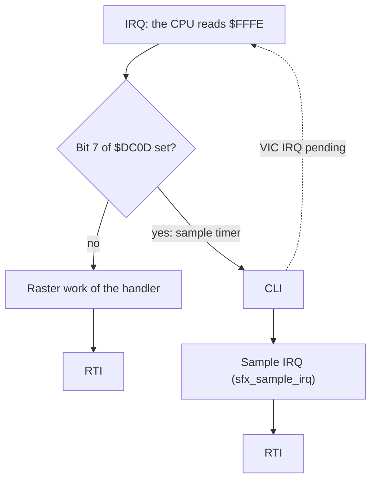
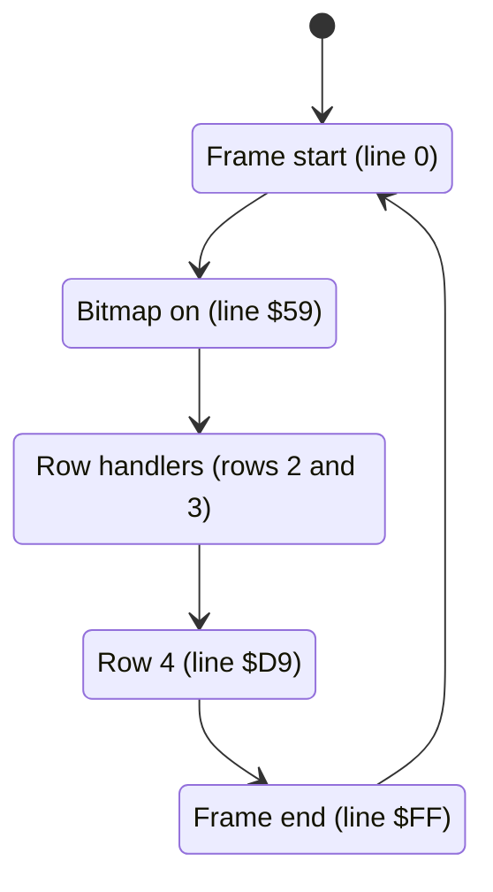

# The interrupts of version II

The interrupts draw the screen of a bout. Each frame, a chain of raster IRQs shows the score panel in text mode and the scene in bitmap mode. The same chain moves six sprites down the screen, so that each fighter gets three rows of three sprites and a shadow. A CIA2 NMI makes the floor yellow. The last IRQ of the frame plays the music. Version II adds one more job: a CIA1 timer IRQ plays the digitized sounds of the hits and the attacks. Thus each handler of the chain must first identify the chip that sent the interrupt.

Most of the chain is the same as in version I. This page tells how version II works and what changed. For the parts that stayed the same, see [the interrupts of version I](../../v1/docs/interrupts.md). For the full list of changes, see [the versions](../../docs/versions.md).

**Conventions.**
- Addresses are C64 addresses. Names are the names of the knowledge.
- A *frame* is one PAL screen: 312 raster lines of 63 cycles, 50 frames each second.
- A *line* is a raster line, the value of `$D012`.
- *Group A* is sprites 0-2, the fighter in front (`front_fighter`). *Group B* is sprites 3-5, the other fighter.
- A *row* is one band of three sprites of a group, 21 lines high. Row 1 is the head, rows 2 and 3 are the body and the legs. Row 4 is the shadow on the floor.
- `group_y` is the sprite Y of row 1 of a group. A fighter on the ground has `group_y` = `$A0`.
- The *planner* is the code in the frame-start IRQ that selects a layout and patches the row handlers.
- A *sample IRQ* is the CIA1 timer B interrupt of the sample player.
- **Observed** marks a fact that a run showed. **Code** marks a fact from the code only. **Conclusion** marks an interpretation.

## How it works

The raster chain starts at line 0 with [`irq_frame_start` `$31F2`](../src/sprite_mux_plan.asm#L6). Each handler sets the line and the address of the next handler. Then the CPU reads the next handler from `$FFFE` at the next raster IRQ. The KERNAL ROM is off, so the CPU vectors at `$FFFA-$FFFF` are in RAM. **Code**.

### The new dispatch at the start of each handler

In version II, two chips can send an IRQ: the VIC-II (the raster) and CIA1 (the sample timer). Each of the 15 raster handlers, the frame-start IRQ included, thus starts with the same four instructions. **Code**.

```
        bit CIAICR          ; $DC0D: read and clear the CIA1 flags
        bpl <handler>_vic   ; bit 7 clear: no CIA1 IRQ, thus a raster IRQ
        cli                 ; CIA1 IRQ: let the raster IRQ in
        jmp sfx_sample_irq  ; play the next half-wave of the sample
```



The BIT instruction reads `$DC0D`, and the read also clears the CIA1 flags. When the BIT finds bit 7 at 1, the handler does CLI and jumps to [`sfx_sample_irq` `$311A`](../src/sfx_sample_player.asm#L6). The sample IRQ itself does not touch `$DC0D` or the I flag. **Code**.

In version I, the four instructions were `BIT $D019 / BMI / JMP`, and the JMP never ran. In version II, the CIA1 path is live. The coverage marks the CLI and the JMP of each handler as executed. **Observed** (coverage).

The CLI gives the raster a higher priority than the sample. Suppose that the VIC-II and CIA1 both request an IRQ. The CIA1 request now has no flag, but the VIC-II request stays. After the CLI, the CPU starts the same handler again at once. This time bit 7 is clear, and the handler does its raster work. Then its RTI goes back into the sample IRQ. **Code** / **Conclusion**.

The raster path costs the same time as in version I. `BIT` and a taken branch take 7 cycles in both versions. The delay comes from the samples: a sample IRQ that starts just before a raster IRQ moves the raster work a few cycles later. **Code** / **Conclusion**.

### The sample IRQ

The sample player makes a 1-bit square wave on the SID volume. Each sample byte is one half-wave. [`sfx_sample_irq` `$311A`](../src/sfx_sample_player.asm#L6) does these steps:

1. It toggles `sfx_volume` between 0 and 15 with `EOR #$0F` and writes it to `$D418`. The filter bits are 0.
2. It reads the next sample byte at `sfx_sample_ptr`.
3. It loads CIA1 timer B with the count of that byte from `sfx_period_hi` (`$0300`) and `sfx_period_lo` (`$0200`). The high byte comes first.
4. It increments `sfx_sample_ptr`.
5. While `sfx_sample_end` is not below the pointer, it starts timer B again with `$DC0F` = `$59`. The player also plays the end byte.
6. At the end of the sample, it sets `sfx_done` = `$FF` and leaves timer B stopped.

**Code**.

Timer A runs all the time with the latch 8, so it underflows every 9 cycles. Timer B counts these underflows and gives the IRQ. A count of 1 gives a half-wave of 9 cycles. **Code**.

A game event starts a sample with one of the entries `sfx_play_sample_0` to `sfx_play_sample_3`. The common part at [`sfx_sample_start` `$3186`](../src/sfx_sample_player.asm#L84) clears all SID registers `$D400-$D41C` and sets `$DC0D` = `$82` (timer B IRQ on). When `samples_off` is not 0, it starts nothing. The DEL key on the title toggles `samples_off`. For the samples, the events and the four sound files, see [the sound and the music](sound_music.md). **Code**.

The sample IRQ runs with the I flag clear, so a raster IRQ can interrupt it. A raster handler runs with the I flag set, so a sample IRQ waits until the RTI of that handler. The planner in `irq_frame_start` runs for a long time with the I flag set. It opens five short windows with `CLI / SEI`, and a waiting sample IRQ can run there. Version I had the same windows, but in version I no CIA1 IRQ used them. **Code**.

`irq_frame_end` calls the music driver with the I flag set. During the driver, each sample IRQ must wait. **Code**. Thus one half-wave in each frame is longer than the data tells. This can make a small distortion of the sample. **Conclusion**.

### The row handlers

The planner selects one of 7 layouts from the gap between the two `group_y` values. Then it writes the lines, the Y values, the sprite pointers and the next vectors into the operands of the row handlers. The layout code starts at [`mux_choose_layout` `$32CD`](../src/sprite_mux_plan.asm#L119). A row handler gets its IRQ on the last line of the row above. It writes the new Y and the three pointers of the next row. **Code**.

| Layout | Condition | Handlers after the bitmap IRQ |
|---|---|---|
| 1 | equal Y | `irq_ab_row2`, `irq_ab_row3` (new waits in version II) |
| 2 | A above B, gap below `$16`, not `$14` | `irq_a_row2`, `irq_b_row2`, `irq_a_row3`, `irq_b_row3` |
| 3 | B above A, gap below `$16`, not `$14` | `irq_b_row2`, `irq_a_row2`, `irq_b_row3`, `irq_a_row3` |
| 4 | A above B, gap `$14` | `irq_a_row2`, `irq_b2_a3`, `irq_b_row3` |
| 5 | B above A, gap `$14` | `irq_b_row2`, `irq_a2_b3`, `irq_a_row3` |
| 6 | A above B, gap `$16` or more | `irq_a_row2`, `irq_a_row3`, `irq_b_row2`, `irq_b_row3` |
| 7 | B above A, gap `$16` or more | `irq_b_row2`, `irq_b_row3`, `irq_a_row2`, `irq_a_row3` |

Layouts 2 to 7 are the same as in version I. Only the start of each handler changed. **Code**.

### The changed equal-Y layout

When both fighters have the same Y, one handler sets the row of both groups: 6 Y values and 6 pointers. In version I, the IRQ of [`irq_ab_row2` `$2E4C`](../src/irq_sprite_rows.asm#L148) came at `group_y + $14`. In version II, it comes 2 lines earlier, at `group_y + $12`. Then the handler waits in a loop until `$D012` is `group_y + $14`. **Code**.

```
        lda #<wait line>    ; patched: group_y + $14 (row 2) or group_y + $29 (row 3)
wait    cmp RASTER          ; $D012
        bne wait
```

`irq_ab_row3` does the same: IRQ at `group_y + $27`, wait for `group_y + $29`, row 3 Y `group_y + $2A`. [`mux_layout_same_y` `$3307`](../src/sprite_mux_plan.asm#L156) writes the two wait lines into `irq_ab_row2_wait_line` and `irq_ab_row3_wait_line`. The two handlers also have a new order. They write the Y values, the acknowledge and the next line first. Then two NOPs, the 6 pointers and the vector follow. **Code**.

The wait gives the 12 writes a fixed start line. Without the wait, a sample IRQ before the raster IRQ can move the writes into the sprites of the row. **Conclusion**.

The wait compares for equality. Suppose that the handler starts after its wait line. Then the loop waits until the same line comes in the next frame, about 20000 cycles later. The margin is 2 lines. No run showed this case. **Code** / **Conclusion**.

### The bitmap IRQ and the floor NMI

The frame-start IRQ sets the next IRQ at line `$59`. In version I, it was line `$5A`. [`irq_bitmap_on` `$2FB0`](../src/irq_screen_split.asm#L6) then waits for line `$5A` with `LDA #$5A / CMP $D012 / BNE`. After the wait, it does these steps:

1. It sets the line and the vector of the first row handler.
2. It loads CIA2 timer B with `$16BC` (5820 cycles) and starts it one-shot (`$DD0F` = `$09`).
3. It runs two NOPs as a short delay (version I had four).
4. It sets bitmap mode (`$D011` = `$3B`).
5. It sets the scene background colour from `irq_bitmap_on_bg_colour`.

**Code**.

Version I started the timer after the background write. Version II starts it at a fixed point after the wait. Thus the floor NMI does not change with the IRQ delay. **Code** / **Conclusion**.

The timer gives the NMI [`nmi_floor_colour` `$2FF2`](../src/irq_screen_split.asm#L44) about 92 lines later. The NMI tests bit 7 of `$DD0D` and sets `$D021` = 7 (yellow) for the floor. An NMI from RESTORE only returns. The NMI code is the same as in version I. **Code**. An NMI can interrupt any IRQ handler, also a row handler. **Conclusion**.

### The row-4 handlers and the frame end

At line `$D9`, one of four handlers runs. `row4_irq_vector` selects it. [`irq_a_row4` `$2FFF`](../src/irq_screen_split.asm#L54), `irq_b_row4` and `irq_ab_row4` move the sprites of a fighter in the air to Y `$DA` and show his shadow. `irq_no_row4` runs when both fighters are on the ground, and it shows no shadow. All four set the next IRQ at line `$FF`. **Code**.

At line `$FF`, [`irq_frame_end` `$30E5`](../src/irq_screen_split.asm#L177) sets the next IRQ to `irq_frame_start` at line 0. It sets text mode (`$D011` = `$1B`) and `panel_bg_colour` for the score panel. Then it calls [`music_play_frame` `$09A5`](../src/music_driver.asm#L6) one time. The row-4 handlers and the frame end are the same as in version I, except the first four instructions. **Code**.

## The timeline of a frame

This table gives the order of the interrupts in one frame. `Y` is `group_y`.

| Line | Interrupt | What it does | Change from version I |
|---|---|---|---|
| `$00` | `irq_frame_start` | Next IRQ `$59`. Groups, row-4 handler, layout, row 1 of both fighters. Five CLI/SEI windows. | Dispatch. IRQ line `$59` (was `$5A`). |
| `$59`, waits for `$5A` | `irq_bitmap_on` | First row handler, CIA2 timer B, bitmap mode, scene background. | New wait. Timer before the mode switch. 2 NOPs (was 4). |
| `Y + $14` | row 2 handler (layouts 2-7) | Row 2 Y = `Y + $15`, pointers of parts 3-5. | Dispatch. |
| `Y + $12`, waits for `Y + $14` | `irq_ab_row2` (layout 1) | Row 2 of both groups: 6 Y values, 6 pointers. | IRQ 2 lines earlier, new wait, new order. |
| `Y + $29` | row 3 handler (layouts 2-7) | Row 3 Y = `Y + $2A`, pointers of parts 6-8. | Dispatch. |
| `Y + $27`, waits for `Y + $29` | `irq_ab_row3` (layout 1) | Row 3 of both groups. | IRQ 2 lines earlier, new wait, new order. |
| about 92 lines after `$5A` | `nmi_floor_colour` (NMI) | `$D021` = 7, the yellow floor. | None. |
| `$D9` | row-4 handler or `irq_no_row4` | Shadow sprites at Y `$DA`, or nothing. Next IRQ `$FF`. | Dispatch. |
| `$FF` | `irq_frame_end` | Next IRQ line 0, text mode, panel colour, music. | Dispatch. |
| any line | `sfx_sample_irq` (CIA1 timer B) | Toggles the volume, loads the next count. | Live (dead in version I). |

## The state machine of the chain

Each handler sets the next handler, so the chain is a loop of states. The planner selects the path through the row handlers in each frame.



| State | Condition | Next state | Code that makes the change |
|---|---|---|---|
| Frame start | always | Bitmap on | `irq_frame_start` |
| Bitmap on | always | first row handler of the layout | `irq_bitmap_on`, patched by the layout code |
| Row handler | not the last of the layout | next row handler | the handler, patched by the layout code |
| Row handler | the last of the layout | row-4 handler from `row4_irq_vector` | the handler, patched by the layout code |
| Row 4 | always | Frame end | `irq_a_row4`, `irq_b_row4`, `irq_ab_row4`, `irq_no_row4` |
| Frame end | always | Frame start | `irq_frame_end` |

A sample IRQ is not a state of the chain. It does not change `$FFFE` or `$D012`. **Code**.

## The data

### The vectors

[`init_vectors_cias` `$1943`](../src/init_machine.asm#L62) sets the vectors and the chips. `init_game_state` calls it at the start of the game. **Code**.

| Address | Value | Meaning |
|---|---|---|
| `$FFFA-$FFFB` | `$2FF2` | NMI: `nmi_floor_colour` |
| `$FFFC-$FFFD` | `$1990` | RESET: `reset_vector_rti`, one RTI byte |
| `$FFFE-$FFFF` | `$31F2` at the start | IRQ: the current handler of the chain. 16 places in the code write it. |

The RESET vector points to [`reset_vector_rti` `$1990`](../src/init_machine.asm#L98), one RTI byte, as in version I (there `$14A6`). A real reset switches the KERNAL ROM in, so the CPU never reads this vector. No run executes `$1990`. **Code** / **Observed** (coverage).

### The chip settings

| Chip | Register | Value | Meaning |
|---|---|---|---|
| VIC-II | `$D01A` | `$01` | Raster IRQ only |
| CIA1 | `$DC0D` | `$7F`, then `$82` at a sample start | All IRQs off. Timer B IRQ on while a sample plays. |
| CIA1 | timer A, `$DC0E` | latch 8, `$51` | Underflow every 9 cycles, continuous |
| CIA1 | timer B, `$DC0F` | count from the period table, `$59` | One-shot, counts the timer A underflows |
| CIA2 | `$DD0D` | `$82` | Timer B NMI on |
| CIA2 | timer B, `$DD0F` | `$16BC`, `$09` | One-shot, started by `irq_bitmap_on` |

**Code**.

### The state of the sample IRQ

| Address | Name | Meaning |
|---|---|---|
| `$2D-$2E` | `sfx_sample_ptr` | Address of the next sample byte |
| `$2F` | `sfx_volume` | Last volume value, 0 or 15 |
| `$31-$32` | `sfx_sample_end` | Address of the last sample byte |
| `$33` | `sfx_done` | 0 while a sample plays, `$FF` at the end |
| `$CF` | `samples_off` | Not 0: no new sample starts (DEL on the title) |
| `$0200-$03FF` | `sfx_period_lo`, `sfx_period_hi` | Timer B count for each byte value |

`init_game_state` copies the period tables from `$C700-$C8FF` to `$0200-$03FF`. A sprite buffer later uses `$C700`. **Code**.

## The worked example

Both fighters stand on the ground, so both `group_y` values are `$A0`. The gap is 0, so the planner uses layout 1. Both groups are at Y `$A0`, so `row4_irq_vector` is `irq_no_row4`. These are the lines of one frame, from the patch code of `mux_layout_same_y`. **Code**.

| Line | Handler | Writes |
|---|---|---|
| `$00` | `irq_frame_start` | Next IRQ `$59`. Row 1 Y = `$A0`. |
| `$59`, waits for `$5A` | `irq_bitmap_on` | Next IRQ `$A0 + $12` = `$B2`. CIA2 timer B starts. |
| `$B2`, waits for `$B4` | `irq_ab_row2` | Row 2 Y = `$B5`. Next IRQ `$B2 + $15` = `$C7`. |
| `$C7`, waits for `$C9` | `irq_ab_row3` | Row 3 Y = `$CA`. Next IRQ `$D9`. |
| `$D9` | `irq_no_row4` | Next IRQ `$FF`. |
| `$FF` | `irq_frame_end` | Next IRQ `$00`. Text mode, music. |

The rows of each fighter use lines `$A0-$B4`, `$B5-$C9` and `$CA-$DE`. Each row handler thus waits for the last line of the row above, and it writes the new Y one line before the next row. The CIA2 timer starts near line `$5A`. 5820 cycles are about 92 lines of 63 cycles, so the floor NMI comes near line `$B6`. **Conclusion**.

## Still open

- The margin of the raster waits: is the entry line of `irq_bitmap_on` or of an equal-Y handler ever after its wait line? A run can break at `$2FBC`, `$2E58` and `$2EB3` and read `$D012`, with samples on during hits.
- The line of the floor NMI: read `$D012` at `$2FF8` in version II and at `$28AB` in version I. Does the version II value change less from frame to frame?
- The distortion of the samples while `music_play_frame` runs with the I flag set. A listening test or a log of the timer B IRQs can show it.
