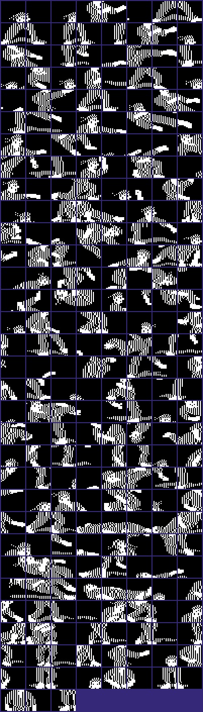
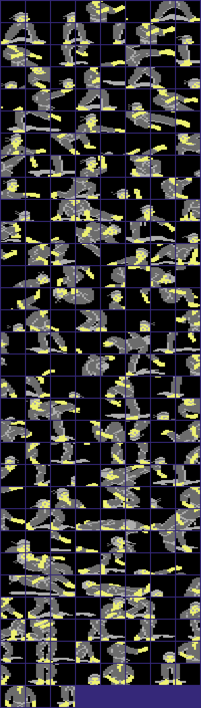
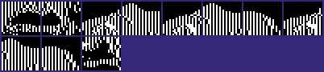
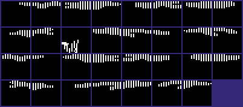
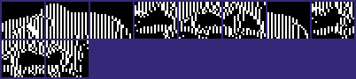
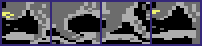
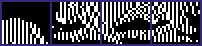
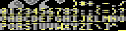
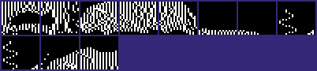

<!-- Generated by c64-docs from knowledge revision 20261025T214835.634-4kntaa and .c64-re-tools/local/generated/src/source-map.json. Do not edit: change the knowledge, generate the source again, then run docs.ts generate. -->
# Graphics

Each sprite, bitmap, charset and screen region of the knowledge. The knowledge gives no display mode and no colours, so a sprite, bitmap or charset shows in hires and in multicolour, in pattern colours: black is pixel value 0, white is 1 in hires; in multicolour light grey is 1, grey is 2 and yellow is 3. Index: [the reference](index.md).

## [`fighter_f02_parts` `$8040`](../../src/graphics/fighter_shapes_8000.asm#L9) `$8040-$BEFF`

*sprite*

Part $01 (1 block), first used by frame 2. Frames that use it: 2 (anim $02,$03), 3 (anim $02,$03), 49 (anim $02,$03), 50 (anim $02,$03). Slots: top left. Poses: walk.

## [`fighter_f56_parts` `$BF40`](../../src/graphics/fighter_shapes_b800_bf40.asm#L6) `$BF40-$BFFF`

*sprite*

Parts $fd-$ff (3 blocks), first used by frame 56. Frames that use them: 56 (anim $19). Slots: top left, middle left, centre. Poses: bow.

## [`bull_f62_parts` `$C940`](../../src/graphics/bull_sprites_c900.asm#L16) `$C940-$CBFF`

*sprite*

Bull parts, VIC pointers $25-$2f. The bull round shows them directly: shape_page_offset is not 0, so $3914 takes the pointers from the part tables ($3b95). These 11 blocks are the v1 bull parts $e0-$ea ($f800-$fabf), byte for byte.
VIC pointers $25-$26: bull frames 62,70,75 (anim $1c,$1e).

## [`figure_f77_parts` `$D000`](../../src/graphics/judge_sprites_d000.asm#L6) `$D000-$D1FF`

*sprite*

VIC pointers $40-$42: frame 77, a small standing figure (slots top left, middle left, bottom left; bottom middle is $4f). No animation script uses frames 77 and 78, so no run shows them. The blocks $d000-$d27f are the v1 blocks $c980-$cbff (v1 pointers $26-$2f) in the same order.

## [`figure_f77_part_b` `$D3C0`](../../src/graphics/judge_sprites_d000_d3c0.asm#L6) `$D3C0-$D3FF`

*sprite*

VIC pointer $4f: bottom middle of frame 77 (v1 $d440, unused in v1). v1 frame 68 had the block $d1c0 in this slot.

## [`judge_sprite_scene23` `$D400`](../../src/graphics/judge_sprites_d000_d3c0.asm#L30) `$D400-$D47F`

*sprite*

Judge sprite for scenes 2 and 3 (sprite 6, pointer $50 from judge_ptr_by_scene $1ffa, colour $0c grey). New in v2: no v1 block matches it.

## [`shadow_facing0` `$D480`](../../src/graphics/shadow_sprites_d480.asm#L6) `$D480-$DC3F`

*sprite*

Floor shadow blocks for facing 0, shown directly as VIC pointers in the 4th sprite row. Tables $3b65/$3b75/$3b85 give the pointers for the 8 air frames at $3b5d (10, 58, 9, 32, 21, 23, 22, 20).
Pointers $52-$5b: shadows of frames 32, 21, 23, 22 and 20 (v1 $d540-$d77f).

## [`bull_f59_parts` `$DC40`](../../src/graphics/bull_sprites_dc40.asm#L6) `$DC40-$DEBF`

*sprite*

Bull parts, VIC pointers $71-$7f. $dc40-$dd3f are the v1 bull parts $fa-$fd; $dd40-$dfff are the v1 bull parts $d5-$df ($f540-$f7ff).
VIC pointers $71-$72: bull frames 59,67 (anim $1c).

## [`bull_f61_parts_b` `$DF00`](../../src/graphics/bull_sprites_dc40_df00.asm#L5) `$DF00-$DFFF`

*sprite*

VIC pointers $7c-$7e: bull frames 61,69,74 (anim $1c,$1e).

## [`bull_f66_parts` `$E000`](../../src/graphics/bull_sprites_e000.asm#L6) `$E000-$E0FF`

*sprite*

Character base of the text rows 0-4 ($d018 = $38). v2 uses only characters $20-$5f, so $e000-$e0ff and $e300-$e5ff hold bull parts. These 4 blocks are the v1 bull parts $f6-$f9 ($fd80-$fe7f).
VIC pointers $80-$83: bull frames 66 (anim $1d).

## [`panel_font` `$E100`](../../src/graphics/panel_charset.asm#L6) `$E100-$E2FF`

*charset*

Characters $20-$5f of the panel (text rows 0-4, colour RAM 6): space, yin-yang, punctuation, digits and upper case letters in ASCII order.
Char $20: space.

## [`bull_f63_parts_b` `$E300`](../../src/graphics/bull_sprites_e300.asm#L6) `$E300-$E5BF`

*sprite*

Bull parts, VIC pointers $8c-$96: the v1 bull parts $eb-$f5 ($fac0-$fd7f).
VIC pointers $8c-$8d: bull frames 63,71,76 (anim $1c,$1f).

