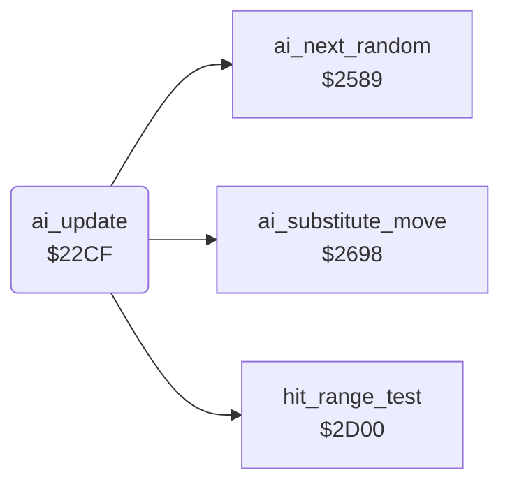

<!-- Generated by c64-docs from knowledge revision 20261025T191824.573-5s4oe2 and .c64-re-tools/local/generated/src/source-map.json. Do not edit: change the knowledge, generate the source again, then run docs.ts generate. -->
# ai/ai_opponent.asm: Computer opponent: decisions, move substitution, random numbers, level set-up and special actions

Range `$22CF-$251D`. Source: [ai/ai_opponent.asm](../../../../src/ai/ai_opponent.asm). Index: [the reference](../../index.md).

## Routines

| Routine | Address | Reached from | Summary |
|---|---|---|---|
| [`ai_update`](ai_opponent.md#ai_update) | `$22CF` | [`fighter_get_input`](../fighter/fighter_input.md#fighter_get_input) | AI of a CPU fighter: sets fighter_input,x and ai_command,x for this frame. |
| [`ai_start_turn`](ai_opponent.md#ai_start_turn) | `$246C` | [`ai_update`](ai_opponent.md#ai_update) | Command $12 = about turn |
| [`ai_attack_store`](ai_opponent.md#ai_attack_store) | `$2512` | [`ai_update`](ai_opponent.md#ai_update) |  |

## Call graph

A solid arrow is a call, a thick arrow a table entry. Rounded nodes are in this file.

## Details

### [`ai_update`](../../../../src/ai/ai_opponent.asm#L6) `$22CF`

*routine*

AI of a CPU fighter: sets fighter_input,x and ai_command,x for this frame. X = fighter, opponent_index = the other fighter. Called by a JMP from fighter_get_input ($2849).

- **Jumped to from:** [`fighter_get_input`](../fighter/fighter_input.md#fighter_get_input)
- **Calls:** [`hit_range_test`](../fighter/hit_test.md#hit_range_test), [`ai_next_random`](ai_opponent_2521.md#ai_next_random), [`ai_substitute_move`](ai_opponent_2521.md#ai_substitute_move)
- **Jumps to:** [`ai_dispatch_special`](ai_opponent_2521.md#ai_dispatch_special)
- **Reads:** [`opponent_index`](../../memory-map.md#opponent_index), [`hit_reaction`](../../memory-map.md#hit_reaction), [`fighter_move`](../../memory-map.md#fighter_move), [`ai_release_timer`](../../memory-map.md#ai_release_timer), [`ai_special_action`](../../memory-map.md#ai_special_action), [`anim_reverse`](../../memory-map.md#anim_reverse), [`move_attack_flags`](../game/entry_and_tables.md#move_attack_flags), [`move_counter_moves`](../game/entry_and_tables.md#move_counter_moves), [`pose_held`](../../memory-map.md#pose_held), [`ai_command`](../../memory-map.md#ai_command), [`ai_react_timer`](../../memory-map.md#ai_react_timer), [`ai_react_mask`](../../memory-map.md#ai_react_mask) and 21 more
- **Writes:** [`ai_release_timer`](../../memory-map.md#ai_release_timer), [`fighter_input`](../../memory-map.md#fighter_input), [`ai_command`](../../memory-map.md#ai_command), [`ai_react_timer`](../../memory-map.md#ai_react_timer), [`ai_special_action`](../../memory-map.md#ai_special_action), [`fighter_move`](../../memory-map.md#fighter_move), [`fighter_facing`](../../memory-map.md#fighter_facing), [`pose_held`](../../memory-map.md#pose_held), [`ai_turning`](../../memory-map.md#ai_turning), [`ai_hold_timer`](../../memory-map.md#ai_hold_timer), [`fighter_distance`](../../memory-map.md#fighter_distance), [`ai_walk_timer`](../../memory-map.md#ai_walk_timer) and 2 more

| Label | Address | Comment |
|---|---|---|
| [`ai_hit_release_now`](../../../../src/ai/ai_opponent.asm#L15) | `$22E0` |  |
| [`ai_hit_return`](../../../../src/ai/ai_opponent.asm#L18) | `$22E4` | fighter_input keeps its last value |
| [`ai_check_special`](../../../../src/ai/ai_opponent.asm#L20) | `$22E5` |  |
| [`ai_check_opponent`](../../../../src/ai/ai_opponent.asm#L24) | `$22EC` |  |
| [`ai_to_movement`](../../../../src/ai/ai_opponent.asm#L28) | `$22F3` |  |
| [`ai_check_opp_attack`](../../../../src/ai/ai_opponent.asm#L30) | `$22F6` |  |
| [`ai_check_block_fits`](../../../../src/ai/ai_opponent.asm#L40) | `$2309` | Block that stops the opponent move |
| [`ai_command_stand`](../../../../src/ai/ai_opponent.asm#L45) | `$2312` | Command 1 = stand: the current move returns |
| [`ai_check_own_move`](../../../../src/ai/ai_opponent.asm#L50) | `$2319` |  |
| [`ai_check_idle_move`](../../../../src/ai/ai_opponent.asm#L55) | `$2322` | Stand, walk back or walk forward: react |
| [`ai_check_low_move`](../../../../src/ai/ai_opponent.asm#L72) | `$2343` | Keep only crouch, low and sweep moves |
| [`ai_keep_command`](../../../../src/ai/ai_opponent.asm#L84) | `$2359` |  |
| [`ai_react_to_attack`](../../../../src/ai/ai_opponent.asm#L88) | `$235E` | Opponent attack in range? Z = 1 out of range |
| [`ai_react_wait`](../../../../src/ai/ai_opponent.asm#L98) | `$2372` |  |
| [`ai_react_count`](../../../../src/ai/ai_opponent.asm#L100) | `$2375` |  |
| [`ai_choose_response`](../../../../src/ai/ai_opponent.asm#L105) | `$237D` |  |
| [`ai_response_random_move`](../../../../src/ai/ai_opponent.asm#L116) | `$238E` | No response bit: a random move, low kick $0b or somersault $09. |
| [`ai_random_somersault`](../../../../src/ai/ai_opponent.asm#L121) | `$2397` |  |
| [`ai_random_move_store`](../../../../src/ai/ai_opponent.asm#L123) | `$2399` |  |
| [`ai_response_special`](../../../../src/ai/ai_opponent.asm#L127) | `$239E` |  |
| [`ai_response_attack`](../../../../src/ai/ai_opponent.asm#L135) | `$23AC` |  |
| [`ai_response_counter`](../../../../src/ai/ai_opponent.asm#L137) | `$23AF` |  |
| [`ai_movement`](../../../../src/ai/ai_opponent.asm#L145) | `$23BD` | Own move runs backwards: keep the command |
| [`ai_turn_check`](../../../../src/ai/ai_opponent.asm#L155) | `$23CF` |  |
| [`ai_hold_pose`](../../../../src/ai/ai_opponent.asm#L169) | `$23E8` |  |
| [`ai_hold_count`](../../../../src/ai/ai_opponent.asm#L177) | `$23F8` |  |
| [`ai_check_standing`](../../../../src/ai/ai_opponent.asm#L186) | `$2407` |  |
| [`ai_repeat_command`](../../../../src/ai/ai_opponent.asm#L194) | `$2415` |  |
| [`ai_check_position`](../../../../src/ai/ai_opponent.asm#L198) | `$241A` |  |
| [`ai_facing_distance`](../../../../src/ai/ai_opponent.asm#L203) | `$2423` |  |
| [`ai_distance_facing_left`](../../../../src/ai/ai_opponent.asm#L210) | `$2430` |  |
| [`ai_store_distance`](../../../../src/ai/ai_opponent.asm#L214) | `$2436` | Distance of the opponent in front, signed |
| [`ai_walk_decision`](../../../../src/ai/ai_opponent.asm#L222) | `$2444` |  |
| [`ai_start_walk`](../../../../src/ai/ai_opponent.asm#L236) | `$245E` |  |
| [`ai_same_facing_distance`](../../../../src/ai/ai_opponent.asm#L251) | `$2477` |  |
| [`ai_same_facing_right`](../../../../src/ai/ai_opponent.asm#L258) | `$2484` |  |
| [`ai_store_same_distance`](../../../../src/ai/ai_opponent.asm#L262) | `$248A` | Negative = opponent in front |
| [`ai_same_facing_turn`](../../../../src/ai/ai_opponent.asm#L270) | `$2498` |  |
| [`ai_attack_timing`](../../../../src/ai/ai_opponent.asm#L272) | `$249B` | Attack delay: bit 7 reload, else count down to the attack |
| [`ai_attack_count`](../../../../src/ai/ai_opponent.asm#L279) | `$24A9` |  |
| [`ai_choose_attack`](../../../../src/ai/ai_opponent.asm#L284) | `$24B1` | Entry also from ai_response_attack, without the delay |
| [`ai_check_opp_block`](../../../../src/ai/ai_opponent.asm#L290) | `$24BD` |  |
| [`ai_reply_low_block`](../../../../src/ai/ai_opponent.asm#L305) | `$24DA` |  |
| [`ai_attack_by_distance`](../../../../src/ai/ai_opponent.asm#L313) | `$24E8` |  |
| [`ai_wait_standing`](../../../../src/ai/ai_opponent.asm#L339) | `$2517` |  |

### [`ai_start_turn`](../../../../src/ai/ai_opponent.asm#L244) `$246C`

*label*

Command $12 = about turn

- **Jumped to from:** [`ai_update`](ai_opponent.md#ai_update)

### [`ai_attack_store`](../../../../src/ai/ai_opponent.asm#L335) `$2512`

*label*

- **Jumped to from:** [`ai_update`](ai_opponent.md#ai_update)
