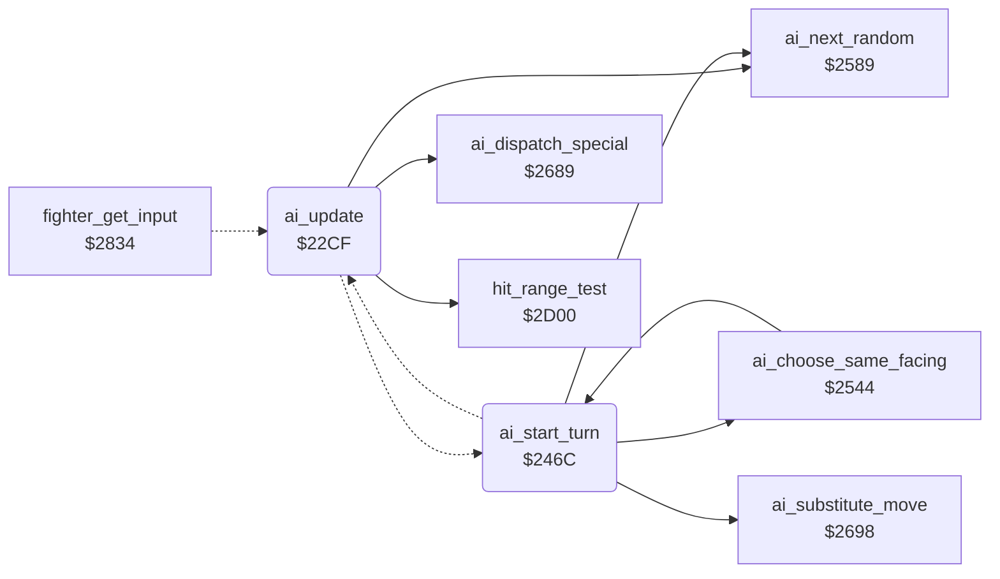

<!-- Generated by c64-docs from knowledge revision 20261022T104543.905-o1bqdy and .c64-re-tools/local/generated/src/source-map.json. Do not edit: change the knowledge, generate the source again, then run docs.ts generate. -->
# ai/ai_opponent.asm: Computer opponent: decisions, move substitution, random numbers, level set-up and special actions

Range `$22CF-$251D`. Source: [ai/ai_opponent.asm](../../../../src/ai/ai_opponent.asm). Index: [the reference](../../index.md).

## Call graph

A solid arrow is a call, a thick arrow a table entry, a dotted arrow a jump. Rounded nodes are in this file.

## Names

### [`ai_update`](../../../../src/ai/ai_opponent.asm#L6) `$22CF`

*routine*

AI of a CPU fighter: sets fighter_input,x and ai_command,x for this frame. X = fighter, opponent_index = the other fighter. Called by a JMP from fighter_get_input ($2849).

- **Jumped to from:** [`fighter_get_input`](../fighter/fighter_input.md#fighter_get_input) [`$2849`](../../../../src/fighter/fighter_input.asm#L44)
- **Calls:** [`ai_dispatch_special`](ai_opponent_2521.md#ai_dispatch_special), [`hit_range_test`](../fighter/hit_test.md#hit_range_test), [`ai_next_random`](ai_opponent_2521.md#ai_next_random)
- **Jumps to:** [`ai_choose_attack`](ai_opponent.md#ai_choose_attack), [`ai_same_facing_distance`](ai_opponent.md#ai_same_facing_distance), [`ai_attack_timing`](ai_opponent.md#ai_attack_timing), [`ai_start_turn`](ai_opponent.md#ai_start_turn)
- **Reads:** [`opponent_index`](../../memory-map.md#opponent_index), [`ai_react_mask`](../../memory-map.md#ai_react_mask), [`ai_response_mask`](../../memory-map.md#ai_response_mask), [`ai_hold_mask`](../../memory-map.md#ai_hold_mask)
- **Writes:** [`fighter_distance`](../../memory-map.md#fighter_distance)
- **Refers to:** [`move_attack_flags`](../game/entry_and_tables.md#move_attack_flags), [`move_counter_moves`](../game/entry_and_tables.md#move_counter_moves), [`ai_special_by_move`](ai_tables.md#ai_special_by_move)

### [`ai_hit_release_now`](../../../../src/ai/ai_opponent.asm#L15) `$22E0`

*label*

- **Jumped to from:** [`ai_update`](ai_opponent.md#ai_update) [`$22DA`](../../../../src/ai/ai_opponent.asm#L12)

### [`ai_hit_return`](../../../../src/ai/ai_opponent.asm#L18) `$22E4`

*label*

fighter_input keeps its last value

- **Jumped to from:** [`ai_update`](ai_opponent.md#ai_update) [`$22DE`](../../../../src/ai/ai_opponent.asm#L14)

### [`ai_check_special`](../../../../src/ai/ai_opponent.asm#L20) `$22E5`

*label*

- **Jumped to from:** [`ai_update`](ai_opponent.md#ai_update) [`$22D4`](../../../../src/ai/ai_opponent.asm#L9)

### [`ai_check_opponent`](../../../../src/ai/ai_opponent.asm#L24) `$22EC`

*label*

- **Jumped to from:** [`ai_update`](ai_opponent.md#ai_update) [`$22E7`](../../../../src/ai/ai_opponent.asm#L22)

### [`ai_to_movement`](../../../../src/ai/ai_opponent.asm#L28) `$22F3`

*label*

- **Jumped to from:** [`ai_update`](ai_opponent.md#ai_update) [`$22FD`](../../../../src/ai/ai_opponent.asm#L34)

### [`ai_check_opp_attack`](../../../../src/ai/ai_opponent.asm#L30) `$22F6`

*label*

- **Jumped to from:** [`ai_update`](ai_opponent.md#ai_update) [`$22F1`](../../../../src/ai/ai_opponent.asm#L27)

### [`ai_check_block_fits`](../../../../src/ai/ai_opponent.asm#L40) `$2309`

*label*

Block that stops the opponent move

- **Jumped to from:** [`ai_update`](ai_opponent.md#ai_update) [`$2303`](../../../../src/ai/ai_opponent.asm#L37)

### [`ai_command_stand`](../../../../src/ai/ai_opponent.asm#L45) `$2312`

*label*

Command 1 = stand: the current move returns

- **Jumped to from:** [`ai_update`](ai_opponent.md#ai_update) [`$2330`](../../../../src/ai/ai_opponent.asm#L63), [`ai_update`](ai_opponent.md#ai_update) [`$2334`](../../../../src/ai/ai_opponent.asm#L65), [`ai_update`](ai_opponent.md#ai_update) [`$2357`](../../../../src/ai/ai_opponent.asm#L83)

### [`ai_check_own_move`](../../../../src/ai/ai_opponent.asm#L50) `$2319`

*label*

- **Jumped to from:** [`ai_update`](ai_opponent.md#ai_update) [`$2307`](../../../../src/ai/ai_opponent.asm#L39), [`ai_update`](ai_opponent.md#ai_update) [`$230C`](../../../../src/ai/ai_opponent.asm#L42)

### [`ai_check_idle_move`](../../../../src/ai/ai_opponent.asm#L55) `$2322`

*label*

Stand, walk back or walk forward: react

- **Jumped to from:** [`ai_update`](ai_opponent.md#ai_update) [`$231D`](../../../../src/ai/ai_opponent.asm#L53)

### [`ai_check_low_move`](../../../../src/ai/ai_opponent.asm#L72) `$2343`

*label*

Keep only crouch, low and sweep moves

- **Jumped to from:** [`ai_update`](ai_opponent.md#ai_update) [`$233D`](../../../../src/ai/ai_opponent.asm#L69)

### [`ai_keep_command`](../../../../src/ai/ai_opponent.asm#L84) `$2359`

*label*

- **Jumped to from:** [`ai_update`](ai_opponent.md#ai_update) [`$2310`](../../../../src/ai/ai_opponent.asm#L44), [`ai_update`](ai_opponent.md#ai_update) [`$2341`](../../../../src/ai/ai_opponent.asm#L71), [`ai_update`](ai_opponent.md#ai_update) [`$2347`](../../../../src/ai/ai_opponent.asm#L75), [`ai_update`](ai_opponent.md#ai_update) [`$234B`](../../../../src/ai/ai_opponent.asm#L77), [`ai_update`](ai_opponent.md#ai_update) [`$234F`](../../../../src/ai/ai_opponent.asm#L79), [`ai_update`](ai_opponent.md#ai_update) [`$2353`](../../../../src/ai/ai_opponent.asm#L81)

### [`ai_react_to_attack`](../../../../src/ai/ai_opponent.asm#L88) `$235E`

*label*

Opponent attack in range? Z = 1 out of range

- **Jumped to from:** [`ai_update`](ai_opponent.md#ai_update) [`$2324`](../../../../src/ai/ai_opponent.asm#L57), [`ai_update`](ai_opponent.md#ai_update) [`$2328`](../../../../src/ai/ai_opponent.asm#L59), [`ai_update`](ai_opponent.md#ai_update) [`$232C`](../../../../src/ai/ai_opponent.asm#L61)

### [`ai_react_wait`](../../../../src/ai/ai_opponent.asm#L98) `$2372`

*label*

- **Jumped to from:** [`ai_update`](ai_opponent.md#ai_update) [`$2377`](../../../../src/ai/ai_opponent.asm#L102)

### [`ai_react_count`](../../../../src/ai/ai_opponent.asm#L100) `$2375`

*label*

- **Jumped to from:** [`ai_update`](ai_opponent.md#ai_update) [`$2367`](../../../../src/ai/ai_opponent.asm#L93)

### [`ai_choose_response`](../../../../src/ai/ai_opponent.asm#L105) `$237D`

*label*

- **Jumped to from:** [`ai_update`](ai_opponent.md#ai_update) [`$2365`](../../../../src/ai/ai_opponent.asm#L92), [`ai_update`](ai_opponent.md#ai_update) [`$236E`](../../../../src/ai/ai_opponent.asm#L96)

### [`ai_response_random_move`](../../../../src/ai/ai_opponent.asm#L116) `$238E`

*label*

No response bit: a random move, low kick $0b or somersault $09.

### [`ai_random_somersault`](../../../../src/ai/ai_opponent.asm#L121) `$2397`

*label*

- **Jumped to from:** [`ai_update`](ai_opponent.md#ai_update) [`$2391`](../../../../src/ai/ai_opponent.asm#L118)

### [`ai_random_move_store`](../../../../src/ai/ai_opponent.asm#L123) `$2399`

*label*

- **Jumped to from:** [`ai_update`](ai_opponent.md#ai_update) [`$2395`](../../../../src/ai/ai_opponent.asm#L120)

### [`ai_response_special`](../../../../src/ai/ai_opponent.asm#L127) `$239E`

*label*

- **Jumped to from:** [`ai_update`](ai_opponent.md#ai_update) [`$238C`](../../../../src/ai/ai_opponent.asm#L114)

### [`ai_response_attack`](../../../../src/ai/ai_opponent.asm#L135) `$23AC`

*label*

- **Jumped to from:** [`ai_update`](ai_opponent.md#ai_update) [`$2382`](../../../../src/ai/ai_opponent.asm#L108)

### [`ai_response_counter`](../../../../src/ai/ai_opponent.asm#L137) `$23AF`

*label*

- **Jumped to from:** [`ai_update`](ai_opponent.md#ai_update) [`$2387`](../../../../src/ai/ai_opponent.asm#L111), [`ai_update`](ai_opponent.md#ai_update) [`$23A7`](../../../../src/ai/ai_opponent.asm#L132)

### [`ai_movement`](../../../../src/ai/ai_opponent.asm#L145) `$23BD`

*label*

Own move runs backwards: keep the command

- **Jumped to from:** [`ai_update`](ai_opponent.md#ai_update) [`$22F3`](../../../../src/ai/ai_opponent.asm#L29), [`ai_update`](ai_opponent.md#ai_update) [`$231F`](../../../../src/ai/ai_opponent.asm#L54), [`ai_update`](ai_opponent.md#ai_update) [`$2361`](../../../../src/ai/ai_opponent.asm#L90), [`ai_update`](ai_opponent.md#ai_update) [`$2372`](../../../../src/ai/ai_opponent.asm#L99)

### [`ai_turn_check`](../../../../src/ai/ai_opponent.asm#L155) `$23CF`

*label*

### [`ai_hold_pose`](../../../../src/ai/ai_opponent.asm#L169) `$23E8`

*label*

- **Jumped to from:** [`ai_update`](ai_opponent.md#ai_update) [`$23CD`](../../../../src/ai/ai_opponent.asm#L154)

### [`ai_hold_count`](../../../../src/ai/ai_opponent.asm#L177) `$23F8`

*label*

- **Jumped to from:** [`ai_update`](ai_opponent.md#ai_update) [`$23EA`](../../../../src/ai/ai_opponent.asm#L171)

### [`ai_check_standing`](../../../../src/ai/ai_opponent.asm#L186) `$2407`

*label*

- **Jumped to from:** [`ai_update`](ai_opponent.md#ai_update) [`$23C3`](../../../../src/ai/ai_opponent.asm#L149)

### [`ai_repeat_command`](../../../../src/ai/ai_opponent.asm#L194) `$2415`

*label*

- **Jumped to from:** [`ai_update`](ai_opponent.md#ai_update) [`$23BF`](../../../../src/ai/ai_opponent.asm#L147), [`ai_update`](ai_opponent.md#ai_update) [`$23C9`](../../../../src/ai/ai_opponent.asm#L152), [`ai_update`](ai_opponent.md#ai_update) [`$23D1`](../../../../src/ai/ai_opponent.asm#L157), [`ai_update`](ai_opponent.md#ai_update) [`$23F5`](../../../../src/ai/ai_opponent.asm#L176), [`ai_update`](ai_opponent.md#ai_update) [`$23FA`](../../../../src/ai/ai_opponent.asm#L179), [`ai_update`](ai_opponent.md#ai_update) [`$2446`](../../../../src/ai/ai_opponent.asm#L224)

### [`ai_check_position`](../../../../src/ai/ai_opponent.asm#L198) `$241A`

*label*

- **Jumped to from:** [`ai_update`](ai_opponent.md#ai_update) [`$240B`](../../../../src/ai/ai_opponent.asm#L189), [`ai_update`](ai_opponent.md#ai_update) [`$240F`](../../../../src/ai/ai_opponent.asm#L191), [`ai_update`](ai_opponent.md#ai_update) [`$2413`](../../../../src/ai/ai_opponent.asm#L193)

### [`ai_facing_distance`](../../../../src/ai/ai_opponent.asm#L203) `$2423`

*label*

### [`ai_distance_facing_left`](../../../../src/ai/ai_opponent.asm#L210) `$2430`

*label*

- **Jumped to from:** [`ai_update`](ai_opponent.md#ai_update) [`$2425`](../../../../src/ai/ai_opponent.asm#L205)

### [`ai_store_distance`](../../../../src/ai/ai_opponent.asm#L214) `$2436`

*label*

Distance of the opponent in front, signed

- **Jumped to from:** [`ai_update`](ai_opponent.md#ai_update) [`$242D`](../../../../src/ai/ai_opponent.asm#L209)

### [`ai_walk_decision`](../../../../src/ai/ai_opponent.asm#L222) `$2444`

*label*

- **Jumped to from:** [`ai_start_turn`](ai_opponent.md#ai_start_turn) [`$2496`](../../../../src/ai/ai_opponent.asm#L269)

### [`ai_start_walk`](../../../../src/ai/ai_opponent.asm#L236) `$245E`

*label*

- **Jumped to from:** [`ai_update`](ai_opponent.md#ai_update) [`$244C`](../../../../src/ai/ai_opponent.asm#L227), [`ai_update`](ai_opponent.md#ai_update) [`$2453`](../../../../src/ai/ai_opponent.asm#L230)

### [`ai_start_turn`](../../../../src/ai/ai_opponent.asm#L244) `$246C`

*label*

Command $12 = about turn

- **Called from:** [`ai_choose_same_facing`](ai_opponent_2521.md#ai_choose_same_facing) [`$257F`](../../../../src/ai/ai_opponent_2521.asm#L66)
- **Jumped to from:** [`ai_update`](ai_opponent.md#ai_update) [`$2442`](../../../../src/ai/ai_opponent.asm#L221)
- **Calls:** [`ai_next_random`](ai_opponent_2521.md#ai_next_random), [`ai_choose_same_facing`](ai_opponent_2521.md#ai_choose_same_facing), [`ai_substitute_move`](ai_opponent_2521.md#ai_substitute_move)
- **Jumps to:** [`ai_walk_decision`](ai_opponent.md#ai_walk_decision), [`ai_attack_variant`](ai_opponent_2521.md#ai_attack_variant)
- **Reads:** [`ai_attack_mask`](../../memory-map.md#ai_attack_mask), [`opponent_index`](../../memory-map.md#opponent_index), [`fighter_distance`](../../memory-map.md#fighter_distance), [`ai_spread_mask`](../../memory-map.md#ai_spread_mask), [`ai_table_index`](../../memory-map.md#ai_table_index)
- **Writes:** [`fighter_distance`](../../memory-map.md#fighter_distance), [`ai_table_index`](../../memory-map.md#ai_table_index)
- **Refers to:** [`ai_reply_to_high_block`](ai_tables.md#ai_reply_to_high_block), [`ai_reply_to_low_block`](ai_tables.md#ai_reply_to_low_block), [`ai_attack_facing_table`](ai_tables.md#ai_attack_facing_table)

### [`ai_same_facing_distance`](../../../../src/ai/ai_opponent.asm#L251) `$2477`

*label*

- **Jumped to from:** [`ai_update`](ai_opponent.md#ai_update) [`$2421`](../../../../src/ai/ai_opponent.asm#L202)

### [`ai_same_facing_right`](../../../../src/ai/ai_opponent.asm#L258) `$2484`

*label*

- **Jumped to from:** [`ai_start_turn`](ai_opponent.md#ai_start_turn) [`$2479`](../../../../src/ai/ai_opponent.asm#L253)

### [`ai_store_same_distance`](../../../../src/ai/ai_opponent.asm#L262) `$248A`

*label*

Negative = opponent in front

- **Jumped to from:** [`ai_start_turn`](ai_opponent.md#ai_start_turn) [`$2481`](../../../../src/ai/ai_opponent.asm#L257)

### [`ai_same_facing_turn`](../../../../src/ai/ai_opponent.asm#L270) `$2498`

*label*

### [`ai_attack_timing`](../../../../src/ai/ai_opponent.asm#L272) `$249B`

*label*

Attack delay: bit 7 reload, else count down to the attack

- **Jumped to from:** [`ai_update`](ai_opponent.md#ai_update) [`$243A`](../../../../src/ai/ai_opponent.asm#L217), [`ai_update`](ai_opponent.md#ai_update) [`$243E`](../../../../src/ai/ai_opponent.asm#L219), [`ai_start_turn`](ai_opponent.md#ai_start_turn) [`$248E`](../../../../src/ai/ai_opponent.asm#L265), [`ai_start_turn`](ai_opponent.md#ai_start_turn) [`$2492`](../../../../src/ai/ai_opponent.asm#L267)

### [`ai_attack_count`](../../../../src/ai/ai_opponent.asm#L279) `$24A9`

*label*

- **Jumped to from:** [`ai_start_turn`](ai_opponent.md#ai_start_turn) [`$249D`](../../../../src/ai/ai_opponent.asm#L274)

### [`ai_choose_attack`](../../../../src/ai/ai_opponent.asm#L284) `$24B1`

*label*

Entry also from ai_response_attack, without the delay

- **Jumped to from:** [`ai_update`](ai_opponent.md#ai_update) [`$23AC`](../../../../src/ai/ai_opponent.asm#L136)

### [`ai_check_opp_block`](../../../../src/ai/ai_opponent.asm#L290) `$24BD`

*label*

- **Jumped to from:** [`ai_start_turn`](ai_opponent.md#ai_start_turn) [`$24B8`](../../../../src/ai/ai_opponent.asm#L288)

### [`ai_reply_low_block`](../../../../src/ai/ai_opponent.asm#L305) `$24DA`

*label*

- **Jumped to from:** [`ai_start_turn`](ai_opponent.md#ai_start_turn) [`$24C2`](../../../../src/ai/ai_opponent.asm#L293)

### [`ai_attack_by_distance`](../../../../src/ai/ai_opponent.asm#L313) `$24E8`

*label*

- **Jumped to from:** [`ai_start_turn`](ai_opponent.md#ai_start_turn) [`$24C6`](../../../../src/ai/ai_opponent.asm#L295)

### [`ai_attack_store`](../../../../src/ai/ai_opponent.asm#L335) `$2512`

*label*

- **Jumped to from:** [`ai_start_turn`](ai_opponent.md#ai_start_turn) [`$2525`](../../../../src/ai/ai_opponent_2521.asm#L9), [`ai_start_turn`](ai_opponent.md#ai_start_turn) [`$2529`](../../../../src/ai/ai_opponent_2521.asm#L11)

### [`ai_wait_standing`](../../../../src/ai/ai_opponent.asm#L339) `$2517`

*label*

- **Jumped to from:** [`ai_start_turn`](ai_opponent.md#ai_start_turn) [`$24A6`](../../../../src/ai/ai_opponent.asm#L278), [`ai_start_turn`](ai_opponent.md#ai_start_turn) [`$24AB`](../../../../src/ai/ai_opponent.asm#L281)
