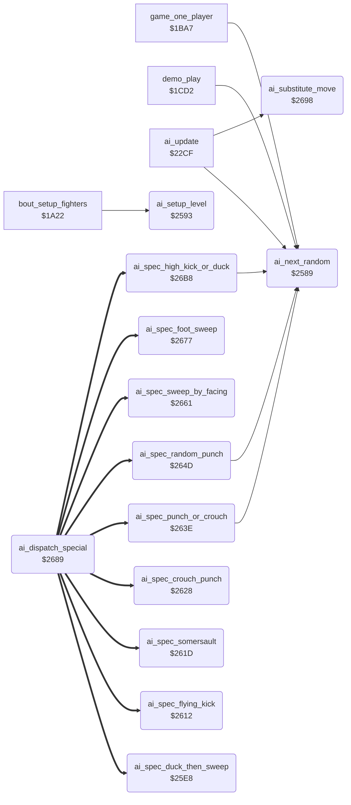

<!-- Generated by c64-docs from knowledge revision 20261025T214835.634-4kntaa and .c64-re-tools/local/generated/src/source-map.json. Do not edit: change the knowledge, generate the source again, then run docs.ts generate. -->
# ai/ai_opponent_2521.asm

Range `$2521-$26D4`. Source: [ai/ai_opponent_2521.asm](../../../../src/ai/ai_opponent_2521.asm). Index: [the reference](../../index.md).

## Routines

| Routine | Address | Reached from | Summary |
|---|---|---|---|
| [`ai_attack_flying_kick`](ai_opponent_2521.md#ai_attack_flying_kick) | `$2521` | [`ai_update`](ai_opponent.md#ai_update) | Levels 7 and up walk forward (command $02) in place of a flying kick. |
| [`ai_attack_foot_sweep`](ai_opponent_2521.md#ai_attack_foot_sweep) | `$252B` | [`ai_update`](ai_opponent.md#ai_update) |  |
| [`ai_start_crouch_punch`](ai_opponent_2521.md#ai_start_crouch_punch) | `$2539` | [`ai_update`](ai_opponent.md#ai_update) | Special action 5: crouch, then move $07 |
| [`ai_choose_same_facing`](ai_opponent_2521.md#ai_choose_same_facing) | `$2544` | [`ai_update`](ai_opponent.md#ai_update) |  |
| [`ai_attack_variant`](ai_opponent_2521.md#ai_attack_variant) | `$2567` | [`ai_update`](ai_opponent.md#ai_update) | Variant of move $0f or $10 (Y): bit 7 turn, $40-$7f walk back, $20-$3f move $08, $00-$1f the move itself. |
| [`ai_next_random`](ai_opponent_2521.md#ai_next_random) | `$2589` | [`game_one_player`](../game/game_modes.md#game_one_player), [`demo_play`](../game/game_modes.md#demo_play), [`ai_update`](ai_opponent.md#ai_update), [`ai_spec_punch_or_crouch`](ai_opponent_2521.md#ai_spec_punch_or_crouch), [`ai_spec_random_punch`](ai_opponent_2521.md#ai_spec_random_punch), [`ai_spec_high_kick_or_duck`](ai_opponent_2521.md#ai_spec_high_kick_or_duck) | Steps the 8-bit random value ai_random (shift left, EOR #$1d on carry) and returns it in A. |
| [`ai_setup_level`](ai_opponent_2521.md#ai_setup_level) | `$2593` | [`bout_setup_fighters`](../game/bout_loop.md#bout_setup_fighters) | Copies the parameters of skill level cpu_skill,x and resets the AI state of both fighters. |
| [`ai_spec_duck_then_sweep`](ai_opponent_2521.md#ai_spec_duck_then_sweep) | `$25E8` | [`ai_dispatch_special`](ai_opponent_2521.md#ai_dispatch_special) | Special action 1, against a flying kick: crouch, then foot sweep. |
| [`ai_spec_flying_kick`](ai_opponent_2521.md#ai_spec_flying_kick) | `$2612` | [`ai_dispatch_special`](ai_opponent_2521.md#ai_dispatch_special) | Special action 3, against a low kick $0b: flying kick $0e. |
| [`ai_spec_somersault`](ai_opponent_2521.md#ai_spec_somersault) | `$261D` | [`ai_dispatch_special`](ai_opponent_2521.md#ai_dispatch_special) | Special action 4, against a foot sweep $0a or a move $0f: move $09. |
| [`ai_spec_crouch_punch`](ai_opponent_2521.md#ai_spec_crouch_punch) | `$2628` | [`ai_dispatch_special`](ai_opponent_2521.md#ai_dispatch_special) | Special action 5: crouch (command 4) until the crouch holds its end pose, then move $07. |
| [`ai_spec_punch_or_crouch`](ai_opponent_2521.md#ai_spec_punch_or_crouch) | `$263E` | [`ai_dispatch_special`](ai_opponent_2521.md#ai_dispatch_special) | Special action 8, against move $06: half the time special action 5, else as special action 6. |
| [`ai_spec_random_punch`](ai_opponent_2521.md#ai_spec_random_punch) | `$264D` | [`ai_dispatch_special`](ai_opponent_2521.md#ai_dispatch_special) | Special action 6, against move $18: move $06 or move $18, half the time each. |
| [`ai_spec_sweep_by_facing`](ai_opponent_2521.md#ai_spec_sweep_by_facing) | `$2661` | [`ai_dispatch_special`](ai_opponent_2521.md#ai_dispatch_special) | Special action 7, against a back sweep: back sweep $10 when the facings differ, else foot sweep $0a. |
| [`ai_spec_foot_sweep`](ai_opponent_2521.md#ai_spec_foot_sweep) | `$2677` | [`ai_dispatch_special`](ai_opponent_2521.md#ai_dispatch_special) | Special action 2, against moves $07, $0c and $11: foot sweep $0a. |
| [`ai_dispatch_special`](ai_opponent_2521.md#ai_dispatch_special) | `$2689` | [`ai_update`](ai_opponent.md#ai_update) | Jumps to special action A (1-9) through ai_special_jump_table. |
| [`ai_substitute_move`](ai_opponent_2521.md#ai_substitute_move) | `$2698` | [`ai_update`](ai_opponent.md#ai_update) | Move substitution of the attack choice. |
| [`ai_spec_high_kick_or_duck`](ai_opponent_2521.md#ai_spec_high_kick_or_duck) | `$26B8` | [`ai_dispatch_special`](ai_opponent_2521.md#ai_dispatch_special) | Special action 9, against a flying kick $0e. |

## Call graph

A solid arrow is a call, a thick arrow a table entry. Rounded nodes are in this file.

## Details

### [`ai_attack_flying_kick`](../../../../src/ai/ai_opponent_2521.asm#L6) `$2521`

*label*

Levels 7 and up walk forward (command $02) in place of a flying kick. Lower levels keep the flying kick $0e.

- **Jumped to from:** [`ai_update`](ai_opponent.md#ai_update)

### [`ai_attack_foot_sweep`](../../../../src/ai/ai_opponent_2521.asm#L12) `$252B`

*label*

- **Jumped to from:** [`ai_update`](ai_opponent.md#ai_update)

### [`ai_start_crouch_punch`](../../../../src/ai/ai_opponent_2521.asm#L22) `$2539`

*label*

Special action 5: crouch, then move $07

- **Jumped to from:** [`ai_update`](ai_opponent.md#ai_update)

### [`ai_choose_same_facing`](../../../../src/ai/ai_opponent_2521.asm#L29) `$2544`

*label*

- **Jumped to from:** [`ai_update`](ai_opponent.md#ai_update)

### [`ai_attack_variant`](../../../../src/ai/ai_opponent_2521.asm#L49) `$2567`

*label*

Variant of move $0f or $10 (Y): bit 7 turn, $40-$7f walk back, $20-$3f move $08, $00-$1f the move itself.

- **Jumped to from:** [`ai_update`](ai_opponent.md#ai_update)

### [`ai_next_random`](../../../../src/ai/ai_opponent_2521.asm#L73) `$2589`

*routine*

Steps the 8-bit random value ai_random (shift left, EOR #$1d on carry) and returns it in A. Carry = the bit that went out. Used by the AI, the demo set-up ($1cda, $1ce3) and the rank wrap ($1c65).

- **Called from:** [`game_one_player`](../game/game_modes.md#game_one_player), [`demo_play`](../game/game_modes.md#demo_play), [`ai_update`](ai_opponent.md#ai_update), [`ai_spec_punch_or_crouch`](ai_opponent_2521.md#ai_spec_punch_or_crouch), [`ai_spec_random_punch`](ai_opponent_2521.md#ai_spec_random_punch), [`ai_spec_high_kick_or_duck`](ai_opponent_2521.md#ai_spec_high_kick_or_duck)
- **Reads:** [`ai_random`](../../memory-map.md#ai_random)
- **Writes:** [`ai_random`](../../memory-map.md#ai_random)

| Label | Address | Comment |
|---|---|---|
| [`ai_random_store`](../../../../src/ai/ai_opponent_2521.asm#L78) | `$2590` |  |

### [`ai_setup_level`](../../../../src/ai/ai_opponent_2521.asm#L82) `$2593`

*routine*

Copies the parameters of skill level cpu_skill,x and resets the AI state of both fighters. bout_setup_fighters calls it for fighter 0, then fighter 1 ($1a66, $1a6b). Bug: ai_hold_mask, ai_spread_mask, ai_attack_mask, ai_response_mask, ai_variant_mask, ai_react_mask and ai_release_timer are written without X. The level of fighter 1 sets them for both fighters.

- **Called from:** [`bout_setup_fighters`](../game/bout_loop.md#bout_setup_fighters)
- **Reads:** [`cpu_skill`](../../memory-map.md#cpu_skill), [`ai_level_hold_mask`](ai_tables.md#ai_level_hold_mask), [`ai_level_spread_mask`](ai_tables.md#ai_level_spread_mask), [`ai_level_variant_mask`](ai_tables.md#ai_level_variant_mask), [`ai_level_attack_mask`](ai_tables.md#ai_level_attack_mask), [`ai_level_response_mask`](ai_tables.md#ai_level_response_mask), [`ai_level_walk_mask`](ai_tables.md#ai_level_walk_mask), [`ai_level_stop_mask`](ai_tables.md#ai_level_stop_mask), [`ai_level_react_mask`](ai_tables.md#ai_level_react_mask)
- **Writes:** [`ai_hold_mask`](../../memory-map.md#ai_hold_mask), [`ai_release_timer`](../../memory-map.md#ai_release_timer), [`ai_spread_mask`](../../memory-map.md#ai_spread_mask), [`ai_variant_mask`](../../memory-map.md#ai_variant_mask), [`ai_hold_timer`](../../memory-map.md#ai_hold_timer), [`ai_command`](../../memory-map.md#ai_command), [`ai_attack_mask`](../../memory-map.md#ai_attack_mask), [`ai_attack_timer`](../../memory-map.md#ai_attack_timer), [`ai_turning`](../../memory-map.md#ai_turning), [`ai_special_action`](../../memory-map.md#ai_special_action), [`ai_response_mask`](../../memory-map.md#ai_response_mask), [`ai_walk_mask`](../../memory-map.md#ai_walk_mask) and 4 more
- **Refers to:** [`ai_release_timer`](../../memory-map.md#ai_release_timer), [`ai_hold_timer`](../../memory-map.md#ai_hold_timer), [`ai_command`](../../memory-map.md#ai_command), [`ai_attack_timer`](../../memory-map.md#ai_attack_timer), [`ai_turning`](../../memory-map.md#ai_turning), [`ai_special_action`](../../memory-map.md#ai_special_action), [`ai_walk_timer`](../../memory-map.md#ai_walk_timer)

### [`ai_spec_duck_then_sweep`](../../../../src/ai/ai_opponent_2521.asm#L123) `$25E8`

*routine*

Special action 1, against a flying kick: crouch, then foot sweep. Level 7 and up sweeps at frame $19 of the opponent, lower levels when it stands again. Special action 9 also starts it ($26d2).

- **Jumped to from:** [`ai_spec_high_kick_or_duck`](ai_opponent_2521.md#ai_spec_high_kick_or_duck)
- **Entry of:** [`ai_special_jump_table`](../../tables.md#ai_special_jump_table)
- **Reads:** [`opponent_index`](../../memory-map.md#opponent_index), [`cpu_skill`](../../memory-map.md#cpu_skill), [`fighter_frame`](../../memory-map.md#fighter_frame), [`fighter_move`](../../memory-map.md#fighter_move)
- **Writes:** [`fighter_input`](../../memory-map.md#fighter_input), [`ai_command`](../../memory-map.md#ai_command), [`ai_special_action`](../../memory-map.md#ai_special_action)

| Label | Address | Comment |
|---|---|---|
| [`ai_spec_wait_frame`](../../../../src/ai/ai_opponent_2521.asm#L128) | `$25F0` |  |
| [`ai_spec_crouch_wait`](../../../../src/ai/ai_opponent_2521.asm#L132) | `$25F7` |  |
| [`ai_spec_sweep_now`](../../../../src/ai/ai_opponent_2521.asm#L137) | `$25FE` |  |
| [`ai_spec_wait_stand`](../../../../src/ai/ai_opponent_2521.asm#L144) | `$2609` |  |

### [`ai_spec_flying_kick`](../../../../src/ai/ai_opponent_2521.asm#L150) `$2612`

*routine*

Special action 3, against a low kick $0b: flying kick $0e.

- **Entry of:** [`ai_special_jump_table`](../../tables.md#ai_special_jump_table)
- **Writes:** [`fighter_input`](../../memory-map.md#fighter_input), [`ai_command`](../../memory-map.md#ai_command), [`ai_special_action`](../../memory-map.md#ai_special_action)

### [`ai_spec_somersault`](../../../../src/ai/ai_opponent_2521.asm#L158) `$261D`

*routine*

Special action 4, against a foot sweep $0a or a move $0f: move $09.

- **Entry of:** [`ai_special_jump_table`](../../tables.md#ai_special_jump_table)
- **Writes:** [`fighter_input`](../../memory-map.md#fighter_input), [`ai_command`](../../memory-map.md#ai_command), [`ai_special_action`](../../memory-map.md#ai_special_action)

### [`ai_spec_crouch_punch`](../../../../src/ai/ai_opponent_2521.asm#L166) `$2628`

*routine*

Special action 5: crouch (command 4) until the crouch holds its end pose, then move $07.

- **Jumped to from:** [`ai_spec_punch_or_crouch`](ai_opponent_2521.md#ai_spec_punch_or_crouch)
- **Entry of:** [`ai_special_jump_table`](../../tables.md#ai_special_jump_table)
- **Reads:** [`pose_held`](../../memory-map.md#pose_held)
- **Writes:** [`ai_command`](../../memory-map.md#ai_command), [`fighter_input`](../../memory-map.md#fighter_input), [`ai_special_action`](../../memory-map.md#ai_special_action)

| Label | Address | Comment |
|---|---|---|
| [`ai_spec_crouch_first`](../../../../src/ai/ai_opponent_2521.asm#L175) | `$2637` |  |

### [`ai_spec_punch_or_crouch`](../../../../src/ai/ai_opponent_2521.asm#L181) `$263E`

*routine*

Special action 8, against move $06: half the time special action 5, else as special action 6.

- **Entry of:** [`ai_special_jump_table`](../../tables.md#ai_special_jump_table)
- **Calls:** [`ai_next_random`](ai_opponent_2521.md#ai_next_random)
- **Jumps to:** [`ai_spec_random_punch`](ai_opponent_2521.md#ai_spec_random_punch), [`ai_spec_crouch_punch`](ai_opponent_2521.md#ai_spec_crouch_punch)
- **Writes:** [`ai_special_action`](../../memory-map.md#ai_special_action)

| Label | Address | Comment |
|---|---|---|
| [`ai_spec_set_crouch_punch`](../../../../src/ai/ai_opponent_2521.asm#L185) | `$2646` |  |

### [`ai_spec_random_punch`](../../../../src/ai/ai_opponent_2521.asm#L190) `$264D`

*routine*

Special action 6, against move $18: move $06 or move $18, half the time each.

- **Jumped to from:** [`ai_spec_punch_or_crouch`](ai_opponent_2521.md#ai_spec_punch_or_crouch)
- **Entry of:** [`ai_special_jump_table`](../../tables.md#ai_special_jump_table)
- **Calls:** [`ai_next_random`](ai_opponent_2521.md#ai_next_random)
- **Writes:** [`ai_command`](../../memory-map.md#ai_command), [`fighter_input`](../../memory-map.md#fighter_input), [`ai_special_action`](../../memory-map.md#ai_special_action)

| Label | Address | Comment |
|---|---|---|
| [`ai_spec_pick_punch`](../../../../src/ai/ai_opponent_2521.asm#L192) | `$2650` |  |
| [`ai_spec_high_punch`](../../../../src/ai/ai_opponent_2521.asm#L194) | `$2652` |  |
| [`ai_spec_low_punch`](../../../../src/ai/ai_opponent_2521.asm#L197) | `$2656` |  |
| [`ai_spec_store_punch`](../../../../src/ai/ai_opponent_2521.asm#L199) | `$2658` |  |

### [`ai_spec_sweep_by_facing`](../../../../src/ai/ai_opponent_2521.asm#L206) `$2661`

*routine*

Special action 7, against a back sweep: back sweep $10 when the facings differ, else foot sweep $0a. No run executed it. Bug: Y is 14 from the dispatch, not the opponent index, so the compare reads fighter_move of fighter 0.

- **Entry of:** [`ai_special_jump_table`](../../tables.md#ai_special_jump_table)
- **Reads:** [`fighter_facing`](../../memory-map.md#fighter_facing)
- **Writes:** [`ai_command`](../../memory-map.md#ai_command), [`fighter_input`](../../memory-map.md#fighter_input), [`ai_special_action`](../../memory-map.md#ai_special_action)

| Label | Address | Comment |
|---|---|---|
| [`ai_spec_same_facing_sweep`](../../../../src/ai/ai_opponent_2521.asm#L213) | `$266C` |  |
| [`ai_spec_store_sweep`](../../../../src/ai/ai_opponent_2521.asm#L215) | `$266E` |  |

### [`ai_spec_foot_sweep`](../../../../src/ai/ai_opponent_2521.asm#L222) `$2677`

*routine*

Special action 2, against moves $07, $0c and $11: foot sweep $0a. The action ends when the move $0a starts.

- **Entry of:** [`ai_special_jump_table`](../../tables.md#ai_special_jump_table)
- **Reads:** [`fighter_move`](../../memory-map.md#fighter_move)
- **Writes:** [`fighter_input`](../../memory-map.md#fighter_input), [`ai_command`](../../memory-map.md#ai_command), [`ai_special_action`](../../memory-map.md#ai_special_action)

| Label | Address | Comment |
|---|---|---|
| [`ai_spec_sweep_done`](../../../../src/ai/ai_opponent_2521.asm#L230) | `$2684` |  |

### [`ai_dispatch_special`](../../../../src/ai/ai_opponent_2521.asm#L235) `$2689`

*routine*

Jumps to special action A (1-9) through ai_special_jump_table. Y = 2*A, not the opponent index. Reached by the JMP at $22e9.

- **Jumped to from:** [`ai_update`](ai_opponent.md#ai_update)
- **Reads:** [`ai_special_jump_table`](ai_tables.md#ai_special_jump_table), [`ai_special_vector`](../../memory-map.md#ai_special_vector)
- **Writes:** [`ai_special_vector`](../../memory-map.md#ai_special_vector)
- **Refers to:** [`ai_special_jump_table`](ai_tables.md#ai_special_jump_table), [`ai_special_vector`](../../memory-map.md#ai_special_vector)

### [`ai_substitute_move`](../../../../src/ai/ai_opponent_2521.asm#L244) `$2698`

*routine*

Move substitution of the attack choice. A = move from the attack table. When the opponent is in move $04, $07, $0a or $10, it returns ai_move_substitute[A], else A. Called at $24ff and $2557; it changes Y and ai_move_temp.

- **Called from:** [`ai_update`](ai_opponent.md#ai_update)
- **Reads:** [`opponent_index`](../../memory-map.md#opponent_index), [`fighter_move`](../../memory-map.md#fighter_move), [`ai_move_temp`](../../memory-map.md#ai_move_temp), [`ai_move_substitute`](../game/entry_and_tables_1299.md#ai_move_substitute)
- **Writes:** [`ai_move_temp`](../../memory-map.md#ai_move_temp)

| Label | Address | Comment |
|---|---|---|
| [`ai_substitute_lookup`](../../../../src/ai/ai_opponent_2521.asm#L258) | `$26B2` |  |

### [`ai_spec_high_kick_or_duck`](../../../../src/ai/ai_opponent_2521.asm#L263) `$26B8`

*routine*

Special action 9, against a flying kick $0e. Levels 7 and up give a high kick $0d half the time. Else the action becomes special action 1: crouch, then foot sweep.

- **Entry of:** [`ai_special_jump_table`](../../tables.md#ai_special_jump_table)
- **Calls:** [`ai_next_random`](ai_opponent_2521.md#ai_next_random)
- **Jumps to:** [`ai_spec_duck_then_sweep`](ai_opponent_2521.md#ai_spec_duck_then_sweep)
- **Reads:** [`cpu_skill`](../../memory-map.md#cpu_skill)
- **Writes:** [`ai_special_action`](../../memory-map.md#ai_special_action), [`ai_command`](../../memory-map.md#ai_command), [`fighter_input`](../../memory-map.md#fighter_input)

| Label | Address | Comment |
|---|---|---|
| [`ai_spec_set_duck_sweep`](../../../../src/ai/ai_opponent_2521.asm#L275) | `$26CE` |  |

## Labels

| Label | Address | Comment |
|---|---|---|
| [`ai_command_foot_sweep`](../../../../src/ai/ai_opponent_2521.asm#L17) | `$2532` |  |
| [`ai_variant_back_roll`](../../../../src/ai/ai_opponent_2521.asm#L58) | `$2577` |  |
| [`ai_variant_store`](../../../../src/ai/ai_opponent_2521.asm#L60) | `$2579` |  |
| [`ai_variant_turn`](../../../../src/ai/ai_opponent_2521.asm#L65) | `$257F` |  |
| [`ai_variant_walk_back`](../../../../src/ai/ai_opponent_2521.asm#L67) | `$2582` |  |
