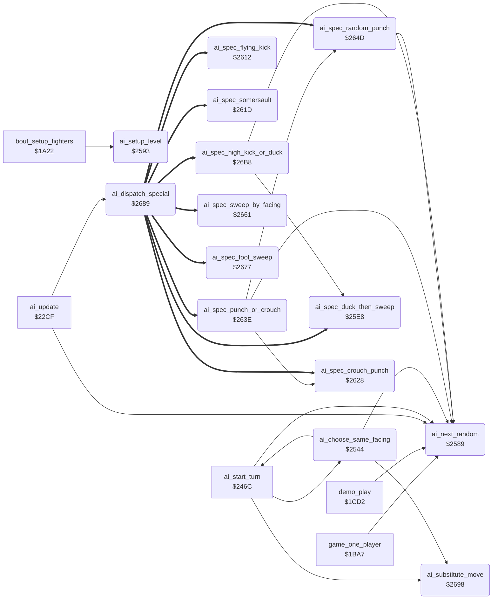

<!-- Generated by c64-docs from knowledge revision 20261022T104543.905-o1bqdy and .c64-re-tools/local/generated/src/source-map.json. Do not edit: change the knowledge, generate the source again, then run docs.ts generate. -->
# ai/ai_opponent_2521.asm

Range `$2521-$26D4`. Source: [ai/ai_opponent_2521.asm](../../../../src/ai/ai_opponent_2521.asm). Index: [the reference](../../index.md).

## Call graph

A solid arrow is a call, a thick arrow a table entry, a dotted arrow a jump. Rounded nodes are in this file.

## Names

### [`ai_attack_flying_kick`](../../../../src/ai/ai_opponent_2521.asm#L6) `$2521`

*label*

Levels 7 and up walk forward (command $02) in place of a flying kick. Lower levels keep the flying kick $0e.

- **Jumped to from:** [`ai_start_turn`](ai_opponent.md#ai_start_turn) [`$24FD`](../../../../src/ai/ai_opponent.asm#L325)

### [`ai_attack_foot_sweep`](../../../../src/ai/ai_opponent_2521.asm#L12) `$252B`

*label*

- **Jumped to from:** [`ai_start_turn`](ai_opponent.md#ai_start_turn) [`$2504`](../../../../src/ai/ai_opponent.asm#L328)

### [`ai_command_foot_sweep`](../../../../src/ai/ai_opponent_2521.asm#L17) `$2532`

*label*

- **Jumped to from:** [`ai_start_turn`](ai_opponent.md#ai_start_turn) [`$252F`](../../../../src/ai/ai_opponent_2521.asm#L15)

### [`ai_start_crouch_punch`](../../../../src/ai/ai_opponent_2521.asm#L22) `$2539`

*label*

Special action 5: crouch, then move $07

- **Jumped to from:** [`ai_start_turn`](ai_opponent.md#ai_start_turn) [`$24D3`](../../../../src/ai/ai_opponent.asm#L301), [`ai_start_turn`](ai_opponent.md#ai_start_turn) [`$2508`](../../../../src/ai/ai_opponent.asm#L330)

### [`ai_choose_same_facing`](../../../../src/ai/ai_opponent_2521.asm#L29) `$2544`

*label*

- **Called from:** [`ai_start_turn`](ai_opponent.md#ai_start_turn) [`$24BA`](../../../../src/ai/ai_opponent.asm#L289)
- **Calls:** [`ai_next_random`](ai_opponent_2521.md#ai_next_random), [`ai_substitute_move`](ai_opponent_2521.md#ai_substitute_move), [`ai_start_turn`](ai_opponent.md#ai_start_turn)
- **Reads:** [`fighter_distance`](../../memory-map.md#fighter_distance), [`ai_spread_mask`](../../memory-map.md#ai_spread_mask), [`ai_table_index`](../../memory-map.md#ai_table_index), [`ai_variant_mask`](../../memory-map.md#ai_variant_mask)
- **Writes:** [`ai_table_index`](../../memory-map.md#ai_table_index)
- **Refers to:** [`ai_attack_same_facing_table`](ai_tables.md#ai_attack_same_facing_table)

### [`ai_attack_variant`](../../../../src/ai/ai_opponent_2521.asm#L49) `$2567`

*label*

Variant of move $0f or $10 (Y): bit 7 turn, $40-$7f walk back, $20-$3f move $08, $00-$1f the move itself.

- **Jumped to from:** [`ai_start_turn`](ai_opponent.md#ai_start_turn) [`$250C`](../../../../src/ai/ai_opponent.asm#L332), [`ai_start_turn`](ai_opponent.md#ai_start_turn) [`$2510`](../../../../src/ai/ai_opponent.asm#L334), [`ai_choose_same_facing`](ai_opponent_2521.md#ai_choose_same_facing) [`$255C`](../../../../src/ai/ai_opponent_2521.asm#L42), [`ai_choose_same_facing`](ai_opponent_2521.md#ai_choose_same_facing) [`$2560`](../../../../src/ai/ai_opponent_2521.asm#L44)

### [`ai_variant_back_roll`](../../../../src/ai/ai_opponent_2521.asm#L58) `$2577`

*label*

### [`ai_variant_store`](../../../../src/ai/ai_opponent_2521.asm#L60) `$2579`

*label*

- **Jumped to from:** [`ai_choose_same_facing`](ai_opponent_2521.md#ai_choose_same_facing) [`$2575`](../../../../src/ai/ai_opponent_2521.asm#L57)

### [`ai_variant_turn`](../../../../src/ai/ai_opponent_2521.asm#L65) `$257F`

*label*

- **Jumped to from:** [`ai_choose_same_facing`](ai_opponent_2521.md#ai_choose_same_facing) [`$256D`](../../../../src/ai/ai_opponent_2521.asm#L53)

### [`ai_variant_walk_back`](../../../../src/ai/ai_opponent_2521.asm#L67) `$2582`

*label*

- **Jumped to from:** [`ai_choose_same_facing`](ai_opponent_2521.md#ai_choose_same_facing) [`$2571`](../../../../src/ai/ai_opponent_2521.asm#L55)

### [`ai_next_random`](../../../../src/ai/ai_opponent_2521.asm#L73) `$2589`

*routine*

Steps the 8-bit random value ai_random (shift left, EOR #$1d on carry) and returns it in A. Carry = the bit that went out. Used by the AI, the demo set-up ($1cda, $1ce3) and the rank wrap ($1c65).

- **Called from:** [`game_one_player`](../game/game_modes.md#game_one_player) [`$1C65`](../../../../src/game/game_modes.asm#L176), [`demo_play`](../game/game_modes.md#demo_play) [`$1CDA`](../../../../src/game/game_modes.asm#L244), [`demo_play`](../game/game_modes.md#demo_play) [`$1CE3`](../../../../src/game/game_modes.asm#L248), [`ai_update`](ai_opponent.md#ai_update) [`$2369`](../../../../src/ai/ai_opponent.asm#L94), [`ai_update`](ai_opponent.md#ai_update) [`$237D`](../../../../src/ai/ai_opponent.asm#L106), [`ai_update`](ai_opponent.md#ai_update) [`$238E`](../../../../src/ai/ai_opponent.asm#L117), [`ai_update`](ai_opponent.md#ai_update) [`$23EC`](../../../../src/ai/ai_opponent.asm#L172), [`ai_update`](ai_opponent.md#ai_update) [`$244E`](../../../../src/ai/ai_opponent.asm#L228), [`ai_update`](ai_opponent.md#ai_update) [`$245E`](../../../../src/ai/ai_opponent.asm#L237), [`ai_start_turn`](ai_opponent.md#ai_start_turn) [`$249F`](../../../../src/ai/ai_opponent.asm#L275), [`ai_start_turn`](ai_opponent.md#ai_start_turn) [`$24C8`](../../../../src/ai/ai_opponent.asm#L296), [`ai_start_turn`](ai_opponent.md#ai_start_turn) [`$24DA`](../../../../src/ai/ai_opponent.asm#L306), [`ai_start_turn`](ai_opponent.md#ai_start_turn) [`$24EF`](../../../../src/ai/ai_opponent.asm#L318), [`ai_choose_same_facing`](ai_opponent_2521.md#ai_choose_same_facing) [`$254B`](../../../../src/ai/ai_opponent_2521.asm#L34), [`ai_choose_same_facing`](ai_opponent_2521.md#ai_choose_same_facing) [`$2568`](../../../../src/ai/ai_opponent_2521.asm#L51), [`ai_spec_punch_or_crouch`](ai_opponent_2521.md#ai_spec_punch_or_crouch) [`$263E`](../../../../src/ai/ai_opponent_2521.asm#L182), [`ai_spec_random_punch`](ai_opponent_2521.md#ai_spec_random_punch) [`$264D`](../../../../src/ai/ai_opponent_2521.asm#L191), [`ai_spec_high_kick_or_duck`](ai_opponent_2521.md#ai_spec_high_kick_or_duck) [`$26BE`](../../../../src/ai/ai_opponent_2521.asm#L267)
- **Reads:** [`ai_random`](../../memory-map.md#ai_random)
- **Writes:** [`ai_random`](../../memory-map.md#ai_random)

### [`ai_random_store`](../../../../src/ai/ai_opponent_2521.asm#L78) `$2590`

*label*

- **Jumped to from:** [`ai_next_random`](ai_opponent_2521.md#ai_next_random) [`$258C`](../../../../src/ai/ai_opponent_2521.asm#L76)

### [`ai_setup_level`](../../../../src/ai/ai_opponent_2521.asm#L82) `$2593`

*routine*

Copies the parameters of skill level cpu_skill,x and resets the AI state of both fighters. bout_setup_fighters calls it for fighter 0, then fighter 1 ($1a66, $1a6b). Bug: ai_hold_mask, ai_spread_mask, ai_attack_mask, ai_response_mask, ai_variant_mask, ai_react_mask and ai_release_timer are written without X. The level of fighter 1 sets them for both fighters.

- **Called from:** [`bout_setup_fighters`](../game/bout_loop.md#bout_setup_fighters) [`$1A66`](../../../../src/game/bout_loop.asm#L40), [`bout_setup_fighters`](../game/bout_loop.md#bout_setup_fighters) [`$1A6B`](../../../../src/game/bout_loop.asm#L42)
- **Writes:** [`ai_hold_mask`](../../memory-map.md#ai_hold_mask), [`ai_release_timer`](../../memory-map.md#ai_release_timer), [`ai_release_timer+1`](../../memory-map.md#ai_release_timer), [`ai_spread_mask`](../../memory-map.md#ai_spread_mask), [`ai_variant_mask`](../../memory-map.md#ai_variant_mask), [`ai_hold_timer`](../../memory-map.md#ai_hold_timer), [`ai_hold_timer+1`](../../memory-map.md#ai_hold_timer), [`ai_command`](../../memory-map.md#ai_command), [`ai_command+1`](../../memory-map.md#ai_command), [`ai_attack_mask`](../../memory-map.md#ai_attack_mask), [`ai_attack_timer`](../../memory-map.md#ai_attack_timer), [`ai_attack_timer+1`](../../memory-map.md#ai_attack_timer), [`ai_turning`](../../memory-map.md#ai_turning), [`ai_turning+1`](../../memory-map.md#ai_turning), [`ai_special_action`](../../memory-map.md#ai_special_action), [`ai_special_action+1`](../../memory-map.md#ai_special_action), [`ai_response_mask`](../../memory-map.md#ai_response_mask), [`ai_walk_timer`](../../memory-map.md#ai_walk_timer), [`ai_walk_timer+1`](../../memory-map.md#ai_walk_timer), [`ai_react_mask`](../../memory-map.md#ai_react_mask)
- **Refers to:** [`ai_level_hold_mask`](ai_tables.md#ai_level_hold_mask), [`ai_release_timer`](../../memory-map.md#ai_release_timer), [`ai_level_spread_mask`](ai_tables.md#ai_level_spread_mask), [`ai_level_variant_mask`](ai_tables.md#ai_level_variant_mask), [`ai_hold_timer`](../../memory-map.md#ai_hold_timer), [`ai_command`](../../memory-map.md#ai_command), [`ai_level_attack_mask`](ai_tables.md#ai_level_attack_mask), [`ai_attack_timer`](../../memory-map.md#ai_attack_timer), [`ai_turning`](../../memory-map.md#ai_turning), [`ai_special_action`](../../memory-map.md#ai_special_action), [`ai_level_response_mask`](ai_tables.md#ai_level_response_mask), [`ai_level_walk_mask`](ai_tables.md#ai_level_walk_mask), [`ai_level_stop_mask`](ai_tables.md#ai_level_stop_mask), [`ai_walk_timer`](../../memory-map.md#ai_walk_timer), [`ai_level_react_mask`](ai_tables.md#ai_level_react_mask)

### [`ai_spec_duck_then_sweep`](../../../../src/ai/ai_opponent_2521.asm#L123) `$25E8`

*routine*

Special action 1, against a flying kick: crouch, then foot sweep. Level 7 and up sweeps at frame $19 of the opponent, lower levels when it stands again. Special action 9 also starts it ($26d2).

- **Called from:** [`ai_spec_high_kick_or_duck`](ai_opponent_2521.md#ai_spec_high_kick_or_duck) [`$26D2`](../../../../src/ai/ai_opponent_2521.asm#L278)
- **Entry of:** [`ai_special_jump_table`](../../tables.md#ai_special_jump_table)
- **Reads:** [`opponent_index`](../../memory-map.md#opponent_index)

### [`ai_spec_wait_frame`](../../../../src/ai/ai_opponent_2521.asm#L128) `$25F0`

*label*

### [`ai_spec_crouch_wait`](../../../../src/ai/ai_opponent_2521.asm#L132) `$25F7`

*label*

- **Jumped to from:** [`ai_spec_duck_then_sweep`](ai_opponent_2521.md#ai_spec_duck_then_sweep) [`$260E`](../../../../src/ai/ai_opponent_2521.asm#L147)

### [`ai_spec_sweep_now`](../../../../src/ai/ai_opponent_2521.asm#L137) `$25FE`

*label*

- **Jumped to from:** [`ai_spec_duck_then_sweep`](ai_opponent_2521.md#ai_spec_duck_then_sweep) [`$25F5`](../../../../src/ai/ai_opponent_2521.asm#L131), [`ai_spec_duck_then_sweep`](ai_opponent_2521.md#ai_spec_duck_then_sweep) [`$2610`](../../../../src/ai/ai_opponent_2521.asm#L148)

### [`ai_spec_wait_stand`](../../../../src/ai/ai_opponent_2521.asm#L144) `$2609`

*label*

- **Jumped to from:** [`ai_spec_duck_then_sweep`](ai_opponent_2521.md#ai_spec_duck_then_sweep) [`$25EE`](../../../../src/ai/ai_opponent_2521.asm#L127)

### [`ai_spec_flying_kick`](../../../../src/ai/ai_opponent_2521.asm#L150) `$2612`

*routine*

Special action 3, against a low kick $0b: flying kick $0e.

- **Entry of:** [`ai_special_jump_table`](../../tables.md#ai_special_jump_table)

### [`ai_spec_somersault`](../../../../src/ai/ai_opponent_2521.asm#L158) `$261D`

*routine*

Special action 4, against a foot sweep $0a or a move $0f: move $09.

- **Entry of:** [`ai_special_jump_table`](../../tables.md#ai_special_jump_table)

### [`ai_spec_crouch_punch`](../../../../src/ai/ai_opponent_2521.asm#L166) `$2628`

*routine*

Special action 5: crouch (command 4) until the crouch holds its end pose, then move $07.

- **Called from:** [`ai_spec_punch_or_crouch`](ai_opponent_2521.md#ai_spec_punch_or_crouch) [`$264A`](../../../../src/ai/ai_opponent_2521.asm#L188)
- **Entry of:** [`ai_special_jump_table`](../../tables.md#ai_special_jump_table)

### [`ai_spec_crouch_first`](../../../../src/ai/ai_opponent_2521.asm#L175) `$2637`

*label*

- **Jumped to from:** [`ai_spec_crouch_punch`](ai_opponent_2521.md#ai_spec_crouch_punch) [`$262A`](../../../../src/ai/ai_opponent_2521.asm#L168)

### [`ai_spec_punch_or_crouch`](../../../../src/ai/ai_opponent_2521.asm#L181) `$263E`

*routine*

Special action 8, against move $06: half the time special action 5, else as special action 6.

- **Entry of:** [`ai_special_jump_table`](../../tables.md#ai_special_jump_table)
- **Calls:** [`ai_next_random`](ai_opponent_2521.md#ai_next_random), [`ai_spec_random_punch`](ai_opponent_2521.md#ai_spec_random_punch), [`ai_spec_crouch_punch`](ai_opponent_2521.md#ai_spec_crouch_punch)
- **Writes:** [`ai_special_action`](../../memory-map.md#ai_special_action)

### [`ai_spec_set_crouch_punch`](../../../../src/ai/ai_opponent_2521.asm#L185) `$2646`

*label*

- **Jumped to from:** [`ai_spec_punch_or_crouch`](ai_opponent_2521.md#ai_spec_punch_or_crouch) [`$2641`](../../../../src/ai/ai_opponent_2521.asm#L183)

### [`ai_spec_random_punch`](../../../../src/ai/ai_opponent_2521.asm#L190) `$264D`

*routine*

Special action 6, against move $18: move $06 or move $18, half the time each.

- **Called from:** [`ai_spec_punch_or_crouch`](ai_opponent_2521.md#ai_spec_punch_or_crouch) [`$2643`](../../../../src/ai/ai_opponent_2521.asm#L184)
- **Entry of:** [`ai_special_jump_table`](../../tables.md#ai_special_jump_table)
- **Calls:** [`ai_next_random`](ai_opponent_2521.md#ai_next_random)

### [`ai_spec_pick_punch`](../../../../src/ai/ai_opponent_2521.asm#L192) `$2650`

*label*

### [`ai_spec_high_punch`](../../../../src/ai/ai_opponent_2521.asm#L194) `$2652`

*label*

### [`ai_spec_low_punch`](../../../../src/ai/ai_opponent_2521.asm#L197) `$2656`

*label*

- **Jumped to from:** [`ai_spec_random_punch`](ai_opponent_2521.md#ai_spec_random_punch) [`$2650`](../../../../src/ai/ai_opponent_2521.asm#L193)

### [`ai_spec_store_punch`](../../../../src/ai/ai_opponent_2521.asm#L199) `$2658`

*label*

- **Jumped to from:** [`ai_spec_random_punch`](ai_opponent_2521.md#ai_spec_random_punch) [`$2654`](../../../../src/ai/ai_opponent_2521.asm#L196)

### [`ai_spec_sweep_by_facing`](../../../../src/ai/ai_opponent_2521.asm#L206) `$2661`

*routine*

Special action 7, against a back sweep: back sweep $10 when the facings differ, else foot sweep $0a. No run executed it. Bug: Y is 14 from the dispatch, not the opponent index, so the compare reads fighter_move of fighter 0.

- **Entry of:** [`ai_special_jump_table`](../../tables.md#ai_special_jump_table)

### [`ai_spec_same_facing_sweep`](../../../../src/ai/ai_opponent_2521.asm#L213) `$266C`

*label*

- **Jumped to from:** [`ai_spec_sweep_by_facing`](ai_opponent_2521.md#ai_spec_sweep_by_facing) [`$2666`](../../../../src/ai/ai_opponent_2521.asm#L210)

### [`ai_spec_store_sweep`](../../../../src/ai/ai_opponent_2521.asm#L215) `$266E`

*label*

- **Jumped to from:** [`ai_spec_sweep_by_facing`](ai_opponent_2521.md#ai_spec_sweep_by_facing) [`$266A`](../../../../src/ai/ai_opponent_2521.asm#L212)

### [`ai_spec_foot_sweep`](../../../../src/ai/ai_opponent_2521.asm#L222) `$2677`

*routine*

Special action 2, against moves $07, $0c and $11: foot sweep $0a. The action ends when the move $0a starts.

- **Entry of:** [`ai_special_jump_table`](../../tables.md#ai_special_jump_table)

### [`ai_spec_sweep_done`](../../../../src/ai/ai_opponent_2521.asm#L230) `$2684`

*label*

- **Jumped to from:** [`ai_spec_foot_sweep`](ai_opponent_2521.md#ai_spec_foot_sweep) [`$267B`](../../../../src/ai/ai_opponent_2521.asm#L225)

### [`ai_dispatch_special`](../../../../src/ai/ai_opponent_2521.asm#L235) `$2689`

*routine*

Jumps to special action A (1-9) through ai_special_jump_table. Y = 2*A, not the opponent index. Reached by the JMP at $22e9.

- **Called from:** [`ai_update`](ai_opponent.md#ai_update) [`$22E9`](../../../../src/ai/ai_opponent.asm#L23)
- **Reads:** [`ai_special_vector`](../../memory-map.md#ai_special_vector)
- **Writes:** [`ai_special_vector`](../../memory-map.md#ai_special_vector), [`ai_special_vector+1`](../../memory-map.md#ai_special_vector)
- **Refers to:** [`ai_special_jump_table`](ai_tables.md#ai_special_jump_table), [`ai_special_jump_table+1`](ai_tables.md#ai_special_jump_table), [`ai_special_vector`](../../memory-map.md#ai_special_vector)

### [`ai_substitute_move`](../../../../src/ai/ai_opponent_2521.asm#L244) `$2698`

*routine*

Move substitution of the attack choice. A = move from the attack table. When the opponent is in move $04, $07, $0a or $10, it returns ai_move_substitute[A], else A. Called at $24ff and $2557; it changes Y and ai_move_temp.

- **Called from:** [`ai_start_turn`](ai_opponent.md#ai_start_turn) [`$24FF`](../../../../src/ai/ai_opponent.asm#L326), [`ai_choose_same_facing`](ai_opponent_2521.md#ai_choose_same_facing) [`$2557`](../../../../src/ai/ai_opponent_2521.asm#L40)
- **Reads:** [`opponent_index`](../../memory-map.md#opponent_index), [`ai_move_temp`](../../memory-map.md#ai_move_temp)
- **Writes:** [`ai_move_temp`](../../memory-map.md#ai_move_temp)
- **Refers to:** [`ai_move_substitute`](../game/entry_and_tables_1299.md#ai_move_substitute)

### [`ai_substitute_lookup`](../../../../src/ai/ai_opponent_2521.asm#L258) `$26B2`

*label*

- **Jumped to from:** [`ai_substitute_move`](ai_opponent_2521.md#ai_substitute_move) [`$26A1`](../../../../src/ai/ai_opponent_2521.asm#L249), [`ai_substitute_move`](ai_opponent_2521.md#ai_substitute_move) [`$26A5`](../../../../src/ai/ai_opponent_2521.asm#L251), [`ai_substitute_move`](ai_opponent_2521.md#ai_substitute_move) [`$26A9`](../../../../src/ai/ai_opponent_2521.asm#L253), [`ai_substitute_move`](ai_opponent_2521.md#ai_substitute_move) [`$26AD`](../../../../src/ai/ai_opponent_2521.asm#L255)

### [`ai_spec_high_kick_or_duck`](../../../../src/ai/ai_opponent_2521.asm#L263) `$26B8`

*routine*

Special action 9, against a flying kick $0e. Levels 7 and up give a high kick $0d half the time. Else the action becomes special action 1: crouch, then foot sweep.

- **Entry of:** [`ai_special_jump_table`](../../tables.md#ai_special_jump_table)
- **Calls:** [`ai_next_random`](ai_opponent_2521.md#ai_next_random), [`ai_spec_duck_then_sweep`](ai_opponent_2521.md#ai_spec_duck_then_sweep)

### [`ai_spec_set_duck_sweep`](../../../../src/ai/ai_opponent_2521.asm#L275) `$26CE`

*label*

- **Jumped to from:** [`ai_spec_high_kick_or_duck`](ai_opponent_2521.md#ai_spec_high_kick_or_duck) [`$26BC`](../../../../src/ai/ai_opponent_2521.asm#L266), [`ai_spec_high_kick_or_duck`](ai_opponent_2521.md#ai_spec_high_kick_or_duck) [`$26C1`](../../../../src/ai/ai_opponent_2521.asm#L268)
