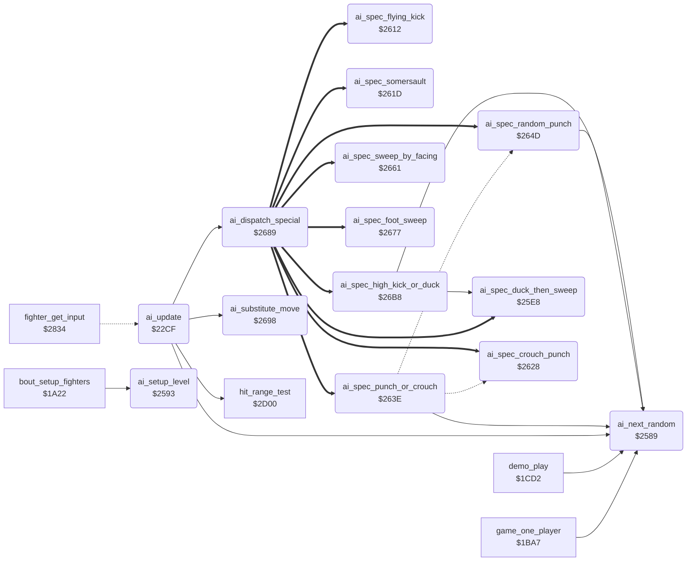

<!-- Generated by c64-docs from knowledge revision 20261021T021734.812-ub0xzr and src/source-map.json. Do not edit: change the knowledge, generate the source again, then run docs.ts generate. -->
# ai_opponent.asm: Computer opponent: decisions, move substitution, random numbers, level set-up and special actions

Range `$22CF-$26D4`. Source: [ai_opponent.asm](../../../src/ai_opponent.asm). Index: [the reference](../index.md).

## Call graph

A solid arrow is a call, a thick arrow a table entry, a dotted arrow a jump. Rounded nodes are in this file.

## Data

| Range | Type | Name | Read by | Written by |
|---|---|---|---|---|
| [`$251E`](../../../src/ai_opponent.asm#L346)-`$2520` | unused | [`ai_dead_repeat_jump`](../../../src/ai_opponent.asm#L345) |  |  |

## Names

### [`ai_update`](../../../src/ai_opponent.asm#L6) `$22CF`

*routine*

AI of a CPU fighter: sets fighter_input,x and ai_command,x for this frame. X = fighter, opponent_index = the other fighter. Called by a JMP from fighter_get_input ($2849).

- **Jumped to from:** [`fighter_get_input`](fighter_input.md#fighter_get_input) [`$2849`](../../../src/fighter_input.asm#L44)
- **Calls:** [`ai_dispatch_special`](ai_opponent.md#ai_dispatch_special), [`hit_range_test`](hit_test.md#hit_range_test), [`ai_next_random`](ai_opponent.md#ai_next_random), [`ai_substitute_move`](ai_opponent.md#ai_substitute_move)
- **Reads:** [`opponent_index`](../memory-map.md#opponent_index), [`ai_react_mask`](../memory-map.md#ai_react_mask), [`ai_response_mask`](../memory-map.md#ai_response_mask), [`ai_hold_mask`](../memory-map.md#ai_hold_mask), [`ai_attack_mask`](../memory-map.md#ai_attack_mask), [`fighter_distance`](../memory-map.md#fighter_distance), [`ai_spread_mask`](../memory-map.md#ai_spread_mask), [`ai_table_index`](../memory-map.md#ai_table_index), [`ai_variant_mask`](../memory-map.md#ai_variant_mask)
- **Writes:** [`fighter_distance`](../memory-map.md#fighter_distance), [`ai_table_index`](../memory-map.md#ai_table_index)
- **Refers to:** [`move_attack_flags`](entry_and_tables.md#move_attack_flags), [`move_counter_moves`](entry_and_tables.md#move_counter_moves), [`ai_special_by_move`](ai_tables.md#ai_special_by_move), [`ai_reply_to_high_block`](ai_tables.md#ai_reply_to_high_block), [`ai_reply_to_low_block`](ai_tables.md#ai_reply_to_low_block), [`ai_attack_facing_table`](ai_tables.md#ai_attack_facing_table), [`ai_attack_same_facing_table`](ai_tables.md#ai_attack_same_facing_table)

### [`ai_hit_release_now`](../../../src/ai_opponent.asm#L15) `$22E0`

*label*

- **Jumped to from:** [`ai_update`](ai_opponent.md#ai_update) [`$22DA`](../../../src/ai_opponent.asm#L12)

### [`ai_hit_return`](../../../src/ai_opponent.asm#L18) `$22E4`

*label*

fighter_input keeps its last value

- **Jumped to from:** [`ai_update`](ai_opponent.md#ai_update) [`$22DE`](../../../src/ai_opponent.asm#L14)

### [`ai_check_special`](../../../src/ai_opponent.asm#L20) `$22E5`

*label*

- **Jumped to from:** [`ai_update`](ai_opponent.md#ai_update) [`$22D4`](../../../src/ai_opponent.asm#L9)

### [`ai_check_opponent`](../../../src/ai_opponent.asm#L24) `$22EC`

*label*

- **Jumped to from:** [`ai_update`](ai_opponent.md#ai_update) [`$22E7`](../../../src/ai_opponent.asm#L22)

### [`ai_to_movement`](../../../src/ai_opponent.asm#L28) `$22F3`

*label*

- **Jumped to from:** [`ai_update`](ai_opponent.md#ai_update) [`$22FD`](../../../src/ai_opponent.asm#L34)

### [`ai_check_opp_attack`](../../../src/ai_opponent.asm#L30) `$22F6`

*label*

- **Jumped to from:** [`ai_update`](ai_opponent.md#ai_update) [`$22F1`](../../../src/ai_opponent.asm#L27)

### [`ai_check_block_fits`](../../../src/ai_opponent.asm#L40) `$2309`

*label*

Block that stops the opponent move

- **Jumped to from:** [`ai_update`](ai_opponent.md#ai_update) [`$2303`](../../../src/ai_opponent.asm#L37)

### [`ai_command_stand`](../../../src/ai_opponent.asm#L45) `$2312`

*label*

Command 1 = stand: the current move returns

- **Jumped to from:** [`ai_update`](ai_opponent.md#ai_update) [`$2330`](../../../src/ai_opponent.asm#L63), [`ai_update`](ai_opponent.md#ai_update) [`$2334`](../../../src/ai_opponent.asm#L65), [`ai_update`](ai_opponent.md#ai_update) [`$2357`](../../../src/ai_opponent.asm#L83)

### [`ai_check_own_move`](../../../src/ai_opponent.asm#L50) `$2319`

*label*

- **Jumped to from:** [`ai_update`](ai_opponent.md#ai_update) [`$2307`](../../../src/ai_opponent.asm#L39), [`ai_update`](ai_opponent.md#ai_update) [`$230C`](../../../src/ai_opponent.asm#L42)

### [`ai_check_idle_move`](../../../src/ai_opponent.asm#L55) `$2322`

*label*

Stand, walk back or walk forward: react

- **Jumped to from:** [`ai_update`](ai_opponent.md#ai_update) [`$231D`](../../../src/ai_opponent.asm#L53)

### [`ai_check_low_move`](../../../src/ai_opponent.asm#L72) `$2343`

*label*

Keep only crouch, low and sweep moves

- **Jumped to from:** [`ai_update`](ai_opponent.md#ai_update) [`$233D`](../../../src/ai_opponent.asm#L69)

### [`ai_keep_command`](../../../src/ai_opponent.asm#L84) `$2359`

*label*

- **Jumped to from:** [`ai_update`](ai_opponent.md#ai_update) [`$2310`](../../../src/ai_opponent.asm#L44), [`ai_update`](ai_opponent.md#ai_update) [`$2341`](../../../src/ai_opponent.asm#L71), [`ai_update`](ai_opponent.md#ai_update) [`$2347`](../../../src/ai_opponent.asm#L75), [`ai_update`](ai_opponent.md#ai_update) [`$234B`](../../../src/ai_opponent.asm#L77), [`ai_update`](ai_opponent.md#ai_update) [`$234F`](../../../src/ai_opponent.asm#L79), [`ai_update`](ai_opponent.md#ai_update) [`$2353`](../../../src/ai_opponent.asm#L81)

### [`ai_react_to_attack`](../../../src/ai_opponent.asm#L88) `$235E`

*label*

Opponent attack in range? Z = 1 out of range

- **Jumped to from:** [`ai_update`](ai_opponent.md#ai_update) [`$2324`](../../../src/ai_opponent.asm#L57), [`ai_update`](ai_opponent.md#ai_update) [`$2328`](../../../src/ai_opponent.asm#L59), [`ai_update`](ai_opponent.md#ai_update) [`$232C`](../../../src/ai_opponent.asm#L61)

### [`ai_react_wait`](../../../src/ai_opponent.asm#L98) `$2372`

*label*

- **Jumped to from:** [`ai_update`](ai_opponent.md#ai_update) [`$2377`](../../../src/ai_opponent.asm#L102)

### [`ai_react_count`](../../../src/ai_opponent.asm#L100) `$2375`

*label*

- **Jumped to from:** [`ai_update`](ai_opponent.md#ai_update) [`$2367`](../../../src/ai_opponent.asm#L93)

### [`ai_choose_response`](../../../src/ai_opponent.asm#L105) `$237D`

*label*

- **Jumped to from:** [`ai_update`](ai_opponent.md#ai_update) [`$2365`](../../../src/ai_opponent.asm#L92), [`ai_update`](ai_opponent.md#ai_update) [`$236E`](../../../src/ai_opponent.asm#L96)

### [`ai_response_random_move`](../../../src/ai_opponent.asm#L116) `$238E`

*label*

No response bit: a random move, low kick $0b or somersault $09.

### [`ai_random_somersault`](../../../src/ai_opponent.asm#L121) `$2397`

*label*

- **Jumped to from:** [`ai_update`](ai_opponent.md#ai_update) [`$2391`](../../../src/ai_opponent.asm#L118)

### [`ai_random_move_store`](../../../src/ai_opponent.asm#L123) `$2399`

*label*

- **Jumped to from:** [`ai_update`](ai_opponent.md#ai_update) [`$2395`](../../../src/ai_opponent.asm#L120)

### [`ai_response_special`](../../../src/ai_opponent.asm#L127) `$239E`

*label*

- **Jumped to from:** [`ai_update`](ai_opponent.md#ai_update) [`$238C`](../../../src/ai_opponent.asm#L114)

### [`ai_response_attack`](../../../src/ai_opponent.asm#L135) `$23AC`

*label*

- **Jumped to from:** [`ai_update`](ai_opponent.md#ai_update) [`$2382`](../../../src/ai_opponent.asm#L108)

### [`ai_response_counter`](../../../src/ai_opponent.asm#L137) `$23AF`

*label*

- **Jumped to from:** [`ai_update`](ai_opponent.md#ai_update) [`$2387`](../../../src/ai_opponent.asm#L111), [`ai_update`](ai_opponent.md#ai_update) [`$23A7`](../../../src/ai_opponent.asm#L132)

### [`ai_movement`](../../../src/ai_opponent.asm#L145) `$23BD`

*label*

Own move runs backwards: keep the command

- **Jumped to from:** [`ai_update`](ai_opponent.md#ai_update) [`$22F3`](../../../src/ai_opponent.asm#L29), [`ai_update`](ai_opponent.md#ai_update) [`$231F`](../../../src/ai_opponent.asm#L54), [`ai_update`](ai_opponent.md#ai_update) [`$2361`](../../../src/ai_opponent.asm#L90), [`ai_update`](ai_opponent.md#ai_update) [`$2372`](../../../src/ai_opponent.asm#L99)

### [`ai_turn_check`](../../../src/ai_opponent.asm#L155) `$23CF`

*label*

### [`ai_hold_pose`](../../../src/ai_opponent.asm#L169) `$23E8`

*label*

- **Jumped to from:** [`ai_update`](ai_opponent.md#ai_update) [`$23CD`](../../../src/ai_opponent.asm#L154)

### [`ai_hold_count`](../../../src/ai_opponent.asm#L177) `$23F8`

*label*

- **Jumped to from:** [`ai_update`](ai_opponent.md#ai_update) [`$23EA`](../../../src/ai_opponent.asm#L171)

### [`ai_check_standing`](../../../src/ai_opponent.asm#L186) `$2407`

*label*

- **Jumped to from:** [`ai_update`](ai_opponent.md#ai_update) [`$23C3`](../../../src/ai_opponent.asm#L149)

### [`ai_repeat_command`](../../../src/ai_opponent.asm#L194) `$2415`

*label*

- **Jumped to from:** [`ai_update`](ai_opponent.md#ai_update) [`$23BF`](../../../src/ai_opponent.asm#L147), [`ai_update`](ai_opponent.md#ai_update) [`$23C9`](../../../src/ai_opponent.asm#L152), [`ai_update`](ai_opponent.md#ai_update) [`$23D1`](../../../src/ai_opponent.asm#L157), [`ai_update`](ai_opponent.md#ai_update) [`$23F5`](../../../src/ai_opponent.asm#L176), [`ai_update`](ai_opponent.md#ai_update) [`$23FA`](../../../src/ai_opponent.asm#L179), [`ai_update`](ai_opponent.md#ai_update) [`$2446`](../../../src/ai_opponent.asm#L224)

### [`ai_check_position`](../../../src/ai_opponent.asm#L198) `$241A`

*label*

- **Jumped to from:** [`ai_update`](ai_opponent.md#ai_update) [`$240B`](../../../src/ai_opponent.asm#L189), [`ai_update`](ai_opponent.md#ai_update) [`$240F`](../../../src/ai_opponent.asm#L191), [`ai_update`](ai_opponent.md#ai_update) [`$2413`](../../../src/ai_opponent.asm#L193)

### [`ai_facing_distance`](../../../src/ai_opponent.asm#L203) `$2423`

*label*

### [`ai_distance_facing_left`](../../../src/ai_opponent.asm#L210) `$2430`

*label*

- **Jumped to from:** [`ai_update`](ai_opponent.md#ai_update) [`$2425`](../../../src/ai_opponent.asm#L205)

### [`ai_store_distance`](../../../src/ai_opponent.asm#L214) `$2436`

*label*

Distance of the opponent in front, signed

- **Jumped to from:** [`ai_update`](ai_opponent.md#ai_update) [`$242D`](../../../src/ai_opponent.asm#L209)

### [`ai_walk_decision`](../../../src/ai_opponent.asm#L222) `$2444`

*label*

- **Jumped to from:** [`ai_update`](ai_opponent.md#ai_update) [`$2496`](../../../src/ai_opponent.asm#L269)

### [`ai_start_walk`](../../../src/ai_opponent.asm#L236) `$245E`

*label*

- **Jumped to from:** [`ai_update`](ai_opponent.md#ai_update) [`$244C`](../../../src/ai_opponent.asm#L227), [`ai_update`](ai_opponent.md#ai_update) [`$2453`](../../../src/ai_opponent.asm#L230)

### [`ai_start_turn`](../../../src/ai_opponent.asm#L244) `$246C`

*label*

Command $12 = about turn

- **Jumped to from:** [`ai_update`](ai_opponent.md#ai_update) [`$2442`](../../../src/ai_opponent.asm#L221), [`ai_update`](ai_opponent.md#ai_update) [`$2498`](../../../src/ai_opponent.asm#L271), [`ai_update`](ai_opponent.md#ai_update) [`$257F`](../../../src/ai_opponent.asm#L408)

### [`ai_same_facing_distance`](../../../src/ai_opponent.asm#L251) `$2477`

*label*

- **Jumped to from:** [`ai_update`](ai_opponent.md#ai_update) [`$2421`](../../../src/ai_opponent.asm#L202)

### [`ai_same_facing_right`](../../../src/ai_opponent.asm#L258) `$2484`

*label*

- **Jumped to from:** [`ai_update`](ai_opponent.md#ai_update) [`$2479`](../../../src/ai_opponent.asm#L253)

### [`ai_store_same_distance`](../../../src/ai_opponent.asm#L262) `$248A`

*label*

Negative = opponent in front

- **Jumped to from:** [`ai_update`](ai_opponent.md#ai_update) [`$2481`](../../../src/ai_opponent.asm#L257)

### [`ai_same_facing_turn`](../../../src/ai_opponent.asm#L270) `$2498`

*label*

### [`ai_attack_timing`](../../../src/ai_opponent.asm#L272) `$249B`

*label*

Attack delay: bit 7 reload, else count down to the attack

- **Jumped to from:** [`ai_update`](ai_opponent.md#ai_update) [`$243A`](../../../src/ai_opponent.asm#L217), [`ai_update`](ai_opponent.md#ai_update) [`$243E`](../../../src/ai_opponent.asm#L219), [`ai_update`](ai_opponent.md#ai_update) [`$248E`](../../../src/ai_opponent.asm#L265), [`ai_update`](ai_opponent.md#ai_update) [`$2492`](../../../src/ai_opponent.asm#L267)

### [`ai_attack_count`](../../../src/ai_opponent.asm#L279) `$24A9`

*label*

- **Jumped to from:** [`ai_update`](ai_opponent.md#ai_update) [`$249D`](../../../src/ai_opponent.asm#L274)

### [`ai_choose_attack`](../../../src/ai_opponent.asm#L284) `$24B1`

*label*

Entry also from ai_response_attack, without the delay

- **Jumped to from:** [`ai_update`](ai_opponent.md#ai_update) [`$23AC`](../../../src/ai_opponent.asm#L136)

### [`ai_check_opp_block`](../../../src/ai_opponent.asm#L290) `$24BD`

*label*

- **Jumped to from:** [`ai_update`](ai_opponent.md#ai_update) [`$24B8`](../../../src/ai_opponent.asm#L288)

### [`ai_reply_low_block`](../../../src/ai_opponent.asm#L305) `$24DA`

*label*

- **Jumped to from:** [`ai_update`](ai_opponent.md#ai_update) [`$24C2`](../../../src/ai_opponent.asm#L293)

### [`ai_attack_by_distance`](../../../src/ai_opponent.asm#L313) `$24E8`

*label*

- **Jumped to from:** [`ai_update`](ai_opponent.md#ai_update) [`$24C6`](../../../src/ai_opponent.asm#L295)

### [`ai_attack_store`](../../../src/ai_opponent.asm#L335) `$2512`

*label*

- **Jumped to from:** [`ai_update`](ai_opponent.md#ai_update) [`$2525`](../../../src/ai_opponent.asm#L351), [`ai_update`](ai_opponent.md#ai_update) [`$2529`](../../../src/ai_opponent.asm#L353)

### [`ai_wait_standing`](../../../src/ai_opponent.asm#L339) `$2517`

*label*

- **Jumped to from:** [`ai_update`](ai_opponent.md#ai_update) [`$24A6`](../../../src/ai_opponent.asm#L278), [`ai_update`](ai_opponent.md#ai_update) [`$24AB`](../../../src/ai_opponent.asm#L281)

### [`ai_dead_repeat_jump`](../../../src/ai_opponent.asm#L345) `$251E-$2520`

*data*

Unused: JMP ai_repeat_command after an RTS. Nothing jumps here. A leftover of an earlier exit of the attack timing, also in version I.

### [`ai_attack_flying_kick`](../../../src/ai_opponent.asm#L348) `$2521`

*label*

Levels 7 and up walk forward (command $02) in place of a flying kick. Lower levels keep the flying kick $0e.

- **Jumped to from:** [`ai_update`](ai_opponent.md#ai_update) [`$24FD`](../../../src/ai_opponent.asm#L325)

### [`ai_attack_foot_sweep`](../../../src/ai_opponent.asm#L354) `$252B`

*label*

- **Jumped to from:** [`ai_update`](ai_opponent.md#ai_update) [`$2504`](../../../src/ai_opponent.asm#L328)

### [`ai_command_foot_sweep`](../../../src/ai_opponent.asm#L359) `$2532`

*label*

- **Jumped to from:** [`ai_update`](ai_opponent.md#ai_update) [`$252F`](../../../src/ai_opponent.asm#L357)

### [`ai_start_crouch_punch`](../../../src/ai_opponent.asm#L364) `$2539`

*label*

Special action 5: crouch, then move $07

- **Jumped to from:** [`ai_update`](ai_opponent.md#ai_update) [`$24D3`](../../../src/ai_opponent.asm#L301), [`ai_update`](ai_opponent.md#ai_update) [`$2508`](../../../src/ai_opponent.asm#L330)

### [`ai_choose_same_facing`](../../../src/ai_opponent.asm#L371) `$2544`

*label*

- **Jumped to from:** [`ai_update`](ai_opponent.md#ai_update) [`$24BA`](../../../src/ai_opponent.asm#L289)

### [`ai_attack_variant`](../../../src/ai_opponent.asm#L391) `$2567`

*label*

Variant of move $0f or $10 (Y): bit 7 turn, $40-$7f walk back, $20-$3f move $08, $00-$1f the move itself.

- **Jumped to from:** [`ai_update`](ai_opponent.md#ai_update) [`$250C`](../../../src/ai_opponent.asm#L332), [`ai_update`](ai_opponent.md#ai_update) [`$2510`](../../../src/ai_opponent.asm#L334), [`ai_update`](ai_opponent.md#ai_update) [`$255C`](../../../src/ai_opponent.asm#L384), [`ai_update`](ai_opponent.md#ai_update) [`$2560`](../../../src/ai_opponent.asm#L386)

### [`ai_variant_back_roll`](../../../src/ai_opponent.asm#L400) `$2577`

*label*

### [`ai_variant_store`](../../../src/ai_opponent.asm#L402) `$2579`

*label*

- **Jumped to from:** [`ai_update`](ai_opponent.md#ai_update) [`$2575`](../../../src/ai_opponent.asm#L399)

### [`ai_variant_turn`](../../../src/ai_opponent.asm#L407) `$257F`

*label*

- **Jumped to from:** [`ai_update`](ai_opponent.md#ai_update) [`$256D`](../../../src/ai_opponent.asm#L395)

### [`ai_variant_walk_back`](../../../src/ai_opponent.asm#L409) `$2582`

*label*

- **Jumped to from:** [`ai_update`](ai_opponent.md#ai_update) [`$2571`](../../../src/ai_opponent.asm#L397)

### [`ai_next_random`](../../../src/ai_opponent.asm#L415) `$2589`

*routine*

Steps the 8-bit random value ai_random (shift left, EOR #$1d on carry) and returns it in A. Carry = the bit that went out. Used by the AI, the demo set-up ($1cda, $1ce3) and the rank wrap ($1c65).

- **Called from:** [`game_one_player`](game_modes.md#game_one_player) [`$1C65`](../../../src/game_modes.asm#L182), [`demo_play`](game_modes.md#demo_play) [`$1CDA`](../../../src/game_modes.asm#L250), [`demo_play`](game_modes.md#demo_play) [`$1CE3`](../../../src/game_modes.asm#L254), [`ai_update`](ai_opponent.md#ai_update) [`$2369`](../../../src/ai_opponent.asm#L94), [`ai_update`](ai_opponent.md#ai_update) [`$237D`](../../../src/ai_opponent.asm#L106), [`ai_update`](ai_opponent.md#ai_update) [`$238E`](../../../src/ai_opponent.asm#L117), [`ai_update`](ai_opponent.md#ai_update) [`$23EC`](../../../src/ai_opponent.asm#L172), [`ai_update`](ai_opponent.md#ai_update) [`$244E`](../../../src/ai_opponent.asm#L228), [`ai_update`](ai_opponent.md#ai_update) [`$245E`](../../../src/ai_opponent.asm#L237), [`ai_update`](ai_opponent.md#ai_update) [`$249F`](../../../src/ai_opponent.asm#L275), [`ai_update`](ai_opponent.md#ai_update) [`$24C8`](../../../src/ai_opponent.asm#L296), [`ai_update`](ai_opponent.md#ai_update) [`$24DA`](../../../src/ai_opponent.asm#L306), [`ai_update`](ai_opponent.md#ai_update) [`$24EF`](../../../src/ai_opponent.asm#L318), [`ai_update`](ai_opponent.md#ai_update) [`$254B`](../../../src/ai_opponent.asm#L376), [`ai_update`](ai_opponent.md#ai_update) [`$2568`](../../../src/ai_opponent.asm#L393), [`ai_spec_punch_or_crouch`](ai_opponent.md#ai_spec_punch_or_crouch) [`$263E`](../../../src/ai_opponent.asm#L524), [`ai_spec_random_punch`](ai_opponent.md#ai_spec_random_punch) [`$264D`](../../../src/ai_opponent.asm#L533), [`ai_spec_high_kick_or_duck`](ai_opponent.md#ai_spec_high_kick_or_duck) [`$26BE`](../../../src/ai_opponent.asm#L609)
- **Reads:** [`ai_random`](../memory-map.md#ai_random)
- **Writes:** [`ai_random`](../memory-map.md#ai_random)

### [`ai_random_store`](../../../src/ai_opponent.asm#L420) `$2590`

*label*

- **Jumped to from:** [`ai_next_random`](ai_opponent.md#ai_next_random) [`$258C`](../../../src/ai_opponent.asm#L418)

### [`ai_setup_level`](../../../src/ai_opponent.asm#L424) `$2593`

*routine*

Copies the parameters of skill level cpu_skill,x and resets the AI state of both fighters. bout_setup_fighters calls it for fighter 0, then fighter 1 ($1a66, $1a6b). Bug: ai_hold_mask, ai_spread_mask, ai_attack_mask, ai_response_mask, ai_variant_mask, ai_react_mask and ai_release_timer are written without X. The level of fighter 1 sets them for both fighters.

- **Called from:** [`bout_setup_fighters`](bout_loop.md#bout_setup_fighters) [`$1A66`](../../../src/bout_loop.asm#L40), [`bout_setup_fighters`](bout_loop.md#bout_setup_fighters) [`$1A6B`](../../../src/bout_loop.asm#L42)
- **Writes:** [`ai_hold_mask`](../memory-map.md#ai_hold_mask), [`ai_release_timer`](../memory-map.md#ai_release_timer), [`ai_release_timer+1`](../memory-map.md#ai_release_timer), [`ai_spread_mask`](../memory-map.md#ai_spread_mask), [`ai_variant_mask`](../memory-map.md#ai_variant_mask), [`ai_hold_timer`](../memory-map.md#ai_hold_timer), [`ai_hold_timer+1`](../memory-map.md#ai_hold_timer), [`ai_command`](../memory-map.md#ai_command), [`ai_command+1`](../memory-map.md#ai_command), [`ai_attack_mask`](../memory-map.md#ai_attack_mask), [`ai_attack_timer`](../memory-map.md#ai_attack_timer), [`ai_attack_timer+1`](../memory-map.md#ai_attack_timer), [`ai_turning`](../memory-map.md#ai_turning), [`ai_turning+1`](../memory-map.md#ai_turning), [`ai_special_action`](../memory-map.md#ai_special_action), [`ai_special_action+1`](../memory-map.md#ai_special_action), [`ai_response_mask`](../memory-map.md#ai_response_mask), [`ai_walk_timer`](../memory-map.md#ai_walk_timer), [`ai_walk_timer+1`](../memory-map.md#ai_walk_timer), [`ai_react_mask`](../memory-map.md#ai_react_mask)
- **Refers to:** [`ai_level_hold_mask`](ai_tables.md#ai_level_hold_mask), [`ai_release_timer`](../memory-map.md#ai_release_timer), [`ai_level_spread_mask`](ai_tables.md#ai_level_spread_mask), [`ai_level_variant_mask`](ai_tables.md#ai_level_variant_mask), [`ai_hold_timer`](../memory-map.md#ai_hold_timer), [`ai_command`](../memory-map.md#ai_command), [`ai_level_attack_mask`](ai_tables.md#ai_level_attack_mask), [`ai_attack_timer`](../memory-map.md#ai_attack_timer), [`ai_turning`](../memory-map.md#ai_turning), [`ai_special_action`](../memory-map.md#ai_special_action), [`ai_level_response_mask`](ai_tables.md#ai_level_response_mask), [`ai_level_walk_mask`](ai_tables.md#ai_level_walk_mask), [`ai_level_stop_mask`](ai_tables.md#ai_level_stop_mask), [`ai_walk_timer`](../memory-map.md#ai_walk_timer), [`ai_level_react_mask`](ai_tables.md#ai_level_react_mask)

### [`ai_spec_duck_then_sweep`](../../../src/ai_opponent.asm#L465) `$25E8`

*routine*

Special action 1, against a flying kick: crouch, then foot sweep. Level 7 and up sweeps at frame $19 of the opponent, lower levels when it stands again. Special action 9 also starts it ($26d2).

- **Called from:** [`ai_spec_high_kick_or_duck`](ai_opponent.md#ai_spec_high_kick_or_duck) [`$26D2`](../../../src/ai_opponent.asm#L620)
- **Entry of:** [`ai_special_jump_table`](../tables.md#ai_special_jump_table)
- **Reads:** [`opponent_index`](../memory-map.md#opponent_index)

### [`ai_spec_wait_frame`](../../../src/ai_opponent.asm#L470) `$25F0`

*label*

### [`ai_spec_crouch_wait`](../../../src/ai_opponent.asm#L474) `$25F7`

*label*

- **Jumped to from:** [`ai_spec_duck_then_sweep`](ai_opponent.md#ai_spec_duck_then_sweep) [`$260E`](../../../src/ai_opponent.asm#L489)

### [`ai_spec_sweep_now`](../../../src/ai_opponent.asm#L479) `$25FE`

*label*

- **Jumped to from:** [`ai_spec_duck_then_sweep`](ai_opponent.md#ai_spec_duck_then_sweep) [`$25F5`](../../../src/ai_opponent.asm#L473), [`ai_spec_duck_then_sweep`](ai_opponent.md#ai_spec_duck_then_sweep) [`$2610`](../../../src/ai_opponent.asm#L490)

### [`ai_spec_wait_stand`](../../../src/ai_opponent.asm#L486) `$2609`

*label*

- **Jumped to from:** [`ai_spec_duck_then_sweep`](ai_opponent.md#ai_spec_duck_then_sweep) [`$25EE`](../../../src/ai_opponent.asm#L469)

### [`ai_spec_flying_kick`](../../../src/ai_opponent.asm#L492) `$2612`

*routine*

Special action 3, against a low kick $0b: flying kick $0e.

- **Entry of:** [`ai_special_jump_table`](../tables.md#ai_special_jump_table)

### [`ai_spec_somersault`](../../../src/ai_opponent.asm#L500) `$261D`

*routine*

Special action 4, against a foot sweep $0a or a move $0f: move $09.

- **Entry of:** [`ai_special_jump_table`](../tables.md#ai_special_jump_table)

### [`ai_spec_crouch_punch`](../../../src/ai_opponent.asm#L508) `$2628`

*routine*

Special action 5: crouch (command 4) until the crouch holds its end pose, then move $07.

- **Jumped to from:** [`ai_spec_punch_or_crouch`](ai_opponent.md#ai_spec_punch_or_crouch) [`$264A`](../../../src/ai_opponent.asm#L530)
- **Entry of:** [`ai_special_jump_table`](../tables.md#ai_special_jump_table)

### [`ai_spec_crouch_first`](../../../src/ai_opponent.asm#L517) `$2637`

*label*

- **Jumped to from:** [`ai_spec_crouch_punch`](ai_opponent.md#ai_spec_crouch_punch) [`$262A`](../../../src/ai_opponent.asm#L510)

### [`ai_spec_punch_or_crouch`](../../../src/ai_opponent.asm#L523) `$263E`

*routine*

Special action 8, against move $06: half the time special action 5, else as special action 6.

- **Entry of:** [`ai_special_jump_table`](../tables.md#ai_special_jump_table)
- **Calls:** [`ai_next_random`](ai_opponent.md#ai_next_random)
- **Jumps to:** [`ai_spec_random_punch`](ai_opponent.md#ai_spec_random_punch), [`ai_spec_crouch_punch`](ai_opponent.md#ai_spec_crouch_punch)
- **Writes:** [`ai_special_action`](../memory-map.md#ai_special_action)

### [`ai_spec_set_crouch_punch`](../../../src/ai_opponent.asm#L527) `$2646`

*label*

- **Jumped to from:** [`ai_spec_punch_or_crouch`](ai_opponent.md#ai_spec_punch_or_crouch) [`$2641`](../../../src/ai_opponent.asm#L525)

### [`ai_spec_random_punch`](../../../src/ai_opponent.asm#L532) `$264D`

*routine*

Special action 6, against move $18: move $06 or move $18, half the time each.

- **Jumped to from:** [`ai_spec_punch_or_crouch`](ai_opponent.md#ai_spec_punch_or_crouch) [`$2643`](../../../src/ai_opponent.asm#L526)
- **Entry of:** [`ai_special_jump_table`](../tables.md#ai_special_jump_table)
- **Calls:** [`ai_next_random`](ai_opponent.md#ai_next_random)

### [`ai_spec_pick_punch`](../../../src/ai_opponent.asm#L534) `$2650`

*label*

### [`ai_spec_high_punch`](../../../src/ai_opponent.asm#L536) `$2652`

*label*

### [`ai_spec_low_punch`](../../../src/ai_opponent.asm#L539) `$2656`

*label*

- **Jumped to from:** [`ai_spec_random_punch`](ai_opponent.md#ai_spec_random_punch) [`$2650`](../../../src/ai_opponent.asm#L535)

### [`ai_spec_store_punch`](../../../src/ai_opponent.asm#L541) `$2658`

*label*

- **Jumped to from:** [`ai_spec_random_punch`](ai_opponent.md#ai_spec_random_punch) [`$2654`](../../../src/ai_opponent.asm#L538)

### [`ai_spec_sweep_by_facing`](../../../src/ai_opponent.asm#L548) `$2661`

*routine*

Special action 7, against a back sweep: back sweep $10 when the facings differ, else foot sweep $0a. No run executed it. Bug: Y is 14 from the dispatch, not the opponent index, so the compare reads fighter_move of fighter 0.

- **Entry of:** [`ai_special_jump_table`](../tables.md#ai_special_jump_table)

### [`ai_spec_same_facing_sweep`](../../../src/ai_opponent.asm#L555) `$266C`

*label*

### [`ai_spec_store_sweep`](../../../src/ai_opponent.asm#L557) `$266E`

*label*

### [`ai_spec_foot_sweep`](../../../src/ai_opponent.asm#L564) `$2677`

*routine*

Special action 2, against moves $07, $0c and $11: foot sweep $0a. The action ends when the move $0a starts.

- **Entry of:** [`ai_special_jump_table`](../tables.md#ai_special_jump_table)

### [`ai_spec_sweep_done`](../../../src/ai_opponent.asm#L572) `$2684`

*label*

- **Jumped to from:** [`ai_spec_foot_sweep`](ai_opponent.md#ai_spec_foot_sweep) [`$267B`](../../../src/ai_opponent.asm#L567)

### [`ai_dispatch_special`](../../../src/ai_opponent.asm#L577) `$2689`

*routine*

Jumps to special action A (1-9) through ai_special_jump_table. Y = 2*A, not the opponent index. Reached by the JMP at $22e9.

- **Called from:** [`ai_update`](ai_opponent.md#ai_update) [`$22E9`](../../../src/ai_opponent.asm#L23)
- **Reads:** [`ai_special_vector`](../memory-map.md#ai_special_vector)
- **Writes:** [`ai_special_vector`](../memory-map.md#ai_special_vector), [`ai_special_vector+1`](../memory-map.md#ai_special_vector)
- **Refers to:** [`ai_special_jump_table`](ai_tables.md#ai_special_jump_table), [`ai_special_jump_table+1`](ai_tables.md#ai_special_jump_table), [`ai_special_vector`](../memory-map.md#ai_special_vector)

### [`ai_substitute_move`](../../../src/ai_opponent.asm#L586) `$2698`

*routine*

Move substitution of the attack choice. A = move from the attack table. When the opponent is in move $04, $07, $0a or $10, it returns ai_move_substitute[A], else A. Called at $24ff and $2557; it changes Y and ai_move_temp.

- **Called from:** [`ai_update`](ai_opponent.md#ai_update) [`$24FF`](../../../src/ai_opponent.asm#L326), [`ai_update`](ai_opponent.md#ai_update) [`$2557`](../../../src/ai_opponent.asm#L382)
- **Reads:** [`opponent_index`](../memory-map.md#opponent_index), [`ai_move_temp`](../memory-map.md#ai_move_temp)
- **Writes:** [`ai_move_temp`](../memory-map.md#ai_move_temp)
- **Refers to:** [`ai_move_substitute`](entry_and_tables.md#ai_move_substitute)

### [`ai_substitute_lookup`](../../../src/ai_opponent.asm#L600) `$26B2`

*label*

- **Jumped to from:** [`ai_substitute_move`](ai_opponent.md#ai_substitute_move) [`$26A1`](../../../src/ai_opponent.asm#L591), [`ai_substitute_move`](ai_opponent.md#ai_substitute_move) [`$26A5`](../../../src/ai_opponent.asm#L593), [`ai_substitute_move`](ai_opponent.md#ai_substitute_move) [`$26A9`](../../../src/ai_opponent.asm#L595), [`ai_substitute_move`](ai_opponent.md#ai_substitute_move) [`$26AD`](../../../src/ai_opponent.asm#L597)

### [`ai_spec_high_kick_or_duck`](../../../src/ai_opponent.asm#L605) `$26B8`

*routine*

Special action 9, against a flying kick $0e. Levels 7 and up give a high kick $0d half the time. Else the action becomes special action 1: crouch, then foot sweep.

- **Entry of:** [`ai_special_jump_table`](../tables.md#ai_special_jump_table)
- **Calls:** [`ai_next_random`](ai_opponent.md#ai_next_random), [`ai_spec_duck_then_sweep`](ai_opponent.md#ai_spec_duck_then_sweep)

### [`ai_spec_set_duck_sweep`](../../../src/ai_opponent.asm#L617) `$26CE`

*label*

- **Jumped to from:** [`ai_spec_high_kick_or_duck`](ai_opponent.md#ai_spec_high_kick_or_duck) [`$26BC`](../../../src/ai_opponent.asm#L608), [`ai_spec_high_kick_or_duck`](ai_opponent.md#ai_spec_high_kick_or_duck) [`$26C1`](../../../src/ai_opponent.asm#L610)
