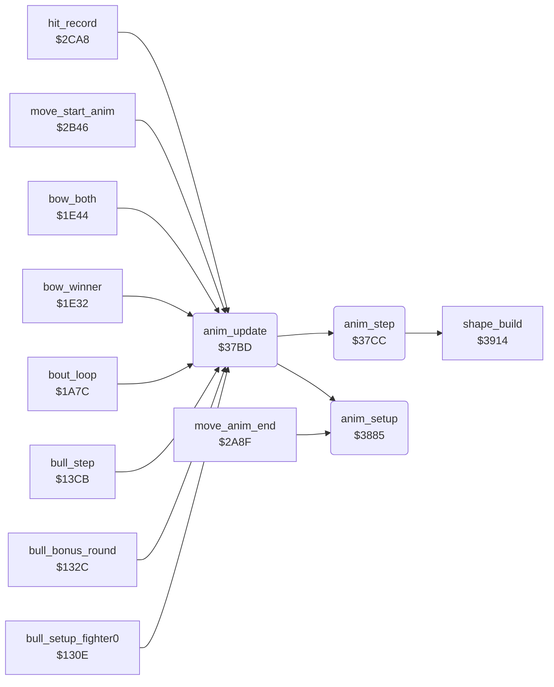

<!-- Generated by c64-docs from knowledge revision 20261021T021734.812-ub0xzr and src/source-map.json. Do not edit: change the knowledge, generate the source again, then run docs.ts generate. -->
# anim_step.asm: Animation stepper: 4-byte script steps (delay, frame, dx, dy), movement and X limits by facing

Range `$37BD-$38AF`. Source: [anim_step.asm](../../../src/anim_step.asm). Index: [the reference](../index.md).

## Call graph

A solid arrow is a call, a thick arrow a table entry, a dotted arrow a jump. Rounded nodes are in this file.

## Data

| Range | Type | Name | Read by | Written by |
|---|---|---|---|---|
| [`$37D7`](../../../src/anim_step.asm#L25) | unused | [`anim_unused_rts`](../../../src/anim_step.asm#L24) |  |  |

## Names

### [`anim_update`](../../../src/anim_step.asm#L6) `$37BD`

*routine*

Plays one frame of the animation of fighter X. Does nothing when anim_number is 0. Calls anim_setup when anim_started is 0, then anim_step. Callers: bull round $1328/$135e/$13d5, bout loop $1a85/$1a8a, bows $1e35/$1e50/$1e55, move start $2b6d, trap $2cb8.

- **Called from:** [`bull_setup_fighter0`](bull_round.md#bull_setup_fighter0) [`$1328`](../../../src/bull_round.asm#L43), [`bull_bonus_round`](bull_round.md#bull_bonus_round) [`$135E`](../../../src/bull_round.asm#L71), [`bull_step`](bull_round.md#bull_step) [`$13D5`](../../../src/bull_round.asm#L137), [`bull_step`](bull_round.md#bull_step) [`$1427`](../../../src/bull_round.asm#L190), [`bout_loop`](bout_loop.md#bout_loop) [`$1A85`](../../../src/bout_loop.asm#L59), [`bout_loop`](bout_loop.md#bout_loop) [`$1A8A`](../../../src/bout_loop.asm#L61), [`bow_winner`](game_modes.md#bow_winner) [`$1E35`](../../../src/game_modes.asm#L435), [`bow_both`](game_modes.md#bow_both) [`$1E50`](../../../src/game_modes.asm#L451), [`bow_both`](game_modes.md#bow_both) [`$1E55`](../../../src/game_modes.asm#L453), [`move_start_anim`](fighter_moves.md#move_start_anim) [`$2B6D`](../../../src/fighter_moves.asm#L289), [`hit_record`](hit_test.md#hit_record) [`$2CB8`](../../../src/hit_test.asm#L200)
- **Calls:** [`anim_setup`](anim_step.md#anim_setup), [`anim_step`](anim_step.md#anim_step)

### [`anim_update_step`](../../../src/anim_step.asm#L12) `$37C8`

*label*

- **Jumped to from:** [`anim_update`](anim_step.md#anim_update) [`$37C3`](../../../src/anim_step.asm#L10)

### [`anim_update_done`](../../../src/anim_step.asm#L14) `$37CB`

*label*

- **Jumped to from:** [`anim_update`](anim_step.md#anim_update) [`$37BF`](../../../src/anim_step.asm#L8)

### [`anim_step`](../../../src/anim_step.asm#L17) `$37CC`

*routine*

Counts down anim_frame_delay of fighter X. At 0 it loads the next 4-byte step (forward, or backward when anim_reverse is 1) and builds the shape. On every frame it adds anim_step_dx/dy to the position. After the last step it clears anim_number and sets anim_finished.

- **Called from:** [`anim_update`](anim_step.md#anim_update) [`$37C8`](../../../src/anim_step.asm#L13)
- **Calls:** [`shape_build`](shape_build.md#shape_build)
- **Reads:** [`anim_script_ptr`](../memory-map.md#anim_script_ptr)
- **Writes:** [`anim_script_ptr`](../memory-map.md#anim_script_ptr), [`anim_script_ptr+1`](../memory-map.md#anim_script_ptr)
- **Refers to:** [`anim_script_table`](anim_scripts.md#anim_script_table), [`anim_script_table+1`](anim_scripts.md#anim_script_table), [`anim_script_ptr`](../memory-map.md#anim_script_ptr), [`fighter_x_min`](entry_and_tables.md#fighter_x_min), [`fighter_x_max`](entry_and_tables.md#fighter_x_max)

### [`anim_unused_rts`](../../../src/anim_step.asm#L24) `$37D7`

*data*

Unused RTS after JMP anim_apply_move: nothing reaches it. The same byte is at v1 $3040.

### [`anim_next_step`](../../../src/anim_step.asm#L26) `$37D8`

*label*

- **Jumped to from:** [`anim_step`](anim_step.md#anim_step) [`$37CE`](../../../src/anim_step.asm#L19)

### [`anim_step_back`](../../../src/anim_step.asm#L40) `$37F1`

*label*

- **Jumped to from:** [`anim_step`](anim_step.md#anim_step) [`$37E2`](../../../src/anim_step.asm#L32)

### [`anim_step_forward`](../../../src/anim_step.asm#L44) `$37F7`

*label*

- **Jumped to from:** [`anim_step`](anim_step.md#anim_step) [`$37DE`](../../../src/anim_step.asm#L30)

### [`anim_load_step`](../../../src/anim_step.asm#L59) `$380F`

*label*

Reads the step at anim_step_offset of script anim_script_table[anim_number]. Byte 0 is the delay in frames, byte 1 the shape frame, bytes 2/3 dx and dy (signed, per frame).

- **Jumped to from:** [`anim_step`](anim_step.md#anim_step) [`$37F4`](../../../src/anim_step.asm#L43), [`anim_step`](anim_step.md#anim_step) [`$37FE`](../../../src/anim_step.asm#L49)

### [`anim_apply_move`](../../../src/anim_step.asm#L82) `$3837`

*label*

Adds anim_step_dy to fighter_y and anim_step_dx to fighter_x on every frame of the step. Facing 1 or reverse play subtracts dx; dy is never negated. Then it clamps fighter_x to the limits of the facing.

- **Jumped to from:** [`anim_step`](anim_step.md#anim_step) [`$37D4`](../../../src/anim_step.asm#L22)

### [`anim_check_x_limits`](../../../src/anim_step.asm#L95) `$384C`

*label*

- **Jumped to from:** [`anim_step`](anim_step.md#anim_step) [`$3882`](../../../src/anim_step.asm#L128)

### [`anim_clamp_x_min`](../../../src/anim_step.asm#L104) `$385D`

*label*

- **Jumped to from:** [`anim_step`](anim_step.md#anim_step) [`$3856`](../../../src/anim_step.asm#L101)

### [`anim_check_x_max`](../../../src/anim_step.asm#L107) `$3862`

*label*

fighter_x_max: $95 facing 0, $89 facing 1

- **Jumped to from:** [`anim_step`](anim_step.md#anim_step) [`$385B`](../../../src/anim_step.asm#L103)

### [`anim_store_x`](../../../src/anim_step.asm#L111) `$386A`

*label*

- **Jumped to from:** [`anim_step`](anim_step.md#anim_step) [`$3850`](../../../src/anim_step.asm#L98), [`anim_step`](anim_step.md#anim_step) [`$3860`](../../../src/anim_step.asm#L106), [`anim_step`](anim_step.md#anim_step) [`$3865`](../../../src/anim_step.asm#L109)

### [`anim_x_msb_clear`](../../../src/anim_step.asm#L120) `$3878`

*label*

- **Jumped to from:** [`anim_step`](anim_step.md#anim_step) [`$3871`](../../../src/anim_step.asm#L116)

### [`anim_move_left`](../../../src/anim_step.asm#L124) `$387D`

*label*

- **Jumped to from:** [`anim_step`](anim_step.md#anim_step) [`$3845`](../../../src/anim_step.asm#L91)

### [`anim_setup`](../../../src/anim_step.asm#L130) `$3885`

*routine*

Prepares animation anim_number of fighter X: clears anim_finished, dx and dy, sets the delay to 1 and anim_started. The length is the low byte of the next script pointer minus this one. Callers: anim_update $37c5 and move_anim_end $2aea.

- **Called from:** [`move_anim_end`](fighter_moves.md#move_anim_end) [`$2AEA`](../../../src/fighter_moves.asm#L209), [`anim_update`](anim_step.md#anim_update) [`$37C5`](../../../src/anim_step.asm#L11)
- **Refers to:** [`anim_script_table`](anim_scripts.md#anim_script_table), [`anim_script_ptrs`](anim_scripts.md#anim_script_ptrs)

### [`anim_setup_reverse`](../../../src/anim_step.asm#L151) `$38AB`

*label*

Reverse: the first step subtracts 4 and gives the last step

- **Jumped to from:** [`anim_setup`](anim_step.md#anim_setup) [`$38A4`](../../../src/anim_step.asm#L147)
