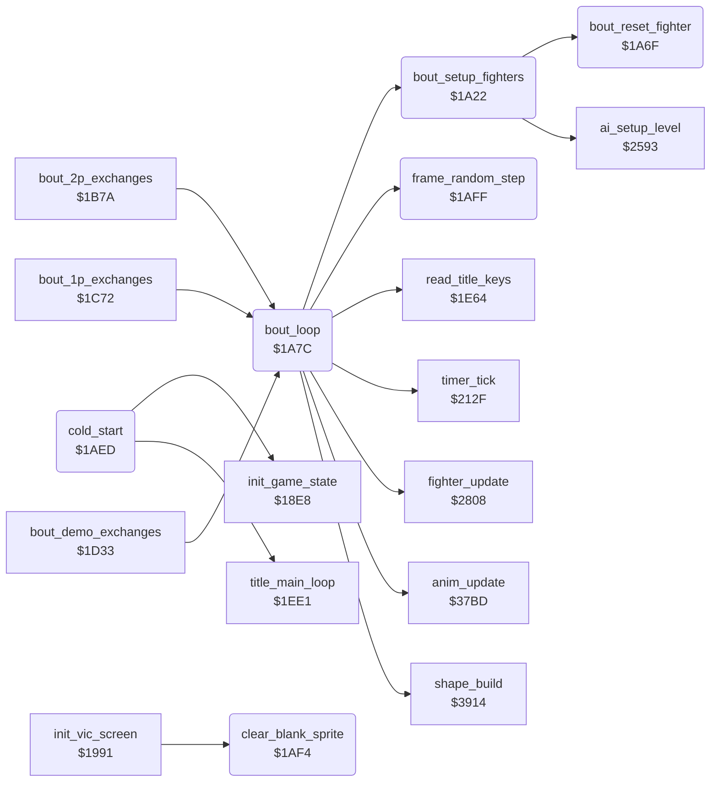

<!-- Generated by c64-docs from knowledge revision 20261021T021734.812-ub0xzr and src/source-map.json. Do not edit: change the knowledge, generate the source again, then run docs.ts generate. -->
# bout_loop.asm: Bout set-up, bout loop, cold start, blank sprite and frame random

Range `$1A22-$1B08`. Source: [bout_loop.asm](../../../src/bout_loop.asm). Index: [the reference](../index.md).

## Call graph

A solid arrow is a call, a thick arrow a table entry, a dotted arrow a jump. Rounded nodes are in this file.

## Data

| Range | Type | Name | Read by | Written by |
|---|---|---|---|---|
| [`$1AF3`](../../../src/bout_loop.asm#L115) | unused | [`cold_start_unused_rts`](../../../src/bout_loop.asm#L114) |  |  |

## Names

### [`bout_setup_fighters`](../../../src/bout_loop.asm#L6) `$1A22`

*routine*

Puts both fighters at the start: x $3e and $5a, on the ground, facing each other, move and animation $17. It also sets fighter 1 red, knockdown_delay 8 and the AI level of both fighters. Called by bout_loop.

- **Called from:** [`bout_loop`](bout_loop.md#bout_loop) [`$1A80`](../../../src/bout_loop.asm#L57)
- **Calls:** [`bout_reset_fighter`](bout_loop.md#bout_reset_fighter), [`ai_setup_level`](ai_opponent.md#ai_setup_level)
- **Writes:** [`fighter_x`](../memory-map.md#fighter_x), [`fighter_x+1`](../memory-map.md#fighter_x), [`fighter_y`](../memory-map.md#fighter_y), [`fighter_y+1`](../memory-map.md#fighter_y), [`anim_reverse`](../memory-map.md#anim_reverse), [`anim_reverse+1`](../memory-map.md#anim_reverse), [`fighter_facing`](../memory-map.md#fighter_facing), [`fighter_facing+1`](../memory-map.md#fighter_facing), [`anim_number`](../memory-map.md#anim_number), [`anim_number+1`](../memory-map.md#anim_number), [`anim_started`](../memory-map.md#anim_started), [`anim_started+1`](../memory-map.md#anim_started), [`bout_knockdown`](../memory-map.md#bout_knockdown), [`draw_buffer`](../memory-map.md#draw_buffer), [`draw_buffer+1`](../memory-map.md#draw_buffer), [`fighter_colour+1`](../memory-map.md#fighter_colour), [`knockdown_delay`](../memory-map.md#knockdown_delay), [`knockdown_delay+1`](../memory-map.md#knockdown_delay)
- **Refers to:** [`fighter_x`](../memory-map.md#fighter_x), [`fighter_y`](../memory-map.md#fighter_y), [`anim_reverse`](../memory-map.md#anim_reverse), [`fighter_facing`](../memory-map.md#fighter_facing), [`anim_number`](../memory-map.md#anim_number), [`anim_started`](../memory-map.md#anim_started), [`draw_buffer`](../memory-map.md#draw_buffer), [`fighter_colour`](../memory-map.md#fighter_colour), [`knockdown_delay`](../memory-map.md#knockdown_delay)

### [`bout_reset_fighter`](../../../src/bout_loop.asm#L45) `$1A6F`

*routine*

Clears hit_reaction, fighter_unused_flag and pose_held of fighter X and sets fighter_move $17. Called by bout_setup_fighters.

- **Called from:** [`bout_setup_fighters`](bout_loop.md#bout_setup_fighters) [`$1A4C`](../../../src/bout_loop.asm#L28), [`bout_setup_fighters`](bout_loop.md#bout_setup_fighters) [`$1A51`](../../../src/bout_loop.asm#L30)

### [`bout_loop`](../../../src/bout_loop.asm#L54) `$1A7C`

*routine*

Plays one exchange from the start positions until a fighter falls, the time ends or a start key comes. Returns A: $80 key, the reaction move, or 1 time up. Called by the three bout handlers.
The bull round sets the offset $40 at $1338; each bout sets 0 again.

- **Called from:** [`bout_2p_exchanges`](game_modes.md#bout_2p_exchanges) [`$1B7A`](../../../src/game_modes.asm#L64), [`bout_1p_exchanges`](game_modes.md#bout_1p_exchanges) [`$1C72`](../../../src/game_modes.asm#L190), [`bout_demo_exchanges`](game_modes.md#bout_demo_exchanges) [`$1D33`](../../../src/game_modes.asm#L294)
- **Calls:** [`bout_setup_fighters`](bout_loop.md#bout_setup_fighters), [`anim_update`](anim_step.md#anim_update), [`fighter_update`](fighter_input.md#fighter_update), [`frame_random_step`](bout_loop.md#frame_random_step), [`read_title_keys`](title_and_scene.md#read_title_keys), [`timer_tick`](timer_and_texts.md#timer_tick), [`shape_build`](shape_build.md#shape_build)
- **Reads:** [`SPENA`](../memory-map.md#SPENA), [`RASTER`](../memory-map.md#RASTER), [`opponent_index`](../memory-map.md#opponent_index), [`bout_knockdown`](../memory-map.md#bout_knockdown), [`hit_reaction`](../memory-map.md#hit_reaction), [`hit_reaction+1`](../memory-map.md#hit_reaction), [`fighter_move`](../memory-map.md#fighter_move), [`time_up`](../memory-map.md#time_up)
- **Writes:** [`shape_page_offset`](../memory-map.md#shape_page_offset), [`SPENA`](../memory-map.md#SPENA), [`opponent_index`](../memory-map.md#opponent_index), [`fighter_frame`](../memory-map.md#fighter_frame), [`fighter_frame+1`](../memory-map.md#fighter_frame), [`fighter_y`](../memory-map.md#fighter_y), [`fighter_y+1`](../memory-map.md#fighter_y), [`sprite_y`](../memory-map.md#sprite_y), [`sprite_y+1`](../memory-map.md#sprite_y)
- **Refers to:** [`hit_reaction`](../memory-map.md#hit_reaction), [`fighter_frame`](../memory-map.md#fighter_frame), [`fighter_y`](../memory-map.md#fighter_y), [`sprite_y`](../memory-map.md#sprite_y)

### [`bout_frame_loop`](../../../src/bout_loop.asm#L66) `$1A96`

*label*

- **Jumped to from:** [`bout_loop`](bout_loop.md#bout_loop) [`$1A9B`](../../../src/bout_loop.asm#L69), [`bout_loop`](bout_loop.md#bout_loop) [`$1ACC`](../../../src/bout_loop.asm#L92)

### [`bout_check_time_up`](../../../src/bout_loop.asm#L90) `$1ACA`

*label*

- **Jumped to from:** [`bout_loop`](bout_loop.md#bout_loop) [`$1ABB`](../../../src/bout_loop.asm#L83), [`bout_loop`](bout_loop.md#bout_loop) [`$1ABF`](../../../src/bout_loop.asm#L85), [`bout_loop`](bout_loop.md#bout_loop) [`$1AC5`](../../../src/bout_loop.asm#L88)

### [`bout_loop_exit`](../../../src/bout_loop.asm#L107) `$1AEC`

*label*

- **Jumped to from:** [`bout_loop`](bout_loop.md#bout_loop) [`$1AB3`](../../../src/bout_loop.asm#L79), [`bout_loop`](bout_loop.md#bout_loop) [`$1AB7`](../../../src/bout_loop.asm#L81)

### [`cold_start`](../../../src/bout_loop.asm#L110) `$1AED`

*routine*

Cold start from program_entry ($115a): init_game_state ($18e8), then the title loop. It never returns.

- **Jumped to from:** [`$115A`](../../../src/entry_and_tables.asm#L7)
- **Calls:** [`init_game_state`](init_machine.md#init_game_state), [`title_main_loop`](title_and_scene.md#title_main_loop)

### [`cold_start_unused_rts`](../../../src/bout_loop.asm#L114) `$1AF3`

*data*

Unused RTS after the JMP of the cold start, as in v1: a trace of an older JSR to the title loop.

### [`clear_blank_sprite`](../../../src/bout_loop.asm#L117) `$1AF4`

*routine*

Clears the 63 bytes of the sprite at $c000 (pointer 0), the blank sprite of empty shape parts. Called by init_vic_screen at $199b.

- **Called from:** [`init_vic_screen`](init_machine.md#init_vic_screen) [`$199B`](../../../src/init_machine.asm#L107)
- **Writes:** [`sprite_blank+61`](../memory-map.md#sprite_blank), [`sprite_blank+62`](../memory-map.md#sprite_blank)

### [`clear_blank_sprite_loop`](../../../src/bout_loop.asm#L120) `$1AF8`

*label*

- **Jumped to from:** [`clear_blank_sprite`](bout_loop.md#clear_blank_sprite) [`$1AFC`](../../../src/bout_loop.asm#L123)

### [`frame_random_step`](../../../src/bout_loop.asm#L126) `$1AFF`

*routine*

Steps frame_random once: shift left, EOR #$1d on carry. Called each frame by bout_loop.

- **Called from:** [`bout_loop`](bout_loop.md#bout_loop) [`$1AAD`](../../../src/bout_loop.asm#L77)
- **Reads:** [`frame_random`](../memory-map.md#frame_random)
- **Writes:** [`frame_random`](../memory-map.md#frame_random)

### [`frame_random_store`](../../../src/bout_loop.asm#L131) `$1B06`

*label*

- **Jumped to from:** [`frame_random_step`](bout_loop.md#frame_random_step) [`$1B02`](../../../src/bout_loop.asm#L129)
