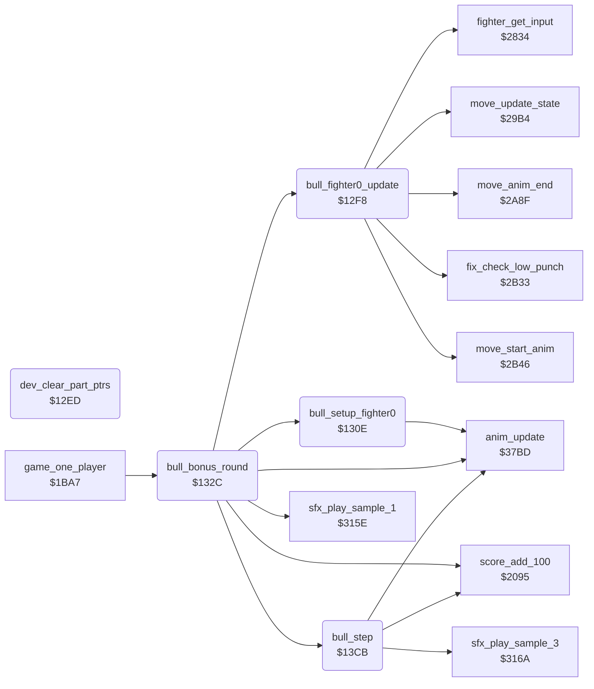

<!-- Generated by c64-docs from knowledge revision 20261021T021734.812-ub0xzr and src/source-map.json. Do not edit: change the knowledge, generate the source again, then run docs.ts generate. -->
# bull_round.asm: Bull bonus round: the old part pointer clear, the fighter and bull steps, and the reach table

Range `$12ED-$1469`. Source: [bull_round.asm](../../../src/bull_round.asm). Index: [the reference](../index.md).

## Call graph

A solid arrow is a call, a thick arrow a table entry, a dotted arrow a jump. Rounded nodes are in this file.

## Data

| Range | Type | Name | Read by | Written by |
|---|---|---|---|---|
| [`$142F`](../../../src/bull_round.asm#L196)-`$1469` | bytes | [`bull_reach_by_frame`](../../../src/bull_round.asm#L195) |  |  |

## Names

### [`dev_clear_part_ptrs`](../../../src/bull_round.asm#L6) `$12ED`

*routine*

Unreferenced development code, the same bytes as v1 $1354. It writes 0 to fighter_part_ptrs $02-$13, so all parts show the blank sprite. No code calls it.

### [`dev_clear_loop`](../../../src/bull_round.asm#L10) `$12F1`

*label*

### [`bull_fighter0_update`](../../../src/bull_round.asm#L16) `$12F8`

*routine*

Bull round: updates fighter 0 for one frame with shape_page_offset 0. Input, low punch fix-up, move state, animation start and end; no hit test, no priority. Called by bull_bonus_round at $13c2.

- **Called from:** [`bull_bonus_round`](bull_round.md#bull_bonus_round) [`$13C2`](../../../src/bull_round.asm#L125)
- **Calls:** [`fighter_get_input`](fighter_input.md#fighter_get_input), [`fix_check_low_punch`](fighter_moves.md#fix_check_low_punch), [`move_update_state`](fighter_moves.md#move_update_state), [`move_start_anim`](fighter_moves.md#move_start_anim), [`move_anim_end`](fighter_moves.md#move_anim_end)
- **Writes:** [`shape_page_offset`](../memory-map.md#shape_page_offset)

### [`solo_fighter_update`](../../../src/bull_round.asm#L20) `$12FC`

*label*

Development code: fighter update without the hit test, the back input fix-up and the front fighter choice. JSR $225f, $2425, $22b7, $2438, $2381.
v1 dev_update_fighter $135f starts here; v2 adds the two instructions before it.

### [`bull_setup_fighter0`](../../../src/bull_round.asm#L29) `$130E`

*routine*

Puts fighter 0 alone at x $3e on the ground, facing right, in move and animation 1 (stand), and steps it once. Called by bull_bonus_round at $1331; v1 dev_setup_fighter0.

- **Called from:** [`bull_bonus_round`](bull_round.md#bull_bonus_round) [`$1331`](../../../src/bull_round.asm#L49)
- **Calls:** [`anim_update`](anim_step.md#anim_update)
- **Writes:** [`fighter_x`](../memory-map.md#fighter_x), [`fighter_y`](../memory-map.md#fighter_y), [`fighter_facing`](../memory-map.md#fighter_facing), [`anim_reverse`](../memory-map.md#anim_reverse), [`pose_held`](../memory-map.md#pose_held), [`anim_started`](../memory-map.md#anim_started), [`anim_number`](../memory-map.md#anim_number), [`fighter_move`](../memory-map.md#fighter_move)

### [`bull_bonus_round`](../../../src/bull_round.asm#L46) `$132C`

*routine*

Bull bonus round after each fourth stage: fighter 0 against a bull that runs in from the right as fighter 1. Stop it with frame $0d for 3000 points; survive the run for 500. Called by game_one_player at $1c24.
Sprites 0-5 on; the judge sprites 6 and 7 off.

- **Called from:** [`game_one_player`](game_modes.md#game_one_player) [`$1C24`](../../../src/game_modes.asm#L148)
- **Calls:** [`bull_setup_fighter0`](bull_round.md#bull_setup_fighter0), [`anim_update`](anim_step.md#anim_update), [`score_add_100`](score_and_judge.md#score_add_100), [`sfx_play_sample_1`](sfx_sample_player.md#sfx_play_sample_1), [`bull_fighter0_update`](bull_round.md#bull_fighter0_update), [`bull_step`](bull_round.md#bull_step)
- **Reads:** [`RASTER`](../memory-map.md#RASTER), [`bull_state`](../memory-map.md#bull_state), [`fighter_frame`](../memory-map.md#fighter_frame), [`anim_frame_tick`](../memory-map.md#anim_frame_tick), [`fighter_x+1`](../memory-map.md#fighter_x), [`fighter_x`](../memory-map.md#fighter_x), [`fighter_distance`](../memory-map.md#fighter_distance), [`bout_knockdown`](../memory-map.md#bout_knockdown)
- **Writes:** [`SPENA`](../memory-map.md#SPENA), [`front_fighter`](../memory-map.md#front_fighter), [`shape_page_offset`](../memory-map.md#shape_page_offset), [`fighter_y+1`](../memory-map.md#fighter_y), [`fighter_x+1`](../memory-map.md#fighter_x), [`anim_number+1`](../memory-map.md#anim_number), [`sfx_done`](../memory-map.md#sfx_done), [`bout_knockdown`](../memory-map.md#bout_knockdown), [`bull_state`](../memory-map.md#bull_state), [`anim_started+1`](../memory-map.md#anim_started), [`anim_reverse+1`](../memory-map.md#anim_reverse), [`fighter_facing+1`](../memory-map.md#fighter_facing), [`fighter_colour+1`](../memory-map.md#fighter_colour), [`anim_finished+1`](../memory-map.md#anim_finished), [`fighter_distance`](../memory-map.md#fighter_distance), [`hit_reaction`](../memory-map.md#hit_reaction)
- **Refers to:** [`fighter_y`](../memory-map.md#fighter_y), [`fighter_x`](../memory-map.md#fighter_x), [`anim_number`](../memory-map.md#anim_number), [`anim_started`](../memory-map.md#anim_started), [`anim_reverse`](../memory-map.md#anim_reverse), [`fighter_facing`](../memory-map.md#fighter_facing), [`fighter_colour`](../memory-map.md#fighter_colour), [`anim_finished`](../memory-map.md#anim_finished), [`bull_reach_by_frame`](bull_round.md#bull_reach_by_frame)

### [`bull_frame_loop`](../../../src/bull_round.asm#L72) `$1361`

*label*

Waits for raster line $fd, then does one frame.

- **Jumped to from:** [`bull_bonus_round`](bull_round.md#bull_bonus_round) [`$1366`](../../../src/bull_round.asm#L75), [`bull_bonus_round`](bull_round.md#bull_bonus_round) [`$13C8`](../../../src/bull_round.asm#L128)

### [`bull_stop_score_loop`](../../../src/bull_round.asm#L92) `$1385`

*label*

- **Jumped to from:** [`bull_bonus_round`](bull_round.md#bull_bonus_round) [`$138B`](../../../src/bull_round.asm#L96)

### [`bull_reach_test`](../../../src/bull_round.asm#L105) `$139D`

*label*

- **Jumped to from:** [`bull_bonus_round`](bull_round.md#bull_bonus_round) [`$1370`](../../../src/bull_round.asm#L80), [`bull_bonus_round`](bull_round.md#bull_bonus_round) [`$1374`](../../../src/bull_round.asm#L83), [`bull_bonus_round`](bull_round.md#bull_bonus_round) [`$137D`](../../../src/bull_round.asm#L88), [`bull_bonus_round`](bull_round.md#bull_bonus_round) [`$1381`](../../../src/bull_round.asm#L90)

### [`bull_frame_update`](../../../src/bull_round.asm#L122) `$13BE`

*label*

After the fall the fighter stays on the ground.

- **Jumped to from:** [`bull_bonus_round`](bull_round.md#bull_bonus_round) [`$136A`](../../../src/bull_round.asm#L77), [`bull_bonus_round`](bull_round.md#bull_bonus_round) [`$139B`](../../../src/bull_round.asm#L104), [`bull_bonus_round`](bull_round.md#bull_bonus_round) [`$13A1`](../../../src/bull_round.asm#L108), [`bull_bonus_round`](bull_round.md#bull_bonus_round) [`$13AD`](../../../src/bull_round.asm#L114), [`bull_bonus_round`](bull_round.md#bull_bonus_round) [`$13B1`](../../../src/bull_round.asm#L116)

### [`bull_frame_step`](../../../src/bull_round.asm#L126) `$13C5`

*label*

- **Jumped to from:** [`bull_bonus_round`](bull_round.md#bull_bonus_round) [`$13C0`](../../../src/bull_round.asm#L124)

### [`bull_step`](../../../src/bull_round.asm#L131) `$13CB`

*routine*

Steps the bull (fighter 1) with shape_page_offset $40 and starts the next run animation at the end of a run. Returns A = 0 at the end of the round, else 1. Called by bull_bonus_round at $13c5.

- **Called from:** [`bull_bonus_round`](bull_round.md#bull_bonus_round) [`$13C5`](../../../src/bull_round.asm#L127)
- **Calls:** [`anim_update`](anim_step.md#anim_update), [`score_add_100`](score_and_judge.md#score_add_100), [`sfx_play_sample_3`](sfx_sample_player.md#sfx_play_sample_3)
- **Reads:** [`bull_state`](../memory-map.md#bull_state), [`anim_finished+1`](../memory-map.md#anim_finished), [`fighter_x+1`](../memory-map.md#fighter_x), [`hit_reaction`](../memory-map.md#hit_reaction), [`bout_knockdown`](../memory-map.md#bout_knockdown), [`sfx_done`](../memory-map.md#sfx_done)
- **Writes:** [`shape_page_offset`](../memory-map.md#shape_page_offset), [`fighter_x+1`](../memory-map.md#fighter_x), [`group_x_lo+1`](../memory-map.md#group_x_lo), [`anim_number+1`](../memory-map.md#anim_number), [`anim_started+1`](../memory-map.md#anim_started)
- **Refers to:** [`anim_finished`](../memory-map.md#anim_finished), [`fighter_x`](../memory-map.md#fighter_x), [`group_x_lo`](../memory-map.md#group_x_lo), [`anim_number`](../memory-map.md#anim_number), [`anim_started`](../memory-map.md#anim_started)

### [`bull_exit_anim_1e`](../../../src/bull_round.asm#L147) `$13EA`

*label*

At x 0: x $0c and the exit animation $1e, frames $44-$46.

- **Jumped to from:** [`bull_step`](bull_round.md#bull_step) [`$13DE`](../../../src/bull_round.asm#L141)

### [`bull_exit_anim_1f`](../../../src/bull_round.asm#L152) `$13F2`

*label*

At x 2: x $0e and the exit animation $1f, frames $48 and $4c.

- **Jumped to from:** [`bull_step`](bull_round.md#bull_step) [`$13E2`](../../../src/bull_round.asm#L143)

### [`bull_run_done`](../../../src/bull_round.asm#L157) `$13FA`

*label*

At x 1 the bull is gone: the round ends.

- **Jumped to from:** [`bull_step`](bull_round.md#bull_step) [`$13E6`](../../../src/bull_round.asm#L145)

### [`bull_pass_score_loop`](../../../src/bull_round.asm#L166) `$1408`

*label*

- **Jumped to from:** [`bull_step`](bull_round.md#bull_step) [`$140E`](../../../src/bull_round.asm#L170)

### [`bull_round_end`](../../../src/bull_round.asm#L171) `$1410`

*label*

- **Jumped to from:** [`bull_step`](bull_round.md#bull_step) [`$1400`](../../../src/bull_round.asm#L161), [`bull_step`](bull_round.md#bull_step) [`$1404`](../../../src/bull_round.asm#L164)

### [`bull_run_again`](../../../src/bull_round.asm#L174) `$1413`

*label*

- **Jumped to from:** [`bull_step`](bull_round.md#bull_step) [`$13E8`](../../../src/bull_round.asm#L146)

### [`bull_start_anim`](../../../src/bull_round.asm#L176) `$1415`

*label*

- **Jumped to from:** [`bull_step`](bull_round.md#bull_step) [`$13F0`](../../../src/bull_round.asm#L151), [`bull_step`](bull_round.md#bull_step) [`$13F8`](../../../src/bull_round.asm#L156)

### [`bull_step_continue`](../../../src/bull_round.asm#L183) `$1422`

*label*

- **Jumped to from:** [`bull_step`](bull_round.md#bull_step) [`$13DA`](../../../src/bull_round.asm#L139), [`bull_step`](bull_round.md#bull_step) [`$141D`](../../../src/bull_round.asm#L181)

### [`bull_stopped_step`](../../../src/bull_round.asm#L187) `$1425`

*label*

Bull stopped by the crouching attack: steps the stop animation $1d. Returns A = 0 when it ended, else 1. No run executed it.

- **Jumped to from:** [`bull_step`](bull_round.md#bull_step) [`$13D1`](../../../src/bull_round.asm#L135)

### [`bull_reach_by_frame`](../../../src/bull_round.asm#L195) `$142F-$1469`

*data*

Bull round: reach of the bull by fighter_frame $00-$3a of fighter 0. The bull hits when bull x minus fighter x is not more than the value. $80: out of reach (somersault and flying kick frames, the fall).

- **Referred to by:** [`bull_bonus_round`](bull_round.md#bull_bonus_round) [`$13AA`](../../../src/bull_round.asm#L113)
